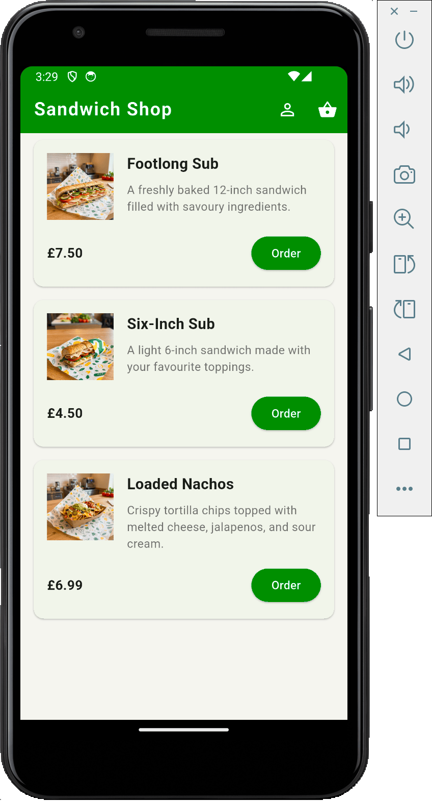
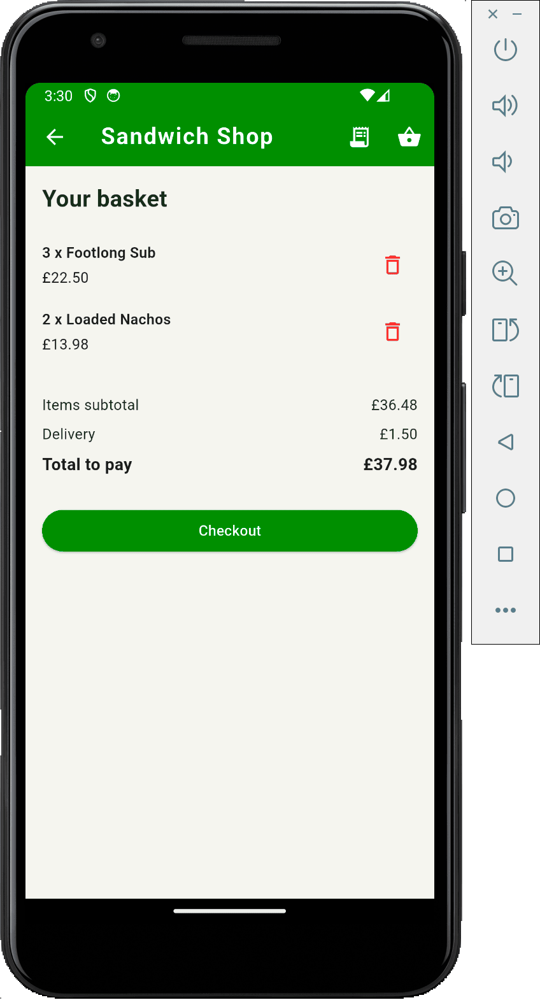

# Sandwich Shop

A Flutter app for browsing a cloud-backed menu, signing in with Firebase Authentication, adding items to a basket, and saving settings and completed orders in Cloud Firestore. The app is set up for Android and web, and is hosted live at [sandwich-shop-59811.web.app](https://sandwich-shop-59811.web.app).

## Features

- Browse sandwiches and loaded nachos loaded from Cloud Firestore (`sandwiches`).
- Register, sign in, and sign out with Email/Password, email links, or Google via Firebase Authentication.
- Adjust quantities, review the basket total, and check out when signed in (the basket is held in memory and cleared on sign-out).
- View saved orders stored per user in Cloud Firestore (`users/<uid>/orders`).
- Save customer profile details and preferences per user in Cloud Firestore (`users/<uid>`), including a bigger-text setting that syncs across devices.

## Platform

The app runs on Android and web (Chrome or Edge). Other desktop or Apple targets require adding platform runners and re-running `flutterfire configure`.

## Getting started

### Prerequisites

- [Flutter](https://docs.flutter.dev/get-started/install) with Chrome/Edge and/or the Android toolchain set up.
- [Firebase CLI](https://firebase.google.com/docs/cli) and FlutterFire CLI (`flutterfire`) if connecting your own Firebase project.
- Git.

### Clone

```bash
git clone https://github.com/manighahrmani/sandwich_shop.git
cd sandwich_shop
git switch 10
```

### Install dependencies

```bash
flutter pub get
```

### Run

Start Chrome or an Android emulator, then run:

```bash
flutter run -d chrome
```

Or run `flutter run` with an Android emulator selected.

### Deploy to Firebase Hosting

```bash
flutter build web
firebase deploy --only hosting
```

## Tests

Run the automated unit and widget tests with:

```bash
flutter test
```

These tests use `MockFirebaseAuth` and `FakeFirebaseFirestore` so they run offline without connecting to live Firebase servers.

To measure test coverage, run `flutter test --coverage`. The report is written to `coverage/lcov.info`.

Run the end-to-end integration tests on an Android emulator with:

```bash
flutter test integration_test/app_test.dart -d <device-id>
```

Replace `<device-id>` with the ID reported by `flutter devices`, for example `emulator-5554`. These integration tests also use `MockFirebaseAuth` and `FakeFirebaseFirestore`.

To run the integration tests in Chrome, start `chromedriver --port=4444` in one terminal and run `flutter drive` in another:

```bash
flutter drive --driver=test_driver/integration_test.dart --target=integration_test/app_test.dart -d chrome
```

## Project structure

- `lib/models/` holds the data classes: `Sandwich`, `CartItem`, `OrderItem`, `OrderRecord` and `UserSettings`.
- `lib/repositories/` holds `AuthRepository`, `CartRepository`, `OrderRepository`, `SandwichRepository` and `SettingsRepository`.
- `lib/screens/` holds `MenuScreen`, `OrderScreen`, `BasketScreen`, `OrdersScreen`, `SettingsScreen` and `AuthScreen`.
- `lib/widgets/` holds reusable buttons (`AccountButton`, `BasketButton`, `OrdersButton`, `SettingsButton`, `PrimaryButton`) and `SandwichCard`.
- `test/` mirrors the folders in `lib/`.
- `integration_test/` holds the end-to-end integration tests (`app_test.dart`).
- `test_driver/` holds the web driver entrypoint (`integration_test.dart`) used with `flutter drive`.

## Screenshots

### Menu

Our shop has a menu that is currently selling two sandwiches and a nacho as starter.



### Basket

The user can add some menu items to their basket and then proceed to check out.


