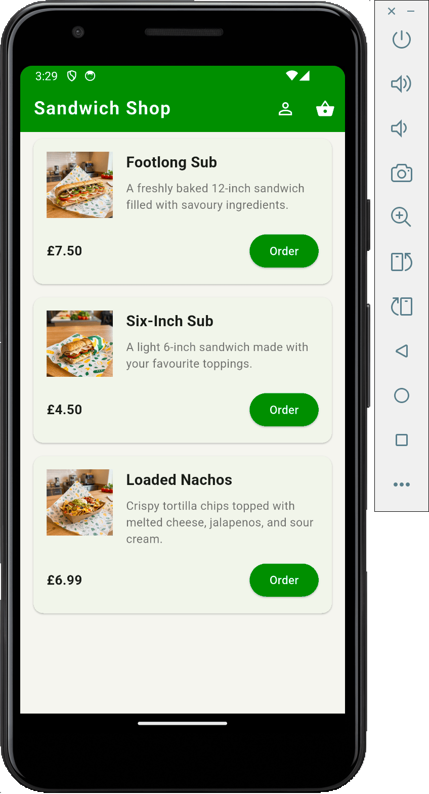
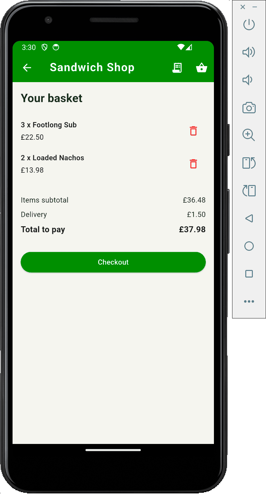

# Sandwich Shop

A Flutter app for browsing a small menu, adding items to a basket, and saving completed orders. The app is set up for Android only.

## Features

- Browse sandwiches and loaded nachos from the bundled menu.
- Adjust quantities, review the basket total, and check out.
- View saved orders. Orders are stored locally in SQLite; the basket is held in memory.
- Save customer profile details and preferences on the device, including a bigger-text setting.

## Run

Install Flutter and set up an Android emulator or device. From the project directory, run:

```bash
flutter pub get
flutter run
```

## Tests

Run the automated unit and widget tests with:

```bash
flutter test
```

These tests use in-memory and temporary file-backed SQLite databases and do not require an Android emulator. Running the app itself does require an Android emulator or device.

## Screenshots

### Menu

Our shop has a menu that is currently selling two sandwiches and a nacho as starter.



### Basket

The user can add some menu items to their basket and then proceed to check out.


