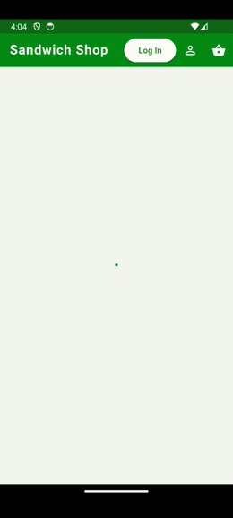
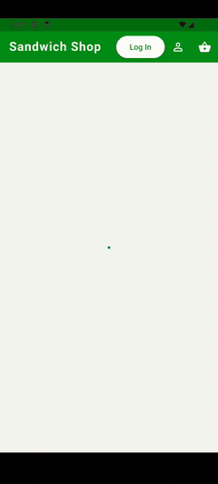
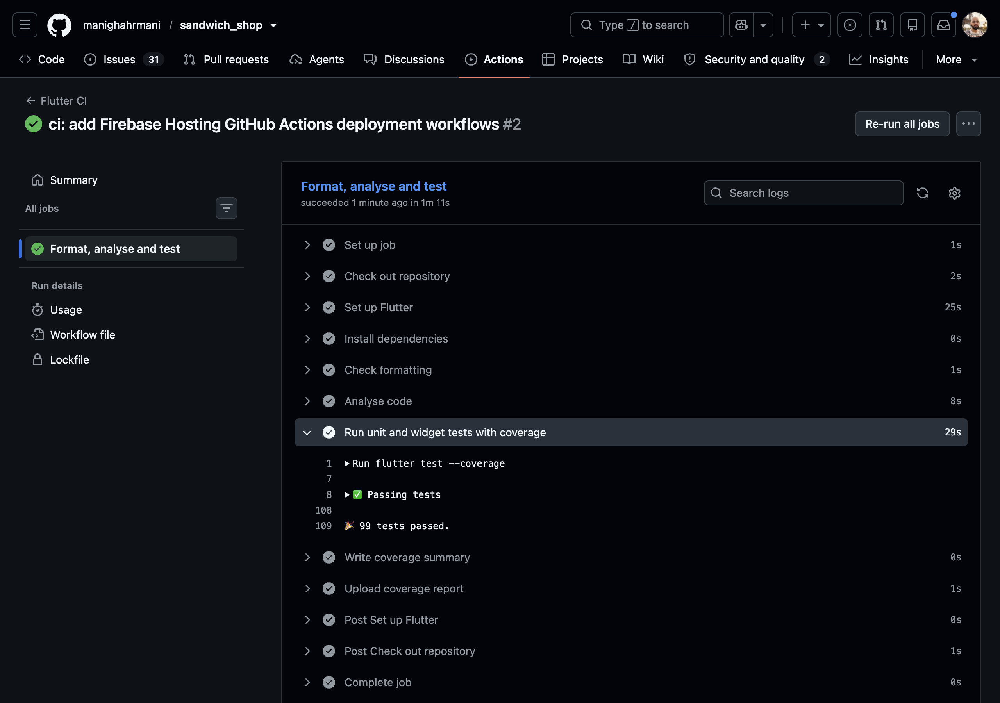
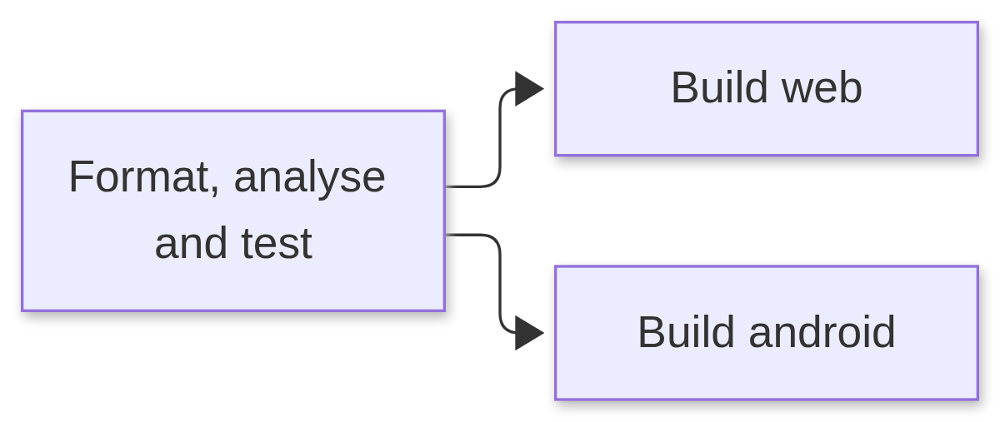
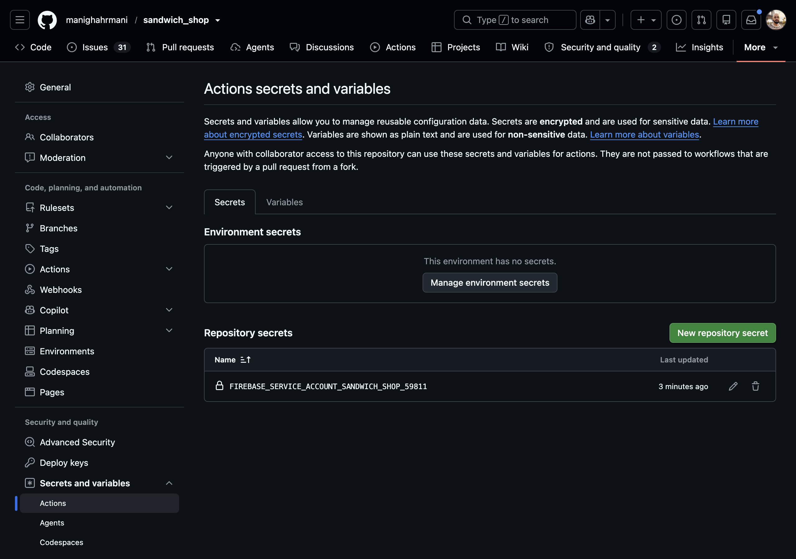

# Worksheet 10 — Integration testing and CI/CD

## Table of contents

- [Getting help](#getting-help)
- [Getting started](#getting-started)
- [Integration testing](#integration-testing)
  - [Install the integration test package](#install-the-integration-test-package)
  - [Add keys to sandwich cards](#add-keys-to-sandwich-cards)
  - [Create the test file](#create-the-test-file)
  - [Run the test on an emulator](#run-the-test-on-an-emulator)
  - [Try a physical device](#try-a-physical-device)
  - [Test ordering and validation](#test-ordering-and-validation)
  - [Add the remaining workflow tests with Copilot](#add-the-remaining-workflow-tests-with-copilot)
  - [Run integration tests in Chrome](#run-integration-tests-in-chrome)
  - [Try Firebase Test Lab](#try-firebase-test-lab)
- [Continuous integration](#continuous-integration)
  - [Create a CI workflow on GitHub](#create-a-ci-workflow-on-github)
  - [Read workflow runs and logs](#read-workflow-runs-and-logs)
  - [Build for more than one platform](#build-for-more-than-one-platform)
  - [Require checks before merging](#require-checks-before-merging)
  - [Integration tests in CI](#integration-tests-in-ci)
- [Deployment](#deployment)
  - [Automate Firebase Hosting deployment](#automate-firebase-hosting-deployment)
  - [Publish a release on GitHub](#publish-a-release-on-github)
  - [Mobile app stores](#mobile-app-stores)
- [Exercises](#exercises)

## Getting help

To get support with this worksheet, follow the [Discord guide](https://portdotacdotuk-my.sharepoint.com/:p:/g/personal/mani_ghahremani_port_ac_uk/IQCMJP6IiR_bQoYUMdXJSRDYAWnajEALZYEXFZyrJkHS1QU) and post your questions there. You can also attend your timetabled practical sessions and ask a member of teaching staff for guidance.

## Getting started

This worksheet is optional, and its exercises are not demoed or assessed in Demo 5. Continue with your Sandwich Shop app from [Worksheet 9](worksheet-9.md) and confirm all unit and widget tests still pass with `flutter test`.

If you need a fresh copy of the starting code, clone the [Sandwich Shop repository](https://github.com/manighahrmani/sandwich_shop) and switch to branch `9`:

```bash
git clone https://github.com/manighahrmani/sandwich_shop.git
cd sandwich_shop
git switch 9
flutter pub get
flutter test
```

Branch `10` contains the reference app and integration tests for this worksheet; use it to compare your finished work, not as your starting point. Its `.github/workflows/` folder also contains the finished workflows from the CI/CD sections.

Use your own GitHub repository for the CI/CD sections. Its default branch must contain your Flutter app, not the worksheets-only `main` branch from the teaching repository.

## Integration testing

Back in [Why automated testing matters](worksheet-4.md#why-automated-testing-matters), we saw that unit tests check individual functions and widget tests check isolated screens. Integration tests go one step further by running the complete app on an Android emulator, phone or web browser to verify that screens, navigation and shared state work together end to end. See the [Flutter integration testing guide](https://docs.flutter.dev/testing/integration-tests) for the full overview.

Integration tests live in a top-level `integration_test/` directory rather than `test/`, so an ordinary `flutter test` run stays fast. Tests in an integration test file share a process and repository singletons, so data left behind by one test can affect the next.

To keep every test fast, repeatable and offline without touching your live Firebase project, we reuse `MockFirebaseAuth` from [Create the authentication repository](worksheet-9.md#create-the-authentication-repository) and `FakeFirebaseFirestore` from [Read the menu from Firestore](worksheet-9.md#read-the-menu-from-firestore). Passing `UniqueKey()` to `App` tells Flutter to build a fresh `_AppState` for each test so no auth subscription or **Bigger text** setting leaks between runs.

These tests exercise complete user journeys through our app, but replace Firebase with test doubles. They do not check live security rules, email delivery or Google's sign-in service. Keep the manual checks from [Test signing up, signing in and signing out](worksheet-9.md#test-signing-up-signing-in-and-signing-out) for your real Firebase connection.

### Install the integration test package

Add `integration_test` from the Flutter SDK under `dev_dependencies` in the root of your project:

```bash
flutter pub add "dev:integration_test:{sdk: flutter}"
```

If Windows PowerShell rejects `{sdk: flutter}`, add the `integration_test` lines directly under `dev_dependencies` in `pubspec.yaml` and run `flutter pub get`:

```yaml
dev_dependencies:
  flutter_test:
    sdk: flutter
  integration_test:
    sdk: flutter
```

Because `integration_test` is a development dependency, Flutter excludes it from release builds automatically.

### Add keys to sandwich cards

Each card on `MenuScreen` renders its own **Order** button, so calling `find.text('Order')` can match more than one button. Giving each `Card` a `Key` built from `sandwich.id` lets tests target a single sandwich card reliably, matching [Write widget tests](worksheet-8.md#write-widget-tests).

Open `lib/widgets/sandwich_card.dart` and add the `key` line inside `build`:

```dart
  @override
  Widget build(BuildContext context) {
    return Card(
      key: Key('sandwichCard_${sandwich.id}'),
      margin: const EdgeInsets.symmetric(horizontal: 16.0, vertical: 8.0),
```

Open `test/widgets/sandwich_card_test.dart` and assert that key inside the `SandwichCard shows the name, description and price` test right after checking `'£5.00'`:

```dart
    expect(find.byKey(const Key('sandwichCard_test')), findsOneWidget);
```

Save both files and run `flutter test` to confirm all existing unit and widget tests still pass.

### Create the test file

Create a top-level `integration_test/` folder and add a new file named `integration_test/app_test.dart`. Start with the imports for our test packages, repositories and `MenuScreen`, then call `IntegrationTestWidgetsFlutterBinding.ensureInitialized()` (like `TestWidgetsFlutterBinding.ensureInitialized()` in [Test the asset loader](worksheet-6.md#test-the-asset-loader)) to connect the test runner to the emulator or browser:

```dart
import 'package:fake_cloud_firestore/fake_cloud_firestore.dart';
import 'package:firebase_auth_mocks/firebase_auth_mocks.dart';
import 'package:flutter/material.dart';
import 'package:flutter/services.dart';
import 'package:flutter_test/flutter_test.dart';
import 'package:integration_test/integration_test.dart';
import 'package:sandwich_shop/main.dart';
import 'package:sandwich_shop/repositories/auth_repository.dart';
import 'package:sandwich_shop/repositories/cart_repository.dart';
import 'package:sandwich_shop/repositories/order_repository.dart';
import 'package:sandwich_shop/repositories/sandwich_repository.dart';
import 'package:sandwich_shop/repositories/settings_repository.dart';
import 'package:sandwich_shop/screens/menu_screen.dart';
import 'package:shared_preferences_platform_interface/in_memory_shared_preferences_async.dart';
import 'package:shared_preferences_platform_interface/shared_preferences_async_platform_interface.dart';

void main() {
  IntegrationTestWidgetsFlutterBinding.ensureInitialized();
}
```

Inside `main()`, below `IntegrationTestWidgetsFlutterBinding.ensureInitialized();`, declare `late FakeFirebaseFirestore fakeFirestore;` alongside `setUp()` and `tearDown()` so every test begins cleanly:

```dart
  late FakeFirebaseFirestore fakeFirestore;

  setUp(() {
    rootBundle.clear();
    SharedPreferencesAsyncPlatform.instance =
        InMemorySharedPreferencesAsync.empty();
    fakeFirestore = FakeFirebaseFirestore();
    final MockFirebaseAuth defaultAuth = MockFirebaseAuth();
    AuthRepository.instance.setAuth(defaultAuth);
    CartRepository.instance.clear();
    SandwichRepository.instance.clearCache();
    SandwichRepository.instance.setFirestore(fakeFirestore);
    SettingsRepository.instance.setFirestore(fakeFirestore);
    OrderRepository.instance.setFirestore(fakeFirestore);
  });

  tearDown(() {
    CartRepository.instance.clear();
    AuthRepository.instance.setAuth(null);
    SandwichRepository.instance.clearCache();
    SandwichRepository.instance.setFirestore(null);
    SettingsRepository.instance.setFirestore(null);
    OrderRepository.instance.setFirestore(null);
  });
```

Calling `rootBundle.clear()` resets cached bundled assets as in [Update the menu and app tests](worksheet-6.md#update-the-menu-and-app-tests), and `SharedPreferencesAsyncPlatform.instance` installs clean in-memory preferences (which still store any pending email-link sign-in from Worksheet 9), matching [Test loading and saving preferences](worksheet-6.md#test-loading-and-saving-preferences). Calling `clearCache()` on `SandwichRepository` ensures `MenuScreen` reads the menu cleanly on every test run.

Below `tearDown()`, add a `group` with your first test checking that `App` opens on `MenuScreen`, loads `Footlong Sub` and `Six-Inch Sub`, and scrolls down to `Loaded Nachos`:

```dart
  group('Sandwich Shop end-to-end workflows', () {
    testWidgets('menu screen opens and loads sandwiches from Firestore', (
      WidgetTester tester,
    ) async {
      await tester.pumpWidget(App(key: UniqueKey()));
      await tester.pumpAndSettle();

      expect(find.byType(MenuScreen), findsOneWidget);
      expect(find.text('Footlong Sub'), findsOneWidget);
      expect(find.text('Six-Inch Sub'), findsOneWidget);

      final Finder nachosFinder = find.text('Loaded Nachos');
      await tester.scrollUntilVisible(nachosFinder, 200);
      expect(nachosFinder, findsOneWidget);
    });
  });
```

As seen in [Simulating user interaction and navigation](worksheet-4.md#simulating-user-interaction-and-navigation) and [Update the menu and app tests](worksheet-6.md#update-the-menu-and-app-tests), `pumpAndSettle()` waits for animations to finish (avoid using it while an endless loading spinner is on screen), and `scrollUntilVisible` scrolls in 200-pixel steps until `Loaded Nachos` appears.

### Run the test on an emulator

Start your Android emulator and find its device ID following [Preparing an Android emulator or device](worksheet-7.md#preparing-an-android-emulator-or-device). Run the test with your emulator ID in place of `emulator-5554`:

```bash
flutter test integration_test/app_test.dart -d emulator-5554
```

Flutter builds and installs the app on the emulator, drives the UI inside the real Android app and reports the result in your terminal. Integration tests take much longer than unit tests, and `flutter test --coverage` excludes `integration_test/`, so keep tracking line coverage with `test/` from [Test coverage](worksheet-8.md#test-coverage).

### Try a physical device

If you have not run your app on a real phone or tablet yet, try it now. For Android, follow [Use a physical Android device](worksheet-7.md#use-a-physical-android-device). For iOS, you need a Mac with Xcode and a signed app; complete [Support more platforms](worksheet-9.md#support-more-platforms) first, because our starting project supports only Android and web.

Run the app normally on your device and check the journeys from Worksheet 9 before running the automated tests. Then follow Flutter's [Test on an Android device](https://docs.flutter.dev/testing/integration-tests#test-on-an-android-device) or [Test on an iOS device](https://docs.flutter.dev/testing/integration-tests#test-on-an-ios-device), using `flutter test integration_test/app_test.dart -d DEVICE_ID` with your phone's ID. Use the same device to rerun the tests as you add journeys below; if you do not have a suitable device, continue with the emulator.

### Test ordering and validation

Add the `OrderScreen` import at the top of `integration_test/app_test.dart`:

```dart
import 'package:sandwich_shop/screens/order_screen.dart';
```

Inside `group(...)`, right before its closing `});`, add a second test that opens `Footlong Sub` and checks zero-quantity validation. We use `find.descendant` to search strictly inside `footlongCard` with explicitly typed `Finder` variables, and `tester.ensureVisible` to scroll a widget onto the screen before `tap`:

```dart
    testWidgets('ordering a sandwich validates quantity and updates subtotal', (
      WidgetTester tester,
    ) async {
      await tester.pumpWidget(App(key: UniqueKey()));
      await tester.pumpAndSettle();

      final Finder footlongCard =
          find.byKey(const Key('sandwichCard_footlong'));
      await tester.ensureVisible(footlongCard);
      final Finder orderTextFinder = find.text('Order');
      final Finder footlongOrderButton = find.descendant(
        of: footlongCard,
        matching: orderTextFinder,
      );
      await tester.tap(footlongOrderButton);
      await tester.pumpAndSettle();

      expect(find.byType(OrderScreen), findsOneWidget);
      expect(find.text('Order Footlong Sub'), findsOneWidget);
      expect(find.text('0 Footlong Sub sandwich(es): '), findsOneWidget);
      expect(find.text('£0.00'), findsOneWidget);

      final Finder addToBasketButton = find.text('Add to Basket');
      await tester.ensureVisible(addToBasketButton);
      await tester.tap(addToBasketButton);
      await tester.pump();
      expect(find.text('Please select at least 1 sandwich'), findsOneWidget);
    });
```

Inside that same test, right before its closing `});`, tap **Add** three times and **Remove** once, verify the sandwich emoji summary and subtotal, and confirm **Add to Basket** shows the confirmation snack bar:

```dart
      final Finder addButton = find.text('Add');
      final Finder removeButton = find.text('Remove');
      await tester.ensureVisible(addButton);
      await tester.tap(addButton);
      await tester.pump();
      await tester.tap(addButton);
      await tester.pump();
      await tester.tap(addButton);
      await tester.pump();
      await tester.tap(removeButton);
      await tester.pump();

      expect(find.text('2 Footlong Sub sandwich(es): 🥪🥪'), findsOneWidget);
      expect(find.text('£15.00'), findsOneWidget);

      await tester.ensureVisible(addToBasketButton);
      await tester.tap(addToBasketButton);
      await tester.pumpAndSettle();
      expect(find.text('Added 2 Footlong Sub to basket'), findsOneWidget);
```

Run `flutter test integration_test/app_test.dart -d emulator-5554` to verify both tests pass on the emulator.

### Add the remaining workflow tests with Copilot

Now that you have written the first two tests manually, use the [plan, implement and review workflow from Worksheet 8](worksheet-8.md#working-with-copilot) to add the remaining journeys below. Include your integration test file and the relevant app files as context, and use `name@example.com` for test email addresses.

Calling `await tester.pageBack()` simulates selecting the app bar back button. To check **Bigger text**, capture the baseline before signing in:

```dart
final Finder menuItemText = find.text('Footlong Sub');
final Element baselineElement = tester.element(menuItemText);
final TextScaler baselineScaler = MediaQuery.textScalerOf(baselineElement);
final double baselineSize = baselineScaler.scale(18);
```

After signing in and enabling **Bigger text**, read the widget's current `TextScaler` again. The `closeTo` matcher allows tiny decimal rounding differences:

```dart
final Element enlargedElement = tester.element(menuItemText);
final TextScaler enlargedScaler = MediaQuery.textScalerOf(enlargedElement);
final double enlargedSize = enlargedScaler.scale(18);
expect(enlargedSize, closeTo(baselineSize * 1.2, 0.05));
```

First, test basket editing and signed-out guards by adding two different sandwiches, removing one on `BasketScreen`, checking the updated totals, and confirming **Checkout**, `OrdersScreen` and `SettingsScreen` prompt a signed-out visitor to log in, as shown below:



Second, test registration, sign-out and sign-in by checking empty-field validation on `AuthScreen`, selecting **Need an account? Register** to switch to **Create Account**, registering a new customer with **Register**, adding an item, selecting **Sign Out** to confirm `BasketScreen` empties, and signing back in, as shown below:


Third, test multi-order checkout and order history from a signed-in account by placing a multi-item order, checking the itemised summary and emptied basket, placing a second order, and comparing vertical positions with `tester.getTopLeft` as in [Test the orders list and its empty state](worksheet-7.md#test-the-orders-list-and-its-empty-state). The newer order should render above the older one, as shown below:


Fourth, test user settings and **Bigger text** sync by recording the baseline text size before sign-in, saving profile fields and **Bigger text** on `SettingsScreen` (add a `Key` such as `Key('largeTextSwitch')` if your switches do not have one yet, or find them by label), checking the `1.2x` scale on `MenuScreen`, signing out to verify the scale and **Bigger text** switch reset, and signing back in to verify both reload from Firestore, as shown below:



Fifth, test **Email me a sign-in link** and **Sign in with Google** from [Sign in with an email link or Google](worksheet-9.md#sign-in-with-an-email-link-or-google) on `AuthScreen` to confirm the confirmation banner appears and Google sign-in returns cleanly to `MenuScreen`.

Review the assertions following [Check the tests](worksheet-8.md#check-the-tests), run `dart analyze`, and rerun the integration test file on your chosen device after each journey. You should have seven tests. Compare the behaviour with our model solution in [`integration_test/app_test.dart` on branch `10`](https://github.com/manighahrmani/sandwich_shop/blob/10/integration_test/app_test.dart); your test data and wording may differ.

### Run integration tests in Chrome

The `flutter test` command cannot run integration tests directly in Chrome, so Flutter uses `flutter drive` with a short driver file and ChromeDriver (a small bridge program that controls Google Chrome; Android emulator tests do not need it). This follows Flutter's [Test in a web browser](https://docs.flutter.dev/testing/integration-tests#test-in-a-web-browser) guide.

Create `test_driver/integration_test.dart` with the code below so `integrationDriver()` collects the results from the app:

```dart
import 'package:integration_test/integration_test_driver.dart';

Future<void> main() async {
  await integrationDriver();
}
```

Download the `chromedriver` archive matching your installed Chrome version and operating system (Windows, Apple Silicon Mac or Intel Mac) from [Chrome for Testing](https://googlechromelabs.github.io/chrome-for-testing/) and extract it.

Open a terminal inside the extracted folder and start ChromeDriver on port `4444`. On Windows PowerShell, run:

```powershell
.\chromedriver.exe --port=4444
```

On macOS or Linux, run `./chromedriver --port=4444` (if macOS blocks the downloaded file on first run, clear the quarantine flag with `xattr -d com.apple.quarantine chromedriver` first):

```bash
./chromedriver --port=4444
```

Leave ChromeDriver running, open a second terminal in your Sandwich Shop project root, and run `flutter drive`:

```bash
flutter drive --driver=test_driver/integration_test.dart --target=integration_test/app_test.dart -d chrome
```

When the browser tests finish, stop ChromeDriver in the first terminal with **Ctrl + C** on Windows or **⌃ + C** on macOS.

### Try Firebase Test Lab

If you want to check more devices than you own, Firebase Test Lab runs your tests on hosted devices and provides logs, screenshots and recordings. Follow Flutter's [Test in Firebase Test Lab for Android](https://docs.flutter.dev/testing/integration-tests#test-in-firebase-test-lab-android) to prepare the app and instrumentation test APKs, or [Test in Firebase Test Lab for iOS](https://docs.flutter.dev/testing/integration-tests#test-in-firebase-test-lab-ios) to prepare the signed iOS test bundle on a Mac.

Use your `integration_test/app_test.dart` as the test target rather than the guide's sample app. These tests still use our Firebase test doubles; Test Lab supplies devices, not a replacement backend. This is an optional extension: check the [Test Lab quotas and pricing](https://firebase.google.com/docs/test-lab/usage-quotas-pricing) before starting runs.

## Continuous integration

Running formatting, `dart analyze` and `flutter test` locally (as in [Running test suites and static analysis](worksheet-4.md#running-test-suites-and-static-analysis) and [Measure coverage](worksheet-8.md#measure-coverage)) is easy to forget before pushing. Continuous integration (CI) automates those checks on a clean cloud computer every time you push commits or open a pull request (a request to merge a branch on GitHub), while continuous deployment (CD) publishes passing builds live automatically.

GitHub provides this service built into every repository through [GitHub Actions](https://docs.github.com/en/actions), with free standard hosted runners for public repositories and a monthly allowance for private ones. Use two spaces per indentation level, as in `pubspec.yaml`, and no tab characters.

A workflow is a `.yml` file inside `.github/workflows/`. Its `on:` section selects the events that start it, such as `push`, `pull_request` or `workflow_dispatch`, which adds a manual **Run workflow** button when the workflow is on your default branch.

The `jobs:` section defines work for fresh cloud machines called runners. Each job chooses its runner with `runs-on:` and lists its `steps:`, which either call a reusable action with `uses:` or execute a command with `run:`.

### Create a CI workflow on GitHub

Open your repository on GitHub, select **Actions**, select **New workflow**, then select **set up a workflow yourself**, as shown below:


Change the file name at the top of the editor to `.github/workflows/tests.yml`. We will build this file in three short stages. First, paste the workflow header, triggers and Flutter setup steps:

```yaml
name: Flutter CI

on:
  push:
  pull_request:
  workflow_dispatch:

permissions:
  contents: read

jobs:
  test:
    name: Format, analyse and test
    runs-on: ubuntu-latest
    steps:
      - name: Check out repository
        uses: actions/checkout@v7

      - name: Set up Flutter
        uses: subosito/flutter-action@v2
        with:
          channel: stable
          cache: true

      - name: Install dependencies
        run: flutter pub get
```

Setting `permissions: contents: read` gives the workflow read-only access to clone your repository. The `actions/checkout@v7` and `subosito/flutter-action@v2` actions download your code and install stable Flutter (reusing cached SDK files via `cache: true`), using major version tags such as `@v7` and `@v2` to receive compatible updates automatically.

Next, append the three check steps at the bottom of `steps:` (using the exact indentation as `Install dependencies`):

```yaml
      - name: Check formatting
        run: dart format --output=none --set-exit-if-changed lib test integration_test test_driver

      - name: Analyse code
        run: dart analyze

      - name: Run unit and widget tests with coverage
        run: flutter test --coverage
```

These run the same formatting, static analysis and coverage checks you already run locally. If your repository does not have `integration_test` or `test_driver` folders yet, omit those folder names from the `dart format` line so it checks `lib test` cleanly.

Finally, append the coverage summary and artifact upload steps at the bottom of `steps:`:

```yaml
      - name: Write coverage summary
        if: always()
        run: |
          if [ -f coverage/lcov.info ]; then
            awk -F: '/^LF:/{found += $2} /^LH:/{hit += $2} END {if (found > 0) printf "### Line coverage\n\nCovered **%d / %d** lines (**%.2f%%**).\n", hit, found, hit * 100 / found}' coverage/lcov.info >> "$GITHUB_STEP_SUMMARY"
          fi

      - name: Upload coverage report
        if: always()
        uses: actions/upload-artifact@v7
        with:
          name: coverage-report
          path: coverage/lcov.info
```

The `if: always()` condition attempts reporting even after a failed check; a coverage file is only available if the test runner produced one. On the Linux runner, the `Write coverage summary` script reads total (`LF:`) and hit (`LH:`) line counts from `coverage/lcov.info` into `$GITHUB_STEP_SUMMARY` so your percentage appears directly on the run page. Copy this reporting snippet as-is; you do not need to learn `awk`. The `actions/upload-artifact@v7` action attaches the report as a downloadable zip, or warns if the file is missing.

Select **Commit changes...** to save `.github/workflows/tests.yml` on your app's default branch, then pull the new file to your computer:

```bash
git pull
```

You can also create and push `.github/workflows/tests.yml` directly from VS Code whenever you prefer editing YAML locally.

### Read workflow runs and logs

As soon as you commit `.github/workflows/tests.yml`, GitHub starts your first workflow run. Open **Actions** on GitHub and select the newest **Flutter CI** run to view its status, **Line coverage** summary and downloadable `coverage-report` zip under **Artifacts**, as shown below:


Select **Format, analyse and test** on the left to inspect each step, and select **Run unit and widget tests with coverage** to view the test output, as shown below:



If a step turns red, open that step to find the failing file or test, fix it locally in VS Code, and rerun the same checks, including all four folders in the formatting command. After learning the browser flow, you can also install the [GitHub CLI](https://cli.github.com/), sign in once with `gh auth login`, and inspect runs from your terminal:

```bash
gh run list --limit 5
gh run watch
gh run view --log-failed
```

### Build for more than one platform

The first workflow has one job, so its graph shows only one box even though it runs several steps. Add a second job named `build` under `jobs:`, aligned with `test:`, to build the web app and an Android debug APK after the checks pass:

```yaml
  build:
    name: Build ${{ matrix.platform }}
    needs: test
    runs-on: ubuntu-latest
    strategy:
      fail-fast: false
      matrix:
        include:
          - platform: web
            command: flutter build web
            output: build/web
          - platform: android
            command: flutter build apk --debug
            output: build/app/outputs/flutter-apk/app-debug.apk
    steps:
      - name: Check out repository
        uses: actions/checkout@v7
      - name: Set up Java
        uses: actions/setup-java@v6
        with:
          distribution: temurin
          java-version: '17'
      - name: Set up Flutter
        uses: subosito/flutter-action@v2
        with:
          channel: stable
          cache: true
      - name: Install dependencies
        run: flutter pub get
      - name: Build app
        run: ${{ matrix.command }}
      - name: Upload build
        uses: actions/upload-artifact@v7
        with:
          name: app-${{ matrix.platform }}
          path: ${{ matrix.output }}
          if-no-files-found: error
```

The `needs: test` line prevents builds when formatting, analysis or tests fail. A `matrix` repeats a job with different values, so the two builds can run in parallel on separate runners. The `${{ matrix.platform }}`, `${{ matrix.command }}` and `${{ matrix.output }}` expressions select the name, command and output path for each build. Setting `fail-fast: false` lets one build finish even if the other fails.

Each runner starts clean, so the build job must check out the code and install Flutter again. Android also needs Java to run Gradle. There are now three job runs, with both builds depending on the checks, as shown below. GitHub may group the matrix entries; expand the build job to inspect each platform.



Run the updated workflow and inspect both build jobs and their `app-web` and `app-android` artifacts. The web artifact contains files for a web server, not a page to open directly from disk. The debug APK can be installed on your own Android device for testing; it is not a signed store release. These jobs build packages but do not deploy them.

### Require checks before merging

A red workflow does not stop someone merging a pull request by itself. On GitHub, open **Settings > Rules > Rulesets**, create a branch ruleset targeting your app's default branch, and enable **Require a pull request before merging** and **Require status checks to pass**. Select the check names from your successful run, including **Format, analyse and test**, **Build web** and **Build android**, then set the ruleset to **Active**.

This makes the graph useful as a gate: a change must pass the selected checks before it reaches that branch. Availability depends on your repository visibility and GitHub plan; see [About rulesets](https://docs.github.com/en/repositories/configuring-branches-and-merges-in-your-repository/managing-rulesets/about-rulesets). The coverage summary reports a percentage but does not enforce a minimum.

### Integration tests in CI

Notice `.github/workflows/tests.yml` runs `flutter test --coverage`, not the integration tests. Building an APK also does not run its user journeys. Integration tests need a running emulator or browser, which adds setup time and uses more runner minutes.

Keep running integration tests locally before merging. As an extension, use the [Android Emulator Runner action](https://github.com/ReactiveCircus/android-emulator-runner#usage--examples) to start an emulator in a separate workflow and run `flutter test integration_test/app_test.dart -d emulator-5554`. That workflow needs the same Flutter and Java setup as the build job, plus the action's Linux acceleration setup.

Start with `workflow_dispatch` so you can run this slower workflow manually. You can later add a `schedule` trigger, such as the example below, to run it daily at 03:00 UTC. Scheduled workflows must exist on the default branch and run that branch; they can be delayed, so they are not a substitute for required pull-request checks.

```yaml
on:
  workflow_dispatch:
  schedule:
    - cron: '0 3 * * *'
```

## Deployment

In [Publish the app on the web](worksheet-9.md#publish-the-app-on-the-web), you ran `flutter build web` and `firebase deploy --only hosting` manually. You can automate web deployment and snapshot versioned milestones directly on GitHub.

### Automate Firebase Hosting deployment

Before automating deployment, make sure `.firebaserc` points to your own Firebase project, following [Connect the Flutter app](worksheet-9.md#connect-the-flutter-app) and [Publish the app on the web](worksheet-9.md#publish-the-app-on-the-web). Keep service account private keys out of Git.

Follow the [Firebase Hosting GitHub guide](https://firebase.google.com/docs/hosting/github-integration) by running this command from your project root:

```bash
firebase init hosting:github
```

When prompted, approve the sign-in request in your browser, enter `<your-github-username>/<your-repo-name>`, answer **No** when asked to set up a build script, and answer **Yes** to automatic deploy when a PR is merged. Choose the branch containing your finished app as the live branch. The examples below use `main`; if you work on `9` or another branch, use that name in both generated workflows and when creating a release.

This creates a Firebase service account (a dedicated account with Hosting permissions), uploads its encrypted key to GitHub as `FIREBASE_SERVICE_ACCOUNT_<PROJECT>`, and writes `.github/workflows/firebase-hosting-merge.yml` and `.github/workflows/firebase-hosting-pull-request.yml`. Open **Settings > Secrets and variables > Actions** on GitHub to see the encrypted secret listed with its value hidden, as shown below:



Next, open `.github/workflows/firebase-hosting-merge.yml` because GitHub must compile `build/web` before deploying it. Add `workflow_dispatch:` under `on:`, set `permissions: contents: read`, update `actions/checkout` to `@v7`, and add Flutter setup, checks and a web build before `FirebaseExtended/action-hosting-deploy@v0`. The job's `if:` condition also limits manual deployments to the live branch; replace `main` there too if your branch has another name. Keep your own generated `firebaseServiceAccount` and `projectId` values rather than copying the example project's values below:

```yaml
name: Deploy to Firebase Hosting on merge

on:
  push:
    branches:
      - main
  workflow_dispatch:

permissions:
  contents: read

jobs:
  build_and_deploy:
    if: github.ref == 'refs/heads/main'
    runs-on: ubuntu-latest
    steps:
      - uses: actions/checkout@v7
      - uses: subosito/flutter-action@v2
        with:
          channel: stable
          cache: true
      - name: Install dependencies
        run: flutter pub get
      - name: Check formatting
        run: dart format --output=none --set-exit-if-changed lib test integration_test test_driver
      - name: Analyse code
        run: dart analyze
      - name: Run unit and widget tests
        run: flutter test
      - name: Build web app
        run: flutter build web
      - uses: FirebaseExtended/action-hosting-deploy@v0
        with:
          repoToken: ${{ secrets.GITHUB_TOKEN }}
          firebaseServiceAccount: ${{ secrets.FIREBASE_SERVICE_ACCOUNT_SANDWICH_SHOP_59811 }}
          channelId: live
          projectId: sandwich-shop-59811
```

In this file, `${{ secrets.NAME }}` reads an encrypted secret from GitHub Settings, while `GITHUB_TOKEN` is a temporary token GitHub creates automatically for each run. Never print secret values. Open `.github/workflows/firebase-hosting-pull-request.yml` and use the same checkout, Flutter setup, dependency, check and build steps before `FirebaseExtended/action-hosting-deploy@v0`. Keep its generated `permissions:` block and same-repository `if:` condition untouched; pull requests from forks do not receive the deployment secret.

Pull requests targeting your live branch now get temporary preview URLs, which expire after seven days by default. A preview still connects to your real Firebase backend, so avoid using real customer data. Live deployment runs on any push to the configured branch, not only a pull-request merge; the ruleset above controls how changes reach it.

Once both workflow files are on GitHub, open **Actions** to confirm **Deploy to Firebase Hosting on merge** succeeds. This is a separate workflow with a single `build_and_deploy` job, so its graph shows one box, as shown below:


Open your `.web.app` link to confirm your live site updated automatically. If you use the GitHub CLI, you can also verify your secrets and deployment runs with `gh secret list` and `gh run list --limit 5`.

### Publish a release on GitHub

When your app reaches a milestone, create a GitHub Release attached to a version tag such as `v1.0.0`. The three numbers track major versions, new features and small fixes.

Open **Releases** from your repository's right sidebar and select **Create a new release** (or **Draft a new release**), which opens the form shown below:


Select **Tag: Select tag** to create `v1.0.0` on `main`, enter a **Release title** such as `Sandwich Shop v1.0.0`, select **Generate release notes** (or write a short summary) and select **Publish release**.

You can also create the same release from your terminal with the GitHub CLI:

```bash
gh release create v1.0.0 --target main --title "Sandwich Shop v1.0.0" --generate-notes
```

A GitHub Release records a version and its notes; it does not deploy your site or create mobile binaries automatically. You can attach the debug APK downloaded from the CI run for that same commit if you want to share a test build.

### Mobile app stores

This module focuses on web deployment and GitHub Releases rather than store binaries. If you later package Android, iOS or desktop builds for testers or public stores, follow Flutter's official [build modes guide](https://docs.flutter.dev/testing/build-modes), [Android deployment guide](https://docs.flutter.dev/deployment/android), [iOS deployment guide](https://docs.flutter.dev/deployment/ios) and [Firebase App Distribution documentation](https://firebase.google.com/docs/app-distribution).

## Exercises

The exercises below apply these concepts to your Southsea Cinema coursework. They are optional extension tasks and are not demoed or assessed in Demo 5. For the full coursework specification and grading criteria, see the [Southsea Cinema coursework brief](https://portdotacdotuk-my.sharepoint.com/:w:/g/personal/mani_ghahremani_port_ac_uk/IQDtIJB3bM7gQ4p03eLUngyyAd7JuhjhHuNA1l0H-qCy3Jw).

Build on your cinema app from Worksheet 9, keeping your mirrored `test/` folder structure and `README.md` up to date.

1. Add integration tests for your Southsea Cinema app following [Integration testing](#integration-testing). Write the first one or two journeys yourself, then use the Worksheet 8 workflow for the remaining journeys, including sign-in, booking, booking history and user settings. If you have not used a real Android or iOS device yet, run the app on one and then run your tests following [Try a physical device](#try-a-physical-device). Also try [Chrome](#run-integration-tests-in-chrome), and optionally explore [Firebase Test Lab](#try-firebase-test-lab) for devices you do not own. Keep the emulator as your alternative when a physical device is unavailable.

2. Set up continuous integration and deployment on your Southsea Cinema repository following [Create a CI workflow on GitHub](#create-a-ci-workflow-on-github) and [Automate Firebase Hosting deployment](#automate-firebase-hosting-deployment). Include formatting, analysis, test coverage and the [web and Android build jobs](#build-for-more-than-one-platform), then inspect the graph and download the artifacts. Require the checks before merging where your GitHub plan allows it, and verify both a pull-request preview and a live deployment. Optionally add scheduled integration tests or publish a versioned GitHub Release.

3. (Advanced) If you want to distribute your app beyond the web, follow Flutter's [Android deployment guide](https://docs.flutter.dev/deployment/android), [iOS deployment guide](https://docs.flutter.dev/deployment/ios) or desktop documentation to package and release your app on Google Play, the App Store or another platform of your choice.
