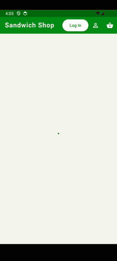
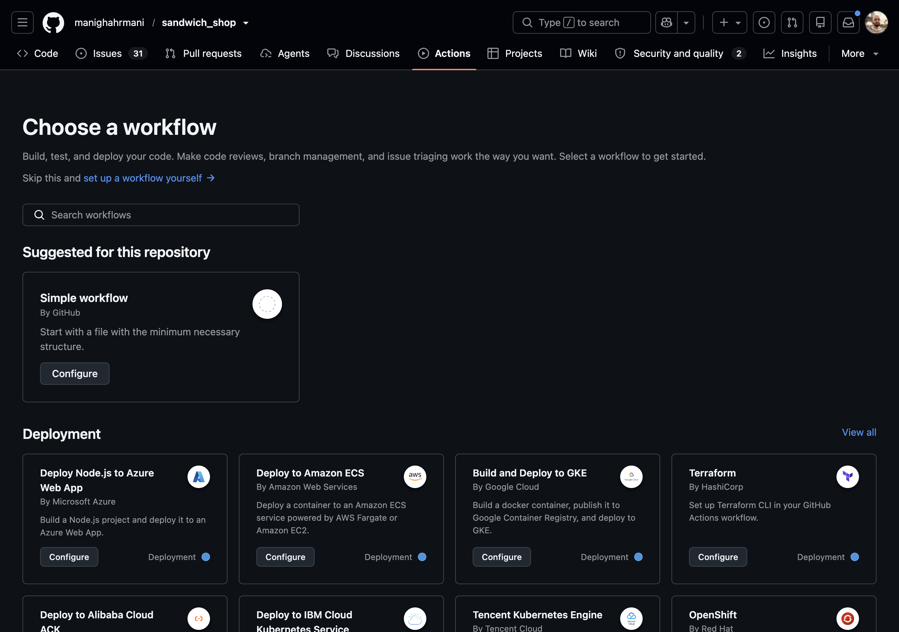
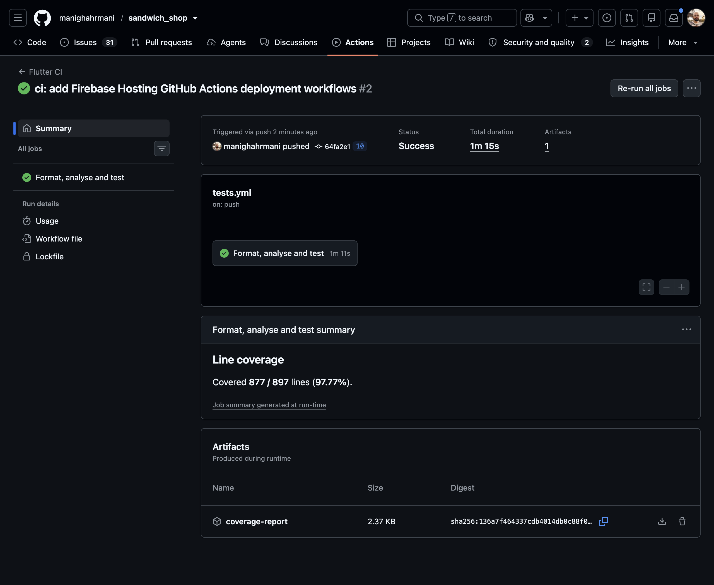

# Worksheet 10 — Integration testing and CI/CD

## Table of contents

- [Getting help](#getting-help)
- [Getting started](#getting-started)
- [Integration testing](#integration-testing)
  - [Install the integration test package](#install-the-integration-test-package)
  - [Add keys to sandwich cards](#add-keys-to-sandwich-cards)
  - [Create the test file](#create-the-test-file)
  - [Run the test on an emulator](#run-the-test-on-an-emulator)
  - [Test ordering and validation](#test-ordering-and-validation)
  - [Add the remaining workflow tests with Copilot](#add-the-remaining-workflow-tests-with-copilot)
  - [Run integration tests in Chrome](#run-integration-tests-in-chrome)
- [Continuous integration](#continuous-integration)
  - [Create a CI workflow on GitHub](#create-a-ci-workflow-on-github)
  - [Read workflow runs and logs](#read-workflow-runs-and-logs)
  - [Integration tests in CI](#integration-tests-in-ci)
- [Deployment](#deployment)
  - [Automate Firebase Hosting deployment](#automate-firebase-hosting-deployment)
  - [Publish a release on GitHub](#publish-a-release-on-github)
  - [Mobile app stores](#mobile-app-stores)
- [Exercises](#exercises)

## Getting help

To get support with this worksheet, follow the [Discord guide](https://portdotacdotuk-my.sharepoint.com/:p:/g/personal/mani_ghahremani_port_ac_uk/IQCMJP6IiR_bQoYUMdXJSRDYAWnajEALZYEXFZyrJkHS1QU) and post your questions there. You can also attend your timetabled practical sessions and ask a member of teaching staff for guidance.

## Getting started

This worksheet is optional, and its exercises are not demoed or assessed in Demo 5. Continue with your Sandwich Shop app from [Worksheet 9](worksheet-9.md) and confirm all unit and widget tests still pass with `flutter test`.

If you need a fresh copy of the starting code, clone the [Sandwich Shop repository](https://github.com/manighahrmani/sandwich_shop) and switch to branch `9`:

```bash
git clone https://github.com/manighahrmani/sandwich_shop.git
cd sandwich_shop
git switch 9
flutter pub get
flutter test
```

Branch `10` contains the completed Sandwich Shop app for this worksheet; use it to compare your finished work, not as your starting point.

## Integration testing

Back in [Why automated testing matters](worksheet-4.md#why-automated-testing-matters), we saw that unit tests check individual functions and widget tests check isolated screens. Integration tests go one step further by running the complete app on an Android emulator, phone or web browser to verify that screens, navigation and shared state work together end to end. See the [Flutter integration testing guide](https://docs.flutter.dev/testing/integration-tests) for the full overview.

Integration tests live in a top-level `integration_test/` directory rather than `test/`, so an ordinary `flutter test` run stays fast. Unlike unit and widget tests, every `testWidgets` block in an integration test file runs inside the same running app instance, so data left behind by one test can affect the next.

To keep every test fast, repeatable and offline without touching your live Firebase project, we reuse `MockFirebaseAuth` from [Create the authentication repository](worksheet-9.md#create-the-authentication-repository) and `FakeFirebaseFirestore` from [Read the menu from Firestore](worksheet-9.md#read-the-menu-from-firestore). Passing `UniqueKey()` to `App` tells Flutter to build a fresh `_AppState` for each test so no auth subscription or **Bigger text** setting leaks between runs.

### Install the integration test package

Add `integration_test` from the Flutter SDK under `dev_dependencies` in the root of your project:

```bash
flutter pub add "dev:integration_test:{sdk: flutter}"
```

If Windows PowerShell rejects `{sdk: flutter}`, add the `integration_test` lines directly under `dev_dependencies` in `pubspec.yaml` and run `flutter pub get`:

```yaml
dev_dependencies:
  flutter_test:
    sdk: flutter
  integration_test:
    sdk: flutter
```

Because `integration_test` is a development dependency, Flutter excludes it from release builds automatically.

### Add keys to sandwich cards

Each card on `MenuScreen` renders its own **Order** button, so calling `find.text('Order')` matches three buttons at once. Giving each `Card` a `Key` built from `sandwich.id` lets tests target a single sandwich card reliably, matching [Write widget tests](worksheet-8.md#write-widget-tests).

Open `lib/widgets/sandwich_card.dart` and add the `key` line inside `build`:

```dart
  @override
  Widget build(BuildContext context) {
    return Card(
      key: Key('sandwichCard_${sandwich.id}'),
      margin: const EdgeInsets.symmetric(horizontal: 16.0, vertical: 8.0),
```

Open `test/widgets/sandwich_card_test.dart` and assert that key inside the `SandwichCard shows the name, description and price` test right after checking `'£5.00'`:

```dart
    expect(find.byKey(const Key('sandwichCard_test')), findsOneWidget);
```

Save both files and run `flutter test` to confirm all existing unit and widget tests still pass.

### Create the test file

Create a top-level `integration_test/` folder and add a new file named `integration_test/app_test.dart`. Start with the imports for our test packages, repositories and `MenuScreen`, then call `IntegrationTestWidgetsFlutterBinding.ensureInitialized()` (like `TestWidgetsFlutterBinding.ensureInitialized()` in [Test the asset loader](worksheet-6.md#test-the-asset-loader)) to connect the test runner to the emulator or browser:

```dart
import 'package:fake_cloud_firestore/fake_cloud_firestore.dart';
import 'package:firebase_auth_mocks/firebase_auth_mocks.dart';
import 'package:flutter/material.dart';
import 'package:flutter/services.dart';
import 'package:flutter_test/flutter_test.dart';
import 'package:integration_test/integration_test.dart';
import 'package:sandwich_shop/main.dart';
import 'package:sandwich_shop/repositories/auth_repository.dart';
import 'package:sandwich_shop/repositories/cart_repository.dart';
import 'package:sandwich_shop/repositories/order_repository.dart';
import 'package:sandwich_shop/repositories/sandwich_repository.dart';
import 'package:sandwich_shop/repositories/settings_repository.dart';
import 'package:sandwich_shop/screens/menu_screen.dart';
import 'package:shared_preferences_platform_interface/in_memory_shared_preferences_async.dart';
import 'package:shared_preferences_platform_interface/shared_preferences_async_platform_interface.dart';

void main() {
  IntegrationTestWidgetsFlutterBinding.ensureInitialized();
}
```

Inside `main()`, below `IntegrationTestWidgetsFlutterBinding.ensureInitialized();`, declare `late FakeFirebaseFirestore fakeFirestore;` alongside `setUp()` and `tearDown()` so every test begins cleanly:

```dart
  late FakeFirebaseFirestore fakeFirestore;

  setUp(() {
    rootBundle.clear();
    SharedPreferencesAsyncPlatform.instance =
        InMemorySharedPreferencesAsync.empty();
    fakeFirestore = FakeFirebaseFirestore();
    final MockFirebaseAuth defaultAuth = MockFirebaseAuth();
    AuthRepository.instance.setAuth(defaultAuth);
    CartRepository.instance.clear();
    SandwichRepository.instance.clearCache();
    SandwichRepository.instance.setFirestore(fakeFirestore);
    SettingsRepository.instance.setFirestore(fakeFirestore);
    OrderRepository.instance.setFirestore(fakeFirestore);
  });

  tearDown(() {
    CartRepository.instance.clear();
    AuthRepository.instance.setAuth(null);
    SandwichRepository.instance.clearCache();
    SandwichRepository.instance.setFirestore(null);
    SettingsRepository.instance.setFirestore(null);
    OrderRepository.instance.setFirestore(null);
  });
```

Calling `rootBundle.clear()` resets cached bundled assets as in [Update the menu and app tests](worksheet-6.md#update-the-menu-and-app-tests), and `SharedPreferencesAsyncPlatform.instance` installs clean in-memory preferences (which still store any pending email-link sign-in from Worksheet 9), matching [Test loading and saving preferences](worksheet-6.md#test-loading-and-saving-preferences). Calling `clearCache()` on `SandwichRepository` ensures `MenuScreen` reads the menu cleanly on every test run.

Below `tearDown()`, add a `group` with your first test checking that `App` opens on `MenuScreen`, loads `Footlong Sub` and `Six-Inch Sub`, and scrolls down to `Loaded Nachos`:

```dart
  group('Sandwich Shop end-to-end workflows', () {
    testWidgets('menu screen opens and loads sandwiches from Firestore', (
      WidgetTester tester,
    ) async {
      await tester.pumpWidget(App(key: UniqueKey()));
      await tester.pumpAndSettle();

      expect(find.byType(MenuScreen), findsOneWidget);
      expect(find.text('Footlong Sub'), findsOneWidget);
      expect(find.text('Six-Inch Sub'), findsOneWidget);

      final Finder nachosFinder = find.text('Loaded Nachos');
      await tester.scrollUntilVisible(nachosFinder, 200);
      expect(nachosFinder, findsOneWidget);
    });
  });
```

As seen in [Simulating user interaction and navigation](worksheet-4.md#simulating-user-interaction-and-navigation) and [Update the menu and app tests](worksheet-6.md#update-the-menu-and-app-tests), `pumpAndSettle()` waits for animations to finish (avoid using it while an endless loading spinner is on screen), and `scrollUntilVisible` scrolls in 200-pixel steps until `Loaded Nachos` appears.

### Run the test on an emulator

Start your Android emulator following [Select the device and run the app](worksheet-7.md#select-the-device-and-run-the-app) and check its device ID:

```bash
flutter devices
```

Look for your emulator ID, such as `emulator-5554`, and run `integration_test/app_test.dart`:

```bash
flutter test integration_test/app_test.dart -d emulator-5554
```

Flutter builds and installs the app on the emulator, drives the UI inside the real Android app and reports the result in your terminal. Integration tests take much longer than unit tests, and `flutter test --coverage` excludes `integration_test/`, so keep tracking line coverage with `test/` from [Test coverage](worksheet-8.md#test-coverage).

### Test ordering and validation

Add the `OrderScreen` import at the top of `integration_test/app_test.dart`:

```dart
import 'package:sandwich_shop/screens/order_screen.dart';
```

Inside `group(...)`, right before its closing `});`, add a second test that opens `Footlong Sub` and checks empty-quantity validation. We use `find.descendant` to search strictly inside `footlongCard` with explicitly typed `Finder` variables, and `tester.ensureVisible` to scroll a widget onto the screen before `tap`:

```dart
    testWidgets('ordering a sandwich validates quantity and updates subtotal', (
      WidgetTester tester,
    ) async {
      await tester.pumpWidget(App(key: UniqueKey()));
      await tester.pumpAndSettle();

      final Finder footlongCard =
          find.byKey(const Key('sandwichCard_footlong'));
      await tester.ensureVisible(footlongCard);
      final Finder orderTextFinder = find.text('Order');
      final Finder footlongOrderButton = find.descendant(
        of: footlongCard,
        matching: orderTextFinder,
      );
      await tester.tap(footlongOrderButton);
      await tester.pumpAndSettle();

      expect(find.byType(OrderScreen), findsOneWidget);
      expect(find.text('Order Footlong Sub'), findsOneWidget);
      expect(find.text('0 Footlong Sub sandwich(es): '), findsOneWidget);
      expect(find.text('£0.00'), findsOneWidget);

      final Finder addToBasketButton = find.text('Add to Basket');
      await tester.ensureVisible(addToBasketButton);
      await tester.tap(addToBasketButton);
      await tester.pump();
      expect(find.text('Please select at least 1 sandwich'), findsOneWidget);
    });
```

Inside that same test, right before its closing `});`, tap **Add** three times and **Remove** once, verify the sandwich emoji summary and subtotal, and confirm **Add to Basket** shows the confirmation snack bar:

```dart
      final Finder addButton = find.text('Add');
      final Finder removeButton = find.text('Remove');
      await tester.ensureVisible(addButton);
      await tester.tap(addButton);
      await tester.pump();
      await tester.tap(addButton);
      await tester.pump();
      await tester.tap(addButton);
      await tester.pump();
      await tester.tap(removeButton);
      await tester.pump();

      expect(find.text('2 Footlong Sub sandwich(es): 🥪🥪'), findsOneWidget);
      expect(find.text('£15.00'), findsOneWidget);

      await tester.ensureVisible(addToBasketButton);
      await tester.tap(addToBasketButton);
      await tester.pumpAndSettle();
      expect(find.text('Added 2 Footlong Sub to basket'), findsOneWidget);
```

Run `flutter test integration_test/app_test.dart -d emulator-5554` to verify both tests pass on the emulator.

### Add the remaining workflow tests with Copilot

Now that you have written the first two tests manually, use GitHub Copilot to plan and add tests for the remaining user journeys. Two short new helpers are useful here alongside `findsNWidgets` from Worksheet 4, `tester.widget<...>` from [Test loading and saving preferences](worksheet-6.md#test-loading-and-saving-preferences), `tester.getTopLeft` from [Test the orders list and its empty state](worksheet-7.md#test-the-orders-list-and-its-empty-state) and `MockFirebaseAuth` from [Create the authentication repository](worksheet-9.md#create-the-authentication-repository).

First, calling `await tester.pageBack()` simulates selecting the app bar back button to return to the previous screen. Second, to verify **Bigger text** scaling on a widget, read its active `TextScaler` via `MediaQuery.textScalerOf(...)` and compare the scaled font size with `closeTo` (which allows tiny decimal rounding differences):

```dart
final Element menuElement = tester.element(menuItemText);
final TextScaler activeScaler = MediaQuery.textScalerOf(menuElement);
final double scaledSize = activeScaler.scale(18);
expect(scaledSize, closeTo(baselineSize * 1.2, 0.05));
```

Switch Copilot to **Plan** mode following [Plan first](worksheet-8.md#plan-first), and attach `#integration_test/app_test.dart`, `#lib/main.dart`, `#lib/constants.dart`, `#assets/data/sandwiches.json`, `#lib/screens/`, `#lib/repositories/` and `#lib/widgets/` following [Attach context](worksheet-8.md#attach-context). Plan tests for the five remaining user journeys below, asking Copilot to keep explicit typed variables, avoid chained expressions and import each screen only when its test uses it.

Switch to **Interactive** mode as in [Make a small change](worksheet-8.md#make-a-small-change) to add the five journeys one by one.

First, test basket editing and signed-out guards by adding two different sandwiches, removing one on `BasketScreen`, checking the updated totals, and confirming **Checkout**, `OrdersScreen` and `SettingsScreen` prompt a signed-out visitor to log in, as shown below:


Second, test registration, sign-out and sign-in by checking empty-field validation on `AuthScreen`, selecting **Need an account? Register** to switch to **Create Account**, registering a new customer with **Register**, adding an item, selecting **Sign Out** to confirm `BasketScreen` empties, and signing back in, as shown below:



Third, test multi-order checkout and order history from a signed-in account by placing a multi-item order, checking the itemised summary and emptied basket, placing a second order, and asserting with `tester.getTopLeft` that the newer order renders above the older one, as shown below:


Fourth, test cloud settings and **Bigger text** sync by recording the baseline text size before sign-in, saving profile fields and **Bigger text** on `SettingsScreen` (add a `Key` such as `Key('largeTextSwitch')` if your switches do not have one yet, or find them by label), checking the `1.2x` scale on `MenuScreen`, signing out to verify the scale and **Bigger text** switch reset, and signing back in to verify both reload from Firestore, as shown below:


Fifth, if you implemented passwordless links in Worksheet 9, test **Email me a sign-in link** and **Sign in with Google** on `AuthScreen` to confirm the confirmation banner appears and Google sign-in returns cleanly to `MenuScreen`.

After adding each journey, inspect the diff in **Source Control** ([Review the result](worksheet-8.md#review-the-result)), verify the assertions follow [Check the tests](worksheet-8.md#check-the-tests), run `dart analyze`, and run `flutter test integration_test/app_test.dart -d emulator-5554`. When all seven tests pass, compare your file with our model solution in [`integration_test/app_test.dart` on branch `10`](https://github.com/manighahrmani/sandwich_shop/blob/10/integration_test/app_test.dart).

### Run integration tests in Chrome

The `flutter test` command cannot run integration tests directly in Chrome, so Flutter uses `flutter drive` with a short driver file and ChromeDriver (a small bridge program that controls Google Chrome; Android emulator tests do not need it).

Create `test_driver/integration_test.dart` with the code below so `integrationDriver()` connects `flutter drive` to ChromeDriver on port `4444`:

```dart
import 'package:integration_test/integration_test_driver.dart';

Future<void> main() async {
  await integrationDriver();
}
```

Download the `chromedriver` archive matching your installed Chrome version and operating system (Windows, Apple Silicon Mac or Intel Mac) from [Chrome for Testing](https://googlechromelabs.github.io/chrome-for-testing/) and extract it.

Open a terminal inside the extracted folder and start ChromeDriver on port `4444`. On Windows PowerShell, run:

```powershell
.\chromedriver.exe --port=4444
```

On macOS or Linux, run `./chromedriver --port=4444` (if macOS blocks the downloaded file on first run, clear the quarantine flag with `xattr -d com.apple.quarantine chromedriver` first):

```bash
./chromedriver --port=4444
```

Leave ChromeDriver running, open a second terminal in your Sandwich Shop project root, and run `flutter drive`:

```bash
flutter drive --driver=test_driver/integration_test.dart --target=integration_test/app_test.dart -d chrome
```

When the browser tests finish, return to the first terminal and press **Ctrl + C** on Windows or **Control + C** on macOS to stop ChromeDriver.

## Continuous integration

Running formatting, `dart analyze` and `flutter test` locally (as in [Running test suites and static analysis](worksheet-4.md#running-test-suites-and-static-analysis) and [Measure coverage](worksheet-8.md#measure-coverage)) is easy to forget before pushing. Continuous integration (CI) automates those checks on a clean cloud computer every time you push commits or open a pull request (a request to merge a branch on GitHub), while continuous deployment (CD) publishes passing builds live automatically.

GitHub provides this service built into every repository through [GitHub Actions](https://docs.github.com/en/actions), with unlimited minutes for public repositories and a free monthly allowance for private ones. Remember from `pubspec.yaml` that YAML uses two spaces per level and never tab characters. GitHub Actions uses three main building blocks:

- Workflow: a `.yml` file inside `.github/workflows/` that defines automated checks for your repository.
- Trigger (`on:`): the event that starts the workflow, such as `push`, `pull_request` or `workflow_dispatch` (which adds a manual **Run workflow** button on GitHub).
- Job and steps (`jobs:` and `steps:`): a list of tasks running on a fresh cloud machine called a runner (`runs-on: ubuntu-latest`), where each step either calls a reusable action (`uses:`) or runs a command (`run:`).

### Create a CI workflow on GitHub

Open your repository on GitHub, select **Actions**, select **New workflow**, then select **set up a workflow yourself**, as shown below:



Change the file name at the top of the editor to `.github/workflows/tests.yml`. We will build this file in three short stages. First, paste the workflow header, triggers and Flutter setup steps:

```yaml
name: Flutter CI

on:
  push:
  pull_request:
  workflow_dispatch:

permissions:
  contents: read

jobs:
  test:
    name: Format, analyse and test
    runs-on: ubuntu-latest
    steps:
      - name: Check out repository
        uses: actions/checkout@v7

      - name: Set up Flutter
        uses: subosito/flutter-action@v2
        with:
          channel: stable
          cache: true

      - name: Install dependencies
        run: flutter pub get
```

Setting `permissions: contents: read` gives the workflow read-only access to clone your repository. The `actions/checkout@v7` and `subosito/flutter-action@v2` actions download your code and install stable Flutter (reusing cached SDK files via `cache: true`), using major version tags such as `@v7` and `@v2` to receive compatible updates automatically.

Next, append the three check steps at the bottom of `steps:` (using the exact indentation as `Install dependencies`):

```yaml
      - name: Check formatting
        run: dart format --output=none --set-exit-if-changed lib test integration_test test_driver

      - name: Analyse code
        run: dart analyze

      - name: Run unit and widget tests with coverage
        run: flutter test --coverage
```

These run the same formatting, static analysis and coverage checks you already run locally. If your repository does not have `integration_test` or `test_driver` folders yet, omit those folder names from the `dart format` line so it checks `lib test` cleanly.

Finally, append the coverage summary and artifact upload steps at the bottom of `steps:`:

```yaml
      - name: Write coverage summary
        if: always()
        run: |
          if [ -f coverage/lcov.info ]; then
            awk -F: '/^LF:/{found += $2} /^LH:/{hit += $2} END {if (found > 0) printf "### Line coverage\n\nCovered **%d / %d** lines (**%.2f%%**).\n", hit, found, hit * 100 / found}' coverage/lcov.info >> "$GITHUB_STEP_SUMMARY"
          fi

      - name: Upload coverage report
        if: always()
        uses: actions/upload-artifact@v7
        with:
          name: coverage-report
          path: coverage/lcov.info
```

Because `if: always()` runs even when tests fail, GitHub still reports what happened. On the Linux runner, the `Write coverage summary` script reads total (`LF:`) and hit (`LH:`) line counts from `coverage/lcov.info` into `$GITHUB_STEP_SUMMARY` so your percentage appears directly on the run page (copy this reporting snippet as-is; you do not need to learn `awk`), and `actions/upload-artifact@v7` attaches `coverage/lcov.info` as a downloadable zip.

Select **Commit changes...** to commit `.github/workflows/tests.yml` to your default branch, then pull the new file to your computer:

```bash
git pull
```

You can also create and push `.github/workflows/tests.yml` directly from VS Code whenever you prefer editing YAML locally.

### Read workflow runs and logs

As soon as you commit `.github/workflows/tests.yml`, GitHub starts your first workflow run. Open **Actions** on GitHub and select the newest **Flutter CI** run to view its status, **Line coverage** summary and downloadable `coverage-report` zip under **Artifacts**, as shown below:



Select **Format, analyse and test** on the left to inspect each step, and select **Run unit and widget tests with coverage** to view the test output, as shown below:


If a step turns red, open that step to find the failing file or test, fix it locally in VS Code, verify `dart format --output=none --set-exit-if-changed lib test`, `dart analyze` and `flutter test`, and push again. After learning the browser flow, you can also install the [GitHub CLI](https://cli.github.com/), sign in once with `gh auth login`, and inspect runs from your terminal:

```bash
gh run list --limit 5
gh run watch
gh run view --log-failed
```

### Integration tests in CI

Notice `.github/workflows/tests.yml` runs `flutter test --coverage` rather than `integration_test/`. Unit and widget tests finish in around a minute on GitHub, whereas booting an Android emulator or ChromeDriver takes several minutes per push and consumes private repository minutes quickly.

In practice, teams run fast unit and widget checks on every push and pull request, while running integration tests locally before merging or on a nightly schedule.

## Deployment

In [Publish the app on the web](worksheet-9.md#publish-the-app-on-the-web), you ran `flutter build web` and `firebase deploy --only hosting` manually. You can automate web deployment and snapshot versioned milestones directly on GitHub.

### Automate Firebase Hosting deployment

Before automating deployment, make sure `.firebaserc` points to your own Firebase project (if you cloned branch `9`, run `flutterfire configure` and `firebase init hosting` first), and never commit Firebase keys to Git as noted in [Connect the Flutter app](worksheet-9.md#connect-the-flutter-app).

Follow the [Firebase Hosting GitHub guide](https://firebase.google.com/docs/hosting/github-integration) by running this command from your project root:

```bash
firebase init hosting:github
```

When prompted, approve the sign-in request in your browser, enter `<your-github-username>/<your-repo-name>`, answer **No** when asked to set up a build script, answer **Yes** to automatic deploy when a PR is merged, and enter `main` as your live branch.

This creates a Firebase service account (a dedicated account with Hosting permissions), uploads its encrypted key to GitHub as `FIREBASE_SERVICE_ACCOUNT_<PROJECT>`, and writes `.github/workflows/firebase-hosting-merge.yml` and `.github/workflows/firebase-hosting-pull-request.yml`. Open **Settings > Secrets and variables > Actions** on GitHub to see the encrypted secret listed with its value hidden, as shown below:


Next, open `.github/workflows/firebase-hosting-merge.yml` because GitHub must compile `build/web` before deploying it. Add `workflow_dispatch:` under `on:`, set `permissions: contents: read`, update `actions/checkout` to `@v7`, and insert the four Flutter build steps before `FirebaseExtended/action-hosting-deploy@v0`, keeping your own generated `firebaseServiceAccount` and `projectId` lines intact:

```yaml
name: Deploy to Firebase Hosting on merge

on:
  push:
    branches:
      - main
  workflow_dispatch:

permissions:
  contents: read

jobs:
  build_and_deploy:
    runs-on: ubuntu-latest
    steps:
      - uses: actions/checkout@v7
      - uses: subosito/flutter-action@v2
        with:
          channel: stable
          cache: true
      - name: Install dependencies
        run: flutter pub get
      - name: Run unit and widget tests
        run: flutter test
      - name: Build web app
        run: flutter build web
      - uses: FirebaseExtended/action-hosting-deploy@v0
        with:
          repoToken: ${{ secrets.GITHUB_TOKEN }}
          firebaseServiceAccount: ${{ secrets.FIREBASE_SERVICE_ACCOUNT_SANDWICH_SHOP_59811 }}
          channelId: live
          projectId: sandwich-shop-59811
```

In this file, `${{ secrets.NAME }}` reads an encrypted secret from GitHub Settings without exposing it in logs, while `GITHUB_TOKEN` is a temporary token GitHub creates automatically for each run. Open `.github/workflows/firebase-hosting-pull-request.yml` and insert the same `subosito/flutter-action@v2`, `flutter pub get`, `flutter test` and `flutter build web` steps (plus `actions/checkout@v7`) before `FirebaseExtended/action-hosting-deploy@v0`, keeping its generated `permissions:` block and `if:` condition untouched so pull requests publish temporary seven-day preview URLs.

Commit and push both workflow files, then open **Actions** to confirm **Deploy to Firebase Hosting on merge** succeeds, as shown below:


Open your `.web.app` link to confirm your live site updated automatically. If you use the GitHub CLI, you can also verify your secrets and deployment runs with `gh secret list` and `gh run list --limit 5`.

### Publish a release on GitHub

When your app reaches a milestone, create a GitHub Release attached to a version tag such as `v1.0.0`. The three numbers track major versions, new features and small fixes.

Open **Releases** from your repository's right sidebar and select **Create a new release** (or **Draft a new release**), which opens the form shown below:


Select **Tag: Select tag** to create `v1.0.0` on `main`, enter a **Release title** such as `Sandwich Shop v1.0.0`, select **Generate release notes** (or write a short summary) and select **Publish release**.

You can also create the same release from your terminal with the GitHub CLI:

```bash
gh release create v1.0.0 --title "Sandwich Shop v1.0.0" --generate-notes
```

### Mobile app stores

This module focuses on web deployment and GitHub Releases rather than store binaries. If you later package Android, iOS or desktop builds for testers or public stores, follow Flutter's official [build modes guide](https://docs.flutter.dev/testing/build-modes), [Android deployment guide](https://docs.flutter.dev/deployment/android), [iOS deployment guide](https://docs.flutter.dev/deployment/ios) and [Firebase App Distribution documentation](https://firebase.google.com/docs/app-distribution).

## Exercises

The exercises below apply these concepts to your Southsea Cinema coursework. They are optional extension tasks and are not demoed or assessed in Demo 5. For the full coursework specification and grading criteria, see the [Southsea Cinema coursework brief](https://portdotacdotuk-my.sharepoint.com/:w:/g/personal/mani_ghahremani_port_ac_uk/IQDtIJB3bM7gQ4p03eLUngyyAd7JuhjhHuNA1l0H-qCy3Jw).

Build on your cinema app from Worksheet 9, keeping your mirrored `test/` folder structure and `README.md` up to date.

1. Add full integration testing to your Southsea Cinema app following [Integration testing](#integration-testing). Add `integration_test`, give cards stable keys, write the first one or two end-to-end tests yourself, and use Copilot in **Plan** and **Interactive** modes to test the remaining core workflows on your Android emulator (and optionally Chrome).

2. Set up continuous integration and deployment on your Southsea Cinema repository following [Create a CI workflow on GitHub](#create-a-ci-workflow-on-github) and [Automate Firebase Hosting deployment](#automate-firebase-hosting-deployment). Add `.github/workflows/tests.yml` to check formatting, static analysis and test coverage, and connect Firebase Hosting for automated live and pull-request deployments (plus an optional `v1.0.0` release on GitHub).

3. (Advanced) If you want to distribute your app beyond the web, follow Flutter's [Android deployment guide](https://docs.flutter.dev/deployment/android), [iOS deployment guide](https://docs.flutter.dev/deployment/ios) or desktop documentation to package and release your app on Google Play, the App Store or another platform of your choice.
