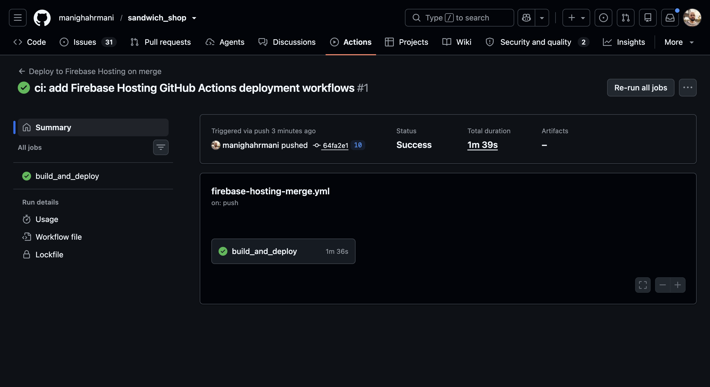
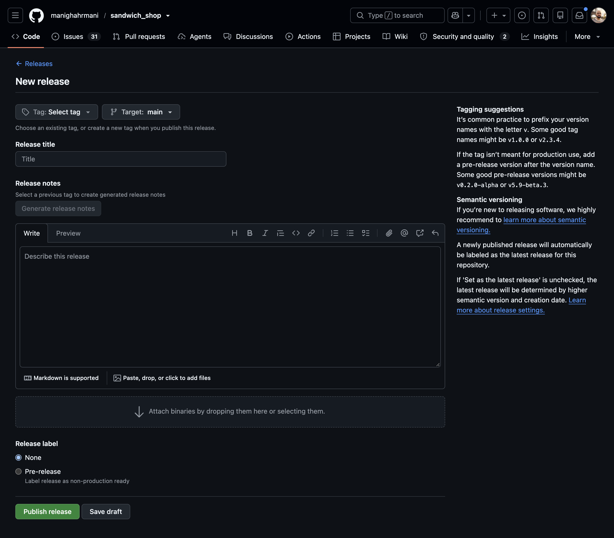

# Worksheet 10 — Integration testing and CI/CD

## Table of contents

- [Getting help](#getting-help)
- [Getting started](#getting-started)
  - [Continue from Worksheet 9](#continue-from-worksheet-9)
- [Integration testing](#integration-testing)
  - [What integration testing is](#what-integration-testing-is)
  - [How Flutter runs integration tests](#how-flutter-runs-integration-tests)
  - [Install the integration test package](#install-the-integration-test-package)
  - [Add stable keys to sandwich cards](#add-stable-keys-to-sandwich-cards)
  - [Write your first integration tests](#write-your-first-integration-tests)
  - [Generate the remaining workflow tests with Copilot](#generate-the-remaining-workflow-tests-with-copilot)
  - [Run integration tests in Chrome](#run-integration-tests-in-chrome)
- [Continuous integration](#continuous-integration)
  - [What CI and CD mean](#what-ci-and-cd-mean)
  - [How GitHub Actions works](#how-github-actions-works)
  - [Create a CI workflow on GitHub](#create-a-ci-workflow-on-github)
  - [Read workflow runs and logs](#read-workflow-runs-and-logs)
  - [Why integration tests do not run on every push](#why-integration-tests-do-not-run-on-every-push)
- [Deployment](#deployment)
  - [Automate Firebase Hosting deployment](#automate-firebase-hosting-deployment)
  - [Publish a release on GitHub](#publish-a-release-on-github)
  - [Mobile app stores](#mobile-app-stores)
- [Exercises](#exercises)

## Getting help

To get support with this worksheet, follow the [Discord guide](https://portdotacdotuk-my.sharepoint.com/:p:/g/personal/mani_ghahremani_port_ac_uk/IQCMJP6IiR_bQoYUMdXJSRDYAWnajEALZYEXFZyrJkHS1QU) and post your questions there. You can also attend your timetabled practical sessions and ask a member of teaching staff for guidance.

## Getting started

### Continue from Worksheet 9

Continue with your Sandwich Shop app from [Worksheet 9](worksheet-9.md). Your unit and widget tests should already pass with coverage measured as shown in [Measure coverage](worksheet-8.md#measure-coverage). If you need the starting code, clone the [Sandwich Shop repository](https://github.com/manighahrmani/sandwich_shop) and switch to branch `9` (the `cd ~/Downloads` command works in macOS, Linux and Windows PowerShell; use `cd %USERPROFILE%\Downloads` in Windows Command Prompt):

```bash
cd ~/Downloads
git clone https://github.com/manighahrmani/sandwich_shop.git
cd sandwich_shop
git switch 9
```

Open the folder in VS Code with **File > Open Folder**, install the packages and confirm all Worksheet 9 tests pass before making changes:

```bash
flutter pub get
flutter test
```

Do not switch branches over unfinished work. Branch `10` contains the completed Sandwich Shop app for this worksheet; use it to compare your finished work, not as your starting point.

## Integration testing

### What integration testing is

Back in [Why automated testing matters](worksheet-4.md#why-automated-testing-matters), we saw that Flutter divides automated tests into unit tests, widget tests and integration tests. Up to Worksheet 9, you wrote unit tests to verify models and repositories on their own and widget tests to check one screen at a time inside a fast simulated environment.

An integration test (also called an end-to-end test or GUI test) runs a complete app or a multi-screen user journey inside a real target runtime, such as an Android emulator, a physical phone or Chrome, to verify that all widgets, routes, plugins and services work together as expected. See Flutter's [Testing Flutter apps](https://docs.flutter.dev/testing/overview) and [Integration testing concepts](https://docs.flutter.dev/cookbook/testing/integration/introduction) pages for the official overview.

Flutter contrasts the three test types along four trade-offs:

| Test type | Execution speed | Dependencies | Maintenance cost | Confidence |
| --- | --- | --- | --- | --- |
| Unit | Quick | Few | Low | Low |
| Widget | Quick | More | Higher | Higher |
| Integration | Slow | Most | Highest | Highest |

Even when unit and widget tests reach high line coverage, bugs can still appear at the boundaries between screens and shared state. Pressing **Checkout** in `BasketScreen` might look right in a standalone widget test yet push the wrong route afterwards, fail to clear the basket in `CartRepository`, or leave **Bigger text** active in `main.dart` after a customer signs out. Integration tests catch those wiring bugs by driving the full `App` across screens.

Because integration tests run much more slowly and take more effort to maintain than unit or widget tests, you do not duplicate every edge case here. Follow Flutter's rule of thumb: keep many fast unit and widget tests tracked by code coverage, plus enough integration tests to verify all critical end-to-end journeys.

### How Flutter runs integration tests

Flutter provides the official `integration_test` package in the Flutter SDK, documented in [Check app functionality with an integration test](https://docs.flutter.dev/testing/integration-tests). Integration tests live in a top-level `integration_test/` directory rather than `test/`, so an ordinary `flutter test` run stays fast and skips device tests until you target `integration_test/`.

Flutter's guides use two terms to explain where code runs:

- Host machine: your laptop or desktop computer running the terminal command.
- Target device: the Android emulator, physical phone or web browser executing the app (for Chrome tests, the host machine and target device are the same computer).

The same `integration_test/app_test.dart` file is cross-platform and works on Android, iOS, desktop and Chrome (via `flutter drive`). However, integration tests differ from unit tests in one vital way: all `testWidgets` blocks inside an integration test file run in one shared Dart process on the device. Calling `app.main()` repeatedly across tests would call `Firebase.initializeApp()` multiple times and leak singleton state between tests.

To keep every journey fast, deterministic and isolated without hardcoding live Firebase passwords or polluting production Firestore collections, branch `10` follows Flutter's local-data integration pattern from [Testing each layer](https://docs.flutter.dev/app-architecture/case-study/testing):

- Before each test, `setUp` injects fresh `MockFirebaseAuth` and `FakeFirebaseFirestore` instances through the `setAuth` and `setFirestore` hooks we added in [Worksheet 9](worksheet-9.md#test-the-authentication-repository).
- Each test mounts a fresh `App(key: UniqueKey())` so `_AppState` resets its auth listener and cloud **Bigger text** scale cleanly for that test.

This tests all Flutter screens, named routes, form controllers, state listeners and repository logic end to end with mocks and fakes rather than live Firebase servers. When you later want end-to-end checks against real Firestore queries and server-side security rules locally, connect the app to the [Firebase Local Emulator Suite](https://firebase.google.com/docs/emulator-suite) instead of live production data. Note also that `integration_test` compiles and runs your local source code before release; it does not test a live deployed Firebase Hosting site such as `https://<project-id>.web.app`, which teams test separately after deployment with web browser automation tools such as Playwright or Cypress.

### Install the integration test package

Add `integration_test` from the Flutter SDK under `dev_dependencies` from the root of your project:

```bash
flutter pub add "dev:integration_test:{sdk: flutter}"
```

Open `pubspec.yaml` and confirm that `integration_test` appears beside `flutter_test` under `dev_dependencies`, while keeping your existing packages (`firebase_auth_mocks`, `fake_cloud_firestore` and `shared_preferences_platform_interface`):

```yaml
dev_dependencies:
  flutter_test:
    sdk: flutter
  integration_test:
    sdk: flutter
```

Run `flutter pub get` if VS Code does not fetch dependencies automatically. Because `integration_test` is a `dev_dependency`, release builds exclude it.

### Add stable keys to sandwich cards

On the menu screen, `SandwichCard` renders an **Order** button on each card (`Footlong Sub`, `Six-Inch Sub` and `Loaded Nachos`). Calling `find.text('Order')` therefore matches three buttons at once, and calling `first` breaks whenever the item order changes. Note that live Cloud Firestore returns documents sorted alphabetically by document ID (`footlong`, `nachos`, `six-inch`), whereas a bundled JSON asset keeps array order.

Give each `Card` a `Key` built from `sandwich.id`, matching Flutter's [Find widgets](https://docs.flutter.dev/cookbook/testing/widget/finders) guide. Open `lib/widgets/sandwich_card.dart` and add the `key` line inside `build`:

```dart
  @override
  Widget build(BuildContext context) {
    return Card(
      key: Key('sandwichCard_${sandwich.id}'),
      margin: const EdgeInsets.symmetric(horizontal: 16.0, vertical: 8.0),
```

Open `test/widgets/sandwich_card_test.dart` and also assert this key inside the `SandwichCard shows the name, description and price` test, right after checking `'£5.00'`:

```dart
    expect(find.byKey(const Key('sandwichCard_test')), findsOneWidget);
```

Save both files and run `flutter test` to confirm all existing unit and widget tests still pass.

### Write your first integration tests

Create an `integration_test` directory in the root of your project and create a new file named `integration_test/app_test.dart`. Start with the imports for the test runner, our repositories, `MenuScreen` and `OrderScreen`, plus `main()` calling `IntegrationTestWidgetsFlutterBinding.ensureInitialized()` to configure Flutter's live binding for emulators and browsers:

```dart
import 'package:fake_cloud_firestore/fake_cloud_firestore.dart';
import 'package:firebase_auth_mocks/firebase_auth_mocks.dart';
import 'package:flutter/material.dart';
import 'package:flutter/services.dart';
import 'package:flutter_test/flutter_test.dart';
import 'package:integration_test/integration_test.dart';
import 'package:sandwich_shop/main.dart';
import 'package:sandwich_shop/repositories/auth_repository.dart';
import 'package:sandwich_shop/repositories/cart_repository.dart';
import 'package:sandwich_shop/repositories/order_repository.dart';
import 'package:sandwich_shop/repositories/sandwich_repository.dart';
import 'package:sandwich_shop/repositories/settings_repository.dart';
import 'package:sandwich_shop/screens/menu_screen.dart';
import 'package:sandwich_shop/screens/order_screen.dart';
import 'package:shared_preferences_platform_interface/in_memory_shared_preferences_async.dart';
import 'package:shared_preferences_platform_interface/shared_preferences_async_platform_interface.dart';

void main() {
  IntegrationTestWidgetsFlutterBinding.ensureInitialized();
}
```

Inside `main()`, below `IntegrationTestWidgetsFlutterBinding.ensureInitialized();`, add a `FakeFirebaseFirestore` variable alongside `setUp` and `tearDown`. Calling `rootBundle.clear()` clears cached bundled asset data, `SharedPreferencesAsyncPlatform.instance` installs clean in-memory preferences, and clearing `SandwichRepository` forces `MenuScreen` to seed and read the menu from `fakeFirestore` on every test (matching [Read the menu from Firestore](worksheet-9.md#read-the-menu-from-firestore)):

```dart
  late FakeFirebaseFirestore fakeFirestore;

  setUp(() {
    rootBundle.clear();
    SharedPreferencesAsyncPlatform.instance =
        InMemorySharedPreferencesAsync.empty();
    fakeFirestore = FakeFirebaseFirestore();
    final MockFirebaseAuth defaultAuth = MockFirebaseAuth();
    AuthRepository.instance.setAuth(defaultAuth);
    CartRepository.instance.clear();
    SandwichRepository.instance.clearCache();
    SandwichRepository.instance.setFirestore(fakeFirestore);
    SettingsRepository.instance.setFirestore(fakeFirestore);
    OrderRepository.instance.setFirestore(fakeFirestore);
  });

  tearDown(() {
    CartRepository.instance.clear();
    AuthRepository.instance.setAuth(null);
    SandwichRepository.instance.clearCache();
    SandwichRepository.instance.setFirestore(null);
    SettingsRepository.instance.setFirestore(null);
    OrderRepository.instance.setFirestore(null);
  });
```

Below `tearDown()`, add a `group` with your first test verifying that `App` opens on `MenuScreen`, loads `Footlong Sub` and `Six-Inch Sub` from Firestore, and scrolls to `Loaded Nachos`:

```dart
  group('Sandwich Shop end-to-end workflows', () {
    testWidgets('menu screen opens and loads sandwiches from Firestore', (
      WidgetTester tester,
    ) async {
      await tester.pumpWidget(App(key: UniqueKey()));
      await tester.pumpAndSettle();

      expect(find.byType(MenuScreen), findsOneWidget);
      expect(find.text('Footlong Sub'), findsOneWidget);
      expect(find.text('Six-Inch Sub'), findsOneWidget);

      final Finder nachosFinder = find.text('Loaded Nachos');
      await tester.scrollUntilVisible(nachosFinder, 200);
      expect(nachosFinder, findsOneWidget);
    });
  });
```

Passing `UniqueKey()` mounts a brand-new `_AppState` per test so no auth listener or scale setting leaks between runs. Calling `await tester.pumpAndSettle()` waits for frames and animations to finish (avoid using it when a continuous loading spinner stays on screen), and `scrollUntilVisible` scrolls in 200-pixel steps until `Loaded Nachos` is visible.

Next, add a second worked test inside `group(...)` to open `Footlong Sub`, verify empty-quantity validation, adjust quantities, check the formatted emoji summary and subtotal, and add to the basket. Notice how `find.descendant` locates `'Order'` strictly inside `footlongCard` with explicitly typed `Finder` variables, while `tester.ensureVisible` scrolls a widget onto the screen before `tap`:

```dart
    testWidgets('ordering a sandwich validates quantity and updates subtotal', (
      WidgetTester tester,
    ) async {
      await tester.pumpWidget(App(key: UniqueKey()));
      await tester.pumpAndSettle();

      final Finder footlongCard =
          find.byKey(const Key('sandwichCard_footlong'));
      await tester.ensureVisible(footlongCard);
      final Finder orderTextFinder = find.text('Order');
      final Finder footlongOrderButton = find.descendant(
        of: footlongCard,
        matching: orderTextFinder,
      );
      await tester.tap(footlongOrderButton);
      await tester.pumpAndSettle();

      expect(find.byType(OrderScreen), findsOneWidget);
      expect(find.text('Order Footlong Sub'), findsOneWidget);
      expect(find.text('0 Footlong Sub sandwich(es): '), findsOneWidget);
      expect(find.text('£0.00'), findsOneWidget);

      final Finder addToBasketButton = find.text('Add to Basket');
      await tester.ensureVisible(addToBasketButton);
      await tester.tap(addToBasketButton);
      await tester.pump();
      expect(find.text('Please select at least 1 sandwich'), findsOneWidget);

      final Finder addButton = find.text('Add');
      final Finder removeButton = find.text('Remove');
      await tester.ensureVisible(addButton);
      await tester.tap(addButton);
      await tester.pump();
      await tester.tap(addButton);
      await tester.pump();
      await tester.tap(addButton);
      await tester.pump();
      await tester.tap(removeButton);
      await tester.pump();

      expect(find.text('2 Footlong Sub sandwich(es): 🥪🥪'), findsOneWidget);
      expect(find.text('£15.00'), findsOneWidget);

      await tester.ensureVisible(addToBasketButton);
      await tester.tap(addToBasketButton);
      await tester.pumpAndSettle();
      expect(find.text('Added 2 Footlong Sub to basket'), findsOneWidget);
    });
```

Start your Android emulator following [Preparing an Android emulator or device](worksheet-7.md#preparing-an-android-emulator-or-device) and list available devices (identical on Windows PowerShell and macOS):

```bash
flutter devices
```

Look for your emulator ID (for example `emulator-5554`), then run `integration_test/app_test.dart`:

```bash
flutter test integration_test/app_test.dart -d emulator-5554
```

Flutter builds and installs a debug APK on the emulator, launches your tests inside the real Android app and prints the pass/fail summary in your terminal. Running integration tests is much slower than unit tests, and `flutter test --coverage` does not include `integration_test/` in `coverage/lcov.info`, so keep tracking line coverage through your `test/` suite from [Worksheet 8](worksheet-8.md#test-coverage).

### Generate the remaining workflow tests with Copilot

Now that you have written and run the first two journeys yourself, you can use GitHub Copilot to plan and build tests for the remaining multi-screen workflows. Before prompting Copilot, learn five small Flutter test helpers used across those journeys so you can read and verify every generated test:

- Navigate back one screen by simulating the app bar back button with `await tester.pageBack();`.
- Pick a specific match from repeated widgets using `deleteButtons.last` or `textFields.at(0)`, and assert exact duplicate labels (such as `'£7.50'` appearing for both a single line item and **Items subtotal**) with `findsNWidgets(2)`.
- Pre-seed a signed-in or signed-out user by passing `MockUser` and `signedIn` into `MockFirebaseAuth`:

```dart
final MockUser existingUser = MockUser(
  uid: 'customer-1',
  email: 'alice@example.com',
);
final MockFirebaseAuth signedOutAuth = MockFirebaseAuth(
  mockUser: existingUser,
  signedIn: false,
);
AuthRepository.instance.setAuth(signedOutAuth);
```

- Check visual vertical ordering on `OrdersScreen` using `tester.getTopLeft` and `Offset.dy` with `lessThan`:

```dart
final Offset order1002Position = tester.getTopLeft(order1002Finder);
final Offset order1001Position = tester.getTopLeft(order1001Finder);
expect(order1002Position.dy, lessThan(order1001Position.dy));
```

- Inspect live **Bigger text** scaling with `MediaQuery.textScalerOf(tester.element(menuItemText)).scale(18)` and `closeTo(baselineSize * 1.2, 0.05)`, and read a switch's boolean state with `tester.widget<SwitchListTile>(largeTextSwitchFinder).value`.

Open GitHub Copilot in **Plan** mode (following [Plan first](worksheet-8.md#plan-first)), attach `#integration_test/app_test.dart` along with the relevant files in `#lib/screens/` and `#lib/repositories/`, and plan the five remaining end-to-end journeys listed below. Remind Copilot to keep beginner-friendly explicit types, use `MockFirebaseAuth` and `FakeFirebaseFirestore`, avoid chaining or shared helper functions inside tests, and avoid `dart analyze` unused-import warnings when importing `auth_screen.dart`, `basket_screen.dart`, `orders_screen.dart` and `settings_screen.dart`.

Switch to **Interactive** mode to add the five journeys one by one, reviewing each generated test carefully as shown in [Review the result](worksheet-8.md#review-the-result):

1. **Basket editing and signed-out guards:** Add `1 x Footlong Sub` and `2 x Six-Inch Sub`, check `BasketScreen` shows `£16.50`, `£1.50` and `£18.00`, delete `Six-Inch Sub` confirming `£7.50` appears twice and `£9.00` once, then confirm **Checkout**, `OrdersScreen` and `SettingsScreen` each prompt a signed-out visitor to log in, as shown below:

   

2. **Registration, sign-out clearing basket and sign-in:** Check blank sign-in validation on `AuthScreen`, switch to **Create Account**, register `alice@example.com`, add an item while signed in, tap **Sign Out**, confirm `BasketScreen` shows `'Your basket is empty'`, then sign back in cleanly, as shown below:

   

3. **Multi-order checkout and order history:** Start signed in, check out two `Footlong Sub`s plus one `Six-Inch Sub` (`Order #1001`, `£21.00`, both itemised lines and empty basket afterwards), return to `MenuScreen`, check out one `Loaded Nachos` (`Order #1002`, `£8.49`) and assert `Order #1002` renders above `Order #1001`, as shown below:

   

4. **Cloud settings and bigger text sync:** Measure baseline text size for `'Footlong Sub'`, sign in, save customer profile fields plus `largeTextSwitch` and `newsletterSwitch` on `SettingsScreen`, verify `1.2x` text scaling on `MenuScreen`, tap **Sign Out** confirming text scale and switches reset, then sign back in and confirm saved fields and `1.2x` scaling reload from Firestore, as shown below:

   

5. **Email link request and Google sign-in:** Open `AuthScreen`, enter `lee@example.com`, tap **Email me a sign-in link** to confirm the confirmation banner appears, then tap **Sign in with Google** and confirm navigation returns to `MenuScreen` with **Sign Out** visible.

Run the complete test suite on your Android emulator once more to confirm all seven end-to-end tests pass:

```bash
flutter test integration_test/app_test.dart -d emulator-5554
```

You can compare your finished test file against our complete model solution in [`integration_test/app_test.dart` on branch `10`](https://github.com/manighahrmani/sandwich_shop/blob/10/integration_test/app_test.dart).

### Run integration tests in Chrome

As noted in Flutter's [Check app functionality with an integration test](https://docs.flutter.dev/testing/integration-tests) guide and [Running Flutter Driver tests with Web](https://github.com/flutter/flutter/blob/main/docs/contributing/testing/Running-Flutter-Driver-tests-with-Web.md), `flutter test integration_test/app_test.dart` does not currently run directly on web browsers. Instead, Flutter uses `flutter drive` alongside a short driver file and ChromeDriver — a small helper program that translates test commands into browser clicks and keystrokes for Google Chrome (you do not need ChromeDriver for Android emulator tests).

Create `test_driver/integration_test.dart` with the content below:

```dart
import 'package:integration_test/integration_test_driver.dart';

Future<void> main() async {
  await integrationDriver();
}
```

Obtain a `chromedriver` binary matching your installed Chrome version using either option below:

- Download the `chromedriver` ZIP for your operating system (`win64` on Windows, `mac-arm64` on Apple Silicon Macs or `mac-x64` on Intel Macs) from [Chrome for Testing](https://googlechromelabs.github.io/chrome-for-testing/) and extract it.
- Or, if you installed Node.js in [Worksheet 9](worksheet-9.md#install-the-firebase-and-flutterfire-tools), run `npx @puppeteer/browsers install chromedriver@stable` to download the matching binary automatically.

In a first terminal, change into the folder containing the downloaded binary (unless it is already on your `PATH`) and start ChromeDriver on port `4444`. On Windows PowerShell, run:

```powershell
.\chromedriver.exe --port=4444
```

On macOS or Linux, run:

```bash
chromedriver --port=4444
```

Leave ChromeDriver running, open a second terminal in your Sandwich Shop project root, and run `flutter drive` as one single line (works identically on Windows PowerShell, Command Prompt, macOS and Linux):

```bash
flutter drive --driver=test_driver/integration_test.dart --target=integration_test/app_test.dart -d chrome
```

## Continuous integration

### What CI and CD mean

Up to now, you ran `dart format`, `dart analyze` and `flutter test` manually on your own computer. On a real project, forgetting one check or committing code that works only on your machine can break the build for everyone else on the repository.

Continuous integration (CI) solves this by running formatting, static analysis and automated tests on a clean cloud computer every time someone pushes commits or opens a pull request. Continuous delivery goes one step further by preparing a tested release bundle ready for a human to deploy, while continuous deployment (CD) pushes every green build live automatically without manual intervention.

GitHub provides this service built into every repository through [GitHub Actions](https://docs.github.com/en/actions). As documented in [Billing for GitHub Actions](https://docs.github.com/en/billing/managing-billing-for-your-products/about-billing-for-github-actions), standard runners are free with unlimited minutes on public repositories, while free personal private repositories receive 2,000 minutes per month (standard `ubuntu-latest` Linux minutes count 1x, whereas `macos-latest` costs 10x per minute).

### How GitHub Actions works

Before creating a workflow, it helps to know six terms GitHub Actions uses:

- **Workflow:** A YAML file stored inside `.github/workflows/` that defines automated checks for your repository.
- **Trigger (`on:`):** The GitHub event that starts the workflow, such as `push`, `pull_request` or `workflow_dispatch` (which lets you click **Run workflow** manually in the browser).
- **Job (`jobs:`):** A named task inside the workflow (such as `test`), which runs inside a fresh cloud virtual machine called a **runner** (we use `runs-on: ubuntu-latest`).
- **Step (`steps:`):** Each ordered command inside a job; a step either calls a reusable pre-built action via `uses:` (such as checking out your repo or installing Flutter) or runs a terminal command via `run:`.
- **Job summary (`$GITHUB_STEP_SUMMARY`) and artifacts:** Files your job writes so GitHub renders formatted results directly on the run page (`$GITHUB_STEP_SUMMARY`) and lets you download outputs such as `coverage/lcov.info` (`actions/upload-artifact`).
- **Action versions:** Pre-built actions use major tags such as `actions/checkout@v7` and `subosito/flutter-action@v2` for readability, while stricter teams sometimes pin a full commit SHA hash so upstream changes cannot alter a workflow unexpectedly.

Notice YAML indentation matters: always use two spaces per level and never use tab characters. Setting `permissions: contents: read` at the top of a CI workflow grants the job read-only access to clone your code and nothing more.

### Create a CI workflow on GitHub

You can create workflows directly in your browser on GitHub without memorising terminal commands. Open your repository on GitHub, select the **Actions** tab, select **New workflow**, and then select **set up a workflow yourself**, as shown below:


Change the file name box at the top of the editor to `.github/workflows/tests.yml`. Paste the YAML below into the editor:

```yaml
name: Flutter CI

on:
  push:
  pull_request:
  workflow_dispatch:

permissions:
  contents: read

jobs:
  test:
    name: Format, analyse and test
    runs-on: ubuntu-latest
    steps:
      - name: Check out repository
        uses: actions/checkout@v7

      - name: Set up Flutter
        uses: subosito/flutter-action@v2
        with:
          channel: stable
          cache: true

      - name: Install dependencies
        run: flutter pub get

      - name: Check formatting
        run: dart format --output=none --set-exit-if-changed lib test integration_test test_driver

      - name: Analyse code
        run: dart analyze

      - name: Run unit and widget tests with coverage
        run: flutter test --coverage

      - name: Write coverage summary
        if: always()
        run: |
          if [ -f coverage/lcov.info ]; then
            awk -F: '/^LF:/{found += $2} /^LH:/{hit += $2} END {if (found > 0) printf "### Line coverage\n\nCovered **%d / %d** lines (**%.2f%%**).\n", hit, found, hit * 100 / found}' coverage/lcov.info >> "$GITHUB_STEP_SUMMARY"
          fi

      - name: Upload coverage report
        if: always()
        uses: actions/upload-artifact@v7
        with:
          name: coverage-report
          path: coverage/lcov.info
```

Walk through what each section checks. First `actions/checkout@v7` downloads your code onto the Linux runner and `subosito/flutter-action@v2` installs stable Flutter with SDK caching (`cache: true`). Next `flutter pub get` fetches dependencies, `dart format --output=none --set-exit-if-changed ...` fails immediately if any Dart file needs formatting, `dart analyze` catches lint or type warnings, and `flutter test --coverage` runs every unit and widget test while recording `coverage/lcov.info`. Finally, `if: always()` ensures the line-coverage summary and downloadable `coverage-report` artifact (`actions/upload-artifact@v7`) still appear even if a test fails.

Click **Commit changes...** at the top right, choose to commit directly to your default branch (or open a pull request), and confirm. Afterwards, pull the new `.github/workflows/tests.yml` file down to your local folder in your terminal (works on Windows PowerShell and macOS):

```bash
git pull
```

You can also create and commit `.github/workflows/tests.yml` directly in VS Code on your computer and push it with Git whenever you prefer editing YAML locally.

### Read workflow runs and logs

As soon as you commit `.github/workflows/tests.yml`, GitHub starts your first workflow run automatically. Open the **Actions** tab on GitHub and click the newest `Flutter CI` run to inspect its summary page, which shows a green checkmark, total duration, the rendered **Line coverage** summary and the `coverage-report` zip download under **Artifacts**, as shown below:


Select the **Format, analyse and test** job on the left to inspect every step and its execution time. Click any step (such as **Run unit and widget tests with coverage**) to expand its full terminal output, as shown below:


Whenever a commit breaks formatting, analysis or a test, the failed step turns red and stops later steps from passing the build. Expand the red step in the browser to read the exact file, line number and error message, fix it locally in VS Code, verify `dart format`, `dart analyze` and `flutter test` locally, and push again until the run turns green.

Once you have learnt the browser workflow, you can check runs from Windows PowerShell or macOS without leaving VS Code by installing the [GitHub CLI](https://cli.github.com/) (`gh`), signing in once with `gh auth login`, and running:

```bash
gh run list --limit 5
gh run watch
gh run view --log-failed
```

### Why integration tests do not run on every push

Notice `.github/workflows/tests.yml` omits `integration_test/` from `flutter test --coverage`. While our unit and widget tests finish in around one minute on `ubuntu-latest`, booting an Android virtual device or running ChromeDriver integration tests adds five to ten minutes per run and burns through free private repository minutes quickly.

In practice, teams run fast unit/widget CI on every push and pull request, while running `integration_test/` locally before merging or on a nightly `schedule:` (`cron`) workflow (for example using [Android Emulator Runner](https://github.com/ReactiveCircus/android-emulator-runner) on `ubuntu-latest` with hardware KVM acceleration).

## Deployment

### Automate Firebase Hosting deployment

In [Publish the app on the web](worksheet-9.md#publish-the-app-on-the-web), you ran `flutter build web` and `firebase deploy --only hosting` by hand. You can automate that deployment via GitHub Actions so every push to your main branch updates your live `.web.app` site and every pull request gets a temporary preview link.

Deployment requires Firebase credentials, which must never be committed directly to your repository. On GitHub, open **Settings > Secrets and variables > Actions** to see where encrypted **Repository secrets** are stored with their values hidden from logs, as shown below:


Following Google's [Deploy to live & preview channels via GitHub pull requests](https://firebase.google.com/docs/hosting/github-integration) guide, run this command from your Sandwich Shop project root (same command on Windows PowerShell and macOS):

```bash
firebase init hosting:github
```

Complete the interactive prompts carefully (do not use the older `firebase login:ci` token flow, which is deprecated):

1. Browser sign-in: approve the Firebase CLI OAuth request in Chrome so the CLI can upload an encrypted deployment secret to your repository.
2. Repository: enter `<your-github-username>/<your-repo-name>` (for example `manighahrmani/sandwich_shop`).
3. Build script prompt (`Set up the workflow to run a build script before every deploy?`): enter `N` because we will configure Flutter directly in the YAML file.
4. Auto-deploy prompt (`Set up automatic deployment to your site's live channel when a PR is merged?`): enter `Y`.
5. Live branch prompt: enter `main` for your own project (note that branch `10` of Sandwich Shop uses `'10'` because `main` holds the worksheets).

The command creates a dedicated Firebase service account, stores its secret in GitHub automatically (`FIREBASE_SERVICE_ACCOUNT_<PROJECT>`), and writes two files: `.github/workflows/firebase-hosting-merge.yml` and `.github/workflows/firebase-hosting-pull-request.yml`. Open both generated files and add Flutter setup, `flutter pub get`, `flutter test` and `flutter build web` before the `FirebaseExtended/action-hosting-deploy@v0` step, because Flutter must compile `build/web` on the runner first. Your `.github/workflows/firebase-hosting-merge.yml` should look like this (using `main` in place of `'10'` for your own repository):

```yaml
name: Deploy to Firebase Hosting on merge

on:
  push:
    branches:
      - main
  workflow_dispatch:

permissions:
  contents: read

jobs:
  build_and_deploy:
    runs-on: ubuntu-latest
    steps:
      - uses: actions/checkout@v7
      - uses: subosito/flutter-action@v2
        with:
          channel: stable
          cache: true
      - name: Install dependencies
        run: flutter pub get
      - name: Run unit and widget tests
        run: flutter test
      - name: Build web app
        run: flutter build web
      - uses: FirebaseExtended/action-hosting-deploy@v0
        with:
          repoToken: ${{ secrets.GITHUB_TOKEN }}
          firebaseServiceAccount: ${{ secrets.FIREBASE_SERVICE_ACCOUNT_SANDWICH_SHOP_59811 }}
          channelId: live
          projectId: sandwich-shop-59811
```

Make the matching Flutter edits inside `.github/workflows/firebase-hosting-pull-request.yml` (omitting `channelId: live` so pull requests deploy to an isolated preview channel that expires after seven days). Replace the project ID and secret name with the values `firebase init hosting:github` wrote for your Firebase project, commit and push both workflow files, and watch `Deploy to Firebase Hosting on merge` turn green in **Actions**, as shown below:



Open your `.web.app` URL to confirm your latest site is live. If you prefer inspecting the generated secret or deploy status from Windows PowerShell or macOS with `gh`, run:

```bash
gh secret list
gh run list --limit 5
```

Enterprise teams also sometimes replace exported service-account JSON secrets with keyless Workload Identity Federation via [`google-github-actions/auth`](https://github.com/google-github-actions/auth).

### Publish a release on GitHub

Once your tested app is ready for a milestone, create a GitHub Release attached to a semantic version tag (`v<major>.<minor>.<patch>`, such as `v1.0.0`). Releases create a permanent snapshot of that code alongside human-readable release notes.

In your repository on GitHub, open **Releases** from the right-hand sidebar (or add `/releases` to your repository URL) and click **Create a new release** (or **Draft a new release** if you already have releases), opening the visual form shown below:



Open **Tag: Select tag**, type `v1.0.0` and choose **Create new tag: v1.0.0 on publish**. Keep **Target** set to the branch you want to tag (typically `main` in your own project), enter a **Release title** such as `Sandwich Shop v1.0.0`, click **Generate release notes** (or write a short list of new features), and click **Publish release**.

After learning the browser workflow, you can also publish the same release in one cross-platform terminal command with `gh` (works on Windows PowerShell and macOS):

```bash
gh release create v1.0.0 --title "Sandwich Shop v1.0.0" --generate-notes
```

### Mobile app stores

This module focuses on web deployment and GitHub Releases rather than building signed mobile binaries. When you later decide to distribute Android or iOS builds to testers or public app stores, start with Flutter's official build modes guide (`debug`, `profile` and `release`) and platform release documentation below:

- [Flutter build modes](https://docs.flutter.dev/testing/build-modes) explains why release builds compile optimised machine code without debugging overhead or `dev_dependencies`.
- [Build and release an Android app](https://docs.flutter.dev/deployment/android) covers creating an upload keystore, changing `applicationId` away from `com.example.*`, and building `.apk` or `.aab` packages for Google Play (note that personal developer accounts pay a one-off $25 USD registration fee and must complete a [closed test with 12 testers for 14 days](https://support.google.com/googleplay/android-developer/answer/14151465) before publishing to production).
- [Build and release an iOS app](https://docs.flutter.dev/deployment/ios) explains code signing, Xcode archiving and App Store Connect submission (requiring a macOS computer with Xcode and an [Apple Developer Program](https://developer.apple.com/programs/how-it-works/) membership costing $99 USD per year).
- [Firebase App Distribution](https://firebase.google.com/docs/app-distribution) lets you share pre-release Android and iOS builds privately with up to 500 testers on Firebase's free Spark plan.

## Exercises

The exercises below are optional extension tasks and are not assessed in Demo 5. For the full coursework specification and grading criteria, see the [Southsea Cinema coursework brief](https://portdotacdotuk-my.sharepoint.com/:w:/g/personal/mani_ghahremani_port_ac_uk/IQDtIJB3bM7gQ4p03eLUngyyAd7JuhjhHuNA1l0H-qCy3Jw).

1. (Advanced) Add the `integration_test` package to your Southsea Cinema project following [Install the integration test package](#install-the-integration-test-package) and add stable keys where lists of cards share button labels. Write the first one or two end-to-end tests yourself, then use GitHub Copilot in **Plan** and **Interactive** modes (following [Generate the remaining workflow tests with Copilot](#generate-the-remaining-workflow-tests-with-copilot)) to complete `integration_test/app_test.dart` covering browsing films, ticket validation, signed-out guards, sign-in/sign-out state clearing, multi-ticket bookings and cloud theme/profile settings sync, and run them on your Android emulator (and optionally Chrome).
2. Create a `.github/workflows/tests.yml` workflow in your Southsea Cinema repository through the **Actions** tab on GitHub following [Create a CI workflow on GitHub](#create-a-ci-workflow-on-github). Verify that a green run completes with your rendered **Line coverage** summary and `coverage-report` artifact, and inspect the latest runs in your terminal with `gh run list`.
3. Connect Firebase Hosting to your Southsea Cinema GitHub repository with `firebase init hosting:github`, update both generated workflows to install Flutter, test and run `flutter build web`, and confirm a push deploys your site live. Create your first tagged `v1.0.0` release visually under **Releases** on GitHub.
