# Worksheet 5 — Navigation, state and forms

## Table of contents

- [Getting help](#getting-help)
- [Getting started](#getting-started)
  - [Continue from Worksheet 4](#continue-from-worksheet-4)
  - [Clone the Sandwich Shop repository](#clone-the-sandwich-shop-repository)
  - [Switch to branch 4](#switch-to-branch-4)
- [Shared constants and the Subway theme](#shared-constants-and-the-subway-theme)
  - [Define the shared constants](#define-the-shared-constants)
  - [Import constants in the main app](#import-constants-in-the-main-app)
  - [Configure the Subway theme](#configure-the-subway-theme)
  - [Hide the debug banner](#hide-the-debug-banner)
- [Reusable widgets and navigation](#reusable-widgets-and-navigation)
  - [Build the primary button](#build-the-primary-button)
  - [Widget test the primary button](#widget-test-the-primary-button)
  - [Use the primary button in the sandwich card](#use-the-primary-button-in-the-sandwich-card)
  - [Create the basket button](#create-the-basket-button)
  - [Create the placeholder basket screen](#create-the-placeholder-basket-screen)
  - [Register named routes](#register-named-routes)
  - [Add the basket button to the menu app bar](#add-the-basket-button-to-the-menu-app-bar)
  - [Widget test the menu screen](#widget-test-the-menu-screen)
  - [Update the app smoke tests](#update-the-app-smoke-tests)
- [Holding an order in a basket](#holding-an-order-in-a-basket)
  - [Define the cart item model](#define-the-cart-item-model)
  - [Create the cart repository singleton](#create-the-cart-repository-singleton)
  - [Unit test the cart repository](#unit-test-the-cart-repository)
- [Building the order screen](#building-the-order-screen)
  - [Recap the order screen state](#recap-the-order-screen-state)
  - [Update the order screen app bar](#update-the-order-screen-app-bar)
  - [Add items to the basket](#add-items-to-the-basket)
  - [Widget test the order screen](#widget-test-the-order-screen)
- [Building the basket screen](#building-the-basket-screen)
  - [Convert BasketScreen to a stateful widget](#convert-basketscreen-to-a-stateful-widget)
  - [Build the empty basket state](#build-the-empty-basket-state)
  - [Build the basket item card](#build-the-basket-item-card)
  - [Build the basket items list and checkout button](#build-the-basket-items-list-and-checkout-button)
  - [Assemble the basket screen scaffold](#assemble-the-basket-screen-scaffold)
  - [Widget test the basket screen](#widget-test-the-basket-screen)
- [Building the customer profile settings form](#building-the-customer-profile-settings-form)
  - [Define the user settings model](#define-the-user-settings-model)
  - [Text controllers and form lifecycle](#text-controllers-and-form-lifecycle)
  - [Add text fields and the switch toggle](#add-text-fields-and-the-switch-toggle)
  - [Wrap the form in a scroll view](#wrap-the-form-in-a-scroll-view)
  - [Create the settings button and register the route](#create-the-settings-button-and-register-the-route)
  - [Save settings and provide feedback](#save-settings-and-provide-feedback)
  - [Widget test the settings screen](#widget-test-the-settings-screen)
- [Exercises](#exercises)

## Getting help

To get support with this worksheet, follow the [Discord guide](https://portdotacdotuk-my.sharepoint.com/:p:/g/personal/mani_ghahremani_port_ac_uk/IQCMJP6IiR_bQoYUMdXJSRDYAWnajEALZYEXFZyrJkHS1QU) and post your questions there. You can also attend your timetabled practical sessions and ask a member of teaching staff for guidance.

## Getting started

### Continue from Worksheet 4

You can continue directly with the Sandwich Shop project you completed in [Worksheet 4](./worksheet-4.md). Open the project folder in VS Code with **File > Open Folder**. You do not need to clone the repository again if your working tree is clean.

### Clone the Sandwich Shop repository

If you need a fresh copy of the project, open a terminal and move to a folder that is not synchronised to cloud storage, such as your `Downloads` folder, then clone the repository:

```bash
cd ~/Downloads
git clone https://github.com/manighahrmani/sandwich_shop.git
cd sandwich_shop
```

Open the cloned folder in VS Code with **File > Open Folder**.

### Switch to branch 4

Switch to branch `4` so your project matches the state after completing Worksheet 4:

```bash
git checkout 4
```

Run `flutter test` in your terminal to confirm that all existing tests pass before continuing.

## Shared constants and the Subway theme

Values such as the app title and brand colours appear across multiple screens. Rather than repeating them in each file, we keep them in a dedicated constants file. This gives us a single source of truth when modifying the theme.

### Define the shared constants

Create a new file named `lib/constants.dart`. Start by importing the Material library and declaring a top-level constant string for the app title:

```dart
import 'package:flutter/material.dart';

const String appTitle = 'Sandwich Shop';
```

Your code should look like this in VS Code:


The `import 'package:flutter/material.dart';` statement brings in the Material Design types, including `Color` and `TextStyle`. Declaring `appTitle` as a top-level `const String` means any screen in our project can import `constants.dart` and use it.

Next, define the brand colour palette below the title:

```dart
const Color shopBrand = Color(0xFF008C15);
const Color shopWhite = Colors.white;
const Color shopBackground = Color(0xFFF5F5F0);
const Color shopText = Color(0xFF1B2B1B);
```

Each colour is declared as a `const Color`. In Flutter, the `Color(0xFF008C15)` constructor creates a colour from an 8-digit hexadecimal integer. The first two digits (`FF`) set full opacity, and the remaining six digits represent the red, green, and blue colour channels. Here `shopBrand` is a green colour inspired by Subway, `shopBackground` provides a soft off-white background for each screen, and `shopText` gives high-contrast dark green text. For more information on colour constructors, see the [Flutter Color documentation](https://api.flutter.dev/flutter/dart-ui/Color-class.html).

Finally, add two reusable text styles to `lib/constants.dart`:

```dart
const TextStyle shopHeaderStyle = TextStyle(
  fontWeight: FontWeight.bold,
  letterSpacing: 1.1,
);

const TextStyle shopSectionTitleStyle = TextStyle(
  fontSize: 22,
  fontWeight: FontWeight.bold,
  color: shopText,
);
```

A `TextStyle` describes text formatting such as font size and weight. The `fontWeight: FontWeight.bold` property bolds the text, `letterSpacing` slightly expands spacing between letters, and `fontSize` specifies text height in logical pixels. We will use `shopHeaderStyle` for app bar titles and `shopSectionTitleStyle` for screen section headings. For more information, see the [Flutter TextStyle documentation](https://api.flutter.dev/flutter/painting/TextStyle-class.html).

### Import constants in the main app

Now open `lib/main.dart` and import our new constants file at the top of `lib/main.dart` with `import 'package:sandwich_shop/constants.dart'`.

Then update the `title` property of `MaterialApp` to use `appTitle` instead of the hardcoded string. Because `appTitle` is a top-level constant, `MaterialApp` can read it directly.

See below where we are showing the changes to our `lib/main.dart` file in VS Code:


### Configure the Subway theme

Next, apply our custom brand colours to the whole application using `ThemeData`. Remove the `const` keyword before `MaterialApp` and add the `theme` property:

```dart
      theme: ThemeData(
        colorScheme: ColorScheme.fromSeed(
          seedColor: shopBrand,
          primary: shopBrand,
        ),
        scaffoldBackgroundColor: shopBackground,
        appBarTheme: const AppBarTheme(
          backgroundColor: shopBrand,
          foregroundColor: shopWhite,
          elevation: 0,
        ),
      ),
```

The `theme` property accepts a `ThemeData` object containing global styles and colour tokens. `ColorScheme.fromSeed` generates a palette around a single seed colour, which we set to `shopBrand`. The `scaffoldBackgroundColor` sets the default background colour for every `Scaffold` in the app.

The `appBarTheme` styles all app bars with our brand green background, white foreground text and icons, and removes the drop shadow with `elevation: 0`. For more details, view the [ThemeData documentation](https://api.flutter.dev/flutter/material/ThemeData-class.html) and [ColorScheme documentation](https://api.flutter.dev/flutter/material/ColorScheme-class.html).

Here is a summary of our changes:


Run the application with `flutter run` in your terminal. Your screen should look like this, with the new green app bar and the debug banner in the corner:


### Hide the debug banner

Notice the small red or grey ribbon in the top-right corner that reads "DEBUG". Flutter displays this ribbon to indicate that the application is running in an unoptimised debug build. It's harmless but you can hide it during development to preview how the final app looks.

Add `debugShowCheckedModeBanner: false` directly inside `MaterialApp` as shown below:


Save the file and trigger hot reload. The debug ribbon disappears from the top-right corner:


## Reusable widgets and navigation

Before adding form inputs or cart state, we construct reusable navigation components and connect our screens. Building interface shells first lets you verify movement through the app before writing business logic.

### Build the primary button

Let's suppose we need a button that gets styled consistently across the app, in multiple screens. Rather than repeating identical `ElevatedButton` styling in multiple files, it's best to extract it into a standalone widget.

Create a new file named `lib/widgets/primary_button.dart` and add the following code inside it:

```dart
import 'package:flutter/material.dart';
import 'package:sandwich_shop/constants.dart';

class PrimaryButton extends StatelessWidget {
  final String label;
  final VoidCallback onPressed;

  const PrimaryButton({
    super.key,
    required this.label,
    required this.onPressed,
  });

  @override
  Widget build(BuildContext context) {
    return ElevatedButton(
      style: ElevatedButton.styleFrom(
        backgroundColor: shopBrand,
        foregroundColor: shopWhite,
      ),
      onPressed: onPressed,
      child: Text(label),
    );
  }
}
```

`PrimaryButton` is a `StatelessWidget` with two properties: `label` for the button caption, and `onPressed` for the tap callback. The type `VoidCallback` represents a function that takes no arguments and returns nothing. `ElevatedButton.styleFrom` configures the green background and white text from our constants file. For more button variants such as `TextButton` and `OutlinedButton`, consult the [Flutter buttons documentation](https://docs.flutter.dev/development/ui/widgets/material#buttons).

We will use `PrimaryButton` in multiple screens later but first we need to write tests for it.

### Widget test the primary button

Every (reusable) widget should be verified with automated tests. Create a new test file named `test/widgets/primary_button_test.dart`. Notice that the name of the subfolder in `test` folder matches the name of the folder in `lib`. This is a common convention for organising widget tests (so here, we have a `test/widgets` folder for testing widgets in `lib/widgets`).

Add the following code to `test/widgets/primary_button_test.dart`:

```dart
import 'package:flutter/material.dart';
import 'package:flutter_test/flutter_test.dart';
import 'package:sandwich_shop/widgets/primary_button.dart';

void main() {
  testWidgets('PrimaryButton renders its label', (WidgetTester tester) async {
    await tester.pumpWidget(
      MaterialApp(
        home: Scaffold(
          body: PrimaryButton(
            label: 'Order',
            onPressed: () {},
          ),
        ),
      ),
    );

    expect(find.text('Order'), findsOneWidget);
  });

  testWidgets('PrimaryButton invokes onPressed when tapped',
      (WidgetTester tester) async {
    bool wasPressed = false;

    await tester.pumpWidget(
      MaterialApp(
        home: Scaffold(
          body: PrimaryButton(
            label: 'Order',
            onPressed: () {
              wasPressed = true;
            },
          ),
        ),
      ),
    );

    await tester.tap(find.text('Order'));
    await tester.pump();

    expect(wasPressed, isTrue);
  });
}
```

The first test confirms that the button renders the text passed to its label. The second test passes a callback that flips a boolean flag, simulates a user tap with `tester.tap`, and asserts that the callback executed.

You can add a `group` to organise these tests. You are also encouraged to organise the rest of the files in `test` folder in a similar way, for example, you can create a `test/screens` folder for testing screens in `lib/screens` and `test/models` folder for testing models in `lib/models`.

Run this test as you learned in [Worksheet 4](./worksheet-4.md#running-test-suites-and-static-analysis). To run a single file from the terminal, pass its path:

```bash
flutter test test/widgets/primary_button_test.dart
```

### Use the primary button in the sandwich card

Now update `lib/widgets/sandwich_card.dart` so each menu item uses our new button. Import `primary_button.dart` at the top of the file:

```dart
import 'package:sandwich_shop/widgets/primary_button.dart';
```

Then locate the `ElevatedButton` inside the card's `build` method and replace it with `PrimaryButton`. Here what the change should look like:


Save the file and check your running application. Each menu card now displays the styled green Order button, as shown below:


### Create the basket button

Let's add another reusable widget for the shopping basket icon button. Every screen in our application needs a shopping basket icon in its app bar that takes the user to their basket.

Create a new file named `lib/widgets/basket_button.dart` and make a `StatelessWidget` that displays a shopping basket icon and navigates to the basket screen when tapped:

```dart
import 'package:flutter/material.dart';

class BasketButton extends StatelessWidget {
  const BasketButton({super.key});

  @override
  Widget build(BuildContext context) {
    return IconButton(
      icon: const Icon(Icons.shopping_basket),
      onPressed: () {
        ModalRoute<dynamic>? modalRoute = ModalRoute.of(context);
        String currentRoute = '';

        if (modalRoute != null) {
          RouteSettings settings = modalRoute.settings;
          String? routeName = settings.name;
          if (routeName != null) {
            currentRoute = routeName;
          }
        }

        if (currentRoute != '/basket') {
          Navigator.pushNamed(context, '/basket');
        }
      },
    );
  }
}
```

`IconButton` displays an icon from Flutter's Material icon set (`Icons.shopping_basket`). You can press **Ctrl + Space** on Windows or **⌘ + Space** on macOS after the dot to browse available icons. For a complete list, consult the [Material icons documentation](https://api.flutter.dev/flutter/material/Icons-class.html).


Inside `onPressed`, we check which screen the user is currently viewing. If the user is already looking at the basket, tapping the button again should not open a second copy of the basket on top of the first.

In Flutter, each screen is called a route. The screen currently displayed in front of the user is represented by a class called `ModalRoute`. We call `ModalRoute.of(context)` to ask Flutter for the route that holds our button.

In Flutter, a screen can optionally return a result when it closes. Because different screens can return different types of data, or no data at all, Flutter uses `dynamic` to mean any type. Writing `ModalRoute<dynamic>` tells Dart that our button only wants to inspect the screen, without expecting any specific return type.

The route's `settings` property holds information about the screen, including its name (`settings.name`). For example, the menu screen is named `'/'` and the basket screen is named `'/basket'`. If the route exists and has a name, we store that name in our `currentRoute` variable.

Finally, we compare `currentRoute != '/basket'`. If the user is on the menu or another screen, `Navigator.pushNamed(context, '/basket')` opens the basket. If the user is already on the basket screen, the code does nothing.

### Create the placeholder basket screen

Notice that `BasketButton` navigates to `'/basket'`. Before registering this route in `MaterialApp`, we create a minimal basket screen so our code compiles cleanly.

Create a new file named `lib/screens/basket_screen.dart`:

```dart
import 'package:flutter/material.dart';

class BasketScreen extends StatelessWidget {
  const BasketScreen({super.key});

  @override
  Widget build(BuildContext context) {
    return const Scaffold(
      body: Center(
        child: Text('Basket Screen'),
      ),
    );
  }
}
```

We will build the complete stateful basket screen later in this worksheet. For now, this placeholder enables navigation between screens.

### Register named routes

In [Worksheet 3](./worksheet-3.md), we navigated to screens using `Navigator.push` with a `MaterialPageRoute`. That approach is suitable for detail views, such as selecting a sandwich to open its order page. For top-level screens like the menu and the basket, named routes provide a cleaner structure.

A named route associates an identifier string with a screen builder. Open `lib/main.dart` and import the basket screen:

```dart
import 'package:sandwich_shop/screens/basket_screen.dart';
```

In `App.build`, remove `home: const MenuScreen()` and replace it with `initialRoute` and `routes`:

```dart
      initialRoute: '/',
      routes: <String, WidgetBuilder>{
        '/': (BuildContext context) {
          return const MenuScreen();
        },
        '/basket': (BuildContext context) {
          return const BasketScreen();
        },
      },
```

The `initialRoute: '/'` property instructs Flutter to open the menu screen on launch. The `routes` map associates `'/'` with `MenuScreen` and `'/basket'` with `BasketScreen`. Your complete `lib/main.dart` should now look like this:


For more details on routing, see the [Flutter named routes documentation](https://docs.flutter.dev/cookbook/navigation/named-routes).

### Add the basket button to the menu app bar

Now add the reusable `BasketButton` to `lib/screens/menu_screen.dart`. Open the file and import our constants and the button widget:

```dart
import 'package:sandwich_shop/constants.dart';
import 'package:sandwich_shop/widgets/basket_button.dart';
```

In `MenuScreen.build`, update the `AppBar` to use `appTitle`, `shopHeaderStyle` first. Also add the `BasketButton` to the `actions` list as shown in the screenshot below:


The `actions` property accepts a list of widgets displayed on the trailing side of the app bar. Save the file. The menu screen app bar now shows the styled title and the basket icon button, as shown below:


### Widget test the menu screen

Create a new test file named `test/menu_screen_test.dart` to verify that the menu displays sandwich cards, the basket action button, and responds to taps:

```dart
import 'package:flutter/material.dart';
import 'package:flutter_test/flutter_test.dart';
import 'package:sandwich_shop/screens/basket_screen.dart';
import 'package:sandwich_shop/screens/menu_screen.dart';
import 'package:sandwich_shop/widgets/sandwich_card.dart';

void main() {
  testWidgets('MenuScreen shows the sandwich list and a basket button', (
    WidgetTester tester,
  ) async {
    await tester.pumpWidget(const MaterialApp(home: MenuScreen()));

    expect(find.byType(SandwichCard), findsWidgets);
    expect(find.byIcon(Icons.shopping_basket), findsOneWidget);
  });

  testWidgets('Tapping the basket button navigates to BasketScreen', (
    WidgetTester tester,
  ) async {
    await tester.pumpWidget(
      MaterialApp(
        initialRoute: '/',
        routes: <String, WidgetBuilder>{
          '/': (BuildContext context) {
            return const MenuScreen();
          },
          '/basket': (BuildContext context) {
            return const BasketScreen();
          },
        },
      ),
    );

    await tester.tap(find.byIcon(Icons.shopping_basket));
    await tester.pumpAndSettle();

    expect(find.byType(BasketScreen), findsOneWidget);
  });
}
```

The first test confirms that `SandwichCard` widgets and the basket icon appear. The second test taps the basket icon button, waits for the transition with `tester.pumpAndSettle()`, and asserts that `BasketScreen` appears.

### Update the app smoke tests

Recall that smoke tests generally verify that the app launches and displays the expected home screen. In [Worksheet 4](./worksheet-4.md), our smoke test in `test/widget_test.dart` looked for the text `'Sandwich Menu'`.

Because our app bar now displays `'Sandwich Shop'` alongside the basket button, update the test in `test/widget_test.dart` to expect the basket button's icon (`Icons.shopping_basket`) instead of the old text. The updated test should look like this:


If this test fails, check that you updated it to look for the basket icon instead of the old text.

The lesson here is to remember to update your tests when you change the user interface. Otherwise, your tests will fail even if the app is working correctly.

## Holding an order in a basket

We would like customers to select a sandwich and quantity, add them to a shared basket, and then check out. We will create a model to hold each selection and a repository to manage the basket. The order screen will let customers choose the quantity before adding their sandwich.

### Define the cart item model

When a customer orders a sandwich, we need to track their selection and the quantity they wish to buy. A `Sandwich` represents an item in the catalogue, with its name, description, and price. A `CartItem` represents a specific line item in the customer's shopping basket.

As introduced in [Worksheet 1](./worksheet-1.md), we use composition to build `CartItem`: it holds a reference to a `Sandwich` instance along with an integer quantity. (Note that we could have alternatively stored a collection of `Sandwich` instances in a `List<Sandwich>` to represent the quantity in a `CartItem`.)

Create a new file named `lib/models/cart_item.dart` and define a `CartItem` class with two instance variables: `sandwich` and `quantity`. `sandwich` is a `Sandwich` object (make sure to import it at the top of the file), and `quantity` is an integer. Both fields should be marked `final` to ensure instances are immutable once constructed. Add a constructor that requires both fields to be passed in and finally add a getter called `lineTotal` that multiplies the sandwich price by the quantity and returns the result.

There are different ways to write this class, here is ours.

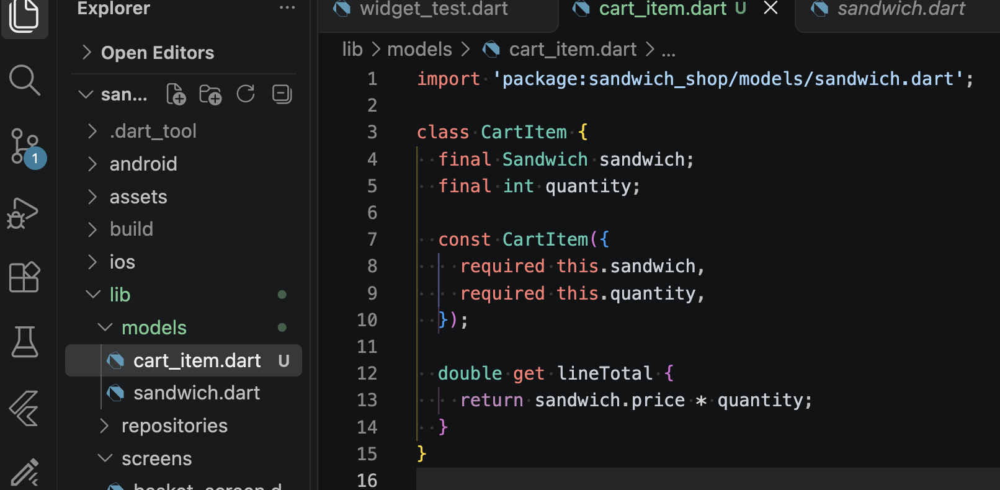

### Create the cart repository singleton

In [Worksheet 3](./worksheet-3.md), we introduced the repository pattern to encapsulate data access for sandwiches (`SandwichRepository`). For our shopping cart, multiple screens (the menu, order, and basket screens) need to read and update the same shared list of items.

If each screen created its own `CartRepository` instance, each would hold an independent list of items, so an item added on the order screen would never appear in the basket. We solve this with the singleton pattern, which restricts a class to a single shared instance accessible throughout the application.

Create a new file named `lib/repositories/cart_repository.dart`. Start with an empty class that declares a private named constructor:

```dart
import 'package:sandwich_shop/models/cart_item.dart';

class CartRepository {
  CartRepository._internal();
}
```

In Dart, an identifier prefixed with an underscore (`_`) is private to its library (the file it is defined in), as you saw with state classes like `_OrderScreenState` in [Worksheet 2](./worksheet-2.md). Naming the constructor `CartRepository._internal()` creates a private named constructor. Because this constructor is private, code outside `lib/repositories/cart_repository.dart` cannot call it. This prevents the creation of a second instance of `CartRepository`.

Now expose a single shared instance from within the class by adding a static field inside the class:

```dart
  static final CartRepository instance = CartRepository._internal();
```

The `static` keyword means this member belongs to the class itself rather than to an individual instance of the class. You access static members directly on the class name (`CartRepository.instance`) without constructing an object. The `final` keyword ensures that the `instance` variable can only be assigned once. Because `CartRepository._internal()` is called inside the class body, it has access to the private constructor, creating the one instance our entire application will share.

Next, add an internal list to hold the customer's items:

```dart
  final List<CartItem> _items = [];

  List<CartItem> getItems() {
    return List<CartItem>.unmodifiable(_items);
  }
```

The list `_items` is again marked with a leading underscore to keep it private. To let screens read the basket items safely (without allowing modifications), `getItems()` returns `List<CartItem>.unmodifiable(_items)`. In Dart, [`List.unmodifiable`](https://api.dart.dev/stable/dart-core/List/List.unmodifiable.html) creates an unmodifiable list wrapper. If an external widget attempts to call `.add()` or `.clear()` on the list returned by `getItems()`, Dart throws an `UnsupportedError` at runtime. This practice is known as defensive copying, ensuring that only the repository itself can alter its internal data structure.

Now add methods to add and remove items:

```dart
  void addItem(CartItem item) {
    _items.add(item);
  }

  void removeItem(int index) {
    if (index >= 0 && index < _items.length) {
      _items.removeAt(index);
    }
  }
```

Next, add methods to calculate quantities and prices. Start with `getTotalItems()` and the `totalItemCount` getter:

```dart
  int getTotalItems() {
    int total = 0;
    for (final CartItem item in _items) {
      total += item.quantity;
    }
    return total;
  }

  int get totalItemCount {
    return getTotalItems();
  }
```

`getTotalItems()` iterates through `_items` using a procedural `for` loop, accumulating each item's `quantity`. The getter `totalItemCount` delegates to `getTotalItems()`, exposing the count as a property.

Now add `getSubtotal()`, `getDeliveryFee()`, and `getTotalDue()` to compute prices:

```dart
  double getSubtotal() {
    double sum = 0.0;
    for (final CartItem item in _items) {
      sum += item.lineTotal;
    }
    return sum;
  }

  double getDeliveryFee() {
    if (_items.isEmpty) {
      return 0.0;
    }
    return 1.50;
  }

  double getTotalDue() {
    return getSubtotal() + getDeliveryFee();
  }
```

`getSubtotal()` sums `lineTotal` across all cart items. `getDeliveryFee()` returns `0.0` when the basket is empty, or a flat fee of `1.50` when items are present. `getTotalDue()` adds the subtotal and delivery fee together.

Finally, add `clear()` to empty the basket:

```dart
  void clear() {
    _items.clear();
  }
```

Calling `clear()` wipes the internal list, which we use when resetting the basket after checkout.

Your complete `lib/repositories/cart_repository.dart` file should have all the members shown in the screenshot below:

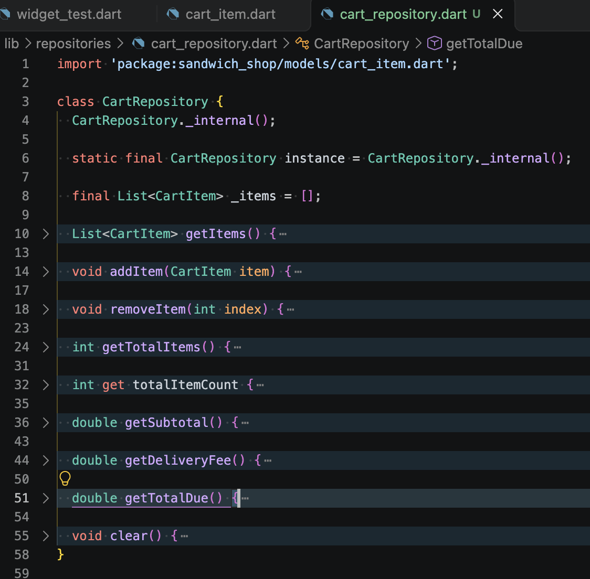

### Unit test the cart repository

In [Worksheet 4](./worksheet-4.md), we introduced unit testing with `flutter_test`. We now write unit tests for `CartRepository` to verify that repository calculations compute accurate totals.

Create a new test file named `test/cart_repository_test.dart`. Start by importing `flutter_test` along with the cart model, sandwich model, and cart repository:

```dart
import 'package:flutter_test/flutter_test.dart';
import 'package:sandwich_shop/models/cart_item.dart';
import 'package:sandwich_shop/models/sandwich.dart';
import 'package:sandwich_shop/repositories/cart_repository.dart';
```

Next, define two sample `Sandwich` constants at the top level of the test file (outside of any function). These constants will be used to create predictable test fixtures with known prices (£10.00 and £6.00) without depending on external asset files.

```dart
const Sandwich testSandwich1 = Sandwich(
  id: 'footlong',
  name: 'Footlong Sub',
  description: 'Classic freshly baked sub.',
  price: 10.0,
  imagePath: 'assets/images/footlong.jpeg',
);

const Sandwich testSandwich2 = Sandwich(
  id: 'six_inch',
  name: 'Six-Inch Sub',
  description: 'Six inch sub.',
  price: 6.0,
  imagePath: 'assets/images/six_inch.jpeg',
);
```

Because `CartRepository` is a singleton, its in-memory list persists across the entire test session. If one test adds items to the cart, subsequent tests would see those items unless we reset the repository state. To prevent test pollution, Flutter provides the `setUp` hook which runs before each test. We can use it to clear the cart before every test case.

Add the following `main()` with its `setUp` function in `test/cart_repository_test.dart`:

```dart
void main() {
  setUp(() {
    CartRepository.instance.clear();
  });
}
```

The `setUp` callback runs before every individual test in this file. Calling `CartRepository.instance.clear()` inside `setUp` guarantees that each test starts with a clean, empty basket.

Now add the test group with three test cases inside `main()`, below the `setUp` call:

```dart
  group('CartRepository tests', () {
    test('starts with empty basket and zero totals', () {
      final CartRepository cart = CartRepository.instance;
      expect(cart.getItems().length, 0);
      expect(cart.getTotalItems(), 0);
      expect(cart.totalItemCount, 0);
      expect(cart.getSubtotal(), 0.0);
      expect(cart.getDeliveryFee(), 0.0);
      expect(cart.getTotalDue(), 0.0);
    });

    test('adds items and calculates subtotal and delivery fee correctly', () {
      final CartRepository cart = CartRepository.instance;
      const CartItem item1 = CartItem(
        sandwich: testSandwich1,
        quantity: 2,
      );
      const CartItem item2 = CartItem(
        sandwich: testSandwich2,
        quantity: 1,
      );

      cart.addItem(item1);
      cart.addItem(item2);

      expect(cart.getItems().length, 2);
      expect(cart.getTotalItems(), 3);
      expect(cart.totalItemCount, 3);
      expect(cart.getSubtotal(), 26.0);
      expect(cart.getDeliveryFee(), 1.50);
      expect(cart.getTotalDue(), 27.50);
    });

    test('removes items correctly', () {
      final CartRepository cart = CartRepository.instance;
      const CartItem item = CartItem(
        sandwich: testSandwich1,
        quantity: 1,
      );
      cart.addItem(item);
      expect(cart.getItems().length, 1);

      cart.removeItem(0);
      expect(cart.getItems().length, 0);
      expect(cart.getTotalDue(), 0.0);
    });
  });
```

Here is what each test case verifies:

1. `starts with empty basket and zero totals`: checks that a newly initialised basket has zero items, a zero item count, a subtotal of `0.0`, a delivery fee of `0.0`, and a total due of `0.0`.
2. `adds items and calculates subtotal and delivery fee correctly`: creates two line items (two footlong subs at £10.00 each and one six-inch sub at £6.00), adds them to the basket, and asserts that the subtotal is £26.00, the delivery fee is £1.50, and the overall total due is £27.50.
3. `removes items correctly`: adds an item to verify the basket has one item, removes it at index 0, and asserts that the basket length returns to zero and the total due resets to `0.0`.

Your complete `test/cart_repository_test.dart` file should look like this:

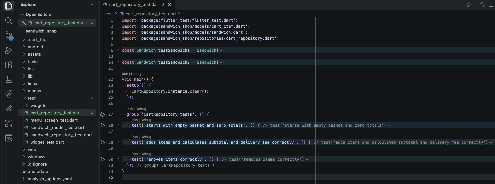

## Building the order screen

Now that the cart model and repository are ready, we turn `lib/screens/order_screen.dart` into an ordering screen that lets users choose a quantity and add their selected sandwich to the basket.

### Recap the order screen state

After [Worksheet 4](./worksheet-4.md), `OrderScreen` was a `StatefulWidget` containing a quantity integer and two buttons (**Add** and **Remove**) that called `setState`. We will keep these quantity handlers and connect them to our basket repository.

### Update the order screen app bar

Open `lib/screens/order_screen.dart`. Import our constants and the basket button:

```dart
import 'package:sandwich_shop/constants.dart';
import 'package:sandwich_shop/widgets/basket_button.dart';
```

In `OrderScreen.build`, update the `AppBar` to display our themed title and include `BasketButton`. The changes in your order screen app bar should look like this:


Make sure to run your app, navigate to the order screen, and verify that the app bar displays the styled title and basket button. Our `OrderScreen` looks like this:

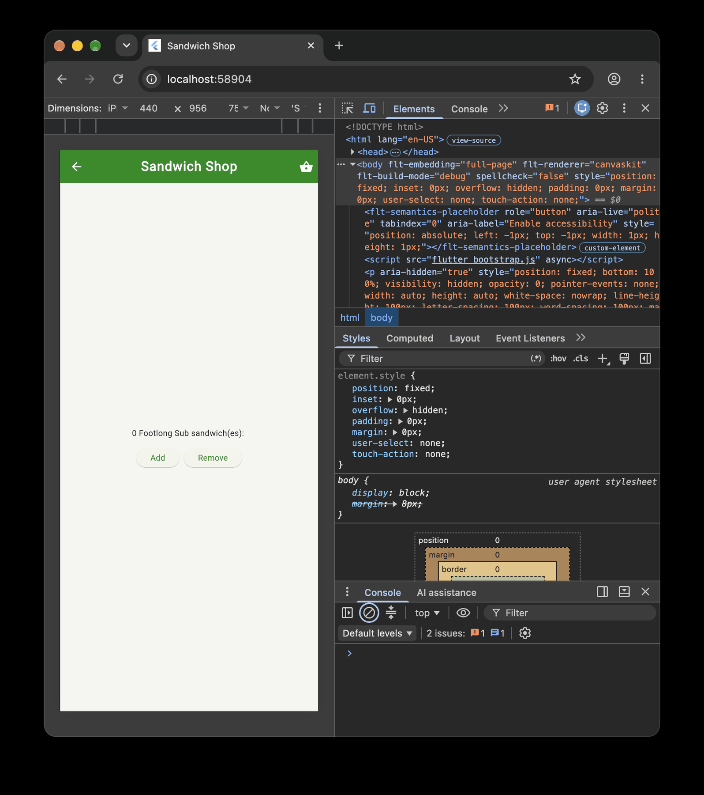

### Add items to the basket

Now wire the screen to `CartRepository`. Add imports for the cart model, repository, and primary button at the top of `lib/screens/order_screen.dart`:

```dart
import 'package:sandwich_shop/models/cart_item.dart';
import 'package:sandwich_shop/repositories/cart_repository.dart';
import 'package:sandwich_shop/widgets/primary_button.dart';
```

Add a string field (instance variable) in `_OrderScreenState` to hold an inline feedback message:

```dart
  String _confirmationMessage = '';
```

Next, add the submission method `_addToBasket`:

```dart
  void _addToBasket() {
    if (_quantity > 0) {
      final CartItem item = CartItem(
        sandwich: widget.sandwich,
        quantity: _quantity,
      );
      CartRepository.instance.addItem(item);
      setState(() {
        _confirmationMessage =
            'Added $_quantity ${widget.sandwich.name} to basket';
      });
    } else {
      setState(() {
        _confirmationMessage = 'Please select at least 1 sandwich';
      });
    }
  }
```

The method checks that `_quantity > 0`. If valid, it constructs a `CartItem` holding `widget.sandwich` and `_quantity`, and passes it to `CartRepository.instance.addItem(item)`. (Recall that we use `widget` to access the `StatefulWidget` instance from its state class.)

It then updates `_confirmationMessage` inside `setState`. If the quantity is zero, it informs the user to select at least one sandwich.

So far, your changes should look like this:

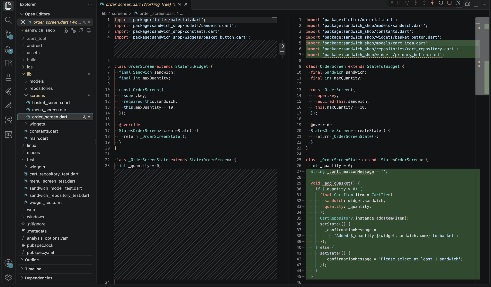

Add the button and confirmation message below the quantity controls in `build`, add this in the `Column`'s children:

```dart
            const SizedBox(height: 24),
            SizedBox(
              width: double.infinity,
              child: PrimaryButton(
                label: 'Add to Basket',
                onPressed: _addToBasket,
              ),
            ),
            const SizedBox(height: 12),
            Text(
              _confirmationMessage,
              style: const TextStyle(fontWeight: FontWeight.bold),
            ),
```

By default, buttons size themselves to fit their label text. Wrapping `PrimaryButton` in a `SizedBox` with `width: double.infinity` tells Flutter to expand the box across the full available width of the parent column, giving the button full width across the screen.

In [Worksheet 3](./worksheet-3.md#build-the-menu-interface) we resolved layout overflow inside a `Row` using `Expanded`. A `Column` behaves similarly along the vertical axis: when child widgets need more vertical height than the display provides, Flutter reports a vertical `RenderFlex` overflow with the yellow-and-black striped hazard banner.

The [`SingleChildScrollView`](https://api.flutter.dev/flutter/widgets/SingleChildScrollView-class.html) widget is new here. Unlike the [`ListView.builder`](./worksheet-3.md#build-the-menuscreen-widget) we used in Worksheet 3 for an arbitrary collection of repeating cards, `SingleChildScrollView` makes a single fixed layout of different widgets scrollable. Wrapping the body `Column` in it ensures the entire column scrolls smoothly if the viewport is constrained.

Click on the `Column` widget in VS Code, then press **Ctrl + .** on Windows or **⌘ + .** on macOS to open the quick fix menu. Select **Wrap with widget**. It should look like this:

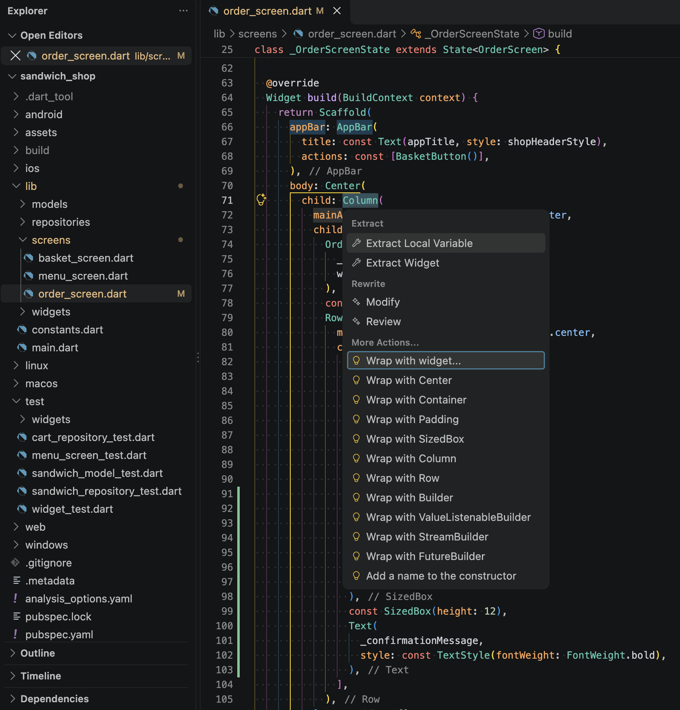

Replace `widget` with `SingleChildScrollView` and add padding to the scroll view. This is what your changes should look like:

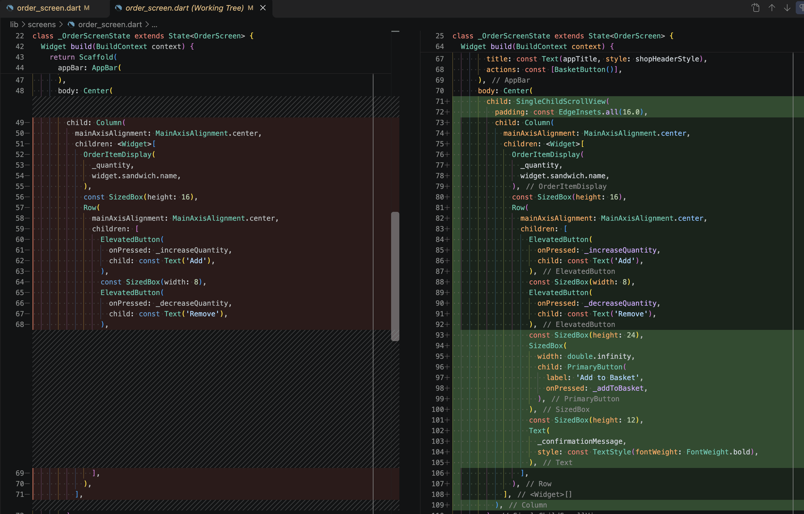

Now assemble the complete `body` inside the `SingleChildScrollView`. Place a `Column` with `crossAxisAlignment: CrossAxisAlignment.start` as its child, containing:

1. A `Text` title displaying `'Order ${widget.sandwich.name}'` with bold styling.
2. A `SizedBox(height: 16)` spacer followed by `OrderItemDisplay(_quantity, widget.sandwich.name)`.
3. The centred `Row` of **Remove** and **Add** buttons that modify `_quantity`.
4. Our full-width `PrimaryButton` labelled **Add to Basket**, wrapped in `SizedBox(width: double.infinity)`.
5. The `Text` widget displaying `_confirmationMessage`.

Your `body` should look like this:

```dart
      body: SingleChildScrollView(
        padding: const EdgeInsets.all(16.0),
        child: Column(
          crossAxisAlignment: CrossAxisAlignment.start,
          children: [
            Text(
              'Order ${widget.sandwich.name}',
              style: const TextStyle(fontSize: 22, fontWeight: FontWeight.bold),
            ),
            const SizedBox(height: 16),
            OrderItemDisplay(_quantity, widget.sandwich.name),
            const SizedBox(height: 16),
            Row(
              mainAxisAlignment: MainAxisAlignment.center,
              children: [
                ElevatedButton(
                  onPressed: _decreaseQuantity,
                  child: const Text('Remove'),
                ),
                const SizedBox(width: 12),
                ElevatedButton(
                  onPressed: _increaseQuantity,
                  child: const Text('Add'),
                ),
              ],
            ),
            const SizedBox(height: 24),
            SizedBox(
              width: double.infinity,
              child: PrimaryButton(
                label: 'Add to Basket',
                onPressed: _addToBasket,
              ),
            ),
            const SizedBox(height: 12),
            Text(
              _confirmationMessage,
              style: const TextStyle(fontWeight: FontWeight.bold),
            ),
          ],
        ),
      ),
```

Keep the existing `OrderItemDisplay` class unchanged at the bottom of the file.

Your order screen should now look like this:

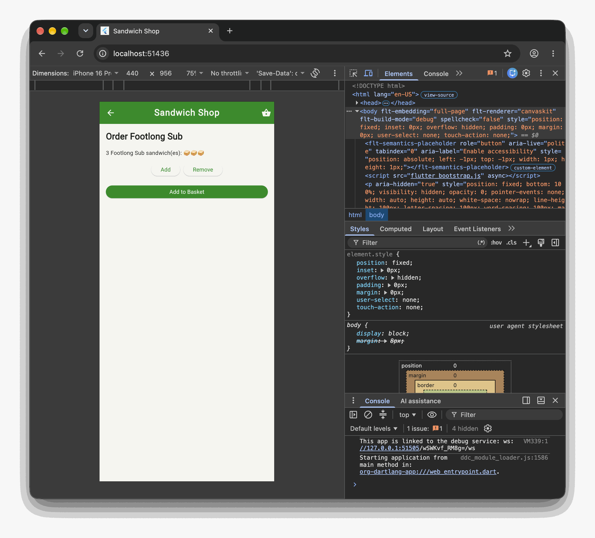

### Widget test the order screen

Create a new test file named `test/order_screen_test.dart` to verify that selecting a quantity and tapping **Add to Basket** properly updates the cart repository.

Import `flutter_test`, the cart model, sandwich model, cart repository, and order screen. Then create a test `Sandwich` constant to use in the tests. Also, add a `main` function, and in there, call `setUp()` to clear the cart repository before each test. Here is what it should look like:

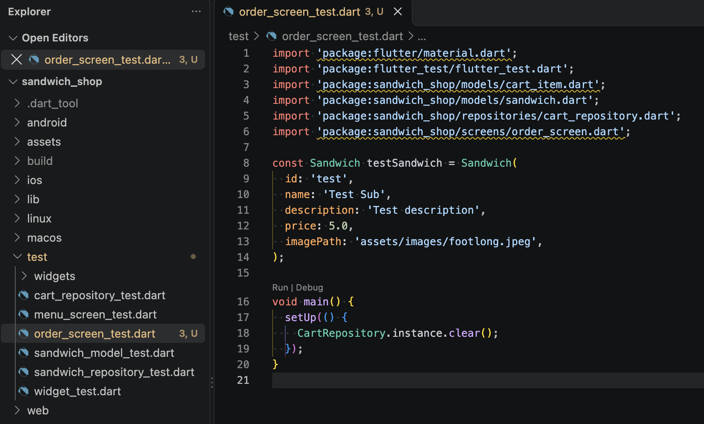

Now add the following three widget tests inside `main()`, below the `setUp` call, verifying screen rendering, zero-quantity validation, and basket submission:

```dart
  testWidgets('OrderScreen shows quantity buttons and Add to Basket button', (
    WidgetTester tester,
  ) async {
    await tester.pumpWidget(
      const MaterialApp(home: OrderScreen(sandwich: testSandwich)),
    );

    expect(find.text('Order Test Sub'), findsOneWidget);
    expect(find.text('0 Test Sub sandwich(es): '), findsOneWidget);
    expect(find.text('Add'), findsOneWidget);
    expect(find.text('Remove'), findsOneWidget);
    expect(find.text('Add to Basket'), findsOneWidget);
  });

  testWidgets('Adding to basket without selecting quantity shows warning', (
    WidgetTester tester,
  ) async {
    await tester.pumpWidget(
      const MaterialApp(home: OrderScreen(sandwich: testSandwich)),
    );

    await tester.tap(find.text('Add to Basket'));
    await tester.pump();

    expect(find.text('Please select at least 1 sandwich'), findsOneWidget);
    expect(CartRepository.instance.getItems(), isEmpty);
  });

  testWidgets('Adding to basket records quantity and sandwich', (
    WidgetTester tester,
  ) async {
    await tester.pumpWidget(
      const MaterialApp(home: OrderScreen(sandwich: testSandwich)),
    );

    await tester.tap(find.text('Add'));
    await tester.pump();
    await tester.tap(find.text('Add'));
    await tester.pump();

    await tester.tap(find.text('Add to Basket'));
    await tester.pump();

    final List<CartItem> items = CartRepository.instance.getItems();
    expect(items.length, 1);

    final CartItem added = items.first;
    expect(added.quantity, 2);
    expect(added.sandwich.id, 'test');
    expect(added.sandwich.name, 'Test Sub');
    expect(find.text('Added 2 Test Sub to basket'), findsOneWidget);
  });
```

Here is what each test case verifies:

1. `OrderScreen shows quantity buttons and Add to Basket button`: pumps `OrderScreen` wrapped in a `MaterialApp` and verifies that the app bar title, zero-quantity display, and the **Add**, **Remove**, and **Add to Basket** buttons all appear on screen.
2. `Adding to basket without selecting quantity shows warning`: taps **Add to Basket** when quantity is zero, calls `tester.pump()` to trigger a rebuild, and asserts that the warning message `Please select at least 1 sandwich` is shown while the repository remains empty.
3. `Adding to basket records quantity and sandwich`: simulates a customer tapping **Add** twice to choose a quantity of 2, taps **Add to Basket**, and asserts that an item with quantity 2 was stored in `CartRepository.instance` and the confirmation message `Added 2 Test Sub to basket` is rendered.

## Building the basket screen

Now we replace the placeholder `lib/screens/basket_screen.dart` with a full screen that displays items in the cart, lets the user remove items, shows the total due, and provides a checkout button.

### Convert BasketScreen to a stateful widget

Open `lib/screens/basket_screen.dart`. Replace the placeholder `StatelessWidget` with a `StatefulWidget` that sets up the high-level screen scaffold:

```dart
import 'package:flutter/material.dart';
import 'package:sandwich_shop/constants.dart';
import 'package:sandwich_shop/models/cart_item.dart';
import 'package:sandwich_shop/repositories/cart_repository.dart';
import 'package:sandwich_shop/widgets/basket_button.dart';
import 'package:sandwich_shop/widgets/primary_button.dart';

class BasketScreen extends StatefulWidget {
  const BasketScreen({super.key});

  @override
  State<BasketScreen> createState() {
    return _BasketScreenState();
  }
}

class _BasketScreenState extends State<BasketScreen> {
  String _confirmationMessage = '';

  @override
  Widget build(BuildContext context) {
    final CartRepository cart = CartRepository.instance;
    final List<CartItem> items = cart.getItems();

    return Scaffold(
      appBar: AppBar(
        title: const Text(appTitle, style: shopHeaderStyle),
        actions: const [BasketButton()],
      ),
      body: const SingleChildScrollView(
        padding: EdgeInsets.all(16.0),
        child: Text('Basket placeholder'),
      ),
    );
  }
}
```

The screen displays the themed `AppBar` and a `SingleChildScrollView` body. The string field `_confirmationMessage` holds feedback to display once an order is submitted.

Here is what your code should look like in VS Code:

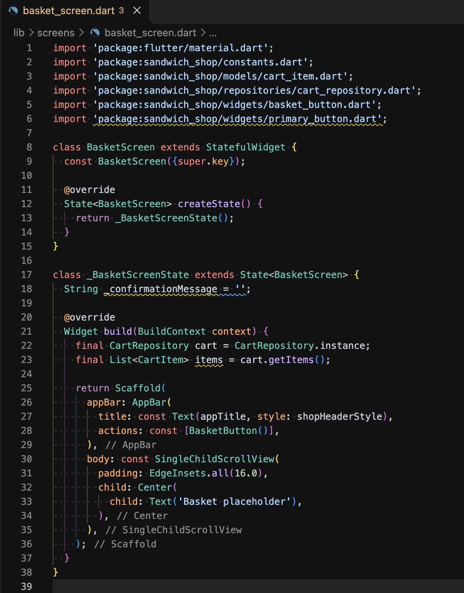

To decide what widget to pass to the `child` parameter of `SingleChildScrollView`, declare a `Widget content` variable before returning `Scaffold`. Add an `if` statement checking `if (items.isEmpty)`, placing a placeholder in the `if` branch and another in the `else` branch:

```dart
    final Widget content;
    if (items.isEmpty) {
      content = const Text('Empty basket placeholder');
    } else {
      content = const Text('Basket list placeholder');
    }
```

Your code should look like this in VS Code:

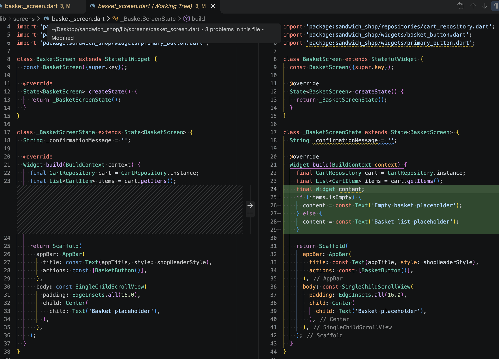

Now add the nested `if` statement checking `if (_confirmationMessage.isNotEmpty)` inside the empty basket branch:

```dart
    final Widget content;
    if (items.isEmpty) {
      if (_confirmationMessage.isNotEmpty) {
        content = Column(
          children: [
            const Text('Empty basket placeholder'),
            Text(_confirmationMessage),
          ],
        );
      } else {
        content = const Text('Empty basket placeholder');
      }
    } else {
      content = const Text('Basket list placeholder');
    }
```

Your code should look like this in VS Code:

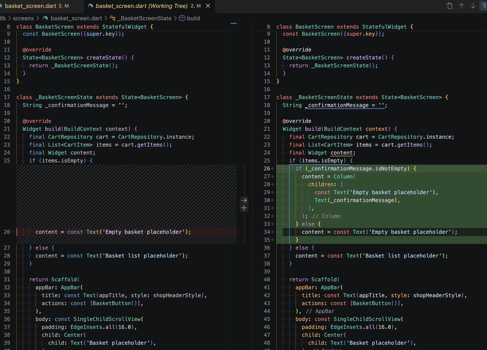

Pass `content` to the `child` parameter of `SingleChildScrollView`, removing `const` from `SingleChildScrollView` because `content` is a dynamic variable:

```dart
      body: SingleChildScrollView(
        padding: const EdgeInsets.all(16.0),
        child: content,
      ),
```

Your code should look like this in VS Code:

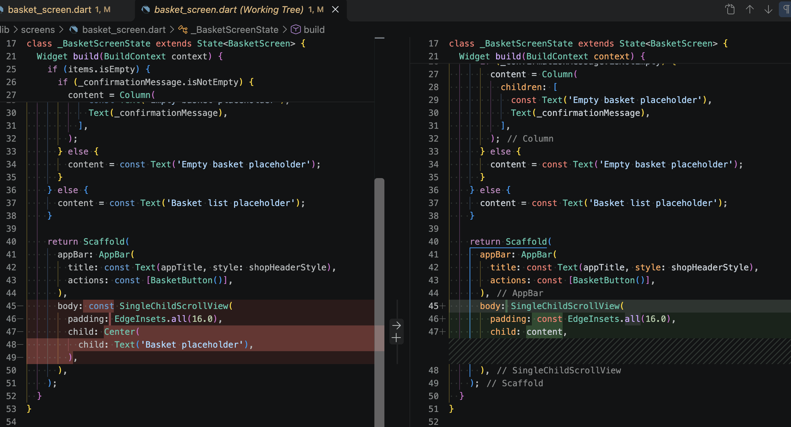

Why do we need the nested `if (_confirmationMessage.isNotEmpty)` check and what does it do? When a customer taps **Checkout**, the cart repository is cleared, so `items.isEmpty` becomes true. If we only checked `items.isEmpty`, the screen would immediately show the plain empty basket message without confirming that the order was received. By checking `_confirmationMessage.isNotEmpty`, we can show the confirmation message alongside the empty state right after an order is placed.

Now we replace the placeholders bit by bit with dedicated helper widgets.

### Build the empty basket state

When the cart contains no items, we display an informative placeholder. Add the `_buildEmptyState` helper inside `_BasketScreenState`:

```dart
  Widget _buildEmptyState() {
    return const Center(
      child: Padding(
        padding: EdgeInsets.symmetric(vertical: 32.0),
        child: Text(
          'Your basket is empty',
          style: TextStyle(fontSize: 16, color: Colors.grey),
        ),
      ),
    );
  }
```

The `Center` widget centres the text horizontally and vertically within the viewport.

In `build`, replace the placeholder `Text('Empty basket placeholder')` with `_buildEmptyState()` and format the confirmation column with spacing and bold styling:

```dart
    final Widget content;
    if (items.isEmpty) {
      if (_confirmationMessage.isNotEmpty) {
        content = Column(
          crossAxisAlignment: CrossAxisAlignment.start,
          children: [
            _buildEmptyState(),
            const SizedBox(height: 12),
            Text(
              _confirmationMessage,
              style: const TextStyle(fontWeight: FontWeight.bold),
            ),
          ],
        );
      } else {
        content = _buildEmptyState();
      }
    } else {
      content = const Text('Basket list placeholder');
    }
```

Your code should look like this in VS Code:

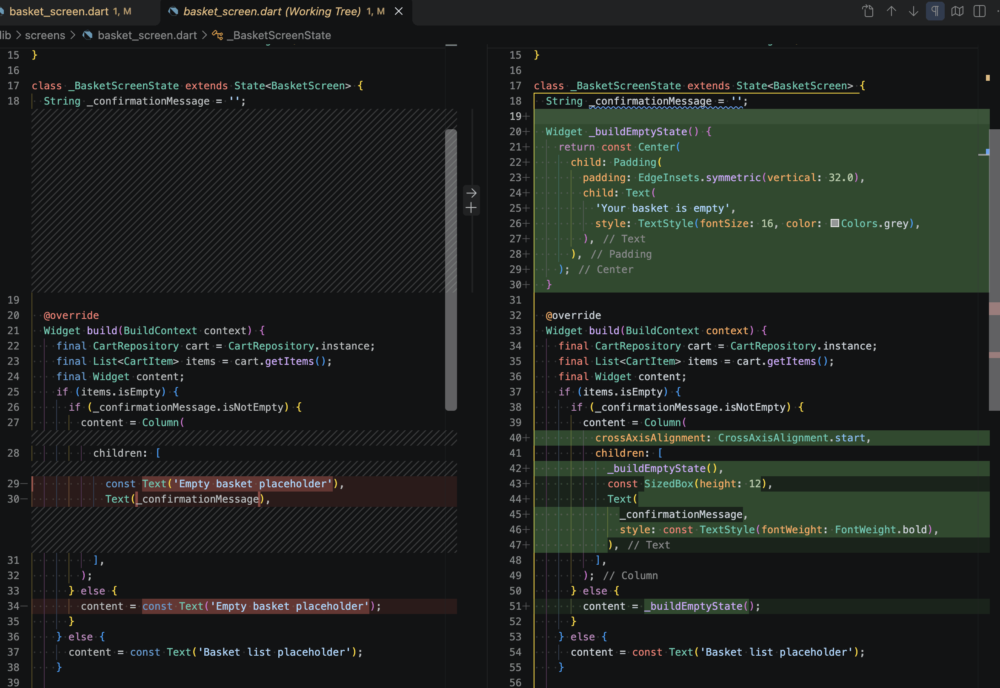

### Build the basket item card

When sandwiches are present in the basket, each entry must display its quantity, name, calculated line total, and an option to remove the item. Add the `_buildLineItem` helper widget inside `_BasketScreenState`:

```dart
  Widget _buildLineItem(CartRepository cart, CartItem item, int index) {
    return Padding(
      padding: const EdgeInsets.symmetric(vertical: 8.0),
      child: Row(
        children: [
          Expanded(
            child: Column(
              crossAxisAlignment: CrossAxisAlignment.start,
              children: [
                Text(
                  '${item.quantity} x ${item.sandwich.name}',
                  style: const TextStyle(fontWeight: FontWeight.w600),
                ),
                const SizedBox(height: 4),
                Text('£${item.lineTotal.toStringAsFixed(2)}'),
              ],
            ),
          ),
          IconButton(
            icon: const Icon(Icons.delete_outline, color: Colors.red),
            onPressed: () {
              setState(() {
                cart.removeItem(index);
              });
            },
          ),
        ],
      ),
    );
  }
```

The layout uses a `Row` containing the item description on the left and a delete `IconButton` on the right. As in [Worksheet 3](./worksheet-3.md#build-the-menu-interface), wrapping the text `Column` in `Expanded` ensures it takes only the remaining horizontal space in the row, wrapping longer sandwich names so the delete button stays in view.

The `IconButton` uses `Icons.delete_outline` with red colouring to indicate a destructive action. Its `onPressed` callback invokes `cart.removeItem(index)` inside `setState` so the screen rebuilds with updated items and totals.

### Build the basket items list and checkout button

The order summary displays three total rows: items subtotal, delivery fee, and the grand total to pay. Writing three separate `Row` implementations would duplicate layout code, so we create a helper method `_buildTotalRow`:

```dart
  Widget _buildTotalRow(String label, String value, {bool emphasise = false}) {
    final TextStyle style;
    if (emphasise) {
      style = const TextStyle(fontWeight: FontWeight.bold, fontSize: 16);
    } else {
      style = const TextStyle(color: shopText);
    }

    return Padding(
      padding: const EdgeInsets.symmetric(vertical: 4.0),
      child: Row(
        mainAxisAlignment: MainAxisAlignment.spaceBetween,
        children: [
          Text(label, style: style),
          Text(value, style: style),
        ],
      ),
    );
  }
```

In `_buildTotalRow`, `MainAxisAlignment.spaceBetween` pushes the description label to the far-left edge and the formatted price to the far-right edge. The optional named parameter `{bool emphasise = false}` determines typography: standard `shopText` for intermediate subtotals, and bold weight with a larger `16` font size for the final total to pay.

Now construct the `_buildBasketList` helper inside `_BasketScreenState`. We build its contents procedurally by accumulating widgets into a `List<Widget> children` list.

Start by adding the section title and a `for` loop that calls `_buildLineItem` for each sandwich in the cart:

```dart
  Widget _buildBasketList(CartRepository cart, List<CartItem> items) {
    final List<Widget> children = [];

    children.add(const Text('Your basket', style: shopSectionTitleStyle));
    children.add(const SizedBox(height: 16));

    for (int index = 0; index < items.length; index++) {
      final CartItem item = items[index];
      children.add(_buildLineItem(cart, item, index));
    }
```

Next, append the three total rows by calling `_buildTotalRow`:

```dart
    children.add(const SizedBox(height: 24));
    children.add(
      _buildTotalRow(
        'Items subtotal',
        '£${cart.getSubtotal().toStringAsFixed(2)}',
      ),
    );
    children.add(
      _buildTotalRow(
        'Delivery',
        '£${cart.getDeliveryFee().toStringAsFixed(2)}',
      ),
    );
    children.add(
      _buildTotalRow(
        'Total to pay',
        '£${cart.getTotalDue().toStringAsFixed(2)}',
        emphasise: true,
      ),
    );
    children.add(const SizedBox(height: 24));
```

Finally, add the full-width **Checkout** button:

```dart
    children.add(
      SizedBox(
        width: double.infinity,
        child: PrimaryButton(
          label: 'Checkout',
          onPressed: () {
            setState(() {
              cart.clear();
              _confirmationMessage = 'Thanks, your order is on its way';
            });
          },
        ),
      ),
    );
```

Tapping checkout clears the cart and updates `_confirmationMessage` inside `setState`. Now append the confirmation text when present and return the `Column`:

```dart
    if (_confirmationMessage.isNotEmpty) {
      children.add(const SizedBox(height: 12));
      children.add(
        Text(
          _confirmationMessage,
          style: const TextStyle(fontWeight: FontWeight.bold),
        ),
      );
    }

    return Column(
      crossAxisAlignment: CrossAxisAlignment.start,
      children: children,
    );
  }
```

### Assemble the basket screen scaffold

With our helper methods in place, update `build` in `_BasketScreenState` to tie everything together.

First, determine `content` based on whether items are present in the cart:

```dart
  @override
  Widget build(BuildContext context) {
    final CartRepository cart = CartRepository.instance;
    final List<CartItem> items = cart.getItems();

    final Widget content;
    if (items.isEmpty) {
      if (_confirmationMessage.isNotEmpty) {
        content = Column(
          crossAxisAlignment: CrossAxisAlignment.start,
          children: [
            _buildEmptyState(),
            const SizedBox(height: 12),
            Text(
              _confirmationMessage,
              style: const TextStyle(fontWeight: FontWeight.bold),
            ),
          ],
        );
      } else {
        content = _buildEmptyState();
      }
    } else {
      content = _buildBasketList(cart, items);
    }
```

Now return the `Scaffold` shell wrapping `content` in a `SingleChildScrollView`:

```dart
    return Scaffold(
      appBar: AppBar(
        title: const Text(appTitle, style: shopHeaderStyle),
        actions: const [BasketButton()],
      ),
      body: SingleChildScrollView(
        padding: const EdgeInsets.all(16.0),
        child: content,
      ),
    );
  }
```

Wrapping `content` in `SingleChildScrollView` ensures customers can scroll through longer orders and comfortably reach the checkout button on smaller screens.

Run your app, add a few sandwiches to the basket, and navigate to the basket screen. You should see a list of items with their quantities, line totals, and a checkout button. Tapping the delete icon removes an item from the basket, and tapping checkout clears the basket and displays a confirmation message.

Our basket screen looks like this:

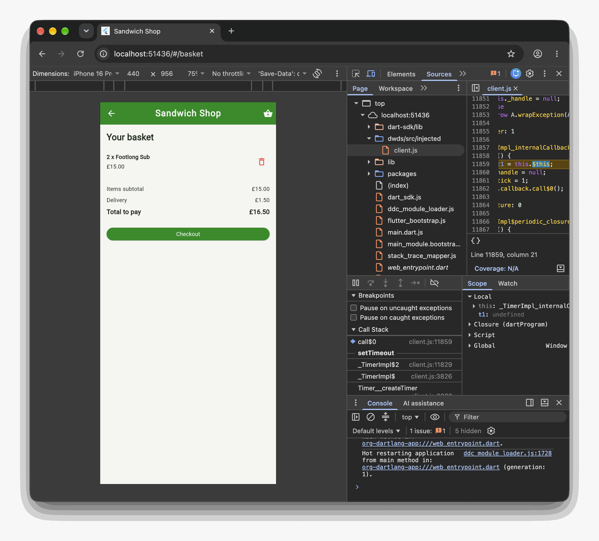

### Widget test the basket screen

Create a new test file named `test/basket_screen_test.dart` to verify that `BasketScreen` properly displays both the empty basket state and populated item cards, and handles item deletion reactively.

Start by importing the required testing utilities, models, repository, and screen:

```dart
import 'package:flutter/material.dart';
import 'package:flutter_test/flutter_test.dart';
import 'package:sandwich_shop/models/cart_item.dart';
import 'package:sandwich_shop/models/sandwich.dart';
import 'package:sandwich_shop/repositories/cart_repository.dart';
import 'package:sandwich_shop/screens/basket_screen.dart';
```

Define a sample `testSandwich` fixture above `main()`, then open `main()` with a `setUp` that resets the singleton cart repository before each test:

```dart
const Sandwich testSandwich = Sandwich(
  id: 'footlong',
  name: 'Footlong Sub',
  description: 'Classic freshly baked sub.',
  price: 10.0,
  imagePath: 'assets/images/footlong.jpeg',
);

void main() {
  setUp(() {
    CartRepository.instance.clear();
  });
```

Now add the first test inside `main()`, verifying that the empty message appears when the cart has no items:

```dart
  testWidgets('BasketScreen displays empty message when basket has no items', (
    WidgetTester tester,
  ) async {
    await tester.pumpWidget(const MaterialApp(home: BasketScreen()));

    expect(find.text('Your basket is empty'), findsOneWidget);
    expect(find.text('Checkout'), findsNothing);
  });
```

This test pumps `BasketScreen` when the repository is empty and asserts that the informational text `Your basket is empty` appears while the **Checkout** button is not rendered.

Next, add a second test inside `main()`, verifying that items render with line totals and that tapping the delete button removes the sandwich. The closing brace of this snippet closes `main()`:

```dart
  testWidgets(
    'BasketScreen renders items and removes item when delete pressed',
    (WidgetTester tester) async {
      const CartItem item = CartItem(
        sandwich: testSandwich,
        quantity: 2,
      );
      CartRepository.instance.addItem(item);

      await tester.pumpWidget(const MaterialApp(home: BasketScreen()));

      expect(find.text('Your basket'), findsOneWidget);
      expect(find.text('2 x Footlong Sub'), findsOneWidget);
      expect(find.text('£20.00'), findsWidgets);
      expect(find.text('Checkout'), findsOneWidget);

      await tester.tap(find.byIcon(Icons.delete_outline));
      await tester.pump();

      expect(find.text('Your basket is empty'), findsOneWidget);
    },
  );
}
```

This test adds a test `CartItem` (2 Footlong Subs) to `CartRepository.instance`, pumps `BasketScreen`, and asserts that the header, item title, computed price (`£20.00`), and **Checkout** button are present. It then simulates tapping the delete icon button (`Icons.delete_outline`), calls `tester.pump()` to trigger the `setState` rebuild, and confirms that the basket transitions to the empty state.

## Building the customer profile settings form

Capturing user input through forms is a fundamental requirement in mobile applications. In this section, we create a customer profile screen that introduces Flutter's core form widgets: `TextField`, `TextEditingController`, and `Switch`.

### Define the user settings model

Create a new file named `lib/models/user_settings.dart` to hold customer preferences.

In there add a `UserSettings` class with four instance variables: `name`, `address`, `email`, and `receiveNewsletter`. Add a constructor with default values for each variable (empty strings for the first three and `false` for the last). Here is what your code should look like:

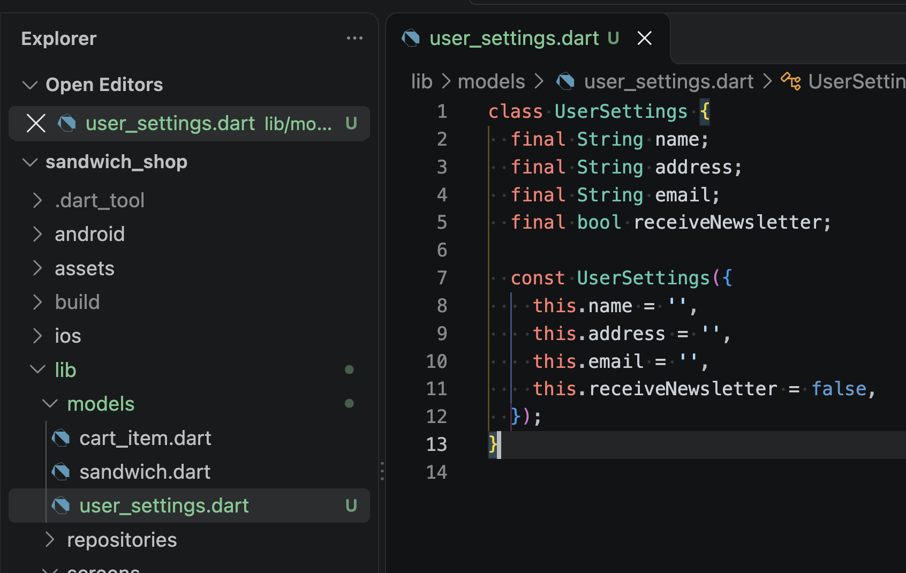

Create a new unit test named `test/user_settings_test.dart` to verify default and configured values. You need to have at least two tests:

1. Verify that a default `UserSettings` instance has empty strings for `name`, `address`, and `email`, and that `receiveNewsletter` is false. You can see some of the constants used in [the `expect` library](https://api.flutter.dev/flutter/package-matcher_expect/#constants) documentation. See for example `isEmpty` and `isFalse`.
2. Verify that a configured `UserSettings` instance stores the values passed to the constructor. For this, create a `UserSettings` instance with non-empty strings for `name`, `address`, and `email`, and set `receiveNewsletter` to true. Then assert that the instance variables match the values you passed in.

Below is what our test file looks like. Yours can be slightly different, but it should test the same functionality.

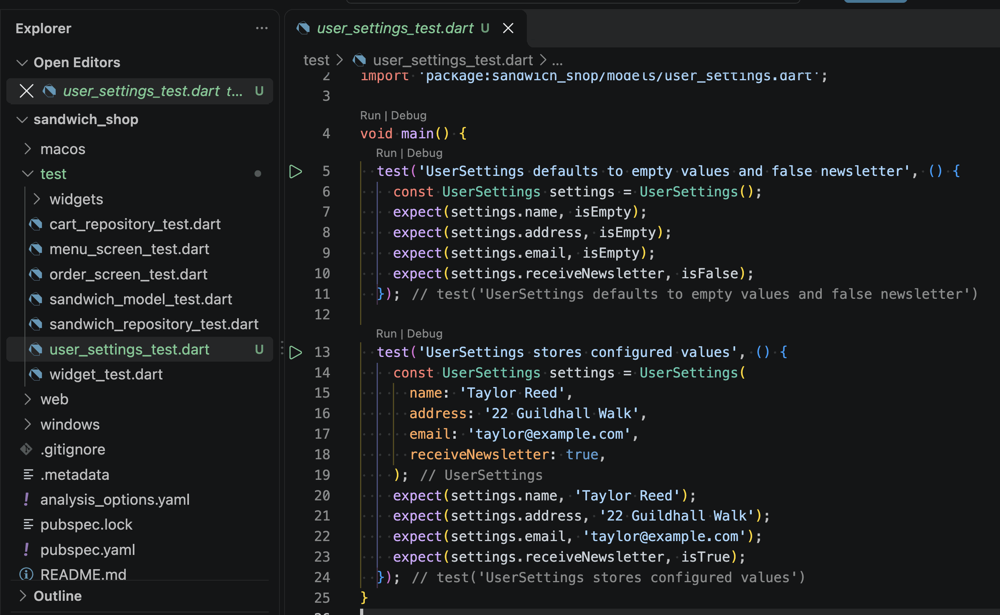

### Text controllers and form lifecycle

In Flutter, reading text from an input requires a `TextEditingController`. Controllers manage the text state and cursor position. Because controllers consume operating system resources, you must dispose of them when the widget is no longer in use to prevent the RAM from filling up with unused objects.

Suppose we have a text controller called `_nameController`. The lifecycle of a controller is tied to the lifecycle of the widget that owns it. Its lifecycle is generally divided into three parts:

1. Declaring fields: `late TextEditingController _nameController;` (`late` tells Dart that the variable will be assigned a value later, before it is used.)
2. Initialisation in `initState()`: `_nameController = TextEditingController();` sets up the controller when the widget is first created.
3. Disposal in `dispose()`: `_nameController.dispose();` frees the memory resources when the widget is removed from the widget tree.

For more details on controller management, see the [TextEditingController documentation](https://api.flutter.dev/flutter/widgets/TextEditingController-class.html).

### Add text fields and the switch toggle

Create a new file named `lib/screens/settings_screen.dart`.

First, define a `StatefulWidget` called `SettingsScreen` that will hold the customer profile form. Add the following imports at the top of the file too:

```dart
import 'package:flutter/material.dart';
import 'package:sandwich_shop/constants.dart';
import 'package:sandwich_shop/models/user_settings.dart';
import 'package:sandwich_shop/widgets/basket_button.dart';
import 'package:sandwich_shop/widgets/primary_button.dart';

class SettingsScreen extends StatefulWidget {
  const SettingsScreen({super.key});

  @override
  State<SettingsScreen> createState() {
    return _SettingsScreenState();
  }
}

class _SettingsScreenState extends State<SettingsScreen> {
  @override
  Widget build(BuildContext context) {
    throw UnimplementedError();
  }
}
```

`SettingsScreen` is a `StatefulWidget` because it will contain a form with which the user can interact. The `build` method currently throws an `UnimplementedError` because we will implement it later.

Now declare the text controllers, newsletter toggle flag, and confirmation string inside `_SettingsScreenState` (before `build`):

```dart
  late TextEditingController _nameController;
  late TextEditingController _addressController;
  late TextEditingController _emailController;
  bool _receiveNewsletter = false;
  String _confirmationMessage = '';
```

We declare three `late TextEditingController` variables to manage the text content for the customer's name, delivery address, and email. As mentioned before, the `late` keyword tells Dart that these fields will be initialised before they are read.

Next, override `initState()` to initialise each controller:

```dart
  @override
  void initState() {
    super.initState();
    _nameController = TextEditingController();
    _addressController = TextEditingController();
    _emailController = TextEditingController();
  }
```

In `initState()`, we create a fresh `TextEditingController` for each field when the widget state is first created.

Here is what your changes should look like in VS Code:

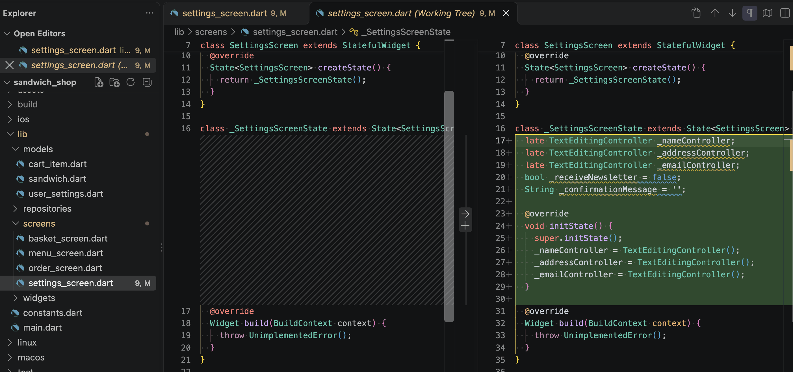

Now override `dispose()` to release the controllers:

```dart
  @override
  void dispose() {
    _nameController.dispose();
    _addressController.dispose();
    _emailController.dispose();
    super.dispose();
  }
```

Calling `.dispose()` on each controller frees the operating system text-editing resources before calling `super.dispose()`. (Recall that we use `super` to invoke the parent class's, `State`, implementation of a method.)

Note that all of these methods are part of the `State` class (hence we are overriding them). For more details on the `State` class, see the [State documentation](https://api.flutter.dev/flutter/widgets/State-class.html). You could also read the what each of these methods does if you hover your mouse over the `State` class as shown below:

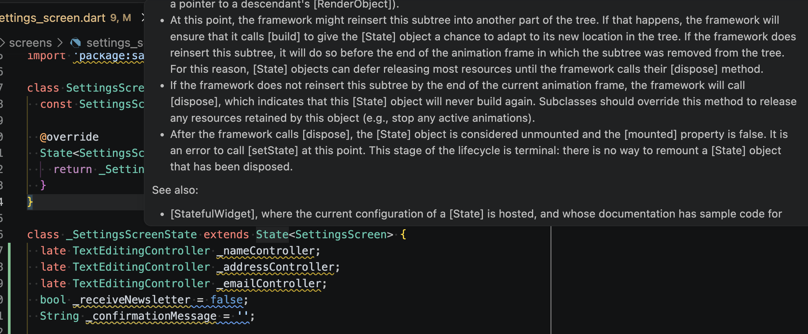

Next, add `_saveSettings` to extract the input values and update state (this method is not an override, so we don't use the `@override` annotation):

```dart
  void _saveSettings() {
    final String name = _nameController.text.trim();
    final String address = _addressController.text.trim();
    final String email = _emailController.text.trim();

    final UserSettings settings = UserSettings(
      name: name,
      address: address,
      email: email,
      receiveNewsletter: _receiveNewsletter,
    );

    setState(() {
      _confirmationMessage = 'Settings saved for ${settings.name}';
    });
  }
```

The `_saveSettings` method reads values from each controller with `.text.trim()`, which removes unwanted leading and trailing whitespace. It constructs a `UserSettings` instance and calls `setState()` to update `_confirmationMessage`, triggering a rebuild so the confirmation appears.

### Wrap the form in a scroll view

On mobile devices, tapping any text field slides the software keyboard up from the bottom of the display, reducing the available screen height and causing the same vertical overflow we handled on the [order screen](#add-items-to-the-basket). As there, we wrap the form `Column` in a `SingleChildScrollView` so the entire page scrolls smoothly whenever the keyboard appears, letting users reach every input field and tap **Save Settings**.

Start implementing `build` inside `_SettingsScreenState` with the `Scaffold` and `SingleChildScrollView`:

```dart
  @override
  Widget build(BuildContext context) {
    return Scaffold(
        appBar: AppBar(
          title: const Text(appTitle, style: shopHeaderStyle),
          actions: const [BasketButton()],
        ),
        body: SingleChildScrollView(
            padding: const EdgeInsets.all(16.0),
            child: Column(
              crossAxisAlignment: CrossAxisAlignment.start,
              children: [
                const Text(
                  'Customer Profile',
                  style: TextStyle(
                    fontSize: 22,
                    fontWeight: FontWeight.bold
                  ),
                ),
                const SizedBox(height: 16),
              ]
            )
        )
    );
  }
```

The `Scaffold` displays the app bar with `BasketButton`. Inside the body, `SingleChildScrollView` wraps a left-aligned `Column` with some space and a title.

Here is what your changes should look like in VS Code:

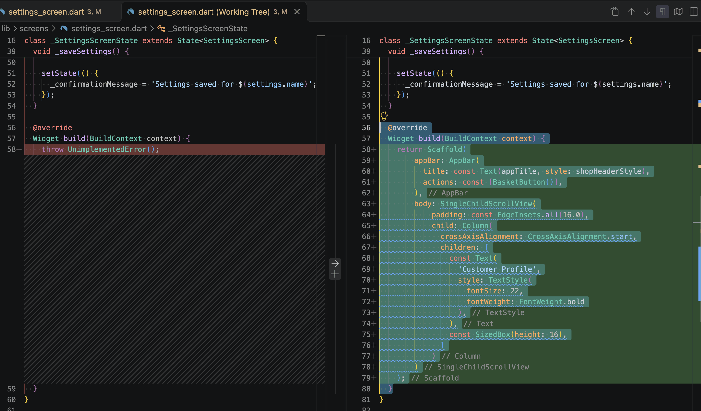

Now add the full name `TextField` inside the children of the `Column`:

```dart
            TextField(
              controller: _nameController,
              decoration: const InputDecoration(
                border: OutlineInputBorder(),
                labelText: 'Full name',
                hintText: 'Enter your name',
              ),
            ),
            const SizedBox(height: 16),
```

The `controller: _nameController` links the input to our name controller. `InputDecoration` lets us customise the text field's appearance. The `border: OutlineInputBorder()` option for example provides an outline border around the box, a floating label `'Full name'`, and placeholder hint text `'Enter your name'`.

Recall that you can browse all of these options by hovering your mouse over `InputDecoration` as shown below:

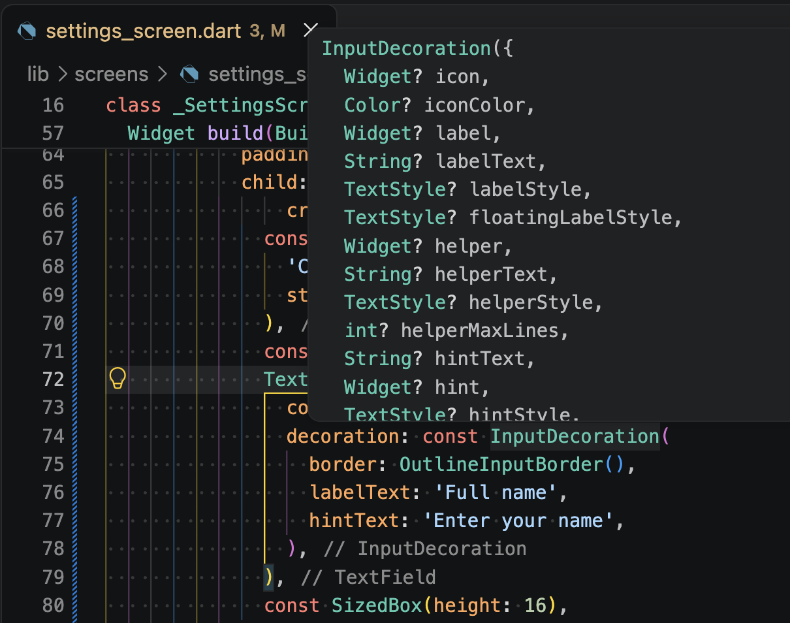

Next, add the delivery address field:

```dart
            TextField(
              controller: _addressController,
              maxLines: 3,
              decoration: const InputDecoration(
                border: OutlineInputBorder(),
                labelText: 'Delivery address',
                hintText: 'Enter delivery address',
              ),
            ),
            const SizedBox(height: 16),
```

Setting `maxLines: 3` allows the input box to expand vertically to accommodate postal addresses that span multiple lines.

Next, add the email address field in the children of the `Column`:

```dart
            TextField(
              controller: _emailController,
              keyboardType: TextInputType.emailAddress,
              decoration: const InputDecoration(
                border: OutlineInputBorder(),
                labelText: 'Email address',
                hintText: 'Enter your email',
              ),
            ),
            const SizedBox(height: 16),
```

The `keyboardType: TextInputType.emailAddress` parameter configures the mobile virtual keyboard to show the `@` symbol.

Now add the newsletter toggle switch in the children of the `Column`:

```dart
            Row(
              children: [
                const Expanded(
                  child: Text('Receive newsletter and offers'),
                ),
                Switch(
                  value: _receiveNewsletter,
                  onChanged: (bool value) {
                    setState(() {
                      _receiveNewsletter = value;
                    });
                  },
                ),
              ],
            ),
            const SizedBox(height: 20),
```

The `Row` places the description text on the left and the `Switch` on the right. Wrapping the text in `Expanded` makes it take up the available horizontal space. When toggled, `onChanged` receives the new boolean value and updates `_receiveNewsletter` inside `setState()`. For more details on the toggle control, see the [Switch documentation](https://api.flutter.dev/flutter/material/Switch-class.html).

Finally, add the submit button and conditional feedback message:

```dart
            SizedBox(
              width: double.infinity,
              child: PrimaryButton(
                label: 'Save Settings',
                onPressed: _saveSettings,
              ),
            ),
            if (_confirmationMessage.isNotEmpty) ...[
              const SizedBox(height: 12),
              Text(
                _confirmationMessage,
                style: const TextStyle(fontWeight: FontWeight.bold),
              ),
            ],
```

Wrapping `PrimaryButton` in `SizedBox(width: double.infinity)` stretches the button across the entire width of the form. When tapped, it invokes `_saveSettings`.

The final part uses a syntax that you may not have seen before: `...` is the spread operator, which allows you to insert multiple widgets into a list. Suppose we have a list `List<int> numbers = [1, 2, 3]` and we want to add a few more numbers at the end of it, we can use `numbers = [...numbers, 4, 5]` to create a new list `[1, 2, 3, 4, 5]`.

In our case, we are using `...` to insert more children into the `Column` widget. The `if (_confirmationMessage.isNotEmpty)` condition checks whether the confirmation message is not empty. If it is not empty, we use the spread operator to add a `SizedBox` for spacing and a `Text` widget to display the confirmation message. If the confirmation message is empty, nothing is added to the `Column`.

You can see the full code for `lib/screens/settings_screen.dart` [at branch 5 of the Sandwich Shop repository](https://github.com/manighahrmani/sandwich_shop/blob/5/lib/screens/settings_screen.dart).

### Create the settings button and register the route

Create a reusable navigation button in `lib/widgets/settings_button.dart` to open the profile screen.

Start with the widget shell and icon button:

```dart
import 'package:flutter/material.dart';

class SettingsButton extends StatelessWidget {
  const SettingsButton({super.key});

  @override
  Widget build(BuildContext context) {
    return IconButton(
        icon: const Icon(Icons.person_outline),
        tooltip: 'Settings',
        onPressed: () {});
  }
}
```

`SettingsButton` is a `StatelessWidget` that displays a person outline icon using `IconButton`.

Now add the navigation logic inside `onPressed`'s curly braces:

```dart
        final ModalRoute<dynamic>? modalRoute = ModalRoute.of(context);
        final String currentRoute;
        if (modalRoute != null) {
          final RouteSettings routeSettings = modalRoute.settings;
          final String? name = routeSettings.name;
          if (name != null) {
            currentRoute = name;
          } else {
            currentRoute = '';
          }
        } else {
          currentRoute = '';
        }

        if (currentRoute != '/settings') {
          Navigator.pushNamed(context, '/settings');
        }
```

The callback inspects `ModalRoute.of(context)` to check the name of the current screen. If the user is not already viewing the settings screen, it calls `Navigator.pushNamed(context, '/settings')`. This prevents stacking duplicate copies of the settings screen when the user taps the icon repeatedly.

This is our final `lib/widgets/settings_button.dart`:

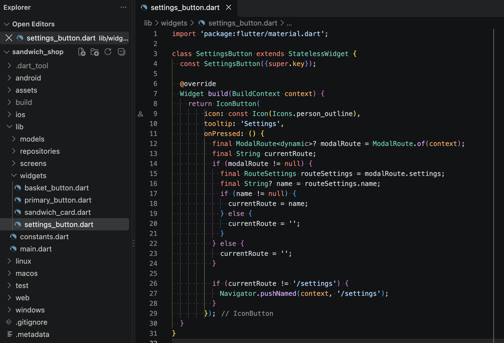

Open `lib/main.dart` and register the `'/settings'` named route:

```dart
import 'package:sandwich_shop/screens/settings_screen.dart';
```

Add the route entry to `routes`:

```dart
        '/settings': (BuildContext context) {
          return const SettingsScreen();
        },
```

See below the changes:

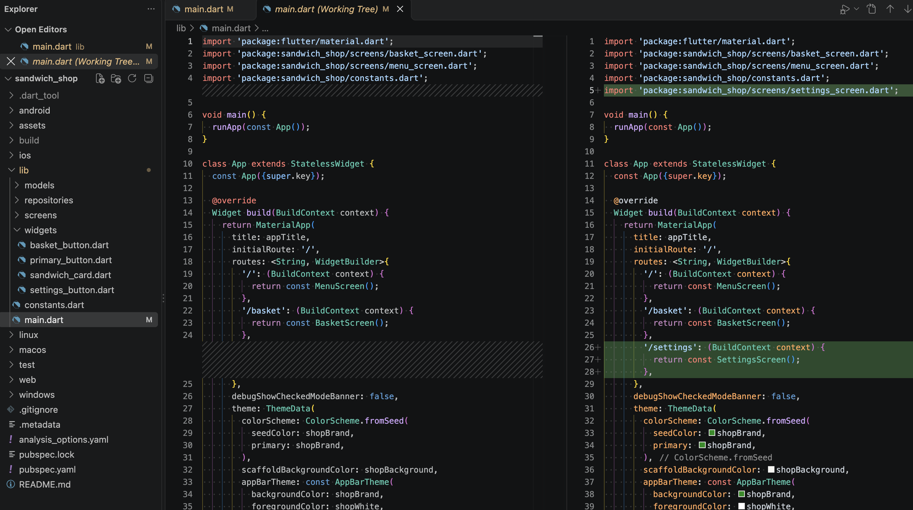

Now open `lib/screens/menu_screen.dart`, import `settings_button.dart`, and add `SettingsButton` to the app bar:

```dart
import 'package:sandwich_shop/widgets/settings_button.dart';
```

Add `SettingsButton` to the front of the `actions` list so the settings icon appears before the basket icon:

```dart
      appBar: AppBar(
        title: const Text(appTitle, style: shopHeaderStyle),
        actions: const [SettingsButton(), BasketButton()],
      ),
```

Again, take a look at the changes:

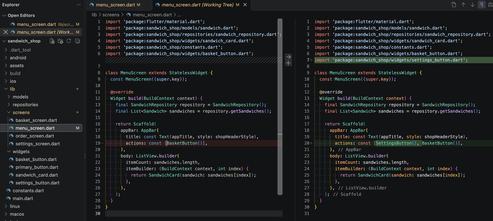

Next, open `test/menu_screen_test.dart` and update the test suite to verify that the menu screen includes the settings button and navigates to the customer profile screen.

Here is what you need to change in the first test case to include the settings button:

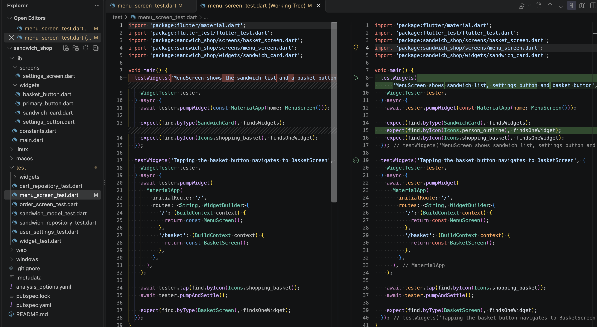

Next import `settings_screen.dart` at the top of the test file and add a test case to verify navigation to the settings screen. We suggest something like this:

```dart
  testWidgets('Tapping the settings button navigates to SettingsScreen', (
    WidgetTester tester,
  ) async {
    await tester.pumpWidget(
      MaterialApp(
        initialRoute: '/',
        routes: <String, WidgetBuilder>{
          '/': (BuildContext context) {
            return const MenuScreen();
          },
          '/settings': (BuildContext context) {
            return const SettingsScreen();
          },
        },
      ),
    );

    await tester.tap(find.byIcon(Icons.person_outline));
    await tester.pumpAndSettle();

    expect(find.byType(SettingsScreen), findsOneWidget);
  });
```

### Save settings and provide feedback

It's time to run the application. Tap the person icon in the top right to open the customer profile. Enter your name, delivery address, and email, toggle the newsletter switch, and click **Save Settings**. The application displays the confirmation message below the button.

This is what ours looks like:

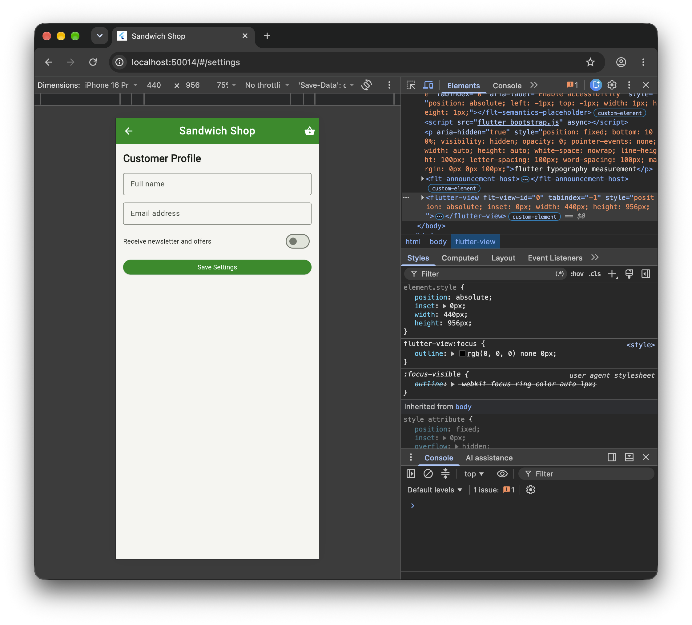

### Widget test the settings screen

Before we forget, we should also add widget tests for the settings screen to ensure that form interactions and state updates work correctly.

Create a new test file named `test/settings_screen_test.dart` to verify form interactions and state updates on `SettingsScreen`.

Start by importing Flutter's material library, test package, and the settings screen, with an empty `main()`:

```dart
import 'package:flutter/material.dart';
import 'package:flutter_test/flutter_test.dart';
import 'package:sandwich_shop/screens/settings_screen.dart';

void main() {}
```

Add the following test inside `main()`, verifying that all form fields, the switch toggle, and the save button render on screen:

```dart
  testWidgets('SettingsScreen displays form fields and switches', (
    WidgetTester tester,
  ) async {
    await tester.pumpWidget(const MaterialApp(home: SettingsScreen()));

    expect(find.text('Customer Profile'), findsOneWidget);
    expect(find.byType(TextField), findsNWidgets(3));
    expect(find.byType(Switch), findsOneWidget);
    expect(find.text('Save Settings'), findsOneWidget);
  });
```

This test renders `SettingsScreen` and verifies that the `Customer Profile` title, three `TextField` inputs (name, address, and email), one `Switch` toggle, and the **Save Settings** button are all rendered.

Next, add a second test inside `main()` that enters form data, toggles the switch, and verifies state updates on save:

```dart
  testWidgets('Toggling switch and saving settings updates state', (
    WidgetTester tester,
  ) async {
    await tester.pumpWidget(const MaterialApp(home: SettingsScreen()));

    final Finder nameField = find.widgetWithText(TextField, 'Full name');
    final Finder addressField =
        find.widgetWithText(TextField, 'Delivery address');
    final Finder emailField = find.widgetWithText(TextField, 'Email address');

    await tester.enterText(nameField, 'Alex Smith');
    await tester.enterText(addressField, '10 Elm Road, Portsmouth');
    await tester.enterText(emailField, 'alex@example.com');

    final Finder switchFinder = find.byType(Switch);
    expect(tester.widget<Switch>(switchFinder).value, isFalse);
    await tester.tap(switchFinder);
    await tester.pump();
    expect(tester.widget<Switch>(switchFinder).value, isTrue);

    await tester.tap(find.text('Save Settings'));
    await tester.pump();

    expect(find.text('Settings saved for Alex Smith'), findsOneWidget);
  });
```

This test locates the individual fields using `find.widgetWithText(TextField, ...)` and enters text using `tester.enterText`. It verifies that the newsletter switch begins as `false`, taps it to toggle it to `true`, and taps **Save Settings** before asserting that the confirmation text `Settings saved for Alex Smith` appears below the button.

With every screen in place, finish with the whole-repository run from [Worksheet 4](./worksheet-4.md#running-test-suites-and-static-analysis) to confirm your widgets, navigation, and settings form all operate together:

```bash
flutter test
```

## Exercises

As in the previous worksheets, these exercises apply to your Southsea Cinema coursework. They prepare you for the user interface side of Demo 3, where you add a themed look, named-route navigation, a ticket basket, and a customer profile form to your cinema application. For the full coursework specification and grading criteria, see the [Southsea Cinema coursework brief](https://portdotacdotuk-my.sharepoint.com/:w:/g/personal/mani_ghahremani_port_ac_uk/IQDtIJB3bM7gQ4p03eLUngyyAd7JuhjhHuNA1l0H-qCy3Jw).

In [Worksheet 3](./worksheet-3.md#exercises) and [Worksheet 4](./worksheet-4.md#exercises) you built a browsable home page of film cards backed by a repository and automated tests. These exercises grow that work into a small multi-page booking flow.

1. The starter already defines the app title, cinema colours and header style in `lib/constants.dart`. See the [Sandwich Shop example for configuring the theme](#configure-the-subway-theme) and use the same approach to set up one shared app-bar style so that every page uses the same background colour, icon colour, title style and elevation. In `lib/main.dart`, add this `appBarTheme` to the existing `ThemeData`:

    ```dart
    appBarTheme: const AppBarTheme(
      backgroundColor: cinemaSurface,
      iconTheme: IconThemeData(color: cinemaBrand),
      titleTextStyle: cinemaHeaderStyle,
      elevation: 0,
    ),
    ```

    Then, in `lib/views/home_view.dart` and `lib/views/movie_listing.dart`, remove the per-page app-bar styling and keep each title. See the [Sandwich Shop menu app bar example](#add-the-basket-button-to-the-menu-app-bar) for how the shared theme supplies the styling consistently across all pages.

    Run the app and check that the app bars on its pages keep the same appearance. The screenshots below show the top of our app on different pages. Notice that all of them look identical in style (and functionality of the `NavBar` is preserved across all pages).

    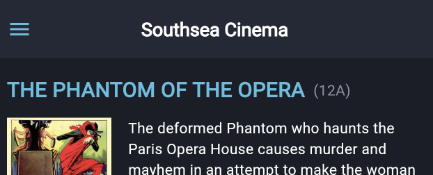

    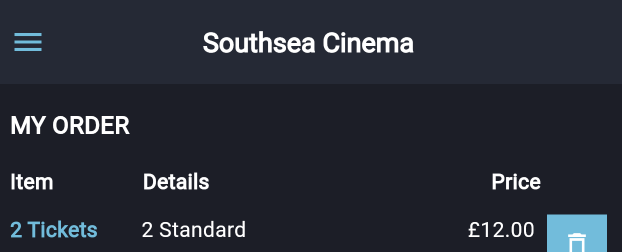

2. The live Southsea Cinema site uses squared buttons with no rounded corners, so your coursework must match it. Create a reusable button widget in `lib/widgets/`. See [Build the primary button](#build-the-primary-button) for an example. Give it a `label` and an `onPressed` callback, and style it with `ElevatedButton.styleFrom` using your brand colour and a squared shape:

    ```dart
    shape: const RoundedRectangleBorder(
      borderRadius: BorderRadius.zero,
    ),
    ```

    Replace the booking and all other suitable buttons on your app with this. Write a widget test for it in `test/widgets/`. See [Widget test the primary button](#widget-test-the-primary-button) for an example that checks the label appears and the callback runs when tapped.

    The screenshots below show the booking button on the home page and the add-to-order button on the movie listing page. Notice that they both have the same style.

    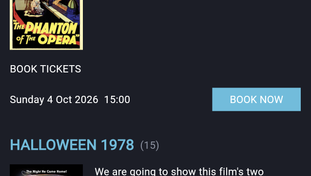

    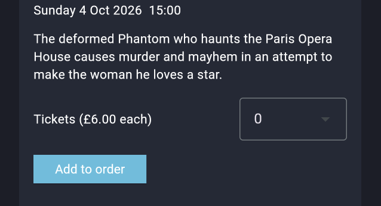

3. See the [Register named routes](#register-named-routes) section of this worksheet. Add the `'/basket'` and `'/settings'` named routes in `lib/main.dart`.

    Then add **My Basket** and **My Settings** items to `NavDrawer` in `lib/widgets/nav_drawer.dart`, similar to the existing **Home** item in the drawer. Check that each item navigates to the correct route. For example, clicking **My Basket** should navigate to `http://127.0.0.1:8765/#/basket`.

    The screenshot below shows us what our opened drawer looks like:

    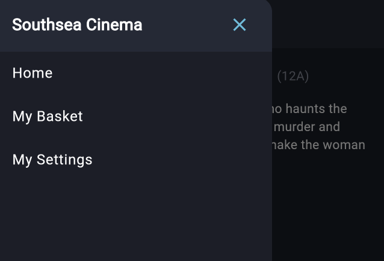

4. The user should be able to add tickets to their basket. Develop and test a basket repository for managing the basket contents similar to how in [Holding an order in a basket](#holding-an-order-in-a-basket), we build and test a repository for the Sandwich Shop order. It should support adding, removing and clearing tickets, and provide the basket contents and total.

5. Use your basket repository from the previous exercise to build and test a basket page that displays and manages the customer's tickets. We build a similar screen for the Sandwich Shop in [Building the basket screen](#building-the-basket-screen).

    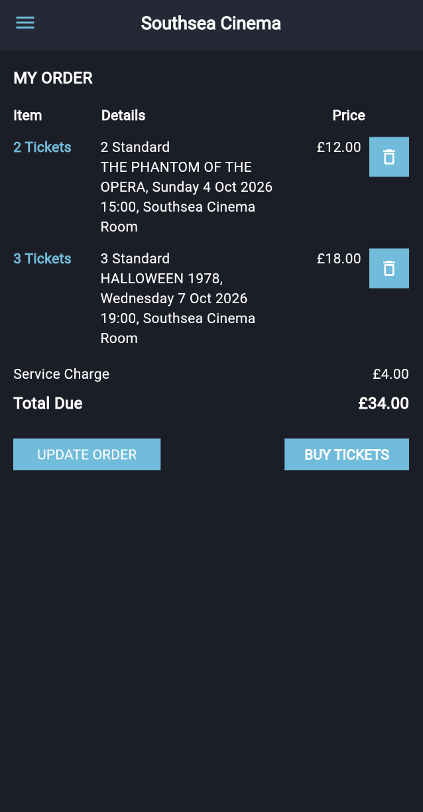

6. Build and test an editable customer profile form on your `'/settings'` page, like the one we create in [Building the customer profile settings form](#building-the-customer-profile-settings-form).

    Here is an example of the customer profile form on the settings page:

    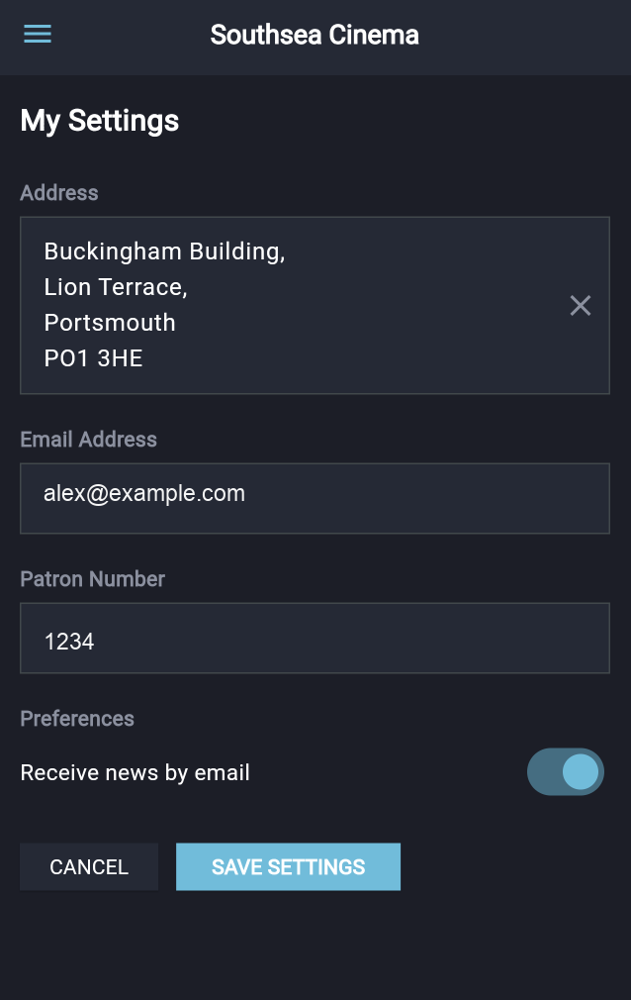
