# Worksheet 5 — Navigation, state and forms

## Table of contents

- [Getting help](#getting-help)
- [Getting started](#getting-started)
  - [Continue from Worksheet 4](#continue-from-worksheet-4)
  - [Clone the Sandwich Shop repository](#clone-the-sandwich-shop-repository)
  - [Switch to branch 4](#switch-to-branch-4)
- [Shared constants and the Subway theme](#shared-constants-and-the-subway-theme)
  - [Define the shared constants](#define-the-shared-constants)
  - [Import constants in the main app](#import-constants-in-the-main-app)
  - [Configure the Subway theme](#configure-the-subway-theme)
  - [Hide the debug banner](#hide-the-debug-banner)
- [Reusable widgets and navigation](#reusable-widgets-and-navigation)
  - [Build the primary button](#build-the-primary-button)
  - [Widget test the primary button](#widget-test-the-primary-button)
  - [Use the primary button in the sandwich card](#use-the-primary-button-in-the-sandwich-card)
  - [Create the basket button](#create-the-basket-button)
  - [Create the placeholder basket screen](#create-the-placeholder-basket-screen)
  - [Register named routes](#register-named-routes)
  - [Add the basket button to the menu app bar](#add-the-basket-button-to-the-menu-app-bar)
  - [Widget test the menu screen](#widget-test-the-menu-screen)
  - [Update the app smoke tests](#update-the-app-smoke-tests)
- [Holding an order in a basket](#holding-an-order-in-a-basket)
  - [Define the cart item model](#define-the-cart-item-model)
  - [Create the cart repository singleton](#create-the-cart-repository-singleton)
  - [Unit test the cart repository](#unit-test-the-cart-repository)
  - [Commit your changes (3)](#commit-your-changes-3)
- [Building the order screen](#building-the-order-screen)
  - [Recap the order screen state](#recap-the-order-screen-state)
  - [Update the order screen app bar](#update-the-order-screen-app-bar)
  - [Add items to the basket](#add-items-to-the-basket)
  - [Widget test the order screen](#widget-test-the-order-screen)
  - [Commit your changes (4)](#commit-your-changes-4)
- [Building the basket screen](#building-the-basket-screen)
  - [Convert BasketScreen to a stateful widget](#convert-basketscreen-to-a-stateful-widget)
  - [Build the empty basket state](#build-the-empty-basket-state)
  - [Build the basket item card](#build-the-basket-item-card)
  - [Build the basket items list and checkout button](#build-the-basket-items-list-and-checkout-button)
  - [Assemble the basket screen scaffold](#assemble-the-basket-screen-scaffold)
  - [Widget test the basket screen](#widget-test-the-basket-screen)
  - [Commit your changes (5)](#commit-your-changes-5)
- [Building the customer profile settings form](#building-the-customer-profile-settings-form)
  - [Define the user settings model](#define-the-user-settings-model)
  - [Text controllers and form lifecycle](#text-controllers-and-form-lifecycle)
  - [Add text fields and the switch toggle](#add-text-fields-and-the-switch-toggle)
  - [Wrap the form in a scroll view](#wrap-the-form-in-a-scroll-view)
  - [Create the settings button and register the route](#create-the-settings-button-and-register-the-route)
  - [Save settings and provide feedback](#save-settings-and-provide-feedback)
  - [Widget test the settings screen](#widget-test-the-settings-screen)
  - [Commit your changes (6)](#commit-your-changes-6)
- [Loading the menu from JSON](#loading-the-menu-from-json)
  - [Create the JSON asset file](#create-the-json-asset-file)
  - [Register the asset in pubspec](#register-the-asset-in-pubspec)
  - [Add JSON serialisation to the sandwich model](#add-json-serialisation-to-the-sandwich-model)
  - [Unit test JSON serialisation](#unit-test-json-serialisation)
  - [Load JSON data in the repository](#load-json-data-in-the-repository)
  - [Commit your changes (7)](#commit-your-changes-7)
- [Exercises](#exercises)

## Getting help

To get support with this worksheet, follow the [Discord guide](https://portdotacdotuk-my.sharepoint.com/:p:/g/personal/mani_ghahremani_port_ac_uk/IQCMJP6IiR_bQoYUMdXJSRDYAWnajEALZYEXFZyrJkHS1QU) and post your questions there. You can also attend your timetabled practical sessions and ask a member of teaching staff for guidance.

## Getting started

### Continue from Worksheet 4

You can continue directly with the Sandwich Shop project you completed in [Worksheet 4](./worksheet-4.md). Open the project folder in VS Code with **File > Open Folder**. You do not need to clone the repository again if your working tree is clean.

### Clone the Sandwich Shop repository

If you need a fresh copy of the project, open a terminal and move to a folder that is not synchronised to cloud storage, such as your `Downloads` folder, then clone the repository:

```bash
cd ~/Downloads
git clone https://github.com/manighahrmani/sandwich_shop.git
cd sandwich_shop
```

Open the cloned folder in VS Code with **File > Open Folder**.

### Switch to branch 4

Switch to branch `4` so your project matches the state after completing Worksheet 4:

```bash
git checkout 4
```

Run `flutter test` in your terminal to confirm that all existing tests pass before continuing.

## Shared constants and the Subway theme

Values such as the app title and brand colours appear across multiple screens. Rather than repeating them in each file, we keep them in a dedicated constants file. This gives us a single source of truth when modifying the theme.

### Define the shared constants

Create a new file named `lib/constants.dart`. Start by importing the Material library and declaring a top-level constant string for the app title:

```dart
import 'package:flutter/material.dart';

const String appTitle = 'Sandwich Shop';
```

Your code should look like this in VS Code:

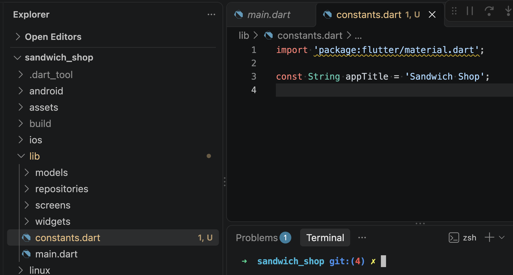

The `import 'package:flutter/material.dart';` statement brings in the Material Design types, including `Color` and `TextStyle`. Declaring `appTitle` as a top-level `const String` means any screen in our project can import `constants.dart` and use it.

Next, define the brand colour palette below the title:

```dart
const Color shopBrand = Color(0xFF008C15);
const Color shopWhite = Colors.white;
const Color shopBackground = Color(0xFFF5F5F0);
const Color shopText = Color(0xFF1B2B1B);
```

Each colour is declared as a `const Color`. In Flutter, the `Color(0xFF008C15)` constructor creates a colour from an 8-digit hexadecimal integer. The first two digits (`FF`) set full opacity, and the remaining six digits represent the red, green, and blue colour channels. Here `shopBrand` is a green colour inspired by Subway, `shopBackground` provides a soft off-white background for each screen, and `shopText` gives high-contrast dark green text. For more information on colour constructors, see the [Flutter Color documentation](https://api.flutter.dev/flutter/dart-ui/Color-class.html).

Finally, add two reusable text styles to `lib/constants.dart`:

```dart
const TextStyle shopHeaderStyle = TextStyle(
  fontWeight: FontWeight.bold,
  letterSpacing: 1.1,
);

const TextStyle shopSectionTitleStyle = TextStyle(
  fontSize: 22,
  fontWeight: FontWeight.bold,
  color: shopText,
);
```

A `TextStyle` describes text formatting such as font size and weight. The `fontWeight: FontWeight.bold` property bolds the text, `letterSpacing` slightly expands spacing between letters, and `fontSize` specifies text height in logical pixels. We will use `shopHeaderStyle` for app bar titles and `shopSectionTitleStyle` for screen section headings. For more information, see the [Flutter TextStyle documentation](https://api.flutter.dev/flutter/painting/TextStyle-class.html).

### Import constants in the main app

Now open `lib/main.dart` and import our new constants file at the top of `lib/main.dart` with `import 'package:sandwich_shop/constants.dart'`.

Then update the `title` property of `MaterialApp` to use `appTitle` instead of the hardcoded string. Because `appTitle` is a top-level constant, `MaterialApp` can read it directly.

See below where we are showing the changes to our `lib/main.dart` file in VS Code:

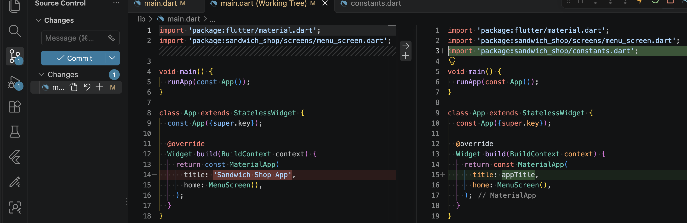

### Configure the Subway theme

Next, apply our custom brand colours to the whole application using `ThemeData`. Remove the `const` keyword before `MaterialApp` and add the `theme` property:

```dart
      theme: ThemeData(
        colorScheme: ColorScheme.fromSeed(
          seedColor: shopBrand,
          primary: shopBrand,
        ),
        scaffoldBackgroundColor: shopBackground,
        appBarTheme: const AppBarTheme(
          backgroundColor: shopBrand,
          foregroundColor: shopWhite,
          elevation: 0,
        ),
      ),
```

The `theme` property accepts a `ThemeData` object containing global styles and colour tokens. `ColorScheme.fromSeed` generates a palette around a single seed colour, which we set to `shopBrand`. The `scaffoldBackgroundColor` sets the default background colour for every `Scaffold` in the app.

The `appBarTheme` styles all app bars with our brand green background, white foreground text and icons, and removes the drop shadow with `elevation: 0`. For more details, view the [ThemeData documentation](https://api.flutter.dev/flutter/material/ThemeData-class.html) and [ColorScheme documentation](https://api.flutter.dev/flutter/material/ColorScheme-class.html).

Here is a summary of our changes:

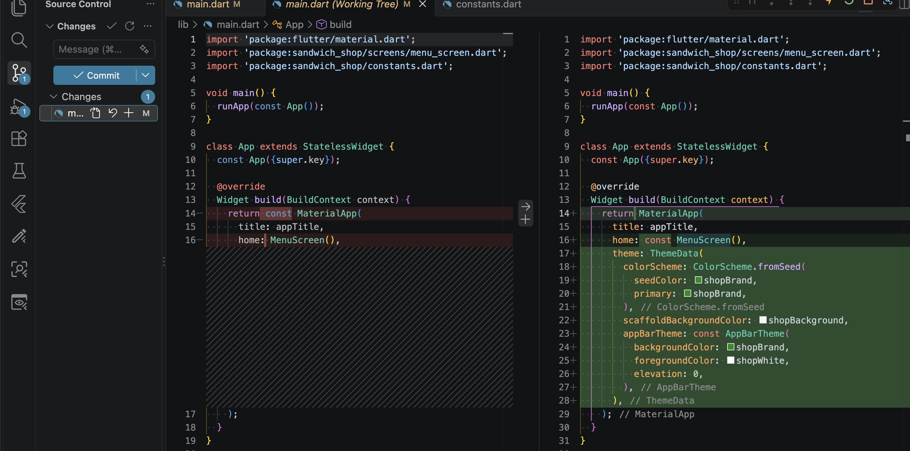

Run the application with `flutter run` in your terminal. Your screen should look like this, with the new green app bar and the debug banner in the corner:

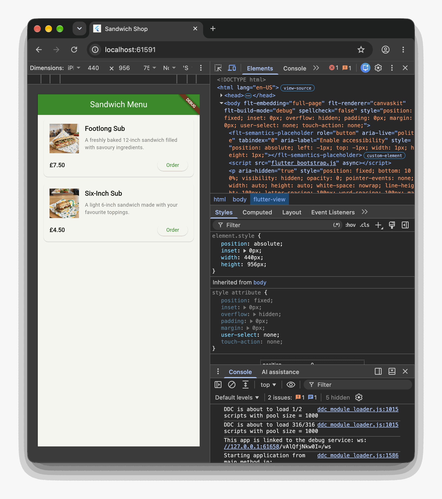

### Hide the debug banner

Notice the small red or grey ribbon in the top-right corner that reads "DEBUG". Flutter displays this ribbon to indicate that the application is running in an unoptimised debug build. It's harmless but you can hide it during development to preview how the final app looks.

Add `debugShowCheckedModeBanner: false` directly inside `MaterialApp` as shown below:

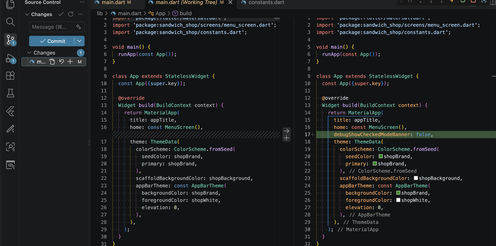

Save the file and trigger hot reload. The debug ribbon disappears from the top-right corner:

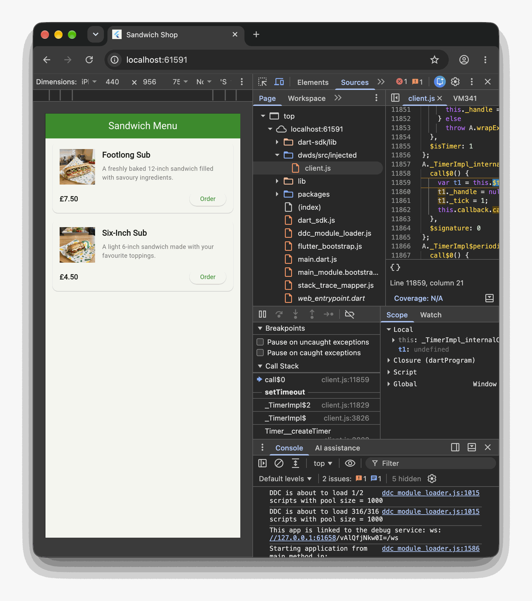

## Reusable widgets and navigation

Before adding form inputs or cart state, we construct reusable navigation components and connect our screens. Building interface shells first lets you verify movement through the app before writing business logic.

### Build the primary button

Let's suppose we need a button that gets styled consistently across the app, in multiple screens. Rather than repeating identical `ElevatedButton` styling in multiple files, it's best to extract it into a standalone widget.

Create a new file named `lib/widgets/primary_button.dart` and add the following code inside it:

```dart
import 'package:flutter/material.dart';
import 'package:sandwich_shop/constants.dart';

class PrimaryButton extends StatelessWidget {
  final String label;
  final VoidCallback onPressed;

  const PrimaryButton({
    super.key,
    required this.label,
    required this.onPressed,
  });

  @override
  Widget build(BuildContext context) {
    return ElevatedButton(
      style: ElevatedButton.styleFrom(
        backgroundColor: shopBrand,
        foregroundColor: shopWhite,
      ),
      onPressed: onPressed,
      child: Text(label),
    );
  }
}
```

`PrimaryButton` is a `StatelessWidget` with two properties: `label` for the button caption, and `onPressed` for the tap callback. The type `VoidCallback` represents a function that takes no arguments and returns nothing. `ElevatedButton.styleFrom` configures the green background and white text from our constants file.

Here is the documentation page on [ElevatedButton](https://api.flutter.dev/flutter/material/ElevatedButton-class.html). But there are other kinds of buttons in Flutter, such as `TextButton` and `OutlinedButton`. For more information on them, feel free to check out the [Flutter buttons documentation](https://docs.flutter.dev/development/ui/widgets/material#buttons).

We will use `PrimaryButton` in multiple screens later but first we need to write tests for it.

### Widget test the primary button

Every (reusable) widget should be verified with automated tests. Create a new test file named `test/widgets/primary_button_test.dart`. Notice that the name of the subfolder in `test` folder matches the name of the folder in `lib`. This is a common convention for organising widget tests (so here, we have a `test/widgets` folder for testing widgets in `lib/widgets`).

Add the following code to `test/widgets/primary_button_test.dart`:

```dart
import 'package:flutter/material.dart';
import 'package:flutter_test/flutter_test.dart';
import 'package:sandwich_shop/widgets/primary_button.dart';

void main() {
  testWidgets('PrimaryButton renders its label', (WidgetTester tester) async {
    await tester.pumpWidget(
      MaterialApp(
        home: Scaffold(
          body: PrimaryButton(
            label: 'Order',
            onPressed: () {},
          ),
        ),
      ),
    );

    expect(find.text('Order'), findsOneWidget);
  });

  testWidgets('PrimaryButton invokes onPressed when tapped',
      (WidgetTester tester) async {
    bool wasPressed = false;

    await tester.pumpWidget(
      MaterialApp(
        home: Scaffold(
          body: PrimaryButton(
            label: 'Order',
            onPressed: () {
              wasPressed = true;
            },
          ),
        ),
      ),
    );

    await tester.tap(find.text('Order'));
    await tester.pump();

    expect(wasPressed, isTrue);
  });
}
```

The first test confirms that the button renders the text passed to its label. The second test passes a callback that flips a boolean flag, simulates a user tap with `tester.tap`, and asserts that the callback executed.

Feel free to add a `group` to organise these tests. You are also encouraged to organise the rest of the files in `test` folder in a similar way, for example, you can create a `test/screens` folder for testing screens in `lib/screens` and `test/models` folder for testing models in `lib/models`.

Run this test using the play button in VS Code or the following command in your terminal:

```bash
flutter test test/widgets/primary_button_test.dart
```

### Use the primary button in the sandwich card

Now update `lib/widgets/sandwich_card.dart` so each menu item uses our new button. Import `primary_button.dart` at the top of the file:

```dart
import 'package:sandwich_shop/widgets/primary_button.dart';
```

Then locate the `ElevatedButton` inside the card's `build` method and replace it with `PrimaryButton`. Here what the change should look like:

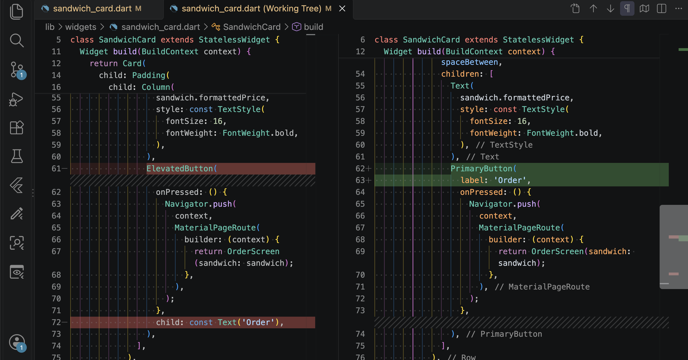

Save the file and check your running application. Each menu card now displays the styled green Order button, as shown below:

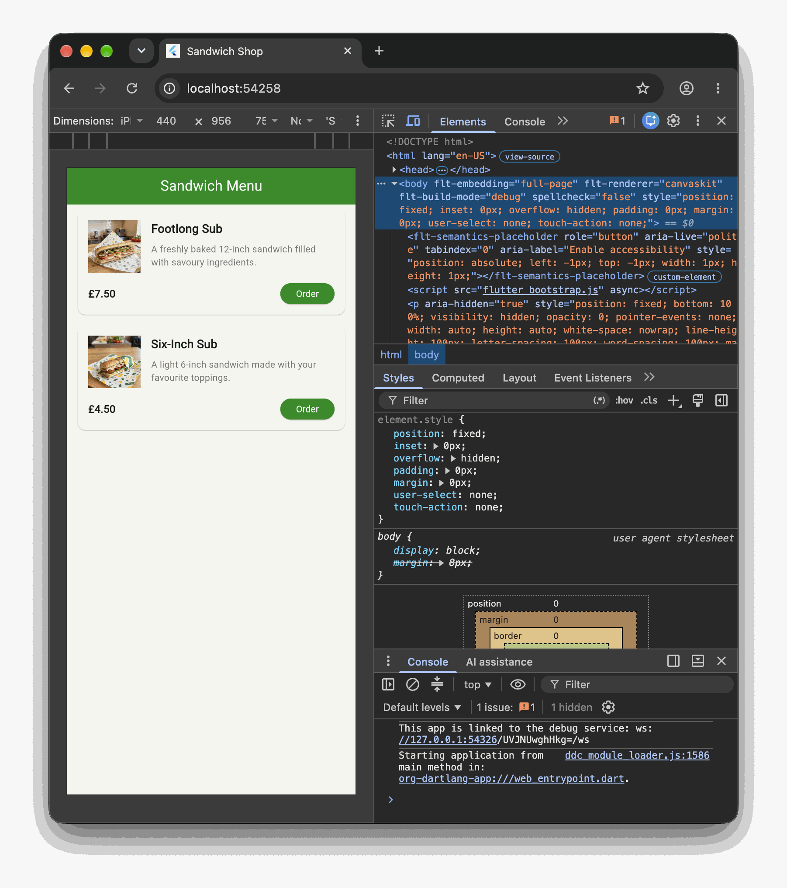

### Create the basket button

Let's add another reusable widget for the shopping basket icon button. Every screen in our application needs a shopping basket icon in its app bar that takes the user to their basket.

Create a new file named `lib/widgets/basket_button.dart` and make a `StatelessWidget` that displays a shopping basket icon and navigates to the basket screen when tapped:

```dart
import 'package:flutter/material.dart';

class BasketButton extends StatelessWidget {
  const BasketButton({super.key});

  @override
  Widget build(BuildContext context) {
    return IconButton(
      icon: const Icon(Icons.shopping_basket),
      onPressed: () {
        ModalRoute<dynamic>? modalRoute = ModalRoute.of(context);
        String currentRoute = '';

        if (modalRoute != null) {
          RouteSettings settings = modalRoute.settings;
          String? routeName = settings.name;
          if (routeName != null) {
            currentRoute = routeName;
          }
        }

        if (currentRoute != '/basket') {
          Navigator.pushNamed(context, '/basket');
        }
      },
    );
  }
}
```

`IconButton` displays an icon from Flutter's Material icon set (`Icons.shopping_basket`). Feel free to remove `shopping_basket`, put your cursor at the dot, and press **Ctrl + Space** on Windows or **⌘ + Space** on macOS to see a list of available icons. You can check out the [documentation page on Material icons](https://api.flutter.dev/flutter/material/Icons-class.html) for a complete list of icons.

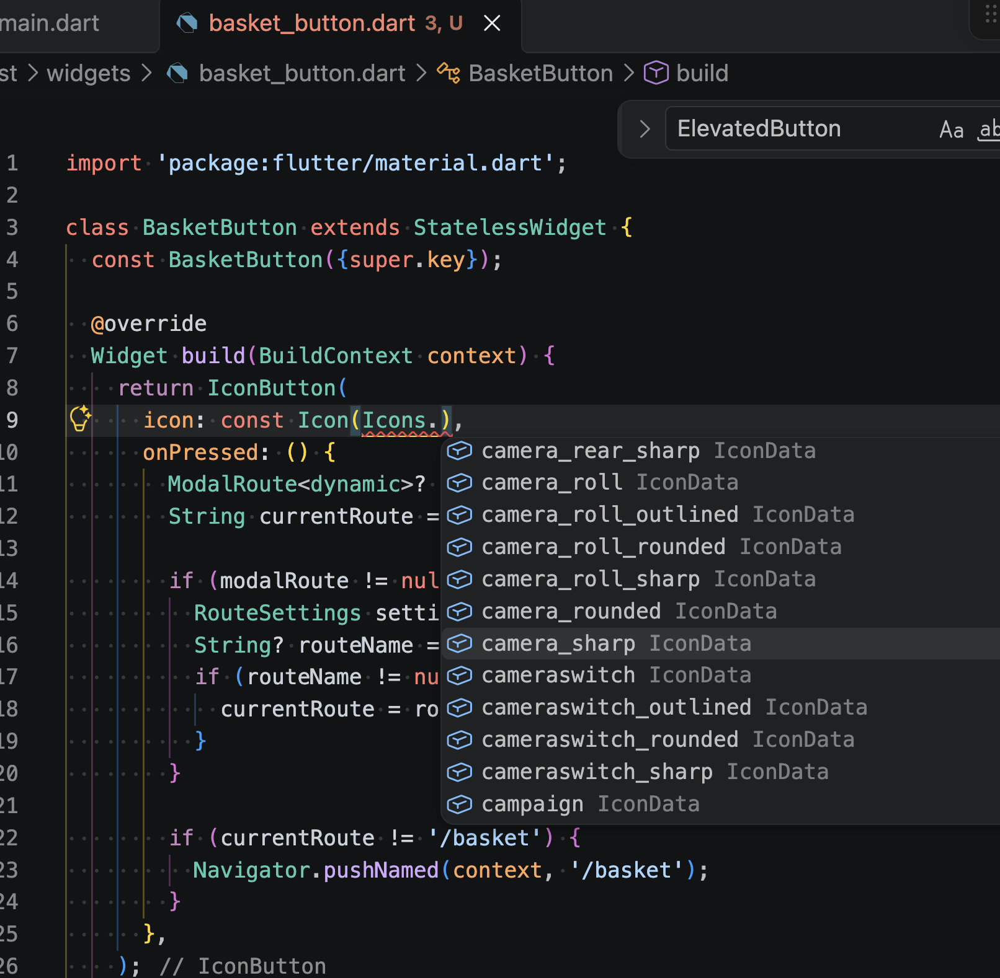

Inside `onPressed`, we check the name of the current route using `ModalRoute.of(context)`. We discussed `context` back in [Worksheet 3](./worksheet-3.md) when we built the `SandwichCard` widget. It is a handle to the location of a widget in the widget tree, and it allows us to access the current route. A route is essentially a screen in the app. So for example if we are on the menu screen, the current route is `'/'`. If we are on the basket screen, the current route is `'/basket'`.

If a modal route exists, we retrieve its `RouteSettings` and extract its route name. If the user is not already on the basket screen, `Navigator.pushNamed(context, '/basket')` opens it. If they are already on the basket screen, nothing happens. This practice prevents unnecessary duplicate screens in the navigation stack.

### Create the placeholder basket screen

Notice that `BasketButton` navigates to `'/basket'`. Before registering this route in `MaterialApp`, we create a minimal basket screen so our code compiles cleanly.

Create a new file named `lib/screens/basket_screen.dart`:

```dart
import 'package:flutter/material.dart';

class BasketScreen extends StatelessWidget {
  const BasketScreen({super.key});

  @override
  Widget build(BuildContext context) {
    return const Scaffold(
      body: Center(
        child: Text('Basket Screen'),
      ),
    );
  }
}
```

We will build the complete stateful basket screen later in this worksheet. For now, this placeholder enables navigation between screens.

### Register named routes

In [Worksheet 3](./worksheet-3.md), we navigated to screens using `Navigator.push` with a `MaterialPageRoute`. That approach is suitable for detail views, such as selecting a sandwich to open its order page. For top-level screens like the menu and the basket, named routes provide a cleaner structure.

A named route associates an identifier string with a screen builder. Open `lib/main.dart` and import the basket screen:

```dart
import 'package:sandwich_shop/screens/basket_screen.dart';
```

In `App.build`, remove `home: const MenuScreen()` and replace it with `initialRoute` and `routes`:

```dart
      initialRoute: '/',
      routes: <String, WidgetBuilder>{
        '/': (BuildContext context) {
          return const MenuScreen();
        },
        '/basket': (BuildContext context) {
          return const BasketScreen();
        },
      },
```

The `initialRoute: '/'` property instructs Flutter to open the menu screen on launch. The `routes` map associates `'/'` with `MenuScreen` and `'/basket'` with `BasketScreen`. Your complete `lib/main.dart` should now look like this:

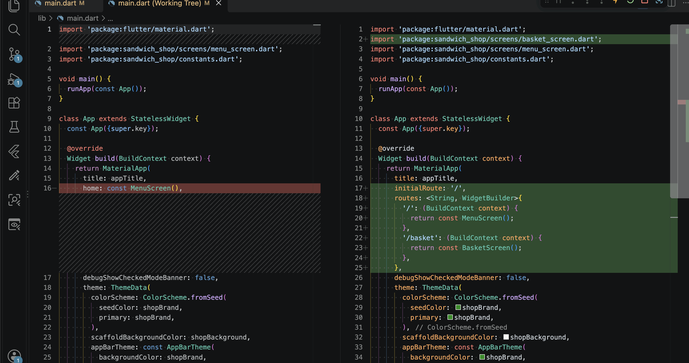

For more details on routing, see the [Flutter named routes documentation](https://docs.flutter.dev/cookbook/navigation/named-routes).

### Add the basket button to the menu app bar

Now add the reusable `BasketButton` to `lib/screens/menu_screen.dart`. Open the file and import our constants and the button widget:

```dart
import 'package:sandwich_shop/constants.dart';
import 'package:sandwich_shop/widgets/basket_button.dart';
```

In `MenuScreen.build`, update the `AppBar` to use `appTitle`, `shopHeaderStyle` first. Also add the `BasketButton` to the `actions` list as shown in the screenshot below:

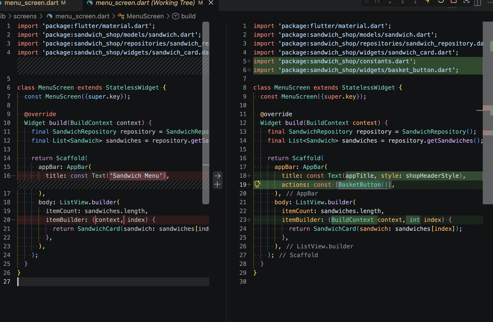

The `actions` property accepts a list of widgets displayed on the trailing side of the app bar. Save the file. The menu screen app bar now shows the styled title and the basket icon button, as shown below:

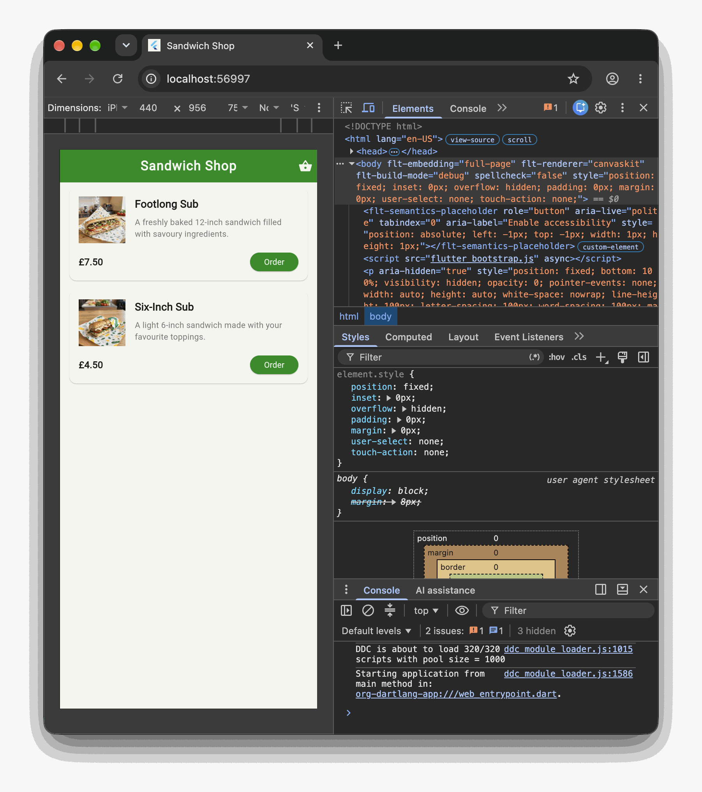

### Widget test the menu screen

Create a new test file named `test/menu_screen_test.dart` to verify that the menu displays sandwich cards, the basket action button, and responds to taps:

```dart
import 'package:flutter/material.dart';
import 'package:flutter_test/flutter_test.dart';
import 'package:sandwich_shop/screens/basket_screen.dart';
import 'package:sandwich_shop/screens/menu_screen.dart';
import 'package:sandwich_shop/widgets/sandwich_card.dart';

void main() {
  testWidgets('MenuScreen shows the sandwich list and a basket button', (
    WidgetTester tester,
  ) async {
    await tester.pumpWidget(const MaterialApp(home: MenuScreen()));

    expect(find.byType(SandwichCard), findsWidgets);
    expect(find.byIcon(Icons.shopping_basket), findsOneWidget);
  });

  testWidgets('Tapping the basket button navigates to BasketScreen', (
    WidgetTester tester,
  ) async {
    await tester.pumpWidget(
      MaterialApp(
        initialRoute: '/',
        routes: <String, WidgetBuilder>{
          '/': (BuildContext context) {
            return const MenuScreen();
          },
          '/basket': (BuildContext context) {
            return const BasketScreen();
          },
        },
      ),
    );

    await tester.tap(find.byIcon(Icons.shopping_basket));
    await tester.pumpAndSettle();

    expect(find.byType(BasketScreen), findsOneWidget);
  });
}
```

The first test confirms that `SandwichCard` widgets and the basket icon appear. The second test taps the basket icon button, waits for the transition with `tester.pumpAndSettle()`, and asserts that `BasketScreen` appears. Run this test suite and make sure it passes.

### Update the app smoke tests

Recall that smoke tests generally verify that the app launches and displays the expected home screen. In [Worksheet 4](./worksheet-4.md), our smoke test in `test/widget_test.dart` looked for the text `'Sandwich Menu'`.

Because our app bar now displays `'Sandwich Shop'` alongside the basket button, update the test in `test/widget_test.dart` to expect the basket button's icon (`Icons.shopping_basket`) instead of the old text. The updated test should look like this:

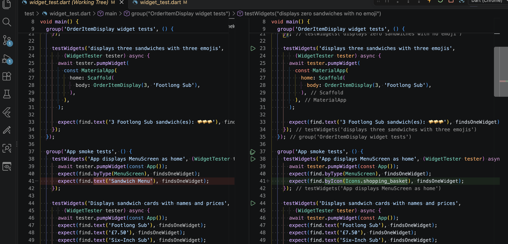

Run the tests suite to make sure all tests pass. If you see a failure, check that you updated the test to look for the basket icon instead of the old text.

The lesson here is to remember to update your tests when you change the user interface. Otherwise, your tests will fail even if the app is working correctly.

## Holding an order in a basket

We would like to give our customers the ability to make certain configurations to their sandwiches, add them to a basket, and then check out. Configurations such as whether they want their sandwich toasted or vegan, and any special notes for the kitchen, need to be stored somewhere. We will create a model and repository to hold this data. And we will also require a form of some sort to allow the user to input their configurations. We will build the form in the next section.

<!-- TODO: Verified till here -->

### Define the cart item model

When a customer orders a sandwich, we need to track their selection and the quantity they wish to buy. In an e-commerce application, a menu item and an item inside a basket serve two distinct purposes. A `Sandwich` represents an item in the catalogue, with its name, description, and price. A `CartItem` represents a specific line item in the customer's shopping basket.

A common beginner mistake is to copy all fields from `Sandwich` into `CartItem`, duplicating `id`, `name`, and `price`. In object-oriented programming, this creates maintenance bugs: if menu data updates, duplicate fields in the basket fall out of sync. A cleaner design is composition: `CartItem` holds a reference to a `Sandwich` instance along with an integer quantity.

Create a new file named `lib/models/cart_item.dart`:

```dart
import 'package:sandwich_shop/models/sandwich.dart';

class CartItem {
  final Sandwich sandwich;
  final int quantity;

  const CartItem({
    required this.sandwich,
    required this.quantity,
  });

  double get lineTotal {
    return sandwich.price * quantity;
  }
}
```

Both fields are marked `final` to ensure instances are immutable once constructed. The computed getter `lineTotal` calculates the cost for that line item by multiplying `sandwich.price` by `quantity`. Notice how composing `Sandwich` inside `CartItem` avoids duplicating properties and guarantees that the basket always reflects the correct sandwich attributes.

### Create the cart repository singleton

In [Worksheet 3](./worksheet-3.md), we introduced the repository pattern to encapsulate data access. For our shopping cart, multiple screens (the order screen, the menu screen, and the basket screen) need to read and update the same list of items. We implement this shared access using the singleton pattern.

Create a new file named `lib/repositories/cart_repository.dart`:

```dart
import 'package:sandwich_shop/models/cart_item.dart';

class CartRepository {
  CartRepository._internal();

  static final CartRepository instance = CartRepository._internal();

  final List<CartItem> _items = [];

  List<CartItem> getItems() {
    return List<CartItem>.unmodifiable(_items);
  }

  void addItem(CartItem item) {
    _items.add(item);
  }

  void removeItem(int index) {
    if (index >= 0 && index < _items.length) {
      _items.removeAt(index);
    }
  }

  void clear() {
    _items.clear();
  }

  int get totalItemCount {
    int total = 0;
    for (final CartItem item in _items) {
      total += item.quantity;
    }
    return total;
  }

  double getSubtotal() {
    double sum = 0.0;
    for (final CartItem item in _items) {
      sum += item.lineTotal;
    }
    return sum;
  }

  double getDeliveryFee() {
    if (_items.isEmpty) {
      return 0.0;
    }
    return 1.50;
  }

  double getTotalDue() {
    return getSubtotal() + getDeliveryFee();
  }
}
```

The private constructor `CartRepository._internal()` prevents direct instantiation from outside the class. The single shared instance is exposed via `static final CartRepository instance`. The internal `_items` list is private; calling `getItems()` returns an unmodifiable view using `List.unmodifiable` so external widgets cannot mutate the list directly. The `totalItemCount` getter and `getSubtotal()` method use standard procedural `for-in` loops to aggregate quantities and prices. The delivery fee is £1.50 when items exist, and `getTotalDue()` computes the overall bill.

### Unit test the cart repository

Create a new test file named `test/cart_repository_test.dart` to verify that repository operations compute accurate totals:

```dart
import 'package:flutter_test/flutter_test.dart';
import 'package:sandwich_shop/models/cart_item.dart';
import 'package:sandwich_shop/models/sandwich.dart';
import 'package:sandwich_shop/repositories/cart_repository.dart';

const Sandwich testSandwich1 = Sandwich(
  id: 'footlong',
  name: 'Footlong Sub',
  description: 'Classic freshly baked sub.',
  price: 10.0,
  imagePath: 'assets/images/footlong.jpeg',
);

const Sandwich testSandwich2 = Sandwich(
  id: 'six_inch',
  name: 'Six-Inch Sub',
  description: 'Six inch sub.',
  price: 6.0,
  imagePath: 'assets/images/six_inch.jpeg',
);

void main() {
  setUp(() {
    CartRepository.instance.clear();
  });

  group('CartRepository tests', () {
    test('starts with empty basket and zero totals', () {
      final CartRepository cart = CartRepository.instance;
      expect(cart.getItems(), isEmpty);
      expect(cart.totalItemCount, 0);
      expect(cart.getSubtotal(), 0.0);
      expect(cart.getDeliveryFee(), 0.0);
      expect(cart.getTotalDue(), 0.0);
    });

    test('adds items and calculates subtotal and delivery fee correctly', () {
      final CartRepository cart = CartRepository.instance;
      const CartItem item1 = CartItem(
        sandwich: testSandwich1,
        quantity: 2,
      );
      const CartItem item2 = CartItem(
        sandwich: testSandwich2,
        quantity: 1,
      );

      cart.addItem(item1);
      cart.addItem(item2);

      expect(cart.getItems().length, 2);
      expect(cart.totalItemCount, 3);
      expect(cart.getSubtotal(), 26.0);
      expect(cart.getDeliveryFee(), 1.50);
      expect(cart.getTotalDue(), 27.50);
    });

    test('removes items correctly', () {
      final CartRepository cart = CartRepository.instance;
      const CartItem item = CartItem(
        sandwich: testSandwich1,
        quantity: 1,
      );
      cart.addItem(item);
      expect(cart.getItems().length, 1);

      cart.removeItem(0);
      expect(cart.getItems().length, 0);
      expect(cart.getTotalDue(), 0.0);
    });
  });
}
```

Run your new unit tests in the terminal:

```bash
flutter test test/cart_repository_test.dart
```

### Commit your changes (3)

Stage `lib/models/cart_item.dart`, `lib/repositories/cart_repository.dart`, and `test/cart_repository_test.dart`. Commit your changes with a message of your own.

## Building the order screen

Now that the cart model and repository are ready, we turn `lib/screens/order_screen.dart` into an ordering screen that lets users choose a quantity and add their selected sandwich to the basket.

### Recap the order screen state

In branch 4, `OrderScreen` was a `StatefulWidget` containing a quantity integer and two buttons (**Add** and **Remove**) that called `setState`:

```dart
class _OrderScreenState extends State<OrderScreen> {
  int _quantity = 0;

  void _increaseQuantity() {
    if (_quantity < widget.maxQuantity) {
      setState(() {
        _quantity++;
      });
    }
  }

  void _decreaseQuantity() {
    if (_quantity > 0) {
      setState(() {
        _quantity--;
      });
    }
  }
```

We keep these quantity handlers and connect them to our basket repository.

### Update the order screen app bar

Open `lib/screens/order_screen.dart`. Import our constants and the basket button:

```dart
import 'package:sandwich_shop/constants.dart';
import 'package:sandwich_shop/widgets/basket_button.dart';
```

In `OrderScreen.build`, update the `AppBar` to display our themed title and include `BasketButton`:

```dart
      appBar: AppBar(
        title: const Text(appTitle, style: shopHeaderStyle),
        actions: const [BasketButton()],
      ),
```

Your order screen app bar should look like this:

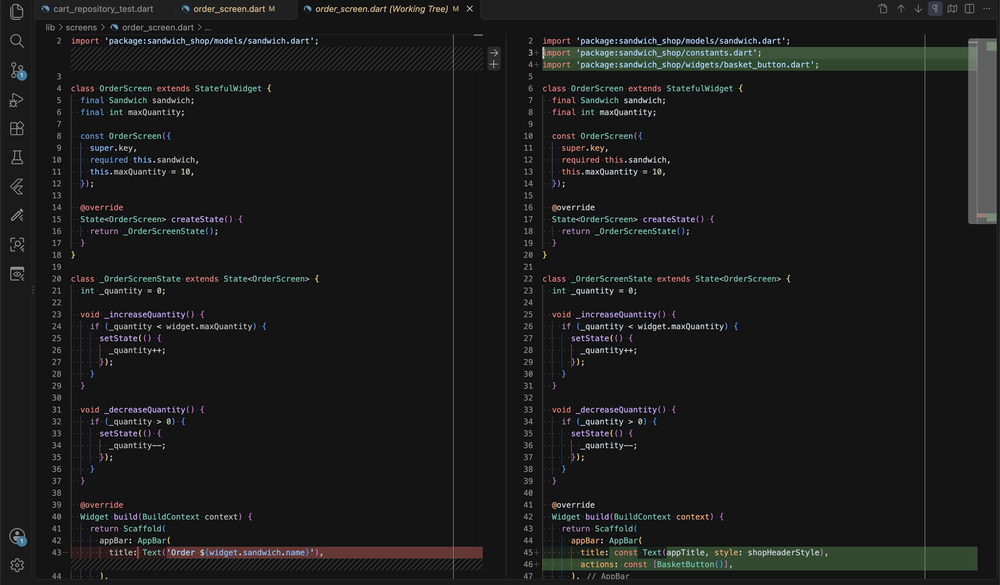

### Add items to the basket

Now wire the screen to `CartRepository`. Add imports for the cart model, repository, and primary button at the top of `lib/screens/order_screen.dart`:

```dart
import 'package:sandwich_shop/models/cart_item.dart';
import 'package:sandwich_shop/repositories/cart_repository.dart';
import 'package:sandwich_shop/widgets/primary_button.dart';
```

Add a string field in `_OrderScreenState` to hold an inline feedback message:

```dart
  String _confirmationMessage = '';
```

Next, add the submission method `_addToBasket`:

```dart
  void _addToBasket() {
    if (_quantity > 0) {
      final CartItem item = CartItem(
        sandwich: widget.sandwich,
        quantity: _quantity,
      );
      CartRepository.instance.addItem(item);
      setState(() {
        _confirmationMessage =
            'Added $_quantity ${widget.sandwich.name} to basket';
      });
    } else {
      setState(() {
        _confirmationMessage = 'Please select at least 1 sandwich';
      });
    }
  }
```

The method checks that `_quantity > 0`. If valid, it constructs a `CartItem` holding `widget.sandwich` and `_quantity`, and passes it to `CartRepository.instance.addItem(item)`. It then updates `_confirmationMessage` inside `setState`. If the quantity is zero, it informs the user to select at least one sandwich.

Add the button and confirmation message below the quantity controls in `build`:

```dart
            const SizedBox(height: 24),
            SizedBox(
              width: double.infinity,
              child: PrimaryButton(
                label: 'Add to Basket',
                onPressed: _addToBasket,
              ),
            ),
            const SizedBox(height: 12),
            Text(
              _confirmationMessage,
              style: const TextStyle(fontWeight: FontWeight.bold),
            ),
```

Wrap the body column in a `SingleChildScrollView` to prevent screen layout issues:

```dart
      body: SingleChildScrollView(
        padding: const EdgeInsets.all(16.0),
        child: Column(
          crossAxisAlignment: CrossAxisAlignment.start,
          children: [
            Text(
              'Order ${widget.sandwich.name}',
              style: const TextStyle(fontSize: 22, fontWeight: FontWeight.bold),
            ),
            const SizedBox(height: 16),
            OrderItemDisplay(_quantity, widget.sandwich.name),
            const SizedBox(height: 16),
            Row(
              mainAxisAlignment: MainAxisAlignment.center,
              children: [
                ElevatedButton(
                  onPressed: _decreaseQuantity,
                  child: const Text('Remove'),
                ),
                const SizedBox(width: 12),
                ElevatedButton(
                  onPressed: _increaseQuantity,
                  child: const Text('Add'),
                ),
              ],
            ),
            const SizedBox(height: 24),
            SizedBox(
              width: double.infinity,
              child: PrimaryButton(
                label: 'Add to Basket',
                onPressed: _addToBasket,
              ),
            ),
            const SizedBox(height: 12),
            Text(
              _confirmationMessage,
              style: const TextStyle(fontWeight: FontWeight.bold),
            ),
          ],
        ),
      ),
```

Keep the existing `OrderItemDisplay` class unchanged at the bottom of the file.

### Widget test the order screen

Create a new test file named `test/order_screen_test.dart` to verify that selecting a quantity and tapping **Add to Basket** properly updates the cart repository:

```dart
import 'package:flutter/material.dart';
import 'package:flutter_test/flutter_test.dart';
import 'package:sandwich_shop/models/cart_item.dart';
import 'package:sandwich_shop/models/sandwich.dart';
import 'package:sandwich_shop/repositories/cart_repository.dart';
import 'package:sandwich_shop/screens/order_screen.dart';

const Sandwich testSandwich = Sandwich(
  id: 'test',
  name: 'Test Sub',
  description: 'Test description',
  price: 5.0,
  imagePath: 'assets/images/footlong.jpeg',
);

void main() {
  setUp(() {
    CartRepository.instance.clear();
  });

  testWidgets('OrderScreen shows quantity buttons and Add to Basket button', (
    WidgetTester tester,
  ) async {
    await tester.pumpWidget(
      const MaterialApp(home: OrderScreen(sandwich: testSandwich)),
    );

    expect(find.text('Order Test Sub'), findsOneWidget);
    expect(find.text('0 Test Sub sandwich(es): '), findsOneWidget);
    expect(find.text('Add'), findsOneWidget);
    expect(find.text('Remove'), findsOneWidget);
    expect(find.text('Add to Basket'), findsOneWidget);
  });

  testWidgets('Adding to basket without selecting quantity shows warning', (
    WidgetTester tester,
  ) async {
    await tester.pumpWidget(
      const MaterialApp(home: OrderScreen(sandwich: testSandwich)),
    );

    await tester.tap(find.text('Add to Basket'));
    await tester.pump();

    expect(find.text('Please select at least 1 sandwich'), findsOneWidget);
    expect(CartRepository.instance.getItems(), isEmpty);
  });

  testWidgets('Adding to basket records quantity and sandwich', (
    WidgetTester tester,
  ) async {
    await tester.pumpWidget(
      const MaterialApp(home: OrderScreen(sandwich: testSandwich)),
    );

    await tester.tap(find.text('Add'));
    await tester.pump();
    await tester.tap(find.text('Add'));
    await tester.pump();

    await tester.tap(find.text('Add to Basket'));
    await tester.pump();

    final List<CartItem> items = CartRepository.instance.getItems();
    expect(items.length, 1);

    final CartItem added = items.first;
    expect(added.quantity, 2);
    expect(added.sandwich.id, 'test');
    expect(added.sandwich.name, 'Test Sub');
    expect(find.text('Added 2 Test Sub to basket'), findsOneWidget);
  });
}
```

Run your new widget tests:

```bash
flutter test test/order_screen_test.dart
```

### Commit your changes (4)

Stage `lib/screens/order_screen.dart` and `test/order_screen_test.dart`. Commit your changes with a message of your own.

## Building the basket screen

Now we replace the placeholder `lib/screens/basket_screen.dart` with a full screen that displays items in the cart, lets the user remove items, shows the total due, and provides a checkout button.

### Convert BasketScreen to a stateful widget

Open `lib/screens/basket_screen.dart`. Replace the placeholder with a `StatefulWidget`:

```dart
import 'package:flutter/material.dart';
import 'package:sandwich_shop/constants.dart';
import 'package:sandwich_shop/models/cart_item.dart';
import 'package:sandwich_shop/repositories/cart_repository.dart';
import 'package:sandwich_shop/widgets/basket_button.dart';
import 'package:sandwich_shop/widgets/primary_button.dart';

class BasketScreen extends StatefulWidget {
  const BasketScreen({super.key});

  @override
  State<BasketScreen> createState() {
    return _BasketScreenState();
  }
}

class _BasketScreenState extends State<BasketScreen> {
  String _confirmationMessage = '';
```

The screen holds a `_confirmationMessage` string to display feedback when orders are placed.

### Build the empty basket state

When the cart contains no items, we display an empty state message. Add the `_buildEmptyState` helper inside `_BasketScreenState`:

```dart
  Widget _buildEmptyState() {
    return const Center(
      child: Padding(
        padding: EdgeInsets.symmetric(vertical: 32.0),
        child: Text(
          'Your basket is empty',
          style: TextStyle(fontSize: 16, color: Colors.grey),
        ),
      ),
    );
  }
```

Your empty basket view should look like this in the running app:


### Build the basket item card

Next, add a helper to format each item as a row displaying its quantity, name, calculated line total, and a delete button:

```dart
  Widget _buildLineItem(CartRepository cart, CartItem item, int index) {
    return Padding(
      padding: const EdgeInsets.symmetric(vertical: 8.0),
      child: Row(
        children: [
          Expanded(
            child: Column(
              crossAxisAlignment: CrossAxisAlignment.start,
              children: [
                Text(
                  '${item.quantity} x ${item.sandwich.name}',
                  style: const TextStyle(fontWeight: FontWeight.w600),
                ),
                const SizedBox(height: 4),
                Text('£${item.lineTotal.toStringAsFixed(2)}'),
              ],
            ),
          ),
          IconButton(
            icon: const Icon(Icons.delete_outline, color: Colors.red),
            onPressed: () {
              setState(() {
                cart.removeItem(index);
              });
            },
          ),
        ],
      ),
    );
  }
```

The `IconButton` with `Icons.delete_outline` calls `cart.removeItem(index)` inside `setState` to immediately remove the item and refresh the view.

### Build the basket items list and checkout button

Now create helpers that assemble the item cards, price breakdown, and checkout button:

```dart
  Widget _buildTotalRow(String label, String value, {bool emphasise = false}) {
    final TextStyle style;
    if (emphasise) {
      style = const TextStyle(fontWeight: FontWeight.bold, fontSize: 16);
    } else {
      style = const TextStyle(color: shopText);
    }

    return Padding(
      padding: const EdgeInsets.symmetric(vertical: 4.0),
      child: Row(
        mainAxisAlignment: MainAxisAlignment.spaceBetween,
        children: [
          Text(label, style: style),
          Text(value, style: style),
        ],
      ),
    );
  }

  Widget _buildBasketList(CartRepository cart, List<CartItem> items) {
    final List<Widget> children = [];

    children.add(const Text('Your basket', style: shopSectionTitleStyle));
    children.add(const SizedBox(height: 16));

    for (int index = 0; index < items.length; index++) {
      final CartItem item = items[index];
      children.add(_buildLineItem(cart, item, index));
    }

    children.add(const SizedBox(height: 24));
    children.add(
      _buildTotalRow(
        'Items subtotal',
        '£${cart.getSubtotal().toStringAsFixed(2)}',
      ),
    );
    children.add(
      _buildTotalRow(
        'Delivery',
        '£${cart.getDeliveryFee().toStringAsFixed(2)}',
      ),
    );
    children.add(
      _buildTotalRow(
        'Total to pay',
        '£${cart.getTotalDue().toStringAsFixed(2)}',
        emphasise: true,
      ),
    );
    children.add(const SizedBox(height: 24));

    children.add(
      SizedBox(
        width: double.infinity,
        child: PrimaryButton(
          label: 'Checkout',
          onPressed: () {
            setState(() {
              cart.clear();
              _confirmationMessage = 'Thanks, your order is on its way';
            });
          },
        ),
      ),
    );

    if (_confirmationMessage.isNotEmpty) {
      children.add(const SizedBox(height: 12));
      children.add(
        Text(
          _confirmationMessage,
          style: const TextStyle(fontWeight: FontWeight.bold),
        ),
      );
    }

    return Column(
      crossAxisAlignment: CrossAxisAlignment.start,
      children: children,
    );
  }
```

The loop builds a row for every item, followed by rows for items subtotal, delivery fee, and the overall total. The **Checkout** button runs `cart.clear()` and sets the confirmation text.

When items are present, your screen should look like this:


### Assemble the basket screen scaffold

Finally, implement the `build` method to select between the empty state and the basket list:

```dart
  @override
  Widget build(BuildContext context) {
    final CartRepository cart = CartRepository.instance;
    final List<CartItem> items = cart.getItems();

    final Widget content;
    if (items.isEmpty) {
      if (_confirmationMessage.isNotEmpty) {
        content = Column(
          crossAxisAlignment: CrossAxisAlignment.start,
          children: [
            _buildEmptyState(),
            const SizedBox(height: 12),
            Text(
              _confirmationMessage,
              style: const TextStyle(fontWeight: FontWeight.bold),
            ),
          ],
        );
      } else {
        content = _buildEmptyState();
      }
    } else {
      content = _buildBasketList(cart, items);
    }

    return Scaffold(
      appBar: AppBar(
        title: const Text(appTitle, style: shopHeaderStyle),
        actions: const [BasketButton()],
      ),
      body: SingleChildScrollView(
        padding: const EdgeInsets.all(16.0),
        child: content,
      ),
    );
  }
}
```

### Widget test the basket screen

Create a new test file named `test/basket_screen_test.dart`:

```dart
import 'package:flutter/material.dart';
import 'package:flutter_test/flutter_test.dart';
import 'package:sandwich_shop/models/cart_item.dart';
import 'package:sandwich_shop/models/sandwich.dart';
import 'package:sandwich_shop/repositories/cart_repository.dart';
import 'package:sandwich_shop/screens/basket_screen.dart';

const Sandwich testSandwich = Sandwich(
  id: 'footlong',
  name: 'Footlong Sub',
  description: 'Classic freshly baked sub.',
  price: 10.0,
  imagePath: 'assets/images/footlong.jpeg',
);

void main() {
  setUp(() {
    CartRepository.instance.clear();
  });

  testWidgets('BasketScreen displays empty message when basket has no items', (
    WidgetTester tester,
  ) async {
    await tester.pumpWidget(const MaterialApp(home: BasketScreen()));

    expect(find.text('Your basket is empty'), findsOneWidget);
    expect(find.text('Checkout'), findsNothing);
  });

  testWidgets(
    'BasketScreen renders items and removes item when delete pressed',
    (WidgetTester tester) async {
      const CartItem item = CartItem(
        sandwich: testSandwich,
        quantity: 2,
      );
      CartRepository.instance.addItem(item);

      await tester.pumpWidget(const MaterialApp(home: BasketScreen()));

      expect(find.text('Your basket'), findsOneWidget);
      expect(find.text('2 x Footlong Sub'), findsOneWidget);
      expect(find.text('£20.00'), findsWidgets);
      expect(find.text('Checkout'), findsOneWidget);

      await tester.tap(find.byIcon(Icons.delete_outline));
      await tester.pump();

      expect(find.text('Your basket is empty'), findsOneWidget);
    },
  );
}
```

Run the tests:

```bash
flutter test test/basket_screen_test.dart
```

### Commit your changes (5)

Stage `lib/screens/basket_screen.dart` and `test/basket_screen_test.dart`. Commit your changes with a message of your own.

## Building the customer profile settings form

Capturing user input through forms is a fundamental requirement in mobile applications. In this section, we create a customer profile screen that introduces Flutter's core form widgets: `TextField`, `TextEditingController`, and `Switch`.

### Define the user settings model

Create a new file named `lib/models/user_settings.dart` to hold customer preferences:

```dart
class UserSettings {
  final String name;
  final String address;
  final String email;
  final bool receiveNewsletter;

  const UserSettings({
    this.name = '',
    this.address = '',
    this.email = '',
    this.receiveNewsletter = false,
  });
}
```

Create a new unit test named `test/user_settings_test.dart` to verify default and configured values:

```dart
import 'package:flutter_test/flutter_test.dart';
import 'package:sandwich_shop/models/user_settings.dart';

void main() {
  test('UserSettings defaults to empty values and false newsletter', () {
    const UserSettings settings = UserSettings();
    expect(settings.name, isEmpty);
    expect(settings.address, isEmpty);
    expect(settings.email, isEmpty);
    expect(settings.receiveNewsletter, isFalse);
  });

  test('UserSettings stores configured values', () {
    const UserSettings settings = UserSettings(
      name: 'Taylor Reed',
      address: '22 Guildhall Walk',
      email: 'taylor@example.com',
      receiveNewsletter: true,
    );
    expect(settings.name, 'Taylor Reed');
    expect(settings.address, '22 Guildhall Walk');
    expect(settings.email, 'taylor@example.com');
    expect(settings.receiveNewsletter, isTrue);
  });
}
```

Run the unit tests:

```bash
flutter test test/user_settings_test.dart
```

### Text controllers and form lifecycle

In Flutter, reading text from an input requires a `TextEditingController`. Controllers manage the native text state and cursor position. Because controllers consume operating system resources, you must dispose of them when the widget is unmounted to prevent memory leaks.

This lifecycle is divided into three parts:

1. Declaring fields: `late TextEditingController _nameController;`
2. Initialisation in `initState()`: `_nameController = TextEditingController();`
3. Disposal in `dispose()`: `_nameController.dispose();`

For more details on controller management, see the [TextEditingController documentation](https://api.flutter.dev/flutter/widgets/TextEditingController-class.html).

### Add text fields and the switch toggle

Create a new file named `lib/screens/settings_screen.dart`:

```dart
import 'package:flutter/material.dart';
import 'package:sandwich_shop/constants.dart';
import 'package:sandwich_shop/models/user_settings.dart';
import 'package:sandwich_shop/widgets/basket_button.dart';
import 'package:sandwich_shop/widgets/primary_button.dart';

class SettingsScreen extends StatefulWidget {
  const SettingsScreen({super.key});

  @override
  State<SettingsScreen> createState() {
    return _SettingsScreenState();
  }
}

class _SettingsScreenState extends State<SettingsScreen> {
  late TextEditingController _nameController;
  late TextEditingController _addressController;
  late TextEditingController _emailController;
  bool _receiveNewsletter = false;
  String _confirmationMessage = '';

  @override
  void initState() {
    super.initState();
    _nameController = TextEditingController();
    _addressController = TextEditingController();
    _emailController = TextEditingController();
  }

  @override
  void dispose() {
    _nameController.dispose();
    _addressController.dispose();
    _emailController.dispose();
    super.dispose();
  }

  void _saveSettings() {
    final String name = _nameController.text.trim();
    final String address = _addressController.text.trim();
    final String email = _emailController.text.trim();

    final UserSettings settings = UserSettings(
      name: name,
      address: address,
      email: email,
      receiveNewsletter: _receiveNewsletter,
    );

    setState(() {
      _confirmationMessage = 'Settings saved for ${settings.name}';
    });
  }
```

The `_saveSettings` method reads values from each controller, constructs a `UserSettings` instance, and stores a confirmation string.

### Wrap the form in a scroll view

On mobile devices, tapping any text field triggers the software keyboard to slide up from the bottom of the display. If the inputs sit in an unconstrained `Column`, the reduced vertical space causes a yellow-and-black striped layout overflow error. Wrapping the form in a `SingleChildScrollView` ensures that the screen can scroll smoothly whenever the keyboard appears. For further guidance, see the [SingleChildScrollView documentation](https://api.flutter.dev/flutter/widgets/SingleChildScrollView-class.html).

Implement the `build` method inside `_SettingsScreenState`:

```dart
  @override
  Widget build(BuildContext context) {
    return Scaffold(
      appBar: AppBar(
        title: const Text(appTitle, style: shopHeaderStyle),
        actions: const [BasketButton()],
      ),
      body: SingleChildScrollView(
        padding: const EdgeInsets.all(16.0),
        child: Column(
          crossAxisAlignment: CrossAxisAlignment.start,
          children: [
            const Text(
              'Customer Profile',
              style: TextStyle(fontSize: 22, fontWeight: FontWeight.bold),
            ),
            const SizedBox(height: 16),
            TextField(
              controller: _nameController,
              decoration: const InputDecoration(
                border: OutlineInputBorder(),
                labelText: 'Full name',
                hintText: 'Enter your name',
              ),
            ),
            const SizedBox(height: 16),
            TextField(
              controller: _addressController,
              maxLines: 3,
              decoration: const InputDecoration(
                border: OutlineInputBorder(),
                labelText: 'Delivery address',
                hintText: 'Enter delivery address',
              ),
            ),
            const SizedBox(height: 16),
            TextField(
              controller: _emailController,
              keyboardType: TextInputType.emailAddress,
              decoration: const InputDecoration(
                border: OutlineInputBorder(),
                labelText: 'Email address',
                hintText: 'Enter your email',
              ),
            ),
            const SizedBox(height: 16),
            Row(
              children: [
                const Expanded(
                  child: Text('Receive newsletter and offers'),
                ),
                Switch(
                  value: _receiveNewsletter,
                  onChanged: (bool value) {
                    setState(() {
                      _receiveNewsletter = value;
                    });
                  },
                ),
              ],
            ),
            const SizedBox(height: 20),
            SizedBox(
              width: double.infinity,
              child: PrimaryButton(
                label: 'Save Settings',
                onPressed: _saveSettings,
              ),
            ),
            if (_confirmationMessage.isNotEmpty) ...[
              const SizedBox(height: 12),
              Text(
                _confirmationMessage,
                style: const TextStyle(fontWeight: FontWeight.bold),
              ),
            ],
          ],
        ),
      ),
    );
  }
}
```

The `keyboardType: TextInputType.emailAddress` parameter configures the mobile virtual keyboard to show the `@` symbol. For more details on the toggle control, see the [Switch documentation](https://api.flutter.dev/flutter/material/Switch-class.html).

### Create the settings button and register the route

Create a reusable navigation button in `lib/widgets/settings_button.dart` to open the profile screen:

```dart
import 'package:flutter/material.dart';

class SettingsButton extends StatelessWidget {
  const SettingsButton({super.key});

  @override
  Widget build(BuildContext context) {
    return IconButton(
      icon: const Icon(Icons.person_outline),
      tooltip: 'Settings',
      onPressed: () {
        final ModalRoute<dynamic>? modalRoute = ModalRoute.of(context);
        final String currentRoute;
        if (modalRoute != null) {
          final RouteSettings routeSettings = modalRoute.settings;
          final String? name = routeSettings.name;
          if (name != null) {
            currentRoute = name;
          } else {
            currentRoute = '';
          }
        } else {
          currentRoute = '';
        }

        if (currentRoute != '/settings') {
          Navigator.pushNamed(context, '/settings');
        }
      },
    );
  }
}
```

Open `lib/main.dart` and register the `'/settings'` named route:

```dart
import 'package:sandwich_shop/screens/settings_screen.dart';
```

Add the route entry to `routes`:

```dart
        '/settings': (BuildContext context) {
          return const SettingsScreen();
        },
```

Now open `lib/screens/menu_screen.dart`, import `settings_button.dart`, and add `SettingsButton` to the app bar:

```dart
import 'package:sandwich_shop/widgets/settings_button.dart';
```

```dart
      appBar: AppBar(
        title: const Text(appTitle, style: shopHeaderStyle),
        actions: const [SettingsButton(), BasketButton()],
      ),
```

### Save settings and provide feedback

Run the application on your computer or emulator. Tap the person icon in the top right to open the customer profile. Enter your name, delivery address, and email, toggle the newsletter switch, and click **Save Settings**. The application displays the confirmation message below the button.

### Widget test the settings screen

Create a new test file named `test/settings_screen_test.dart` to verify form interactions:

```dart
import 'package:flutter/material.dart';
import 'package:flutter_test/flutter_test.dart';
import 'package:sandwich_shop/screens/settings_screen.dart';

void main() {
  testWidgets('SettingsScreen displays form fields and switches', (
    WidgetTester tester,
  ) async {
    await tester.pumpWidget(const MaterialApp(home: SettingsScreen()));

    expect(find.text('Customer Profile'), findsOneWidget);
    expect(find.byType(TextField), findsNWidgets(3));
    expect(find.byType(Switch), findsOneWidget);
    expect(find.text('Save Settings'), findsOneWidget);
  });

  testWidgets('Toggling switch and saving settings updates state', (
    WidgetTester tester,
  ) async {
    await tester.pumpWidget(const MaterialApp(home: SettingsScreen()));

    final Finder nameField = find.widgetWithText(TextField, 'Full name');
    final Finder addressField =
        find.widgetWithText(TextField, 'Delivery address');
    final Finder emailField = find.widgetWithText(TextField, 'Email address');

    await tester.enterText(nameField, 'Alex Smith');
    await tester.enterText(addressField, '10 Elm Road, Portsmouth');
    await tester.enterText(emailField, 'alex@example.com');

    final Finder switchFinder = find.byType(Switch);
    expect(tester.widget<Switch>(switchFinder).value, isFalse);
    await tester.tap(switchFinder);
    await tester.pump();
    expect(tester.widget<Switch>(switchFinder).value, isTrue);

    await tester.tap(find.text('Save Settings'));
    await tester.pump();

    expect(find.text('Settings saved for Alex Smith'), findsOneWidget);
  });
}
```

Run the settings widget tests:

```bash
flutter test test/settings_screen_test.dart
```

### Commit your changes (6)

Stage `lib/models/user_settings.dart`, `lib/screens/settings_screen.dart`, `lib/widgets/settings_button.dart`, `lib/main.dart`, `lib/screens/menu_screen.dart`, `test/user_settings_test.dart`, and `test/settings_screen_test.dart`. Commit your changes with a message of your own.

## Loading the menu from JSON

Up to this point, our sandwich menu items were hardcoded in `SandwichRepository`. Hardcoded data is inflexible; adding a new sandwich or altering prices requires modifying Dart code. In this section we move the menu into an external JSON file, register the asset, and load it into our data models.

### Create the JSON asset file

Create a new file named `assets/data/sandwiches.json`:

```json
[
  {
    "id": "footlong",
    "name": "Footlong Sub",
    "description": "Our classic freshly baked 12-inch sub.",
    "price": 7.50,
    "imagePath": "assets/images/footlong.jpeg"
  },
  {
    "id": "six_inch",
    "name": "Six-Inch Sub",
    "description": "A 6-inch sub packed with fresh ingredients.",
    "price": 4.50,
    "imagePath": "assets/images/six_inch.jpeg"
  }
]
```

Your file in VS Code should look like this:


This JSON array contains two sandwich objects matching the fields in our `Sandwich` class.

### Register the asset in pubspec

Flutter requires external assets to be registered in `pubspec.yaml` before they can be bundled with the application. Open `pubspec.yaml` and locate the `flutter:` section:

```yaml
flutter:
  uses-material-design: true
  assets:
    - assets/images/
```

Add `- assets/data/` to the list of assets:

```yaml
flutter:
  uses-material-design: true
  assets:
    - assets/images/
    - assets/data/
```

Trailing slashes register entire directories. Run `flutter pub get` in your terminal to update the asset bundle. For more details on asset management, see the [Flutter Assets documentation](https://docs.flutter.dev/ui/assets/assets-and-images).

### Add JSON serialisation to the sandwich model

Open `lib/models/sandwich.dart`. We add a factory constructor `Sandwich.fromJson` to parse a `Map<String, dynamic>` into a `Sandwich`, and a `toJson` method to convert it back to a map:

```dart
class Sandwich {
  final String id;
  final String name;
  final String description;
  final double price;
  final String imagePath;

  const Sandwich({
    required this.id,
    required this.name,
    required this.description,
    required this.price,
    required this.imagePath,
  });

  factory Sandwich.fromJson(Map<String, dynamic> json) {
    final num priceNumber = json['price'] as num;
    final double parsedPrice = priceNumber.toDouble();

    return Sandwich(
      id: json['id'] as String,
      name: json['name'] as String,
      description: json['description'] as String,
      price: parsedPrice,
      imagePath: json['imagePath'] as String,
    );
  }

  Map<String, dynamic> toJson() {
    return <String, dynamic>{
      'id': id,
      'name': name,
      'description': description,
      'price': price,
      'imagePath': imagePath,
    };
  }

  String get formattedPrice {
    return '£${price.toStringAsFixed(2)}';
  }
}
```

In Dart, parsing numbers from JSON can yield either an `int` or a `double`. Reading `json['price']` as `num` and calling `.toDouble()` safely handles both integers and floats without runtime casting errors.

### Unit test JSON serialisation

Open `test/sandwich_model_test.dart` and add tests verifying `fromJson` and `toJson`:

```dart
  test('fromJson creates a Sandwich instance from valid JSON map', () {
    final Map<String, dynamic> jsonMap = <String, dynamic>{
      'id': 'veggie',
      'name': 'Veggie Delight',
      'description': 'Crisp garden vegetables',
      'price': 4.25,
      'imagePath': 'assets/images/six_inch.jpeg',
    };

    final Sandwich sandwich = Sandwich.fromJson(jsonMap);

    expect(sandwich.id, 'veggie');
    expect(sandwich.name, 'Veggie Delight');
    expect(sandwich.description, 'Crisp garden vegetables');
    expect(sandwich.price, 4.25);
    expect(sandwich.imagePath, 'assets/images/six_inch.jpeg');
  });

  test('toJson serialises a Sandwich instance into a JSON map', () {
    const Sandwich sandwich = Sandwich(
      id: 'turkey',
      name: 'Turkey Sub',
      description: 'Sliced turkey breast',
      price: 6.00,
      imagePath: 'assets/images/footlong.jpeg',
    );

    final Map<String, dynamic> jsonMap = sandwich.toJson();

    expect(jsonMap['id'], 'turkey');
    expect(jsonMap['name'], 'Turkey Sub');
    expect(jsonMap['description'], 'Sliced turkey breast');
    expect(jsonMap['price'], 6.00);
    expect(jsonMap['imagePath'], 'assets/images/footlong.jpeg');
  });
```

Run your model tests:

```bash
flutter test test/sandwich_model_test.dart
```

### Load JSON data in the repository

Open `lib/repositories/sandwich_repository.dart`. We add a method `loadSandwichesFromAsset` that uses `rootBundle.loadString` from `package:flutter/services.dart` to read the JSON file, decodes it with `jsonDecode` from `dart:convert`, and builds `Sandwich` instances:

```dart
import 'dart:convert';
import 'package:flutter/services.dart';
import 'package:sandwich_shop/models/sandwich.dart';

class SandwichRepository {
  List<Sandwich> getSandwiches() {
    return const [
      Sandwich(
        id: 'footlong',
        name: 'Footlong Sub',
        description: 'Our classic freshly baked 12-inch sub.',
        price: 7.50,
        imagePath: 'assets/images/footlong.jpeg',
      ),
      Sandwich(
        id: 'six_inch',
        name: 'Six-Inch Sub',
        description: 'A 6-inch sub packed with fresh ingredients.',
        price: 4.50,
        imagePath: 'assets/images/six_inch.jpeg',
      ),
    ];
  }

  Future<List<Sandwich>> loadSandwichesFromAsset(String path) async {
    final String jsonString = await rootBundle.loadString(path);
    final List<dynamic> jsonList = jsonDecode(jsonString) as List<dynamic>;
    final List<Sandwich> sandwiches = [];
    for (final dynamic item in jsonList) {
      sandwiches.add(Sandwich.fromJson(item as Map<String, dynamic>));
    }
    return sandwiches;
  }

  Sandwich? getSandwichById(String id) {
    for (final Sandwich sandwich in getSandwiches()) {
      if (sandwich.id == id) {
        return sandwich;
      }
    }
    return null;
  }
}
```

The method reads the asset string asynchronously, parses the list, and uses a standard `for-in` loop to deserialize each item with `Sandwich.fromJson`. Run all tests across the repository to verify that existing synchronous calls and new model methods work properly:

```bash
flutter test
```

### Commit your changes (7)

Stage `assets/data/sandwiches.json`, `pubspec.yaml`, `lib/models/sandwich.dart`, `lib/repositories/sandwich_repository.dart`, and `test/sandwich_model_test.dart`. Commit your changes with a message of your own.

## Exercises

The exercises below apply the concepts from this worksheet to the Southsea Cinema coursework application. They prepare you for Demo 3 of your coursework. For the full coursework specification and grading criteria, see the [Southsea Cinema coursework brief](https://portdotacdotuk-my.sharepoint.com/:w:/g/personal/mani_ghahremani_port_ac_uk/IQDtIJB3bM7gQ4p03eLUngyyAd7JuhjhHuNA1l0H-qCy3Jw). Remember to commit your changes to Git after each exercise.

1. Following [Shared constants and the Subway theme](#shared-constants-and-the-subway-theme), create a `constants.dart` file in your Southsea Cinema fork to hold shared brand colours and typography. Configure `ThemeData` on your root `MaterialApp` and remove the debug banner with `debugShowCheckedModeBanner: false`.

2. Following [Reusable widgets and navigation](#reusable-widgets-and-navigation), extract your application's squared action buttons into a reusable widget using `ElevatedButton.styleFrom` and `RoundedRectangleBorder(borderRadius: BorderRadius.zero)`, matching the cinema site design.

3. Following [Register named routes](#register-named-routes), configure named routes (`'/'`, `'/basket'`, `'/settings'`) on your cinema application's `MaterialApp` and connect app bar navigation action buttons across your screens.

4. Following [Holding an order in a basket](#holding-an-order-in-a-basket), build a `BasketItem` model that composes film details and a quantity, and create a `BasketRepository` singleton to manage tickets. Write unit tests verifying that tickets can be added, removed, and totals accurately calculated.

5. Following [Building the customer profile settings form](#building-the-customer-profile-settings-form), build a `UserSettings` model and a `SettingsView` customer profile screen with `TextField`, `TextEditingController`, and `Switch`. Wrap the form in a `SingleChildScrollView` to prevent keyboard overflow errors.

6. Following [Building the basket screen](#building-the-basket-screen), build a basket screen displaying booked tickets, line totals, a total summary row, and a checkout button. Verify your screen with automated widget tests using `testWidgets`.

7. Following [Loading the menu from JSON](#loading-the-menu-from-json), move your film listings into a JSON asset file, register it in `pubspec.yaml`, and implement `fromJson` and `toJson` methods on your cinema models. **Show your running application with active cart and settings navigation to a member of staff** for your progress sign-off.
