# Worksheet 6 — JSON assets and saved preferences

## Table of contents

- [Getting help](#getting-help)
- [Getting started](#getting-started)
  - [Continue from Worksheet 5](#continue-from-worksheet-5)
  - [Clone the Sandwich Shop repository](#clone-the-sandwich-shop-repository)
  - [Switch to branch 5](#switch-to-branch-5)
- [Understanding JSON](#understanding-json)
  - [Objects and arrays](#objects-and-arrays)
  - [Why we use a bundled asset](#why-we-use-a-bundled-asset)
- [Loading the menu from a JSON asset](#loading-the-menu-from-a-json-asset)
  - [Create and register the JSON asset](#create-and-register-the-json-asset)
  - [Convert a JSON map into a sandwich](#convert-a-json-map-into-a-sandwich)
  - [Convert a sandwich back into a map](#convert-a-sandwich-back-into-a-map)
  - [Test both sandwich conversions](#test-both-sandwich-conversions)
  - [Read the asset in the repository](#read-the-asset-in-the-repository)
  - [Test the asset loader](#test-the-asset-loader)
  - [Load the menu when the screen opens](#load-the-menu-when-the-screen-opens)
  - [Display loading and error states](#display-loading-and-error-states)
  - [Update the menu and app tests](#update-the-menu-and-app-tests)
- [Adding shared preferences](#adding-shared-preferences)
- [Remembering the customer profile with shared preferences](#remembering-the-customer-profile-with-shared-preferences)
  - [Define the preference keys](#define-the-preference-keys)
  - [Read saved values when settings opens](#read-saved-values-when-settings-opens)
  - [Fill the form after loading](#fill-the-form-after-loading)
  - [Save the profile before showing confirmation](#save-the-profile-before-showing-confirmation)
  - [Test loading and saving preferences](#test-loading-and-saving-preferences)
- [Exercises](#exercises)

## Getting help

To get support with this worksheet, follow the [Discord guide](https://portdotacdotuk-my.sharepoint.com/:p:/g/personal/mani_ghahremani_port_ac_uk/IQCMJP6IiR_bQoYUMdXJSRDYAWnajEALZYEXFZyrJkHS1QU) and post your questions there. You can also attend your timetabled practical sessions and ask a member of teaching staff for guidance.

## Getting started

### Continue from Worksheet 5

Open the Sandwich Shop project you completed in [Worksheet 5](worksheet-5.md). We keep its basket, customer profile form, shared theme and navigation, then add local storage.

### Clone the Sandwich Shop repository

If you need a fresh copy of the project, clone the [Sandwich Shop repository](https://github.com/manighahrmani/sandwich_shop). Open a terminal and move to a folder that is not synchronised to cloud storage, such as your `Downloads` folder:

```bash
cd ~/Downloads
git clone https://github.com/manighahrmani/sandwich_shop
cd sandwich_shop
```

Open the cloned folder in VS Code with **File > Open Folder**.

### Switch to branch 5

If you cloned a fresh copy, switch to branch `5` so your project matches the state after completing Worksheet 5. If you are continuing your own project, stay on the branch containing your completed work instead:

```bash
git checkout 5
```

Run `flutter pub get` to install the project dependencies, then run `flutter test` to confirm that all existing tests pass before continuing.

Do not switch branches over unfinished work. Branch `6` contains the completed Sandwich Shop application for this worksheet; use it to compare your finished work, not as your starting point.

## Understanding JSON

JSON stands for JavaScript Object Notation. It is a plain-text format for storing and exchanging structured data, not a programming language. Despite its name, you can use it with Dart and many other languages without writing JavaScript. JSON files use the `.json` extension.

Apps commonly use JSON for product catalogues, configuration and data sent between an app and a server. Both people and programs can read its structure. The [MDN JSON introduction](https://developer.mozilla.org/en-US/docs/Learn_web_development/Core/Scripting/JSON) explains the format with further examples.

### Objects and arrays

A JSON object groups related values inside curly braces, `{}` (similar to a dictionary in Python). Each value has a name, called a key, followed by a colon and the value. For example, this object describes a sandwich's name and price:

```json
{
  "name": "Footlong Sub",
  "price": 7.50
}
```

The key `"name"` holds the text value `"Footlong Sub"`, while `"price"` holds the number `7.50`. Keys and text values need double quotes; numbers do not. JSON also supports the Boolean values `true` and `false`, and `null` to represent no value.

A JSON array holds an ordered collection of values inside square brackets, `[]`. Our catalogue needs several sandwiches, so we can put objects into an array. This shortened example contains two sandwiches:

```json
[
  {
    "name": "Footlong Sub",
    "price": 7.50
  },
  {
    "name": "Six-Inch Sub",
    "price": 4.50
  }
]
```

Commas separate the fields in an object and the items in an array. Do not put a trailing comma after the final field or item, and do not add comments inside JSON. These examples show only two fields; the catalogue you create below will include all the fields required by `Sandwich`.

JSON is text, not a Dart `Sandwich` instance. Decoding turns that text into Dart collections and values; we then use those values to construct our model objects. Encoding works in the other direction, turning Dart collections and values into JSON text. We will write the model conversion ourselves rather than use generated code, following the [Flutter manual JSON guide](https://docs.flutter.dev/data-and-backend/serialization/json#manual-encoding).

### Why we use a bundled asset

At present, changing a sandwich's name or price means editing Dart code in `SandwichRepository`. A separate data file keeps the catalogue apart from the program's behaviour, making menu maintenance easier. Someone who does not write Dart can edit the JSON in a text editor, provided they follow its structure, without changing how the app works.

The same loading code can read the updated catalogue each time the app starts, without a server or an internet connection. The hard-coded list also survives restarts; the benefit of JSON here is separating data from code.

You already registered image assets in [Worksheet 3](worksheet-3.md#register-assets-in-pubspec). A JSON file can be an asset too: it is a supporting file that the app reads, rather than Dart source code. It is called a bundled asset because Flutter packages the registered file with the app during the build, in an asset bundle. See the [Flutter assets guide](https://docs.flutter.dev/ui/assets/assets-and-images).

The running app reads this packaged copy; it does not overwrite it when a customer changes settings. To distribute a changed bundled catalogue, you must rebuild and redistribute the app. This makes it suitable for fixed data, such as our starting menu, but not for saving customer edits or keeping a live shop's prices up to date without an app update.

## Loading the menu from a JSON asset

We add a JSON loader to `SandwichRepository` and use its result on the menu screen. The repository keeps its original (synchronous) methods for the existing lookup tests, but the running menu will use the asset.

### Create and register the JSON asset

Create `assets/data/sandwiches.json`. Start with an empty JSON array:

```json
[]
```

Inside the square brackets, add the first object:

```json
{
  "id": "footlong",
  "name": "Footlong Sub",
  "description": "A freshly baked 12-inch sandwich filled with savoury ingredients.",
  "price": 7.50,
  "imagePath": "assets/images/footlong.jpeg"
}
```

Add a comma after that object's closing brace, then add the second object:

```json
{
  "id": "six-inch",
  "name": "Six-Inch Sub",
  "description": "A light 6-inch sandwich made with your favourite toppings.",
  "price": 4.50,
  "imagePath": "assets/images/six_inch.jpeg"
}
```

The array now contains two objects matching the [Sandwich fields from Worksheet 3](worksheet-3.md#add-the-fields). Here is what your JSON file should look like:

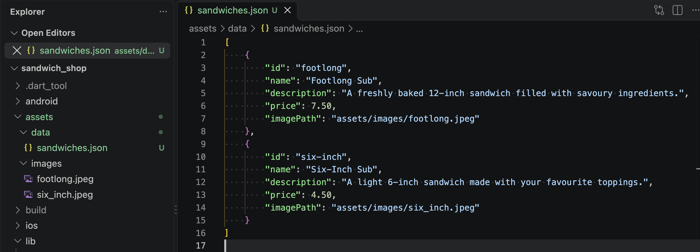

With `sandwiches.json` open, open the Command Palette with **Ctrl + Shift + P** on Windows or **⌘ + Shift + P** on macOS. Run **Format Document With...**, select **Configure Default Formatter...**, then choose **JSON Language Features** or **Prettier - Code formatter** (you may be prompted to install extensions if you don't have them). This sets the default formatter for JSON files, without changing your Dart formatter.

Run **Format Document** from the Command Palette to tidy the indentation. You can also use **Shift + Alt + F** on Windows or **Shift + Option + F** on macOS. If formatting fails, check for missing commas or brackets first; formatting does not repair invalid JSON.

Similar to [asset registration in Worksheet 3](worksheet-3.md#register-assets-in-pubspec), we add `assets/data/` alongside `assets/images/` in `pubspec.yaml`:

```yaml
  assets:
    - assets/images/
    - assets/data/
```

See below the changes we made in `pubspec.yaml`:

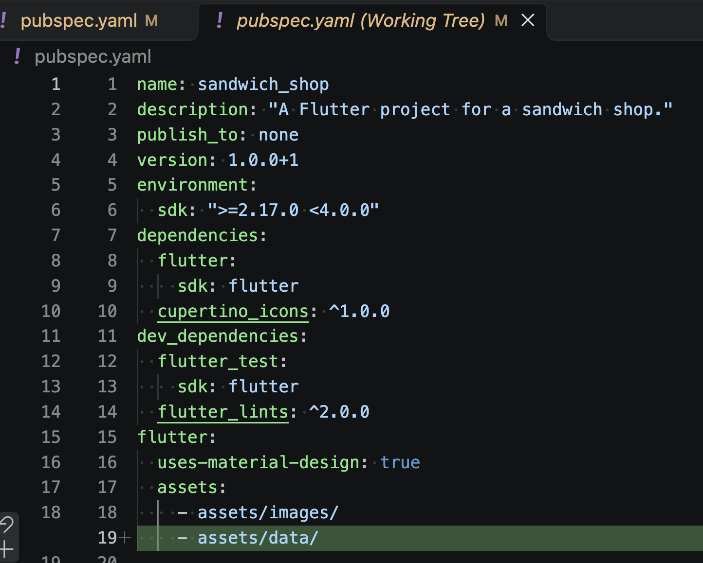

Make sure to place this under the existing `flutter:` entry and run `flutter pub get`.

### Convert a JSON map into a sandwich

Open `lib/models/sandwich.dart`. We will add a named constructor, `Sandwich.fromJson`, to convert the map representing each JSON object into a `Sandwich`.

A `Map` stores values under keys. `Map<String, dynamic>` means that its keys are strings and its values can have different types. Inside `Sandwich`, after its existing constructor, add this factory constructor outline. It will show an error until you add its return statement:

```dart
  factory Sandwich.fromJson(Map<String, dynamic> json) {
  }
```

The `Sandwich` constructor you wrote in Worksheet 3 needs every value to be passed in separately. Here we have a single map instead, so we write a second constructor that takes the map, picks out each value and builds the `Sandwich` for us. The `factory` keyword lets a constructor run some code first and then `return` the new `Sandwich`. The way you can use this constructor is to call `Sandwich.fromJson(someMap)`. See [factory constructors](https://dart.dev/language/constructors#factory-constructors) for more detail.

Inside the braces of `Sandwich.fromJson`, add the fields:

```dart
    final String id = json['id'] as String;
    final String name = json['name'] as String;
    final String description = json['description'] as String;
    final num priceNumber = json['price'] as num;
    final double price = priceNumber.toDouble();
    final String imagePath = json['imagePath'] as String;
```

Because the map's values are `dynamic`, Dart does not know that `json['name']` holds a `String`. The `as` operator checks that a value has the stated type, so `json['name'] as String` gives us a `String` we can store in a typed variable; it throws an error if the data is wrong. `num` accepts either an integer or a decimal number, and `toDouble()` gives our model a `double` in both cases. See [Dart type tests](https://dart.dev/language/operators#type-test-operators).

After those declarations, return the instance:

```dart
    return Sandwich(
      id: id,
      name: name,
      description: description,
      price: price,
      imagePath: imagePath,
    );
```

Your `fromJson` constructor should look like this:

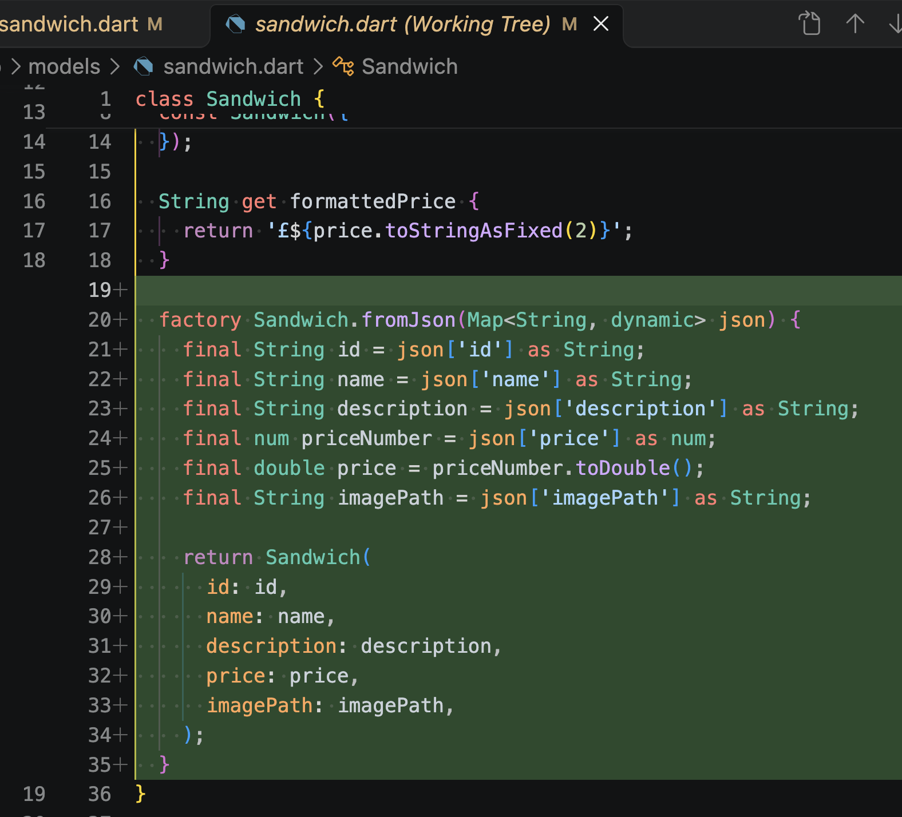

### Convert a sandwich back into a map

The menu only needs to read JSON, but we also practise the reverse conversion so you can export a sandwich's data when needed. Inside `Sandwich`, add a `toJson` method:

```dart
  Map<String, dynamic> toJson() {
    final Map<String, dynamic> data = <String, dynamic>{};
    return data;
  }
```

Replace the empty map `{}` with these entries:

```dart
    final Map<String, dynamic> data = <String, dynamic>{
      'id': id,
      'name': name,
      'description': description,
      'price': price,
      'imagePath': imagePath,
    };
```

`toJson` returns a map, not JSON text. `jsonEncode` from `dart:convert` can turn that map into text when needed; we only need to decode text for the catalogue. We check `toJson` in the tests below.

Here is the `toJson` method:

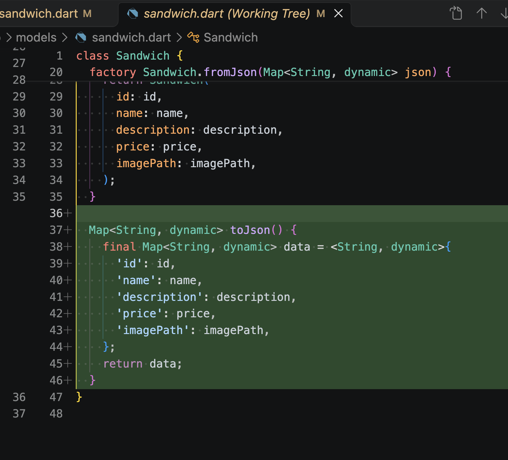

### Test both sandwich conversions

Let's use the [model testing pattern from Worksheet 4](worksheet-4.md#unit-testing-data-models) to add tests for the `Sandwich` model's newly added `fromJson` and `toJson` methods.

Inside the existing group in `test/sandwich_model_test.dart`, add a test that creates a map as shown below:

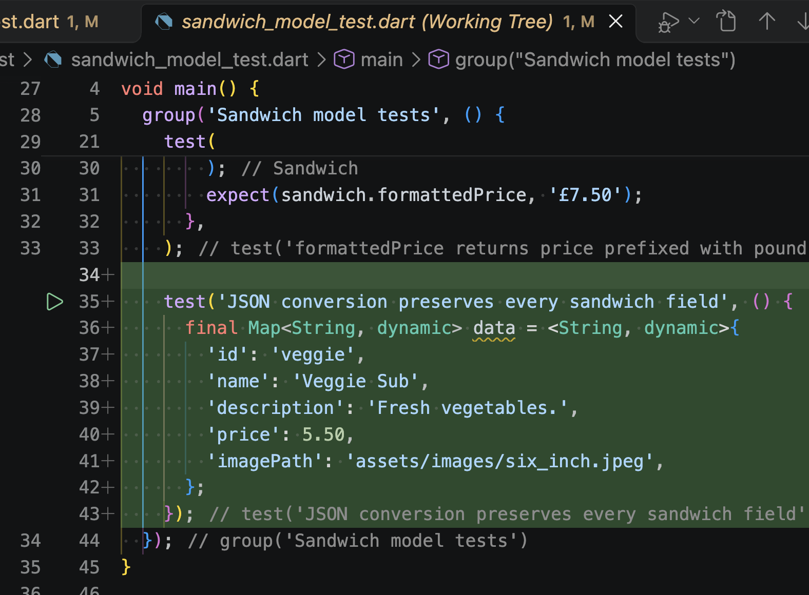

Inside that test, after the map declaration, convert it into a `Sandwich`, check each field, and compare the map returned by `toJson` with the original. See below:

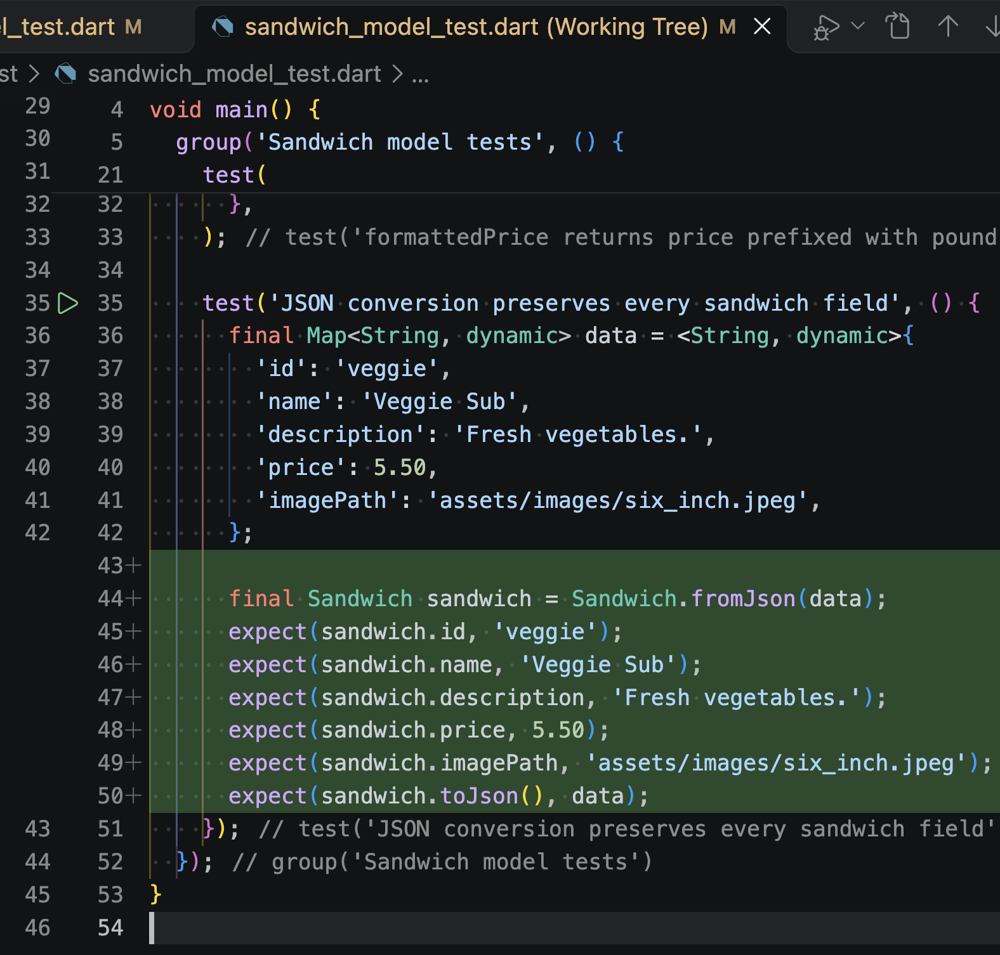

Add another test that makes another map with a whole-number price to test the `fromJson` method's handling of `num` conversion. See below our example:

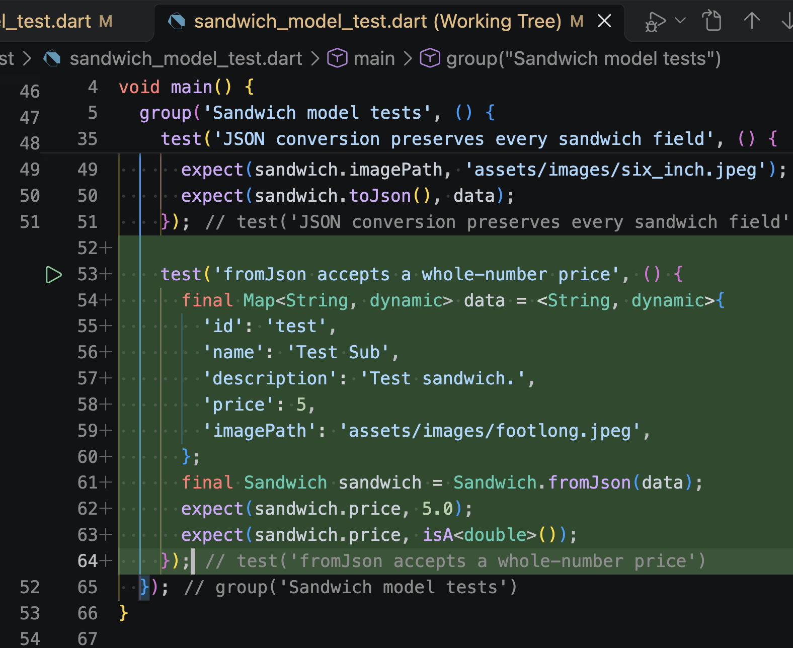

`isA<double>()` checks that the value is a `double`, even if the original JSON had a whole-number price.

Run `flutter test test/sandwich_model_test.dart` and make sure they pass.

### Read the asset in the repository

Open `lib/repositories/sandwich_repository.dart` and add these imports (try to put `dart:convert` first, followed by package imports).

```dart
import 'dart:convert';

import 'package:flutter/services.dart';
```

`dart:convert` provides `jsonDecode`, which turns JSON text into Dart lists and maps: a JSON array becomes a `List` and each JSON object becomes a `Map<String, dynamic>`. `package:flutter/services.dart` provides `rootBundle`, an object that reads the files listed under `assets:` in `pubspec.yaml`; see [loading text assets](https://docs.flutter.dev/ui/assets/assets-and-images#loading-text-assets).

At the top of `SandwichRepository`, add a private field `_cachedSandwiches` to hold the most recently loaded list:

```dart
  List<Sandwich>? _cachedSandwiches;
```

After the `getSandwichById` method, add the loader's outline:

```dart
  Future<List<Sandwich>> loadSandwichesFromAsset({
    String assetPath = 'assets/data/sandwiches.json',
  }) async {
  }
```

See below what the repository code should look like:

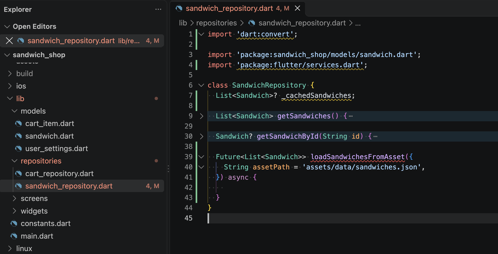

`List<Sandwich>?` means that the `_cachedSandwiches` cache (a variable that holds the most recently loaded list) is either a list or `null`; it starts as `null` because nothing has been loaded yet.

Recall the use of `Future`, `async` and `await` in [Worksheet 4's widget tests](worksheet-4.md#understand-widget-tests) and apply the same pattern to the file read. In our repository, `Future<List<Sandwich>>` means that `loadSandwichesFromAsset` eventually completes with a sandwich list or an error, rather than returning a list immediately.

Like `maxQuantity` in [Worksheet 2](worksheet-2.md#use-orderscreen-inside-app), `assetPath` is an optional named parameter with a default value (hence it is in curly brackets). Calling `loadSandwichesFromAsset()` reads `assets/data/sandwiches.json`, while a test could pass a different path.

Inside the loader, read and decode the text:

```dart
    final String jsonString = await rootBundle.loadString(assetPath);
    final dynamic decodedData = jsonDecode(jsonString);
    final List<dynamic> jsonList = decodedData as List<dynamic>;
    final List<Sandwich> loadedSandwiches = [];
```

`rootBundle.loadString` returns a `Future<String>`, so `await` waits for the JSON file's text to be available before continuing.

Next, `jsonDecode` returns `dynamic`, because it cannot know in advance whether the text holds a list, a map or a single value.

We know that our file contains an array, so `decodedData as List<dynamic>` checks that the decoded value is a list; it throws an error if the file contains a different kind of value.

Finally, we declare the empty `loadedSandwiches` list. The loop below creates a `Sandwich` from each JSON object in `jsonList` and adds it to this list.

After those declarations, convert each entry using the following loop:

```dart
    for (final dynamic item in jsonList) {
      final Map<String, dynamic> itemMap = item as Map<String, dynamic>;
      final Sandwich sandwich = Sandwich.fromJson(itemMap);
      loadedSandwiches.add(sandwich);
    }

    _cachedSandwiches = loadedSandwiches;
    return loadedSandwiches;
```

Each `item` is `dynamic`, so `item as Map<String, dynamic>` checks that it is a JSON object before we pass it to `Sandwich.fromJson`. After the loop, we store the list in the cache and return it. Because the method is `async`, returning a `List<Sandwich>` completes the `Future`. Otherwise, if at any point in the process an error occurs, the `Future` will complete with an error.

See below the completed `loadSandwichesFromAsset` method:


At the beginning of the existing `getSandwiches` method, before its original `return` statement, add the following:

```dart
    final List<Sandwich>? cachedSandwiches = _cachedSandwiches;
    if (cachedSandwiches != null) {
      return cachedSandwiches;
    }
```

We copy the field into a local variable first. After the `!= null` check, Dart knows the local variable cannot be `null` inside the `if`, so it can be returned as a `List<Sandwich>`. Dart cannot make that guarantee for our mutable `_cachedSandwiches` field directly, which is why we use the local copy.

Keep the existing fixed list and `getSandwichById` method so the earlier synchronous lookup tests still work without loading an asset. For each repository instance, `getSandwiches` returns the fixed list until a successful load, then returns the cached list. The menu will await the loader directly and display an error if it fails, rather than fall back to the fixed list.

The `getSandwiches` method should look like this:


### Test the asset loader

Open `test/sandwich_repository_test.dart`. Reading an asset with `rootBundle` needs Flutter's test binding, which connects the test to Flutter services. Plain `test` calls do not initialise it automatically.

To do this, at the top of `main()`, before the group, add:

```dart
  TestWidgetsFlutterBinding.ensureInitialized();
```

`testWidgets` initialises the binding for you, but our repository tests use `test`. The existing `flutter_test` import provides `TestWidgetsFlutterBinding`. Inside the group, add a test that loads the real file:

```dart
    test('loadSandwichesFromAsset reads the bundled JSON menu', () async {
      final SandwichRepository repository = SandwichRepository();
      final List<Sandwich> sandwiches =
          await repository.loadSandwichesFromAsset();

      expect(sandwiches.length, 2);
      expect(sandwiches[0].id, 'footlong');
      expect(sandwiches[1].id, 'six-inch');
      expect(repository.getSandwiches(), sandwiches);
    });
```

The callback is `async` so that it can `await` the loader. The last line checks that `getSandwiches` now returns the cached list. Run `flutter test test/sandwich_repository_test.dart`.

The new test should pass alongside the existing repository tests, as shown below:

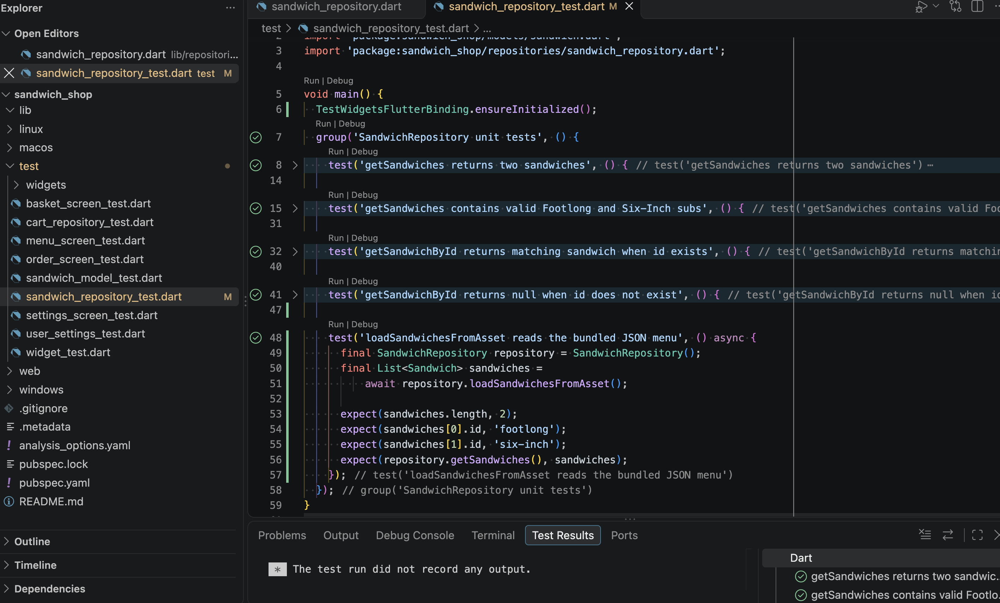

### Load the menu when the screen opens

Open `lib/screens/menu_screen.dart`. Convert `MenuScreen` to a `StatefulWidget` using **Ctrl + .** on Windows or **⌘ + .** on macOS and **Convert to StatefulWidget**. Keep its constructor, imports, app bar and list layout. If you forgot how to do this, revisit [Worksheet 2 and its exercises](worksheet-2.md#define-the-orderscreen-stateful-widget).

Inside `_MenuScreenState`, declare:

```dart
  List<Sandwich> _sandwiches = [];
  bool _loading = true;
  String _errorMessage = '';
```

Also add an `initState` method. Then implement a `_loadSandwiches` method to asynchronously load the menu:

```dart
  @override
  void initState() {
    super.initState();
    _loadSandwiches();
  }

  Future<void> _loadSandwiches() async {
    try {
    } catch (error) {
    }
  }
```

`Future<void>` means the asynchronous method completes without returning a value; it updates the screen's state instead. Keep `initState` synchronous: it starts `_loadSandwiches`, and that separate method awaits the file read.

`try` runs an operation that might fail; if any statement inside it throws an error, Dart jumps to `catch`, and `error` holds what was thrown. Here we display the failure rather than leave a permanent loading indicator. See [Dart error handling](https://dart.dev/language/error-handling#catch) or [the Dart worksheets linked in Worksheet 1](worksheet-1.md#introduction-to-the-dart-language) for a refresher.

Inside `try`, load the menu and update state:

```dart
      final SandwichRepository repository = SandwichRepository();
      final List<Sandwich> sandwiches =
          await repository.loadSandwichesFromAsset();
      if (!mounted) {
        return;
      }
      setState(() {
        _sandwiches = sandwiches;
        _loading = false;
      });
```

[`mounted`](https://api.flutter.dev/flutter/widgets/State/mounted.html) is a Boolean property declared in the `State` class. It is true while this state belongs to the widget tree. After an `await`, the user might have left the screen. The check prevents updating a disposed state; we use the same guard after later storage operations.

Inside `catch`, add:

```dart
      if (!mounted) {
        return;
      }
      setState(() {
        _errorMessage = 'Could not load the menu: $error';
        _loading = false;
      });
```

Here is our completed `_loadSandwiches` method:


### Display loading and error states

In `build`, remove the local repository and `sandwiches` declarations. Start the method with:

```dart
    final Widget body;
    if (_loading) {
      body = const Center(child: CircularProgressIndicator());
    } else if (_errorMessage.isNotEmpty) {
      body = Center(child: Text(_errorMessage));
    } else {
      body = ListView.builder(
        itemCount: _sandwiches.length,
        itemBuilder: (BuildContext context, int index) {
          return SandwichCard(sandwich: _sandwiches[index]);
        },
      );
    }
```

`final Widget body;` declares a variable without giving it a value yet. Each branch of the `if` statement assigns it exactly once, and Dart reports an error if any branch forgets. [`CircularProgressIndicator`](https://api.flutter.dev/flutter/material/CircularProgressIndicator-class.html) shows that work is in progress. Keep the existing `Scaffold` and its app bar, but replace its `body` value with `body`. The list now comes from the asset.

Here is what your `build` method should look like now:


Let's test our loading and error states by adding two more menu items to the JSON asset. One is a real item we sell; the other is a made-up item with an incorrect price type. Replace the contents of `assets/data/sandwiches.json` with this array:

```json
[
  {
    "id": "footlong",
    "name": "Footlong Sub",
    "description": "A freshly baked 12-inch sandwich filled with savoury ingredients.",
    "price": 7.50,
    "imagePath": "assets/images/footlong.jpeg"
  },
  {
    "id": "six-inch",
    "name": "Six-Inch Sub",
    "description": "A light 6-inch sandwich made with your favourite toppings.",
    "price": 4.50,
    "imagePath": "assets/images/six_inch.jpeg"
  },
  {
    "id": "nachos",
    "name": "Loaded Nachos",
    "description": "Crispy tortilla chips topped with melted cheese, jalapenos, and sour cream.",
    "price": 6.99,
    "imagePath": "assets/images/nachos.jpeg"
  },
  {
    "id": "nonexistent",
    "name": "Nonexistent Sandwich",
    "description": "This item is not on our real menu and its image is missing.",
    "price": "free",
    "imagePath": "assets/images/nonexistent.jpeg"
  }
]
```

Download the [nachos image](images/6/nachos.jpeg) and save it as `assets/images/nachos.jpeg`. The completed branch `6` includes this file. The existing `assets/images/` registration already covers it, so no new `pubspec.yaml` entry is needed. Run `flutter pub get` and fully restart the app after adding the image.

The text is valid JSON, but `"free"` is a string where `Sandwich.fromJson` expects a number. When you run the app, the menu's error message should report this type error, as shown below:

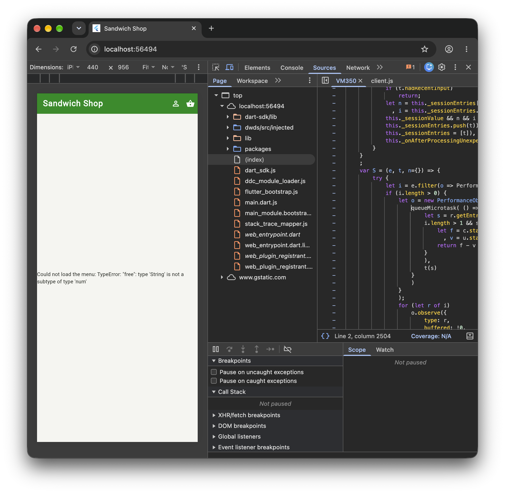

To fix this error, replace the `"price": "free"` line with a valid number, for example `"price": 0.00`, and run the app again. The menu should now look like this:

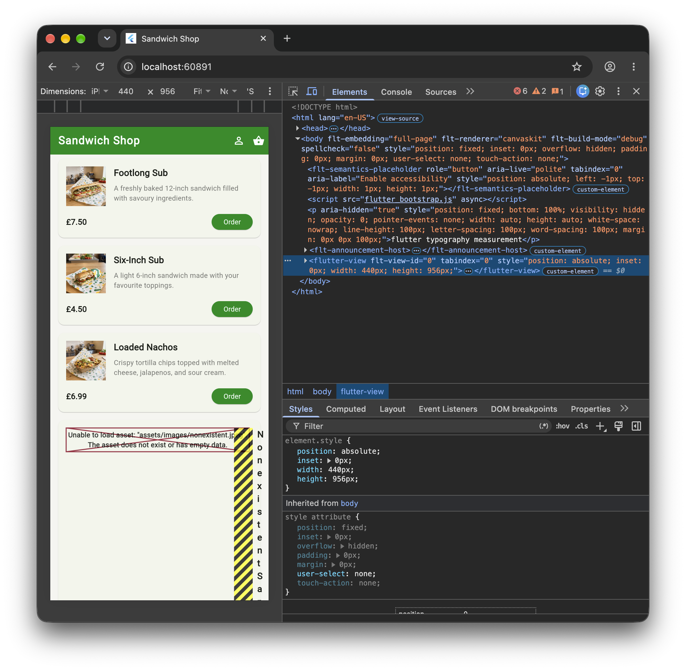

The screenshot also shows a second, separate error: `assets/images/nonexistent.jpeg` deliberately does not exist. Keep that path so we can test image-loading feedback without breaking the whole menu. In `lib/widgets/sandwich_card.dart`, add an `errorBuilder` argument to the existing `Image.asset`, after `fit`:

```dart
                  errorBuilder: (
                    BuildContext context,
                    Object error,
                    StackTrace? stackTrace,
                  ) {
                    return const SizedBox(
                      width: 80,
                      height: 80,
                      child: Center(child: Text('Image unavailable')),
                    );
                  },
```

Flutter calls `errorBuilder` if the image cannot load. Its parameters supply the widget context, error and optional stack trace. Our builder displays a visible message in the same space as the image, rather than the debug error shown in the screenshot. Restart and scroll down: the nachos should have a photo, while the made-up item should show **Image unavailable**. Leave the final price as `0.00`, not `"free"`, so the completed menu can load.

### Update the menu and app tests

The bundled menu now has four items. In the asset-loader test in `test/sandwich_repository_test.dart`, change the length expectation from `2` to `4`. After checking the original two IDs, add:

```dart
      expect(sandwiches[2].id, 'nachos');
      expect(sandwiches[2].price, 6.99);
      expect(sandwiches[2].imagePath, 'assets/images/nachos.jpeg');
      expect(sandwiches[3].id, 'nonexistent');
      expect(sandwiches[3].price, 0.0);
```

Keep the earlier synchronous repository tests expecting two sandwiches: each fresh repository still starts with the original fixed list until its asset loader runs. A lookup for `'non-existent'` still returns `null`; it is not the same ID as our added `'nonexistent'` item.

In `test/menu_screen_test.dart` and `test/widget_test.dart`, import the asset services:

```dart
import 'package:flutter/services.dart';
```

Inside `main`, add this setup, or add its single statement to an existing `setUp`:

```dart
  setUp(() {
    rootBundle.clear();
  });
```

`setUp` runs before each test, as in [Worksheet 5's repository tests](worksheet-5.md#unit-test-the-cart-repository). Flutter widget tests control time so that asynchronous behaviour can be tested predictably. `rootBundle.clear()` clears cached asset reads so a later widget test does not reuse an unfinished read from an earlier test.

In every test that opens the menu or app, add `await tester.pumpAndSettle();` after `pumpWidget`, before checking catalogue text or tapping its buttons. As well as the route transitions from [Worksheet 4](worksheet-4.md#simulating-user-interaction-and-navigation), `pumpAndSettle` now waits for the asset load to finish.

In the app test that checks names and prices, replace `expect(find.text('Order'), findsNWidgets(2));` with `expect(find.text('Order'), findsWidgets);`. `ListView.builder` builds cards as they approach the visible area, so neither two nor four visible buttons is a reliable catalogue count. Keep the exact count in the repository test instead.

At the end of that app test, scroll to the added items and check their prices and image feedback:

```dart
      await tester.scrollUntilVisible(find.text('Loaded Nachos'), 150);
      expect(find.text('£6.99'), findsOneWidget);
      await tester.scrollUntilVisible(find.text('Nonexistent Sandwich'), 150);
      await tester.pumpAndSettle();
      expect(find.text('£0.00'), findsOneWidget);
      expect(find.text('Image unavailable'), findsOneWidget);
      expect(tester.takeException(), isNull);
```

`scrollUntilVisible` scrolls the list until the named item is visible. `takeException` retrieves an unhandled Flutter error; expecting `null` checks that the missing image is handled by our builder.

To verify the actual data source, temporarily change a sandwich name in the JSON asset, fully restart the app, and check that the menu changes. Restore the name afterwards. A hot reload alone does not reliably refresh a bundled asset.

## Adding shared preferences

The menu now reads its catalogue from a bundled JSON file. Next, we address a different need: remembering entries in the customer profile form when the app closes. The bundled catalogue is read-only, so it is not where we save those changes.

For these few editable values, we use shared preferences, which stores values under named keys on the device. It does not require JSON conversion: we save text and Boolean values directly, following the [Flutter key-value recipe](https://docs.flutter.dev/cookbook/persistence/key-value). The JSON asset supplies the menu, while preferences remember the customer's choices.

Shared preferences suits small, non-critical values, such as whether you want email news. It does not encrypt stored values, so never use it for passwords or payment details, and use fictional profile details when testing. The [package documentation](https://pub.dev/packages/shared_preferences) also warns that a completed save does not guarantee the data has reached permanent storage. Losing a recent preference is inconvenient, but losing a paid order would be unacceptable.

The only data we save in this worksheet is the customer profile. The basket keeps its existing in-memory behaviour: closing the app loses its contents, and checkout shows a temporary confirmation rather than saving a purchase record.

From the project root, add the preference package by running the following command in the terminal:

```bash
flutter pub add 'shared_preferences:^2.5.6'
```

This command adds `shared_preferences: ^2.5.6` under `dependencies` in `pubspec.yaml` and fetches the package, as shown below:

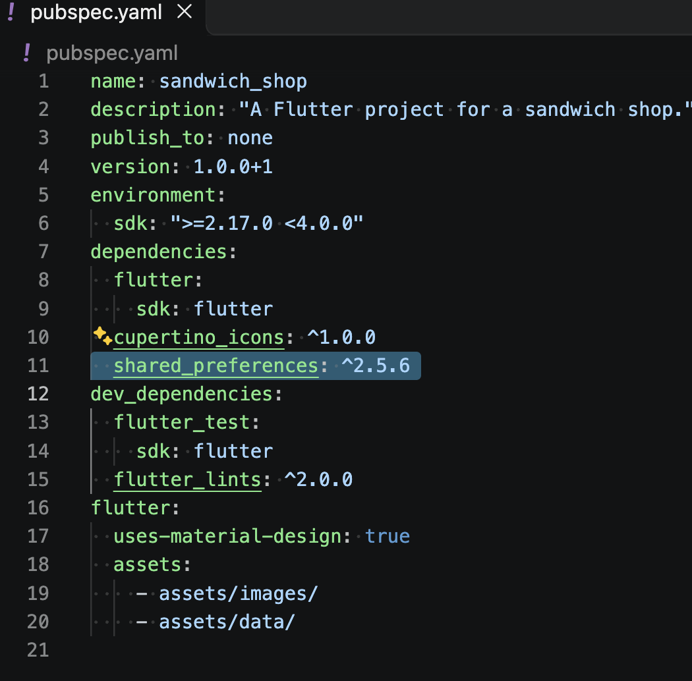

Stop and restart the app after adding the plugin rather than only hot reloading.

## Remembering the customer profile with shared preferences

We extend the [profile form from Worksheet 5](worksheet-5.md#building-the-customer-profile-settings-form). Keep its controllers, `dispose`, fields and switch; only loading and saving change.

We use `SharedPreferencesAsync` from the [shared_preferences package](https://pub.dev/packages/shared_preferences). Its reads and writes are asynchronous, so we use `await` when loading or saving each value.

### Define the preference keys

In `lib/screens/settings_screen.dart`, add the package import alongside the existing imports:

```dart
import 'package:shared_preferences/shared_preferences.dart';
```

Each saved value needs a stable key so we can find it again. Below the imports, define these keys using the [constants pattern from Worksheet 5](worksheet-5.md#define-the-shared-constants):

```dart
const String prefName = 'user_name';
const String prefAddress = 'user_address';
const String prefEmail = 'user_email';
const String prefNewsletter = 'user_newsletter';
```

Here is what the top of `lib/screens/settings_screen.dart` should look like:

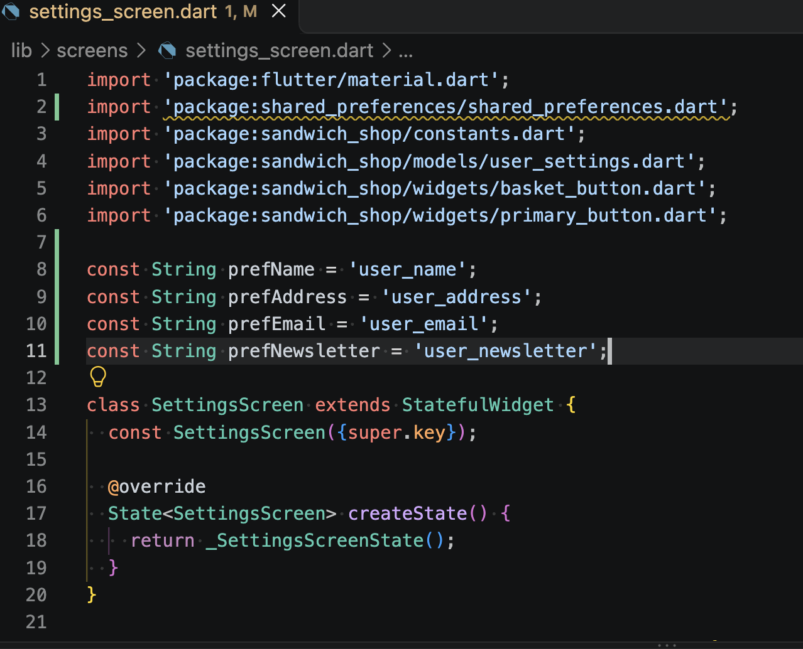

### Read saved values when settings opens

Inside `_SettingsScreenState`, create an empty `Future<void> _loadSettings() async {}` method. Within its braces, obtain the store and read its values:

```dart
    final SharedPreferencesAsync prefs = SharedPreferencesAsync();
    final String? savedName = await prefs.getString(prefName);
    final String? savedAddress = await prefs.getString(prefAddress);
    final String? savedEmail = await prefs.getString(prefEmail);
    final bool? savedNewsletter = await prefs.getBool(prefNewsletter);
```

Creating `SharedPreferencesAsync` does not need `await`. Its `getString` method reads a text value and `getBool` reads a Boolean value under the supplied key. Await each read; the result is `null` when that key has not been saved.

Below those declarations, resolve each optional string with an explicit check:

```dart
    String name = '';
    if (savedName != null) {
      name = savedName;
    }

    String address = '';
    if (savedAddress != null) {
      address = savedAddress;
    }

    String email = '';
    if (savedEmail != null) {
      email = savedEmail;
    }
```

Resolve the switch value in the same way:

```dart
    bool newsletter = false;
    if (savedNewsletter != null) {
      newsletter = savedNewsletter;
    }
```

These are first-use defaults for missing keys, not substitutes for handling a storage error.

### Fill the form after loading

Finish `_loadSettings` with the mounted guard and state update:

```dart
    if (!mounted) {
      return;
    }
    setState(() {
      _nameController.text = name;
      _addressController.text = address;
      _emailController.text = email;
      _receiveNewsletter = newsletter;
    });
```

In the existing `initState`, add `_loadSettings();` after creating all three controllers. Do not create a second `initState` or remove `dispose`.

This is what your `_loadSettings` method should look like in its entirety:

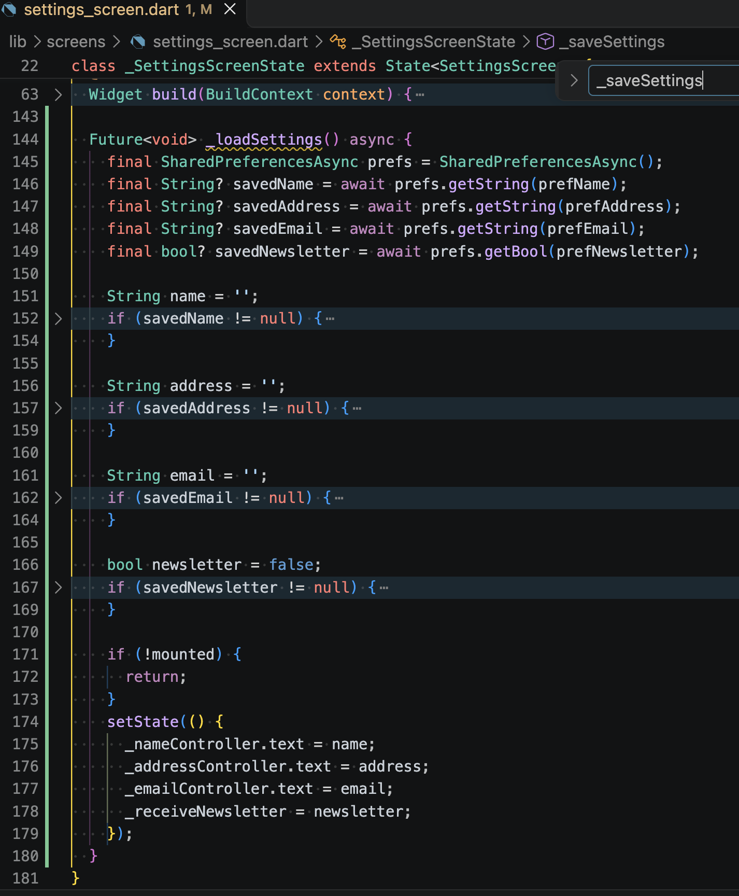

### Save the profile before showing confirmation

Change the existing `_saveSettings` return type from `void` to `Future<void>` and add `async`. Keep its three declarations that read and trim the controller text, as in [Worksheet 5](worksheet-5.md#add-text-fields-and-the-switch-toggle).

After those declarations, before constructing `UserSettings`, write the values:

```dart
    final SharedPreferencesAsync prefs = SharedPreferencesAsync();
    await prefs.setString(prefName, name);
    await prefs.setString(prefAddress, address);
    await prefs.setString(prefEmail, email);
    await prefs.setBool(prefNewsletter, _receiveNewsletter);
```

Keep the existing `UserSettings` construction. Before its confirmation `setState`, insert the guard:

```dart
    if (!mounted) {
      return;
    }
```

The existing **Save Settings** button still uses `onPressed: _saveSettings`. The confirmation now follows the awaited writes, rather than only changing the form's in-memory state.

Save a profile in the running app, then reload the page in your browser. When you open the settings screen, the form should be filled with your saved details, as shown below:

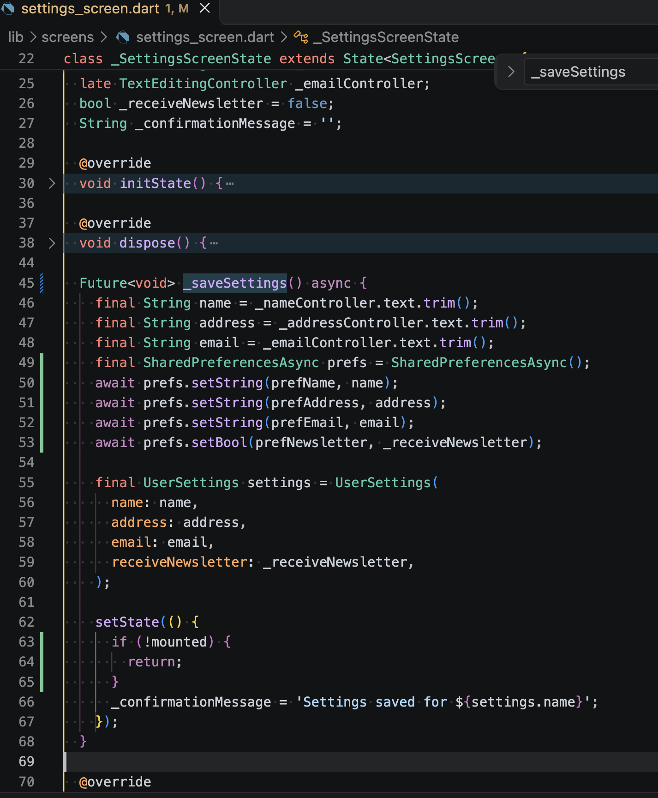

### Test loading and saving preferences

Add the package's test storage implementation as a development dependency:

```bash
flutter pub add --dev 'shared_preferences_platform_interface:^2.4.2'
```

You should see this change to your `pubspec.yaml` file:

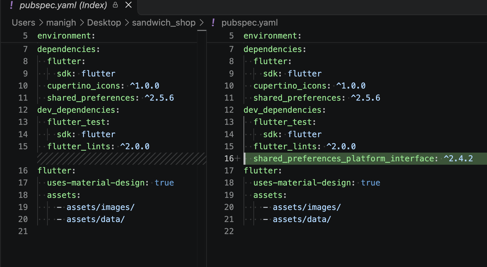

Open the existing `test/settings_screen_test.dart` from [Worksheet 5](worksheet-5.md#widget-test-the-settings-screen); do not replace its earlier tests. Add these imports:

```dart
import 'package:shared_preferences/shared_preferences.dart';
import 'package:shared_preferences_platform_interface/in_memory_shared_preferences_async.dart';
import 'package:shared_preferences_platform_interface/shared_preferences_async_platform_interface.dart';
```

Inside `main`, add this setup, or add its statement to an existing `setUp`:

```dart
  setUp(() {
    SharedPreferencesAsyncPlatform.instance =
        InMemorySharedPreferencesAsync.empty();
  });
```

This resets an in-memory test store using the same `setUp` pattern as [Worksheet 5's cart tests](worksheet-5.md#unit-test-the-cart-repository), so tests do not read or change your real profile. `SharedPreferencesAsyncPlatform.instance` selects the storage implementation used by `SharedPreferencesAsync`. The package supplies `InMemorySharedPreferencesAsync` for tests; we do not need to write our own storage class.

In each existing settings test, add `await tester.pumpAndSettle();` after opening the screen. In the save test, also replace the `await tester.pump();` after tapping **Save Settings** with `await tester.pumpAndSettle();`, so the saves finish before the result is checked.

Add a new test inside `main`:

```dart
  testWidgets('SettingsScreen pre-fills saved settings on open', (
    WidgetTester tester,
  ) async {
    SharedPreferencesAsyncPlatform.instance =
        InMemorySharedPreferencesAsync.withData(<String, Object>{
          prefName: 'Abdul Kadir',
          prefAddress: 'Portsmouth Guildhall, PO1 2AJ',
          prefEmail: 'abdul.kadir@portsmouthcc.gov.uk',
          prefNewsletter: true,
        });
  });
```

Inside the new test, after setting the mock values and before its closing `});`, render the form and check the result:

```dart
    await tester.pumpWidget(const MaterialApp(home: SettingsScreen()));
    await tester.pumpAndSettle();

    expect(find.text('Abdul Kadir'), findsOneWidget);
    expect(find.text('Portsmouth Guildhall, PO1 2AJ'), findsOneWidget);
    expect(find.text('abdul.kadir@portsmouthcc.gov.uk'), findsOneWidget);
    final Switch switchWidget = tester.widget<Switch>(find.byType(Switch));
    expect(switchWidget.value, isTrue);
```

As in [Worksheet 4](worksheet-4.md#test-navigating-to-the-order-screen), `find.byType(Switch)` locates the switch by its type. `tester.widget<Switch>(...)` returns that widget as a `Switch` so we can read its `value` property.

Next, update the existing save test, `'Toggling switch and saving settings updates state'`, rather than the new pre-fill test. Replace its three `enterText` calls and its confirmation check with these values:

```dart
    await tester.enterText(nameField, 'Gerald Vernon-Jackson');
    await tester.enterText(addressField, 'Guildhall, PO1 2AJ');
    await tester.enterText(
      emailField,
      'gerald.vernon-jackson@portsmouthcc.gov.uk',
    );
```

```dart
    expect(
      find.text('Settings saved for Gerald Vernon-Jackson'),
      findsOneWidget,
    );
```

At the end of the same save test, read the mock store to verify persistence, not just the confirmation:

```dart
    final SharedPreferencesAsync prefs = SharedPreferencesAsync();
    expect(await prefs.getString(prefName), 'Gerald Vernon-Jackson');
    expect(await prefs.getString(prefAddress), 'Guildhall, PO1 2AJ');
    expect(
      await prefs.getString(prefEmail),
      'gerald.vernon-jackson@portsmouthcc.gov.uk',
    );
    expect(await prefs.getBool(prefNewsletter), isTrue);
```

Then remove and recreate the screen to verify the saved profile is loaded again:

```dart
    await tester.pumpWidget(const SizedBox.shrink());
    await tester.pumpWidget(const MaterialApp(home: SettingsScreen()));
    await tester.pumpAndSettle();
    expect(find.text('Gerald Vernon-Jackson'), findsOneWidget);
    expect(find.text('Guildhall, PO1 2AJ'), findsOneWidget);
    expect(
      find.text('gerald.vernon-jackson@portsmouthcc.gov.uk'),
      findsOneWidget,
    );
    final Switch reopenedSwitch = tester.widget<Switch>(find.byType(Switch));
    expect(reopenedSwitch.value, isTrue);
```

Pumping `const SizedBox.shrink()`, an empty widget, removes the settings screen from the test, so the next `pumpWidget` creates a fresh screen that must load the saved values again.

The menu navigation test also opens `SettingsScreen`. Add the two platform-interface imports to `test/menu_screen_test.dart` and add `SharedPreferencesAsyncPlatform.instance = InMemorySharedPreferencesAsync.empty();` to the `setUp` that already clears `rootBundle`. Keep both setup statements, otherwise the test may reuse an earlier asset read or try to call the real preferences plugin. Use the same mock setup in any other test file that opens the settings screen.

Run the two affected files together:

```bash
flutter test test/settings_screen_test.dart test/menu_screen_test.dart
```

All of the tests in both files should pass. Finish by running `dart analyze` and `flutter test` from the project root to check that the full application still passes static analysis and all tests.

## Exercises

The exercises below apply these concepts to your Southsea Cinema coursework. Together with [Worksheet 5's exercises](worksheet-5.md#exercises), they prepare you for Demo 3. For the full coursework specification and grading criteria, see the [Southsea Cinema coursework brief](https://portdotacdotuk-my.sharepoint.com/:w:/g/personal/mani_ghahremani_port_ac_uk/IQDtIJB3bM7gQ4p03eLUngyyAd7JuhjhHuNA1l0H-qCy3Jw).

Build on the cinema app from Worksheet 5. Keep the shared app bars, drawer routes, squared buttons and ticket basket you already built.

1. Following [Loading the menu from a JSON asset](#loading-the-menu-from-a-json-asset), move the films into `assets/data/movies.json` and register the asset. Add `Movie.fromJson` and `Movie.toJson`, with tests for all fields and whole-number prices. Then add an asset loader to your movie repository, like `loadSandwichesFromAsset`, and test that it reads every film from the file.

2. In the state class for `HomeView`, start an asynchronous loading method from `initState`, following the menu screen example in this worksheet. Await the repository's asset loader inside that method (not inside `initState`); the displayed film cards must come from its result, not a hard-coded list.

    The home page should look the same as before once the films load. Show a loading indicator while the asset is read and an error message if loading fails, and check `mounted` before updating the page. Update your widget tests so they wait for the films to load.

3. Check that the JSON change has not broken your booking flow. Add tickets from a film loaded from the JSON asset, remove one from the basket and complete the temporary checkout. Checkout should still clear the in-memory basket without saving a booking history; saved bookings come in Worksheet 7. Then run `dart format`, `dart analyze` and `flutter test`, and fix any issues until the analyser reports none and every test passes.

4. (Advanced) You must complete [Worksheet 5's Exercise 6](worksheet-5.md#exercises), which builds the customer profile form on the `'/settings'` page, before starting this exercise.
 
    Add `shared_preferences` and use `SharedPreferencesAsync`, following the [Remembering the customer profile with shared preferences](#remembering-the-customer-profile-with-shared-preferences) section of this worksheet. Persist the editable cinema profile fields and email-news preference under named keys. Load them when the settings page opens and save them when the patron submits. Use fictional details. Keep the existing controller lifecycle and scrollable form. Reload the page in your browser to check that the profile values remain.

5. (Advanced) Test loading saved preferences, saving edited values and reopening the settings form with in-memory preferences, following [Test loading and saving preferences](#test-loading-and-saving-preferences).
