# Worksheet 7 — SQLite and order history

## Table of contents

- [Getting help](#getting-help)
- [Getting started](#getting-started)
  - [Continue from Worksheet 6](#continue-from-worksheet-6)
  - [Clone the Sandwich Shop repository](#clone-the-sandwich-shop-repository)
  - [Switch to branch 6](#switch-to-branch-6)
- [Choosing a database for completed orders](#choosing-a-database-for-completed-orders)
- [Preparing an Android emulator or device](#preparing-an-android-emulator-or-device)
  - [Install the Android bundle on university computers or Windows 11](#install-the-android-bundle-on-university-computers-or-windows-11)
  - [Set up an emulator on your own computer](#set-up-an-emulator-on-your-own-computer)
  - [Use a physical Android device](#use-a-physical-android-device)
  - [Add Android support to the project](#add-android-support-to-the-project)
  - [Select the device and run the app](#select-the-device-and-run-the-app)
- [Adding the SQLite packages](#adding-the-sqlite-packages)
  - [Prevent running on unsupported platforms](#prevent-running-on-unsupported-platforms)
- [Run on other platforms](#run-on-other-platforms)
  - [iOS and macOS support](#ios-and-macos-support)
  - [Windows support](#windows-support)
  - [Linux support](#linux-support)
- [Representing a saved order](#representing-a-saved-order)
  - [Create the order record and its constructor](#create-the-order-record-and-its-constructor)
  - [Convert an order into a database row](#convert-an-order-into-a-database-row)
  - [Convert a database row into an order](#convert-a-database-row-into-an-order)
- [Creating the SQLite database helper](#creating-the-sqlite-database-helper)
  - [Create one shared database helper](#create-one-shared-database-helper)
  - [Open the database in the app folder](#open-the-database-in-the-app-folder)
  - [Create the orders table](#create-the-orders-table)
  - [Seed past orders only when creating the database](#seed-past-orders-only-when-creating-the-database)
  - [Insert an order and read saved orders](#insert-an-order-and-read-saved-orders)
  - [Find the next order number and close the connection](#find-the-next-order-number-and-close-the-connection)
- [Displaying saved orders](#displaying-saved-orders)
  - [Create the orders screen and its state](#create-the-orders-screen-and-its-state)
  - [Load orders and report a database error](#load-orders-and-report-a-database-error)
  - [Build an order card in stages](#build-an-order-card-in-stages)
  - [Choose the loading, error, empty or list body](#choose-the-loading-error-empty-or-list-body)
  - [Register the orders route and add navigation buttons](#register-the-orders-route-and-add-navigation-buttons)
- [Saving the basket at checkout](#saving-the-basket-at-checkout)
  - [Build the order summary and date](#build-the-order-summary-and-date)
  - [Save the order before clearing the basket](#save-the-order-before-clearing-the-basket)
  - [Connect the checkout button and verify a restart](#connect-the-checkout-button-and-verify-a-restart)
  - [Inspect the database on the emulator](#inspect-the-database-on-the-emulator)
- [Testing SQLite without an emulator](#testing-sqlite-without-an-emulator)
  - [Remove the temporary menu item](#remove-the-temporary-menu-item)
  - [Move the tests into mirrored folders](#move-the-tests-into-mirrored-folders)
  - [Prepare a fresh database for each test](#prepare-a-fresh-database-for-each-test)
  - [Test inserting, reading and numbering orders](#test-inserting-reading-and-numbering-orders)
  - [Test order map conversion](#test-order-map-conversion)
  - [Update the basket checkout test](#update-the-basket-checkout-test)
  - [Test that a failed save keeps the basket](#test-that-a-failed-save-keeps-the-basket)
  - [Test the orders list and its empty state](#test-the-orders-list-and-its-empty-state)
  - [Test supported platforms and run the complete suite](#test-supported-platforms-and-run-the-complete-suite)
- [Organising tests](#organising-tests)
- [Exercises](#exercises)

## Getting help

To get support with this worksheet, follow the [Discord guide](https://portdotacdotuk-my.sharepoint.com/:p:/g/personal/mani_ghahremani_port_ac_uk/IQCMJP6IiR_bQoYUMdXJSRDYAWnajEALZYEXFZyrJkHS1QU) and post your questions there. You can also attend your timetabled practical sessions and ask a member of teaching staff for guidance.

## Getting started

### Continue from Worksheet 6

You can continue directly with the Sandwich Shop project you completed in [Worksheet 6](worksheet-6.md). Open the project folder in VS Code with **File > Open Folder**. You do not need to clone the repository again.

### Clone the Sandwich Shop repository

If you need a fresh copy of the project, clone the [Sandwich Shop repository](https://github.com/manighahrmani/sandwich_shop). Open a terminal and move to a folder that is not synchronised to cloud storage, such as your `Downloads` folder:

```bash
cd ~/Downloads
git clone https://github.com/manighahrmani/sandwich_shop
cd sandwich_shop
```

Open the cloned folder in VS Code with **File > Open Folder**.

### Switch to branch 6

If you cloned a fresh copy, switch to branch `6` so your project matches the state after completing Worksheet 6:

```bash
git checkout 6
```

If you are continuing your own project, stay on the branch containing your completed work instead.

Run `flutter pub get` to install the project dependencies, then run `flutter test` to confirm that all existing tests pass before continuing.

Do not switch branches over unfinished work. Branch `7` contains the completed Sandwich Shop application for this worksheet; use it to compare your finished work, not as your starting point.

## Choosing a database for completed orders

So far, we have used JSON assets for the catalogue and shared preferences for profile settings. Neither is a suitable store for a growing purchase history because JSON assets are read-only and shared preferences are intended for small key-value pairs, not structured, queryable data.

SQL databases, on the other hand, are designed for reading, writing and querying structured data efficiently. There are different SQL database engines, such as MySQL, PostgreSQL and SQLite, each with its own features and use cases. For mobile applications, SQLite is commonly used because it is lightweight and runs directly on the device. It is serverless, which means that it does not require a separate database server.

We will therefore use SQLite to store completed orders locally on the device. A table has named columns, and each row holds one order, with a primary key that identifies that row. We create the table with `CREATE TABLE`, insert purchases with `insert` and read them with `query`; these helper methods build SQL `INSERT` and `SELECT` statements. Read the [Flutter SQLite recipe](https://docs.flutter.dev/cookbook/persistence/sqlite) alongside this example.

We record completed purchases rather than edit or delete purchase history. Updating and deleting records are not required for now, but you can investigate them later if you wish. No Provider package, notifier or new state-management layer is needed.

## Preparing an Android emulator or device

The standard `sqflite` plugin we use to access SQLite does not support web browsers. For this worksheet, we will run the app on an Android emulator or a physical Android device instead.

An emulator is a virtual Android device running on your computer.

Our automated tests will use an in-memory database and do not need an emulator. Prepare your emulator or device now, before adding database code. Follow the appropriate section below:

1. [Install the Android bundle on university computers or Windows 11](#install-the-android-bundle-on-university-computers-or-windows-11)
2. [Set up an emulator on your own computer](#set-up-an-emulator-on-your-own-computer)
3. [Use a physical Android device](#use-a-physical-android-device)

### Install the Android bundle on university computers or Windows 11

The browser-only bundle from [Worksheet 1](worksheet-1.md#b---using-the-university-machines-on-campus) does not include the Android tools. If you are working on a university lab machine or on your own Windows 11 computer, use the [Android emulator release of the portable bundle](https://github.com/manighahrmani/flutter_vscode_package#android-emulator-setup-worksheet-7-onwards). It sets up VS Code, the Flutter SDK, the Android SDK command-line tools and a virtual device without needing manual toolchain configuration. Open PowerShell and run its installer:

```powershell
irm https://raw.githubusercontent.com/manighahrmani/flutter_vscode_package/main/install-android-beta.ps1 | iex
```

This installer configures a JDK, the Android SDK and a virtual device named `flutter_emulator`, tests the emulator boot with an extended timeout, and opens VS Code on your project. The download is several gigabytes, so let it run to completion.

Because the installer already booted the emulator, you do not repeat its setup. If the emulator is not running, launch it with the command below and wait for the Android home screen. The first cold boot can take a few minutes, and a black screen is normal while it boots.

```bash
flutter emulators --launch flutter_emulator
```

Wait for the Android home screen before continuing, as shown below:

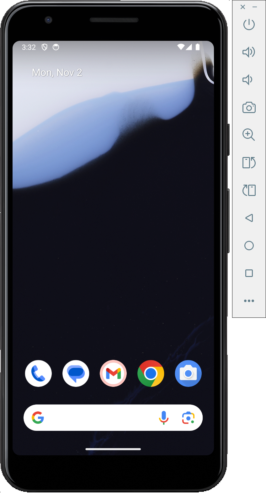

### Set up an emulator on your own computer

On your own Windows, macOS or Linux computer, you need to have Flutter installed already, as in [Worksheet 1](worksheet-1.md#a---on-your-own-device). If not, follow the [Flutter installation guide](https://docs.flutter.dev/install/quick).

Follow the [Flutter Android setup guide](https://docs.flutter.dev/platform-integration/android/setup) for your operating system, including the tooling, SDK licences, emulator setup and validation steps. You only need this setup or the university bundle, not both.

Return to this worksheet once the emulator shows the Android home screen. Check your setup in the terminal:

```bash
flutter doctor
flutter devices
flutter emulators
```

Resolve any issues reported under **Android toolchain** or **Android Studio** before continuing. On Windows, if `flutter doctor` reports that it cannot execute `java` to determine the version, point Flutter to the `jbr` subfolder inside your Android Studio installation:

```bash
flutter config --jdk-dir "C:\Program Files\Android\Android Studio\jbr"
```

If you installed Android Studio in a custom location, replace `C:\Program Files\Android\Android Studio` with your installation folder, keeping `\jbr` at the end.

The output of `flutter devices` should include your running emulator with the platform marked as `android`.

The screenshot below shows `flutter doctor` output on macOS with a working Android toolchain:

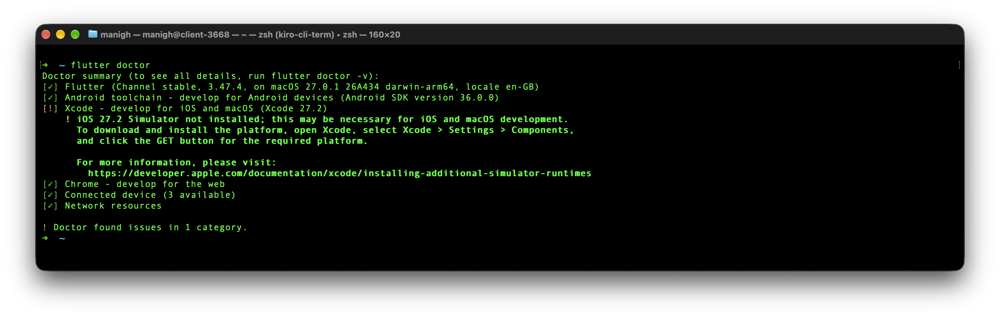

The Xcode warning concerns iOS and macOS development; you do not need to resolve it to run this worksheet's app on Android.

The screenshot below shows `flutter devices` and `flutter emulators` output with a running Android emulator:

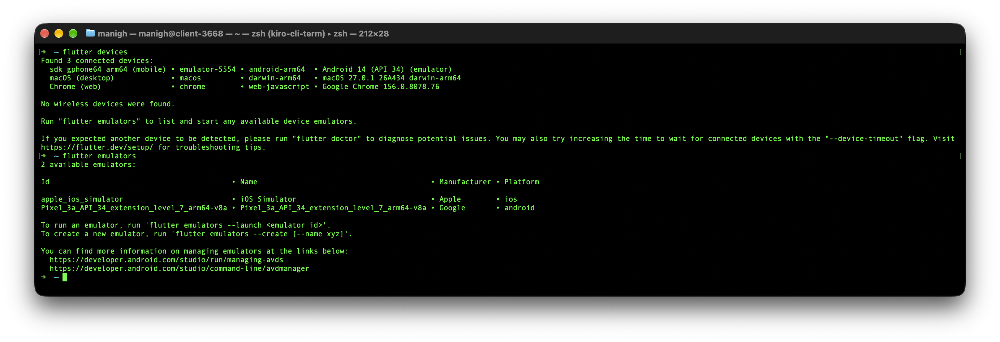

You only need one Android emulator or physical Android device for this worksheet. The screenshot also lists an iOS simulator, but you do not need to set one up.

### Use a physical Android device

On your own computer, you can run the app on an Android phone or tablet instead of an emulator. Follow the [Flutter Android setup guide](https://docs.flutter.dev/platform-integration/android/setup), choosing the physical device instructions rather than the emulator instructions. University computers may not allow USB devices, so use the emulator there.

Before continuing, run `flutter doctor` and resolve any issues reported under **Android toolchain** or **Android Studio**. Run `flutter devices` and check that your connected phone or tablet is listed with the platform marked as `android`.

To run on an iPhone or the iOS simulator instead, you need a Mac with Xcode; follow the [Flutter iOS setup guide](https://docs.flutter.dev/platform-integration/ios/setup). The app we build only allows Android until you follow [Run on other platforms](#run-on-other-platforms).

### Add Android support to the project

Before continuing, check that your Android emulator or connected physical Android device appears in `flutter devices`.

Until now, you ran the project in a browser. Flutter keeps the native project for each platform in a folder named after it. Branch `6` has a `web` folder but no `android` folder. If your project does not already have an `android` folder, add the Android project from the project root:

```bash
flutter create --platforms=android .
```

The `.` means the current folder. The command adds the `android` folder and leaves your existing `lib`, `test` and `assets` files unchanged.

### Select the device and run the app

Once the emulator or phone is running, pick it as the run target in VS Code using the device selector in the bottom-right of the status bar. If a different device is selected, click the status bar item and choose the Android emulator (for example `sdk gphone64 x86 64`) or your phone. You can also open the Command Palette with **Ctrl + Shift + P** on Windows or **⌘ + Shift + P** on macOS and run the command **Flutter: Select Device**. Do not pick Edge, Chrome or Windows, as we use Android for this worksheet. Then press **F5** to build, install and run the app with hot reload.

To run from the terminal instead, list the devices and target yours by its id:

```bash
flutter devices
flutter run -d emulator-5554
```

Replace `emulator-5554` with the id that `flutter devices` reports for your emulator or phone. The first build downloads Android build dependencies and can take several minutes. If it fails, read the reported error and check `flutter doctor`; do not assume every warning or failure is harmless.

The app should appear inside the emulator, as shown below:

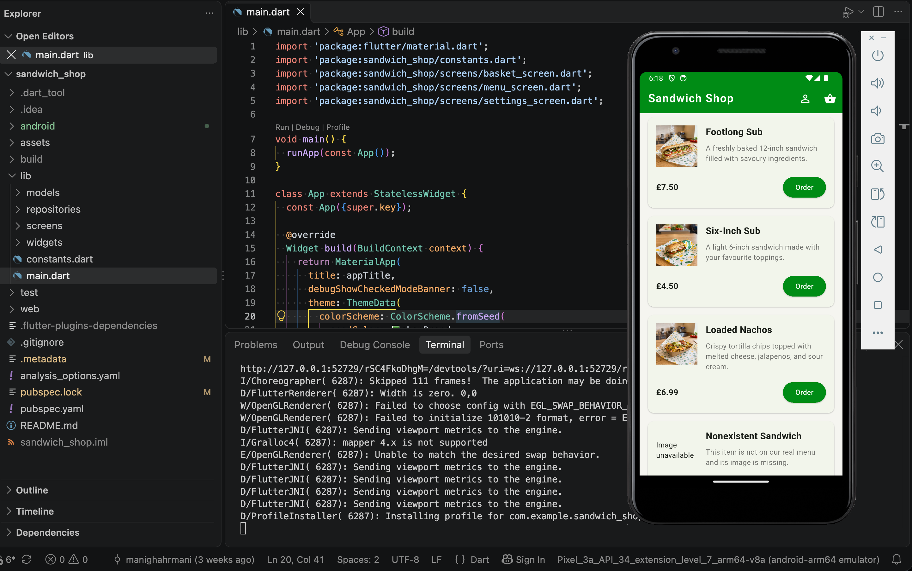

## Adding the SQLite packages

If the terminal is already running the app, click the **+** button to open a new terminal, as shown below:

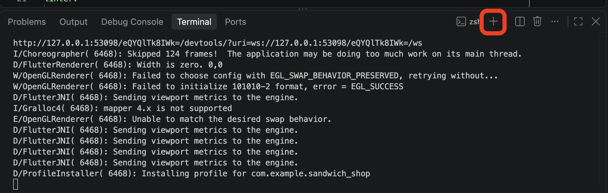

Alternatively, open the Command Palette and run **Terminal: Create New Terminal**. From the project root, run these commands to add the mobile database packages and the separate test dependency:

```bash
flutter pub add sqflite path
flutter pub add --dev sqflite_common_ffi
```

`sqflite` opens SQLite on Android. `path` provides `join` to build a file path, and `sqflite_common_ffi` supplies SQLite for tests on your computer, not the mobile app. Keep the `shared_preferences` dependency from Worksheet 6.

You should see the following changes in your `pubspec.yaml` file. Your version numbers may differ:

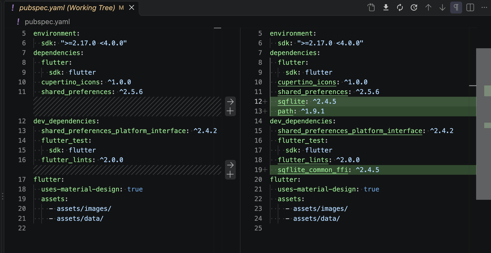

The `flutter pub add` commands also fetch the dependencies, so you do not need to run `flutter pub get` separately. After adding the plugins, stop and restart the app rather than only hot reloading.

### Prevent running on unsupported platforms

Up to Worksheet 6, you ran and tested the app in a web browser with Flutter Web. The `shared_preferences` package you added in Worksheet 6 works there because, on the web, it stores its key-value pairs in the browser's `localStorage`. That storage survives a page reload, but a university computer clears it when the profile resets.

In this worksheet we store a growing order history with `sqflite`, which is a different kind of storage. It keeps structured tables through native bindings to SQLite in the operating system, so it runs on Android, iOS and macOS but not in a web browser. Windows and Linux desktop need the extra set-up described in [Run on other platforms](#run-on-other-platforms). On the Android emulator, both the orders table and the preferences file are written to the emulator's internal storage and survive stopping and restarting the app. Uninstalling the app or clearing its storage removes these data.

`sqflite` connects itself to SQLite only when the app starts on a platform it supports. If you selected Edge or Windows and pressed **F5** once the database code is in place, the app would still open, but every database call would fail. The orders screen would show an error like the one below instead of the saved orders, and checkout would never save anything:

```text
Could not load orders: Bad state: databaseFactory not initialized
```

To stop you from running the app where it cannot work, we add a platform check to `lib/main.dart`. The check uses three pieces:

1. `kIsWeb` is a built-in Flutter constant from `package:flutter/foundation.dart`. It is `true` whenever the app runs in a web browser, so the check returns `false` in that case.
2. `defaultTargetPlatform` reports the target operating system. Our helper returns `true` only when this is `TargetPlatform.android`, allowing an Android emulator or physical Android device. You can allow more platforms later by following [Run on other platforms](#run-on-other-platforms).
3. `UnsupportedPlatformApp` is a small fallback screen. When the target is not supported, `main` starts this screen instead of the app, so the database code never runs where it would fail.

Open `lib/main.dart` and add this import alongside the existing Material import:

```dart
import 'package:flutter/foundation.dart';
```

Replace the `main` function with:

```dart
bool isSupportedPlatform() {
  if (kIsWeb) {
    return false;
  }
  if (defaultTargetPlatform == TargetPlatform.android) {
    return true;
  }
  return false;
}

void main() {
  if (isSupportedPlatform()) {
    runApp(const App());
  } else {
    runApp(const UnsupportedPlatformApp());
  }
}
```

Also, add the fallback widget shown on unsupported platforms:

```dart
class UnsupportedPlatformApp extends StatelessWidget {
  const UnsupportedPlatformApp({super.key});

  @override
  Widget build(BuildContext context) {
    return const MaterialApp(
      debugShowCheckedModeBanner: false,
      home: Scaffold(
        body: Center(
          child: Padding(
            padding: EdgeInsets.all(24.0),
            child: Text(
              'This app saves orders with SQLite and is set up to run on '
              'Android only. Stop the app and run it on an Android emulator '
              'or device instead.',
              textAlign: TextAlign.center,
            ),
          ),
        ),
      ),
    );
  }
}
```

Your changes in `main.dart` should look like this:

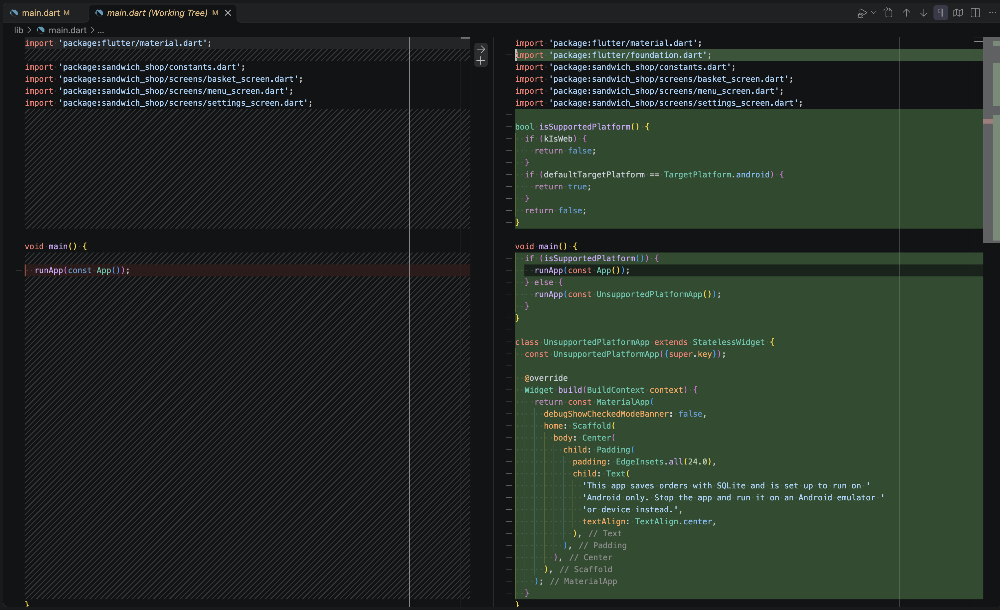

If you accidentally run the app on an unsupported browser or desktop target, the fallback screen appears as shown below:

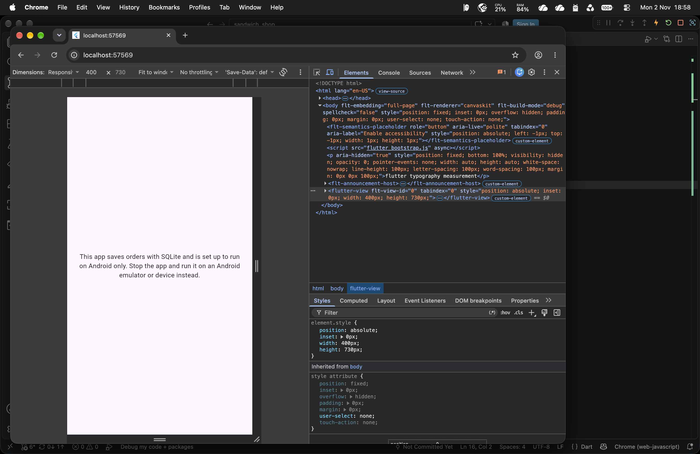

From now on, ensure your Android emulator or physical Android device is selected before running the app, as described in [Select the device and run the app](#select-the-device-and-run-the-app). The app no longer runs in a browser, so you can delete the `web` folder, as branch `7` does.

## Run on other platforms

This section is optional and applies only if you are working on your own computer. If you are using a university computer or only need Android, continue with [Representing a saved order](#representing-a-saved-order). Otherwise, complete the rest of the worksheet on Android first, then return here to add another platform.

Whenever you add a platform, update the platform tests in [Test supported platforms and run the complete suite](#test-supported-platforms-and-run-the-complete-suite) so that platform expects `isTrue`.

### iOS and macOS support

On a Mac, `sqflite` also runs on the iOS simulator and on macOS desktop. Install Xcode by following the [Flutter iOS setup guide](https://docs.flutter.dev/platform-integration/ios/setup) or the [Flutter macOS setup guide](https://docs.flutter.dev/platform-integration/macos/setup). Then add a check for each platform you want to `isSupportedPlatform`, below the Android check:

```dart
  if (defaultTargetPlatform == TargetPlatform.iOS) {
    return true;
  }
  if (defaultTargetPlatform == TargetPlatform.macOS) {
    return true;
  }
```

As with Android, the project needs a folder for each new platform. Add them with `flutter create --platforms=ios,macos .`, leaving out any platform you do not need. If the command creates a new `test/widget_test.dart` template, delete that template; keep any existing tests. Then select the iOS simulator or **macOS** in the device selector and run the app.

### Windows support

On Windows, `sqflite` has no desktop implementation, so we use the same `sqflite_common_ffi` package that the tests use. You need Visual Studio (not VS Code) with the **Desktop development with C++** workload, as described in the [Flutter Windows setup guide](https://docs.flutter.dev/platform-integration/windows/setup). The university computers do not have it. Run `flutter doctor` and check that the **Visual Studio** line has a tick. Building a Windows app with plugins also needs **Developer Mode**; run `start ms-settings:developers` and turn it on, which needs administrator rights.

In the terminal, add Windows support to the project and move `sqflite_common_ffi` from the development dependencies to the app dependencies:

```bash
flutter create --platforms=windows .
flutter pub add sqflite_common_ffi
```

The first command creates a `windows` folder. If it also creates a new `test/widget_test.dart` template, delete that template; keep any existing tests.

In `lib/main.dart`, add this import:

```dart
import 'package:sqflite_common_ffi/sqflite_ffi.dart';
```

Add a Windows check to `isSupportedPlatform`, below the Android check:

```dart
  if (defaultTargetPlatform == TargetPlatform.windows) {
    return true;
  }
```

At the start of `main`, before the existing `if` statement, point the database code at the FFI implementation when the app runs on Windows:

```dart
  if (!kIsWeb && defaultTargetPlatform == TargetPlatform.windows) {
    sqfliteFfiInit();
    databaseFactory = databaseFactoryFfi;
  }
```

`databaseFactory` decides how `openDatabase` reaches SQLite. Setting it to `databaseFactoryFfi` makes the existing `SandwichDatabase` code work on Windows without other changes. The `!kIsWeb` check matters because `defaultTargetPlatform` reports the computer's operating system even when the app runs in a browser. Select **Windows** in the device selector and run the app. The database file is saved in the project's `.dart_tool/sqflite_common_ffi/databases` folder.

### Linux support

On Linux, install the build tools listed in the [Flutter Linux setup guide](https://docs.flutter.dev/platform-integration/linux/setup), then follow the same steps as for Windows. Use `flutter create --platforms=linux .` and `TargetPlatform.linux` in place of the Windows values, and select **Linux** in the device selector. If the app reports that it cannot load the SQLite library, install it with `sudo apt-get install libsqlite3-dev`.

## Representing a saved order

A SQL table has named columns, and each row contains values for those columns. Our `orders` table will store one completed basket per row.

### Create the order record and its constructor

Create a `lib/models/order_record.dart` file with a class called `OrderRecord`. Inside its braces, declare:

```dart
  final int? id;
  final int orderNumber;
  final String summary;
  final double total;
  final String date;
```

The `id` instance variable is `null` for a new order. SQLite assigns an id to its row when it is inserted. `orderNumber` tracks the order sequence, while `summary`, `total` and `date` store the purchase details.

Add the constructor:

```dart
  const OrderRecord({
    this.id,
    required this.orderNumber,
    required this.summary,
    required this.total,
    required this.date,
  });
```

Each completed purchase is saved as one row in SQLite. To keep things simple, rather than building a multi-table relational schema with joins, we flatten the basket (the list of `CartItem` objects, which includes the sandwiches and their quantities) into a plain text summary. `CartItem` still contains only a sandwich and quantity; do not change that model.

### Convert an order into a database row

A `Map<String, Object?>` pairs string keys with values: each key is a column name, and each value is the data for that column. `Object?` allows any Dart value (`Object`), including `null`; here we only use SQLite-supported values. Inside `OrderRecord`, add an empty `Map<String, Object?> toMap() {}` method.

Inside the method, build the row:

```dart
    final Map<String, Object?> data = <String, Object?>{
      'order_number': orderNumber,
      'summary': summary,
      'total': total,
      'date': date,
    };
```

After the map, add the id only if it exists, then return the row:

```dart
    if (id != null) {
      data['id'] = id;
    }
    return data;
```

The keys are column names, not necessarily the Dart instance variable names. Leaving out a new order's id lets SQLite generate a unique id automatically.

### Convert a database row into an order

Add `factory OrderRecord.fromMap(Map<String, Object?> map) {}`. Inside it, we will read the values using the same conversion pattern as [the sandwich JSON constructor](worksheet-6.md#convert-a-json-map-into-a-sandwich). A map lookup returns `Object?`; `as int` tells Dart that this value must be an integer, and fails if it is not. We know the types because our table defines them:

```dart
    final int orderNumber = map['order_number'] as int;
    final String summary = map['summary'] as String;
    final num totalNumber = map['total'] as num;
    final double total = totalNumber.toDouble();
    final String date = map['date'] as String;
```

Return the record:

```dart
    return OrderRecord(
      id: map['id'] as int?,
      orderNumber: orderNumber,
      summary: summary,
      total: total,
      date: date,
    );
```

Your `order_record.dart` file should look like this:

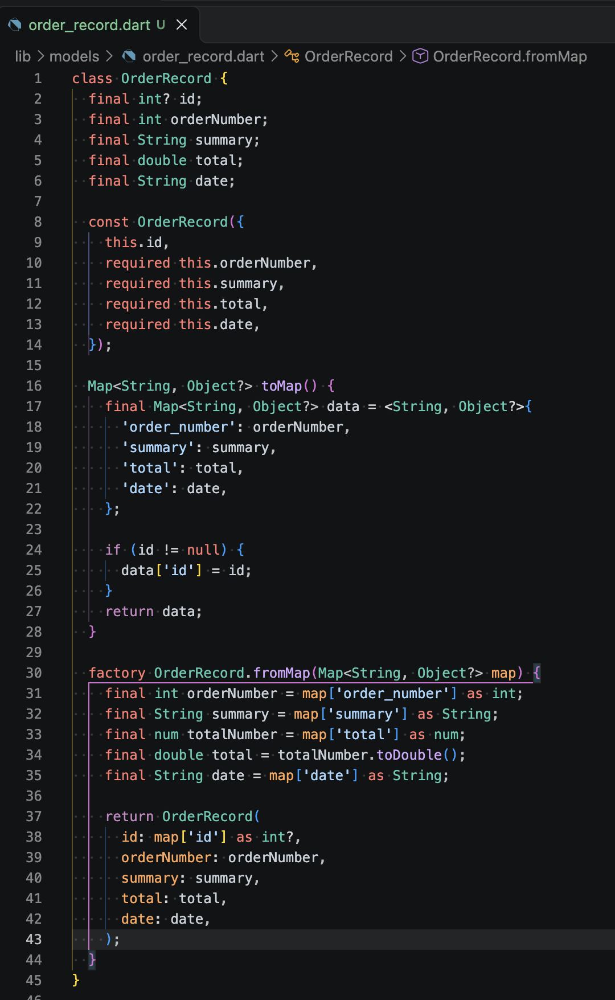

## Creating the SQLite database helper

Create a file `lib/database/sandwich_db.dart`. Following the [SQLite cookbook recipe](https://docs.flutter.dev/cookbook/persistence/sqlite), we will keep database operations in this helper class rather than scattering SQL queries throughout the app. Screens call this helper instead of repeating SQL.

### Create one shared database helper

In `lib/database/sandwich_db.dart`, start with these imports and an empty class:

```dart
import 'package:path/path.dart';
import 'package:sandwich_shop/models/order_record.dart';
import 'package:sqflite/sqflite.dart';

class SandwichDatabase {}
```

Recall the [singleton pattern from Worksheet 5](worksheet-5.md#create-the-cart-repository-singleton). A singleton gives the screens one shared helper, just as `CartRepository.instance` gives them one shared basket. The `_internal` named constructor is private, so other files cannot create their own helper.

Add the following code inside the `SandwichDatabase` class to implement the singleton pattern:

```dart
  SandwichDatabase._internal();

  static final SandwichDatabase instance = SandwichDatabase._internal();

  static Database? _database;
```

`static` means a field belongs to the class rather than an individual object. The `static final instance` field creates the shared helper once; `_database` holds its connection and starts as `null`. `Database` represents an open SQLite connection. Add a method that lets tests supply their own connection:

```dart
  void setDatabase(Database? db) {
    _database = db;
  }
```

As a reminder from Worksheet 6, a `Future<T>` represents a result that arrives later, `async` lets a method use `await`, and `await` waits for that result without blocking the interface. Here `T` is `Database`. A getter is read like a property, so callers use `await database` rather than `await database()`. Add the asynchronous getter:

```dart
  Future<Database> get database async {
    final Database? cachedDatabase = _database;
    if (cachedDatabase != null) {
      return cachedDatabase;
    }
    final Database db = await _initDB('sandwich_data.db');
    _database = db;
    return db;
  }
```

This reuses the connection after the first call. Checking the local `cachedDatabase` for `null` lets Dart treat it as a non-null `Database` inside the `if` block.

### Open the database in the app folder

In the following code, `getDatabasesPath` finds the app's writable database folder. `join` from the `path` package combines that folder with a file name using the operating system's path separator. The separator is `/` on macOS and Linux and `\` on Windows; `path` handles this automatically.

Next, `openDatabase` opens the file, creating it if necessary. Inside `SandwichDatabase`, add `_initDB`:

```dart
  Future<Database> _initDB(String fileName) async {
    final String folder = await getDatabasesPath();
    final String filePath = join(folder, fileName);
    final Database db = await openDatabase(
      filePath,
      version: 1,
      onCreate: _createDB,
    );
    return db;
  }
```

`version` identifies the table structure. `onCreate` receives a callback, `_createDB`, which runs only when the database is first created. We define `_createDB` below.

### Create the orders table

Add an empty `Future<void> createTables(Database db, int version) async {}` method inside `SandwichDatabase`. Unlike `_initDB`, its name does not start with an underscore, so tests can call it directly to create the same table without adding sample orders.

`CREATE TABLE` defines the columns of a new table; `IF NOT EXISTS` leaves an existing table alone. Inside `createTables`, use `execute` to run this SQL statement:

```dart
    await db.execute('''
      CREATE TABLE IF NOT EXISTS orders (
        id INTEGER PRIMARY KEY AUTOINCREMENT,
        order_number INTEGER NOT NULL,
        summary TEXT NOT NULL,
        total REAL NOT NULL,
        date TEXT NOT NULL
      )
    ''');
```

`execute` runs the statement without returning rows. `INTEGER`, `TEXT` and `REAL` store whole numbers, strings and decimal numbers. `PRIMARY KEY` uniquely identifies a row; `AUTOINCREMENT` assigns ids without reusing earlier automatically generated ids. `NOT NULL` requires a value.

The triple quotes let a Dart string span several lines. The column names match the keys used by `OrderRecord.toMap`, including `id` when it is present.

### Seed past orders only when creating the database

Seeding means adding initial data to a database. We will add three sample orders when the database is first created.

Add the private `_createDB` method inside `SandwichDatabase`. As the `onCreate` callback, it creates the table and inserts the sample orders.

First, call `createTables` inside `_createDB`:

```dart
  Future<void> _createDB(Database db, int version) async {
    await createTables(db, version);
  }
```

After the table call, insert the first sample order:

```dart
    await db.insert('orders', <String, Object?>{
      'order_number': 1003,
      'summary': '2 x Footlong Sub',
      'total': 15.00,
      'date': '18/04/2026 12:45',
    });
```

`insert` builds an SQL `INSERT` statement, which adds a row using the map's column names. Add a second sample after it:

```dart
    await db.insert('orders', <String, Object?>{
      'order_number': 1002,
      'summary': '1 x Six-Inch Sub',
      'total': 4.50,
      'date': '02/03/2026 18:10',
    });
```

Then add the third:

```dart
    await db.insert('orders', <String, Object?>{
      'order_number': 1001,
      'summary': '3 x Footlong Sub',
      'total': 22.50,
      'date': '11/01/2026 13:02',
    });
```

Reopening the app does not add the sample orders again. Tests call `createTables` directly when they need an empty table.

Changing this SQL or the seed values does not change an existing database. During development, clearing the emulator app's storage or uninstalling it creates a fresh start, but also deletes saved orders and preferences.

### Insert an order and read saved orders

The screens need methods to insert new orders and read saved orders.

Add the insert method:

```dart
  Future<int> insertOrder(OrderRecord order) async {
    final Database db = await database;
    final int id = await db.insert('orders', order.toMap());
    return id;
  }
```

`insert` returns the generated row id. Next, add the method that retrieves all saved orders:

```dart
  Future<List<OrderRecord>> getAllOrders() async {
    final Database db = await database;
    final List<Map<String, Object?>> records = await db.query(
      'orders',
      orderBy: 'order_number DESC',
    );

    final List<OrderRecord> orders = [];
    for (final Map<String, Object?> row in records) {
      orders.add(OrderRecord.fromMap(row));
    }
    return orders;
  }
```

`query` builds an SQL `SELECT` statement to retrieve rows. Its `orderBy` argument supplies SQL `ORDER BY`, which sorts the result. `DESC` means descending order, so the highest order number appears first. We sort by number, not the displayed date string. The loop converts each returned database row into an `OrderRecord` instance using `fromMap`.

### Find the next order number and close the connection

For demonstration purposes, order numbers start at `1001`. The next order number is one greater than the current maximum in the database.

`rawQuery` runs an SQL `SELECT` statement that you write yourself. `MAX` finds the largest value in a column, and `as max_num` gives the result a column name. Add `getNextOrderNumber` to calculate the next sequence number:

```dart
  Future<int> getNextOrderNumber() async {
    final Database db = await database;
    final List<Map<String, Object?>> records = await db.rawQuery(
      'SELECT MAX(order_number) as max_num FROM orders',
    );

    if (records.isEmpty) {
      return 1001;
    }
    final Object? maxValue = records[0]['max_num'];
    if (maxValue == null) {
      return 1001;
    }

    final int currentMax = maxValue as int;
    return currentMax + 1;
  }
```

`MAX` returns `null` when the table has no orders. Otherwise, convert the value once and add one. An empty table starts at `1001`; a new app with our seed data starts at `1004`. This approach assumes orders are saved one at a time.

Finally, add a method to close an existing connection and reset the field:

```dart
  Future<void> close() async {
    final Database? cachedDatabase = _database;
    if (cachedDatabase != null) {
      await cachedDatabase.close();
      _database = null;
    }
  }
```

Tests close the connection after each test so no data leaks into the next one. Your database helper class in `lib/database/sandwich_db.dart` should look like this:

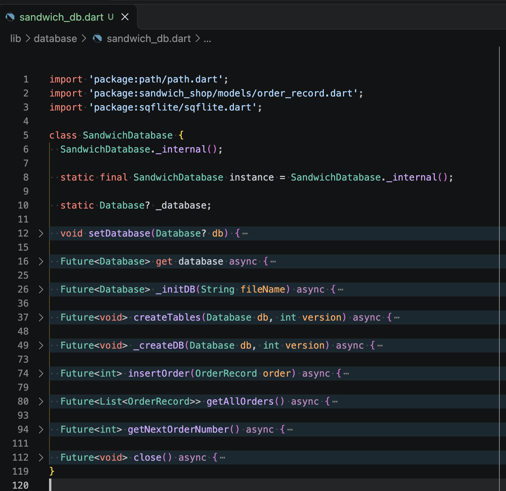

## Displaying saved orders

Build and register the destination screen before making checkout navigate to it.

### Create the orders screen and its state

Create `lib/screens/orders_screen.dart` with these imports:

```dart
import 'package:flutter/material.dart';
import 'package:sandwich_shop/constants.dart';
import 'package:sandwich_shop/database/sandwich_db.dart';
import 'package:sandwich_shop/models/order_record.dart';
import 'package:sandwich_shop/widgets/basket_button.dart';
```

Create the widget using the [stateful structure from Worksheet 2](worksheet-2.md#define-the-orderscreen-stateful-widget):

```dart
class OrdersScreen extends StatefulWidget {
  const OrdersScreen({super.key});

  @override
  State<OrdersScreen> createState() {
    return _OrdersScreenState();
  }
}
```

Below it, create the state class with a temporary body:

```dart
class _OrdersScreenState extends State<OrdersScreen> {
  List<OrderRecord> _orders = [];
  bool _loading = true;
  String _errorMessage = '';

  @override
  Widget build(BuildContext context) {
    return const Placeholder();
  }
}
```

### Load orders and report a database error

Inside the state class, add `initState`:

```dart
  @override
  void initState() {
    super.initState();
    _loadOrders();
  }
```

`try` contains work that might fail; `catch` runs if that work throws an error. Similar to [the menu loader from Worksheet 6](worksheet-6.md#load-the-menu-when-the-screen-opens), add `Future<void> _loadOrders() async {}`. Inside it, type `try` and select the `try` snippet as shown below:

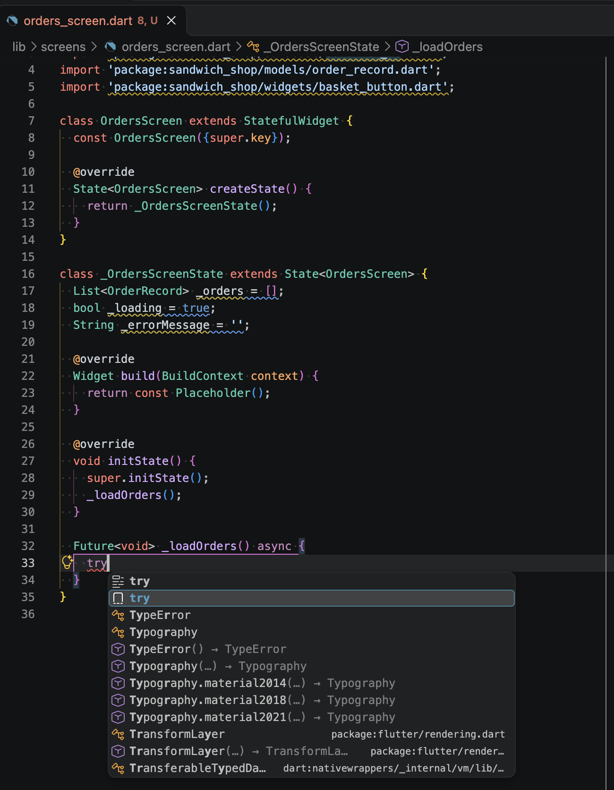

Press **Enter** to insert the empty `try` and `catch (e)` blocks, as shown below:

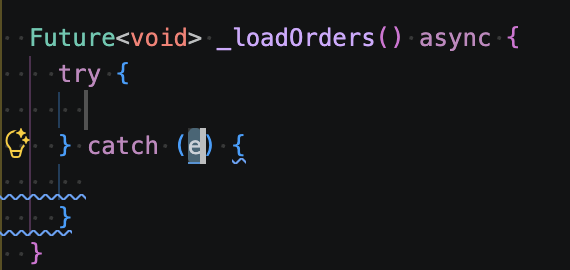

If the snippet does not appear, type `try {} catch (e) {}` yourself. Rename `e` to `error` so it matches the code below.

Inside `try`, add the following. `mounted` tells us whether this state still belongs to a widget on screen. After an `await`, check it before calling `setState`, because the user might have left the screen:

```dart
      final List<OrderRecord> orders =
          await SandwichDatabase.instance.getAllOrders();
      if (!mounted) {
        return;
      }
      setState(() {
        _orders = orders;
        _loading = false;
      });
```

Inside `catch`, add the following code to report the error and update the state:

```dart
      if (!mounted) {
        return;
      }
      setState(() {
        _errorMessage = 'Could not load orders: $error';
        _loading = false;
      });
```

This uses the same asynchronous loading pattern once again, rather than introducing another widget or state-management approach.

### Build an order card in stages

Add this helper in the `_OrdersScreenState` class, below `_loadOrders`:

```dart
  Widget _buildOrderCard(OrderRecord order) {
    return Card(
      margin: const EdgeInsets.symmetric(horizontal: 16.0, vertical: 8.0),
      child: Padding(
        padding: const EdgeInsets.all(16.0),
        child: Column(
          crossAxisAlignment: CrossAxisAlignment.start,
          children: [],
        ),
      ),
    );
  }
```

We will do the same thing we did on the home screen when we displayed [sandwich cards in Worksheet 3](worksheet-3.md#create-the-sandwichcard-widget).

Inside the empty `children` list, add a row for the number and total:

```dart
            Row(
              mainAxisAlignment: MainAxisAlignment.spaceBetween,
              children: [
                Text(
                  'Order #${order.orderNumber}',
                  style: const TextStyle(fontWeight: FontWeight.bold),
                ),
                Text('£${order.total.toStringAsFixed(2)}'),
              ],
            ),
```

After the row, add the summary and date:

```dart
            const SizedBox(height: 4),
            Text(order.summary),
            const SizedBox(height: 4),
            Text(
              order.date,
              style: const TextStyle(fontSize: 12, color: Colors.black54),
            ),
```

This is the finished `_buildOrderCard` method:

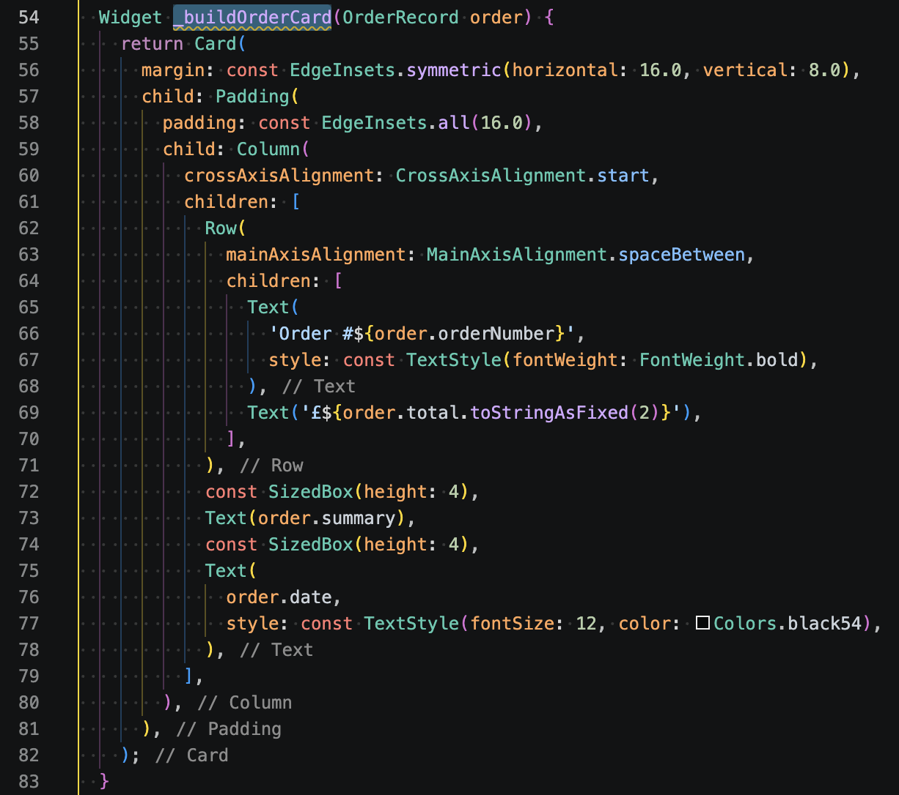

### Choose the loading, error, empty or list body

In `build`, replace `return const Placeholder();` with the following code to declare `body` and choose the first three states:

```dart
    final Widget body;
    if (_loading) {
      body = const Center(child: CircularProgressIndicator());
    } else if (_errorMessage.isNotEmpty) {
      body = Center(child: Text(_errorMessage));
    } else if (_orders.isEmpty) {
      body = const Center(
        child: Padding(
          padding: EdgeInsets.symmetric(vertical: 32.0),
          child: Text(
            'No orders yet',
            style: TextStyle(fontSize: 16, color: Colors.grey),
          ),
        ),
      );
    }
```

After the conditional, add `return body;`. This is similar to the [loading and error states from Worksheet 6](worksheet-6.md#display-loading-and-error-states), with one extra branch for a table that has no rows.

This is what your code should look like now:

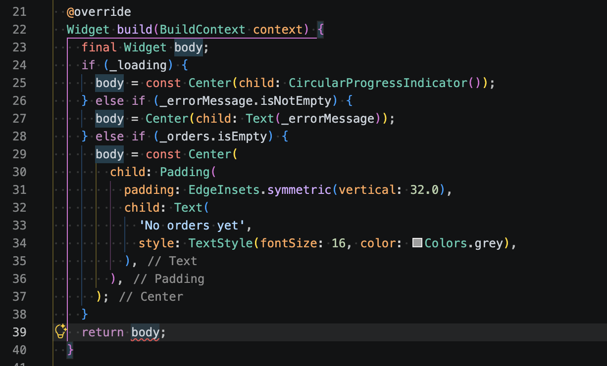

The editor still reports an error, because `body` is not assigned when there are orders to show. Immediately after the closing brace of the `if` statement, add an `else` block for the populated state:

```dart
    else {
      body = ListView.builder(
        itemCount: _orders.length,
        itemBuilder: (BuildContext context, int index) {
          return _buildOrderCard(_orders[index]);
        },
      );
    }
```

Every branch now assigns `body` exactly once. Replace `return body;` with a `Scaffold`:

```dart
    return Scaffold(
      appBar: AppBar(
        title: const Text(appTitle, style: shopHeaderStyle),
        actions: const [BasketButton()],
      ),
      body: body,
    );
```

Your `build` method should look like this:

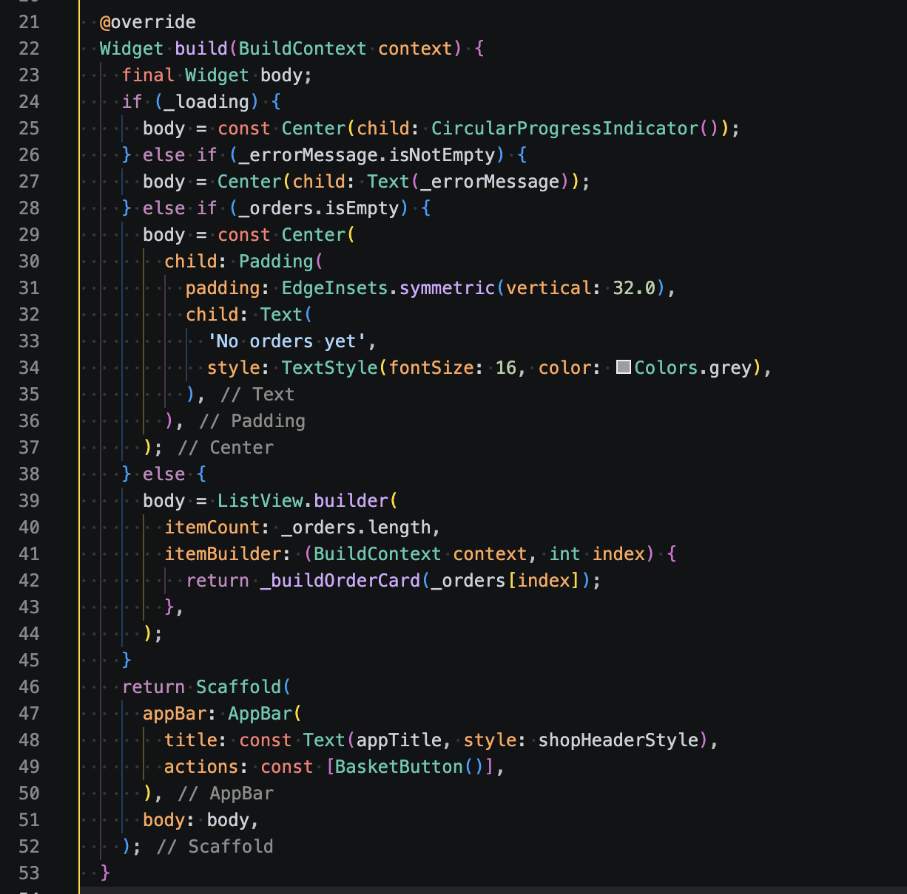

You cannot see the empty state in the app yet, because the database starts with three sample orders. We check it with a widget test in [Test the orders list and its empty state](#test-the-orders-list-and-its-empty-state).

### Register the orders route and add navigation buttons

In `lib/main.dart`, import `orders_screen.dart` and add this entry to the existing `routes` map:

```dart
        '/orders': (BuildContext context) {
          return const OrdersScreen();
        },
```

Create `lib/widgets/orders_button.dart`. In it, copy the completed [BasketButton from `basket_button` which we made in Worksheet 5](worksheet-5.md#create-the-basket-button). Rename the class and constructor to `OrdersButton`, by right clicking on its name, then selecting "Rename Symbol" and entering `OrdersButton` as shown below:

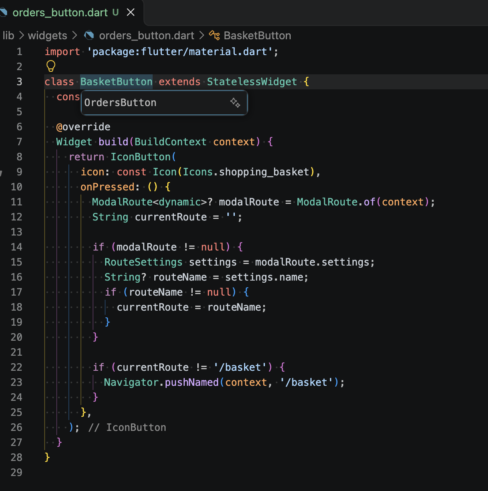

Replace `Icons.shopping_basket` with `Icons.receipt_long`, and replace both occurrences of `'/basket'` with `'/orders'`. To do this open the Search panel in your editor, search for `'/basket'` in the `orders_button.dart` file, and replace them with `'/orders'`. (Make sure to only replace it in the `orders_button.dart` file.) See below:

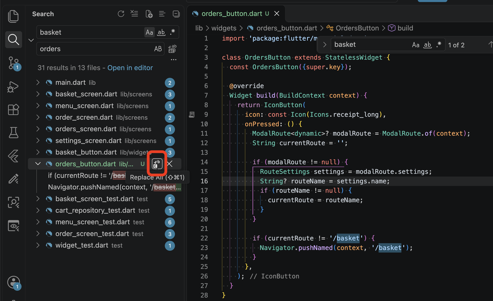

Keep the existing route-name check so pressing the receipt icon while already on orders does not push a second orders screen. No new navigation mechanism is needed.

`Navigator.pushNamed` opens the screen registered under a route name, just as it does for the basket in Worksheet 5. Import `orders_button.dart` into the order, basket and orders screens as shown below:

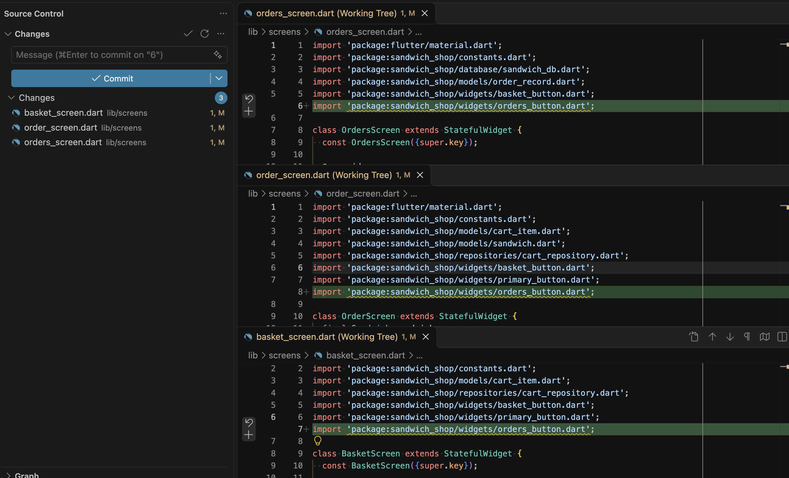

In those three app bars, use:

```dart
        actions: const [OrdersButton(), BasketButton()],
```

See below the changes that you need to make:

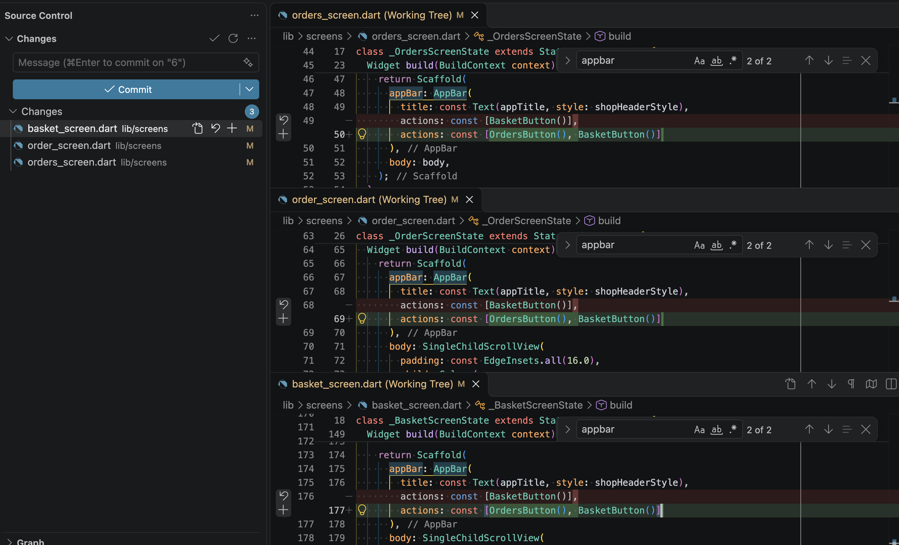

Leave the menu and settings screens unchanged from Worksheet 6. On the emulator, open the basket from the menu, then select the receipt icon. You should see orders `1003`, `1002` and `1001`, in that order, with their summaries, totals and dates, as shown below:

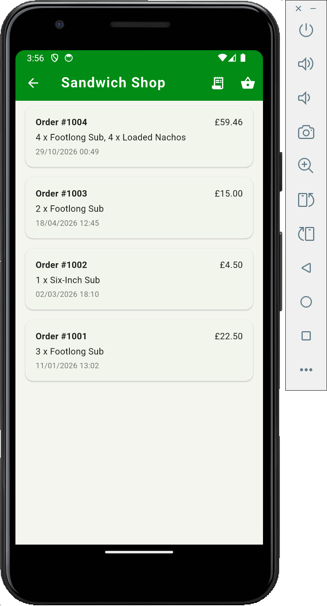

## Saving the basket at checkout

The [Worksheet 5 basket](worksheet-5.md#building-the-basket-screen) already calculates totals and clears its contents at checkout. We now save the order first, and only clear the basket if insertion succeeds.

### Build the order summary and date

In `lib/screens/basket_screen.dart`, add these imports:

```dart
import 'package:sandwich_shop/database/sandwich_db.dart';
import 'package:sandwich_shop/models/order_record.dart';
```

Inside `_BasketScreenState`, add:

```dart
  String _buildSummary(List<CartItem> items) {
    final List<String> parts = [];
    for (final CartItem item in items) {
      parts.add('${item.quantity} x ${item.sandwich.name}');
    }
    return parts.join(', ');
  }
```

This is what `basket_screen.dart` should look like:

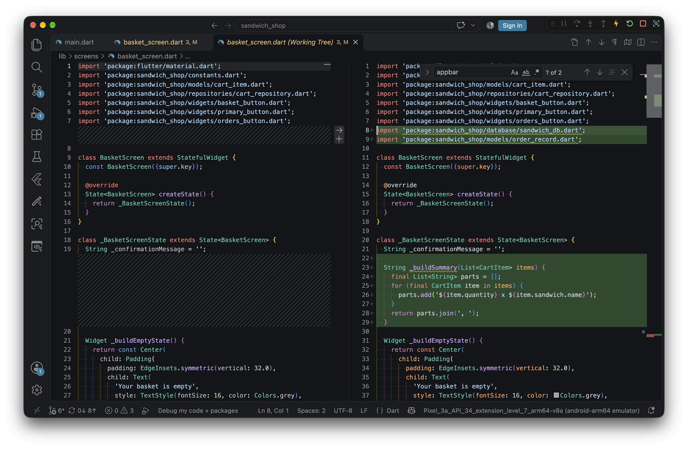

The list method `join` combines strings with a separator to create a summary such as `2 x Footlong Sub, 1 x Six-Inch Sub`. This is different from the file-path function imported in the database helper. Add a helper method to format the current date and time for the display date:

```dart
  String _formatDate(DateTime now) {
    final String day = now.day.toString().padLeft(2, '0');
    final String month = now.month.toString().padLeft(2, '0');
    final String hour = now.hour.toString().padLeft(2, '0');
    final String minute = now.minute.toString().padLeft(2, '0');
    return '$day/$month/${now.year} $hour:$minute';
  }
```

[`DateTime`](https://api.dart.dev/dart-core/DateTime-class.html) provides the date and time parts. `padLeft(2, '0')` gives each part two digits, so five minutes past nine displays as `09:05`. This string is for display; order numbers determine list order.

### Save the order before clearing the basket

Keep the existing `_confirmationMessage` field. Add `_checkout` inside `_BasketScreenState` to persist the purchase before resetting the basket:

```dart
  Future<void> _checkout(CartRepository cart, List<CartItem> items) async {
    final String summary = _buildSummary(items);
    final double total = cart.getTotalDue();
    final String date = _formatDate(DateTime.now());

    try {
      final SandwichDatabase database = SandwichDatabase.instance;
      final int orderNumber = await database.getNextOrderNumber();
      final OrderRecord record = OrderRecord(
        orderNumber: orderNumber,
        summary: summary,
        total: total,
        date: date,
      );

      await database.insertOrder(record);
      cart.clear();
      if (!mounted) {
        return;
      }
      setState(() {
        _confirmationMessage = 'Order $orderNumber saved';
      });
      Navigator.pushNamed(context, '/orders');
    } catch (error) {
      if (!mounted) {
        return;
      }
      setState(() {
        _confirmationMessage = 'Could not save your order: $error';
      });
    }
  }
```

`DateTime.now()` gives the current local date and time. We prepare the summary, total and display date before starting the database work. After inserting the record with `database.insertOrder(record)`, the cart is cleared with `cart.clear()` and the app navigates to `/orders`. If insertion fails, the error is caught, the cart is preserved, and an error message is displayed. Never use an empty `catch` around a database write.

### Connect the checkout button and verify a restart

Keep `PrimaryButton` unchanged from Worksheet 6: its `onPressed` is a non-nullable `VoidCallback`. In `_buildBasketList`, replace the checkout callback with:

```dart
          onPressed: () {
            _checkout(cart, items);
          },
```

This is what the changes should look like:

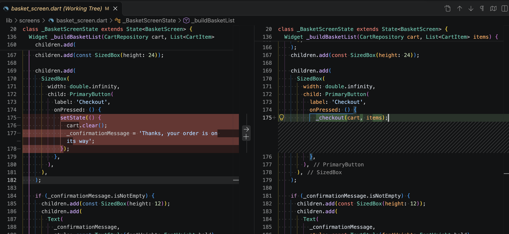

The callback starts `_checkout`; that method handles its own asynchronous work and errors. Keep the delete button's existing callback:

```dart
            onPressed: () {
              setState(() {
                cart.removeItem(index);
              });
            },
```

Keep the existing confirmation field, feedback widgets, empty-basket handling and app bar. Do not replace the whole basket screen.

On the emulator, save fictional profile details, add a sandwich and check out. Checkout saves the order and opens the orders screen, where your new order appears above the seeded history. If you return to the basket screen, the basket is empty and displays the confirmation message, as shown below:

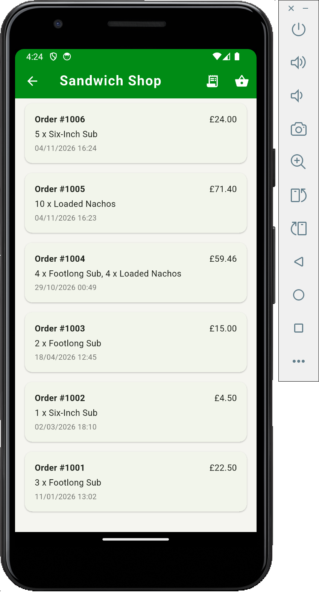

Now fully close the app on the emulator. Terminate it by stopping the debug run and relaunching, or by swiping it away from the emulator's recent-apps list. This is a real cold restart, not a hot reload or hot restart, so do not just save a file and let the app refresh. Reopen the app without uninstalling it or clearing its storage, and confirm both that your past orders are still listed and that the saved profile fields from Worksheet 6 are still populated from the previous session.

Reopening the app must not duplicate the three seed orders. The basket itself is still in memory; only completed orders and the saved profile persist.

### Inspect the database on the emulator

This optional check opens a copy of the actual SQLite file. Stop the app's debug run first so there are no writes in progress, but leave the emulator running.

Before inspecting the database, confirm these prerequisites:

- The Android emulator or physical device is running and visible when you run `adb devices` in your terminal.
- The app has been launched on the device in debug mode (**F5** in VS Code or `flutter run`). Android security prevents `run-as` from reading files of release builds.
- The app has initialised and created `sandwich_data.db` (for example by opening the orders screen or checking out).
- The `adb` tool is available in your terminal path, which the portable bundle or Android SDK provides.

For the supplied Android project, the debug package is `com.example.sandwich_shop`. Copy the database to a temporary location on the emulator, then pull the copy into your project folder.

On Windows PowerShell:

```powershell
adb shell "run-as com.example.sandwich_shop cat databases/sandwich_data.db > /data/local/tmp/s.db"; adb pull /data/local/tmp/s.db sandwich_shop.db
```

On macOS, Linux or Bash:

```bash
adb shell "run-as com.example.sandwich_shop cat databases/sandwich_data.db > /data/local/tmp/s.db" && adb pull /data/local/tmp/s.db sandwich_shop.db
```

`adb` communicates with the Android device. `run-as` reads the debug app's private files by executing inside its application sandbox, copying the database to `/data/local/tmp/`, and `pull` downloads that copy to your computer. If you changed the Android application id, use that id instead. Re-running the chained command refreshes `sandwich_shop.db` whenever you make further database changes.

Open `sandwich_shop.db` in VS Code using the bundle's **SQLite Viewer** extension. Select the `orders` table and check that it contains the three seed rows and your saved order.

This is a snapshot, not a live connection. Remove the copied file after inspection; it is runtime data, not an application asset.

## Testing SQLite without an emulator

The [sqflite FFI package](https://pub.dev/packages/sqflite_common_ffi) runs SQLite directly on the test computer. FFI means foreign function interface: Dart calls a native library. We use it only in tests, with a fresh in-memory database rather than the user's file.

Before adding database tests, we tidy the menu and the existing tests.

### Remove the temporary menu item

In [Worksheet 6](worksheet-6.md#display-loading-and-error-states), we added a `Nonexistent Sandwich` to `assets/data/sandwiches.json` to test the image error message. The real menu does not sell it, so delete that object from the array, together with the comma before it. The file should end with the `Loaded Nachos` object.

See below:

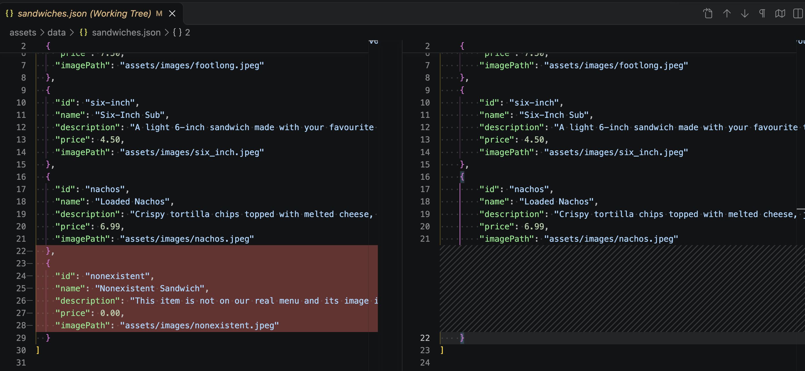

Run the tests to see which ones depend on the old catalogue:

```bash
flutter test
```

Two tests now fail on purpose, as shown below. The asset loader test in `test/sandwich_repository_test.dart` still expects four sandwiches, and the app test in `test/widget_test.dart` still scrolls to a sandwich that no longer exists:

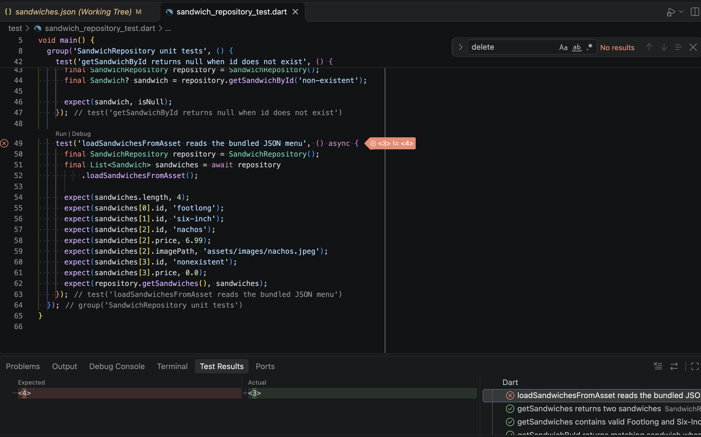

A failing test is useful here: it points to every place that relied on the item we removed. In the asset loader test, change the length expectation from `4` to `3`, and delete the two expectations that read `sandwiches[3]`.

In `test/widget_test.dart`, find the test named `Displays sandwich cards with names and prices` inside the `App smoke tests` group. Delete the five lines from `scrollUntilVisible(find.text('Nonexistent Sandwich'), 150)` to `expect(tester.takeException(), isNull);`, but keep the closing `});` of the test. Keep the checks for `Loaded Nachos` and `£6.99`. Run `flutter test` again and check that every test passes.

This is what `test/widget_test.dart` should look like after removing the lines related to the `Nonexistent Sandwich` test:

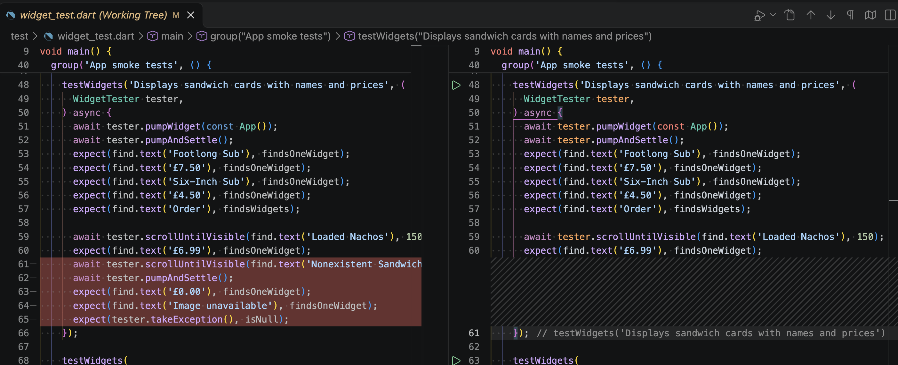

### Move the tests into mirrored folders

Each test file should sit in a folder that matches the file it tests, so `test/` mirrors `lib/`.

Moving files is another form of [refactoring](worksheet-3.md#move-orderscreen-into-its-own-file). When you move or rename a Dart file in the VS Code explorer, the Dart extension can update affected imports so they still point to the right files. Its [`dart.updateImportsOnRename`](https://dartcode.org/docs/settings/#dartupdateimportsonrename) setting is enabled by default and supports one file at a time. Not every move requires an import to change.

For example, if `test/sandwich_model_test.dart` used `import '../lib/models/sandwich.dart';`, moving it into `test/models/` would require changing the relative import to `import '../../lib/models/sandwich.dart';` because the path starts from the test file's folder. The Dart extension can make this update, but [Dart discourages relative imports that reach into `lib/`](https://dart.dev/effective-dart/usage#dont-allow-an-import-path-to-reach-into-or-out-of-lib).

Open `test/sandwich_model_test.dart` and find `import 'package:sandwich_shop/models/sandwich.dart';`. This package-absolute import uses the package name from `pubspec.yaml` to identify a file inside `lib/`, rather than a location on your computer. Prefer package imports when tests import app code: moving the test will not change this import. If the imported file itself moves or is renamed, the package import still needs updating.

In the VS Code explorer, create `test/models/`, `test/repositories/` and `test/screens/`, then drag the existing test files into them one at a time. The two model tests, `sandwich_model_test.dart` and `user_settings_test.dart`, go into `test/models/`. The two repository tests go into `test/repositories/`, and the four screen tests for the basket, menu, order and settings screens go into `test/screens/`. After moving `sandwich_model_test.dart`, check that its `Sandwich` import is unchanged.

The button test already lives under `test/widgets/`. Rename `sandwich_model_test.dart` to `sandwich_test.dart` so it matches `lib/models/sandwich.dart`. In the sandwich model tests, write the type in each `const` declaration, for example `const Sandwich sandwich = Sandwich(...)`, as our code style prefers explicit types.

`test/widget_test.dart` holds two kinds of test. Its `App smoke tests` group checks `lib/main.dart`, so rename the file to `test/main_test.dart`. Its `OrderItemDisplay` group and the two quantity-limit tests at the end of the smoke tests group check `lib/screens/order_screen.dart`, so cut them and paste them at the end of `main` in `test/screens/order_screen_test.dart`. Then remove the unused `Sandwich` import from `main_test.dart`.

Run `flutter test` once more. The same tests should pass from their new folders. Your test folder structure in the editor should look like this:

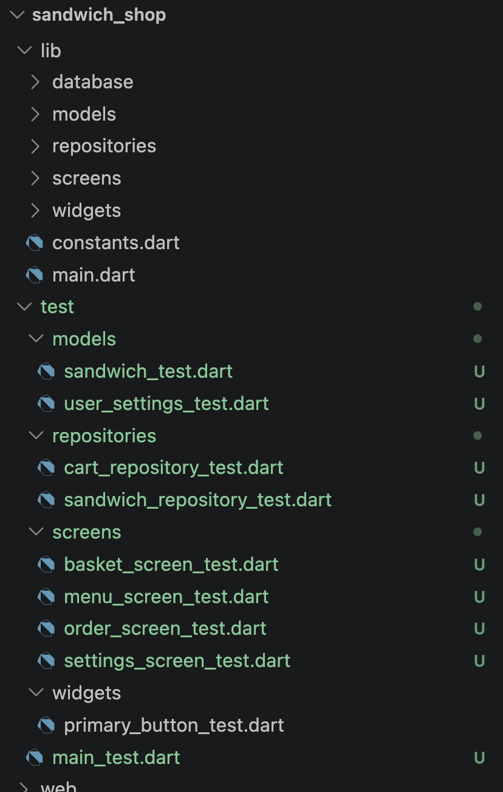

We have not written the database tests yet, and `constants.dart` only contains shared values, so it does not need a separate test file.

### Prepare a fresh database for each test

Create `test/database/sandwich_db_test.dart` with these imports and an empty `main`:

```dart
import 'package:flutter_test/flutter_test.dart';
import 'package:sandwich_shop/database/sandwich_db.dart';
import 'package:sandwich_shop/models/order_record.dart';
import 'package:sqflite_common_ffi/sqflite_ffi.dart';

void main() {}
```

The `setUp` function runs before every test; the `tearDown` function runs afterwards, even when a test fails. Use them to give each test an empty database and close it afterwards. Add these inside `main`:

```dart
  setUp(() async {
    sqfliteFfiInit();
    final Database database = await databaseFactoryFfiNoIsolate.openDatabase(
      inMemoryDatabasePath,
      options: OpenDatabaseOptions(
        version: 1,
        onCreate: SandwichDatabase.instance.createTables,
      ),
    );
    SandwichDatabase.instance.setDatabase(database);
  });

  tearDown(() async {
    await SandwichDatabase.instance.close();
  });
```

`sqfliteFfiInit` prepares the native SQLite library. `databaseFactoryFfiNoIsolate` runs the database in the current Dart isolate, without starting a separate worker. `inMemoryDatabasePath` stores the rows in memory, so closing the connection discards them. `OpenDatabaseOptions` supplies the version and creation callback.

We pass the application's `createTables` method to `onCreate`, so tests exercise the real table definition without adding seed orders. `setDatabase` supplies this connection to the singleton; `close` also resets its cached connection. Copy this setup and clean-up into each of the database-backed screen test files below, rather than creating another helper layer.

### Test inserting, reading and numbering orders

Inside `main`, add a small fixture builder to create reusable `OrderRecord` instances for your tests (recall that fixtures are reusable pieces of test data, in this case a function that returns an `OrderRecord` with specified fields).

```dart
  OrderRecord buildRecord(int orderNumber, String summary, double total) {
    return OrderRecord(
      orderNumber: orderNumber,
      summary: summary,
      total: total,
      date: '01/01/2026 10:00',
    );
  }
```

Add the insert-and-read test:

```dart
  test('insertOrder stores an order and returns its id', () async {
    final int id = await SandwichDatabase.instance.insertOrder(
      buildRecord(1001, '1 x Footlong Sub', 7.50),
    );
    expect(id, greaterThan(0));

    final List<OrderRecord> orders =
        await SandwichDatabase.instance.getAllOrders();
    expect(orders.length, 1);
    expect(orders[0].id, id);
    expect(orders[0].summary, '1 x Footlong Sub');
    expect(orders[0].total, 7.50);
  });
```

This checks `toMap`, SQLite insertion and `fromMap` together. Add a test for numbering:

```dart
  test('getNextOrderNumber increments the current maximum', () async {
    expect(await SandwichDatabase.instance.getNextOrderNumber(), 1001);

    await SandwichDatabase.instance.insertOrder(
      buildRecord(1005, 'Order', 5.0),
    );
    expect(await SandwichDatabase.instance.getNextOrderNumber(), 1006);
  });
```

Add a third test for descending order:

```dart
  test('getAllOrders returns newest order number first', () async {
    await SandwichDatabase.instance.insertOrder(
      buildRecord(1001, 'First', 5.0),
    );
    await SandwichDatabase.instance.insertOrder(
      buildRecord(1003, 'Third', 9.0),
    );
    await SandwichDatabase.instance.insertOrder(
      buildRecord(1002, 'Second', 7.0),
    );

    final List<OrderRecord> orders =
        await SandwichDatabase.instance.getAllOrders();
    expect(orders[0].orderNumber, 1003);
    expect(orders[1].orderNumber, 1002);
    expect(orders[2].orderNumber, 1001);
  });
```

Make sure to run all the database tests after adding them to verify that insertion, retrieval, and ordering of `OrderRecord` instances work correctly with your SQLite setup.

### Test order map conversion

Create `test/models/order_record_test.dart` with the test tools and `OrderRecord` imports and an empty `main`:

```dart
import 'package:flutter_test/flutter_test.dart';
import 'package:sandwich_shop/models/order_record.dart';

void main() {}
```

Inside `main`, add this fixture:

```dart
  const OrderRecord order = OrderRecord(
    orderNumber: 1004,
    summary: '2 x Footlong Sub',
    total: 16.50,
    date: '01/01/2026 09:05',
  );
```

Check that a new order omits its database id and converts to a map (recall that the `id` is assigned by the database upon insertion and is not part of the initial order data, so it should be `null` before insertion):

```dart
  test('New orders omit database ids and convert to map', () {
    expect(order.id, isNull);
    expect(order.toMap(), <String, Object?>{
      'order_number': 1004,
      'summary': '2 x Footlong Sub',
      'total': 16.50,
      'date': '01/01/2026 09:05',
    });
  });
```

Check the reverse conversion with a complete database row:

```dart
  test('A database map converts back into an order', () {
    final Map<String, Object?> row = <String, Object?>{
      'id': 7,
      'order_number': 1010,
      'summary': '1 x Six-Inch Sub',
      'total': 6.0,
      'date': '02/01/2026 10:20',
    };
    final OrderRecord restored = OrderRecord.fromMap(row);
    expect(restored.id, 7);
    expect(restored.orderNumber, 1010);
    expect(restored.summary, '1 x Six-Inch Sub');
    expect(restored.total, 6.0);
    expect(restored.date, '02/01/2026 10:20');
    expect(restored.toMap(), row);
  });
```

SQLite may return a whole number for a total. Check that our `num` conversion still produces a `double` since the `total` field in `OrderRecord` is expected to be a `double` regardless of how SQLite stores it:

```dart
  test('Whole-number SQLite totals become doubles', () {
    final Map<String, Object?> row = order.toMap();
    row['total'] = 6;
    final OrderRecord restored = OrderRecord.fromMap(row);
    expect(restored.total, 6.0);
    expect(restored.total, isA<double>());
  });
```

Run `flutter test test/models/order_record_test.dart` and check that all three tests pass.

### Update the basket checkout test

Keep the two existing tests in `test/screens/basket_screen_test.dart`. Add these imports alongside its current imports:

```dart
import 'package:sandwich_shop/database/sandwich_db.dart';
import 'package:sandwich_shop/models/order_record.dart';
import 'package:sandwich_shop/screens/orders_screen.dart';
import 'package:sqflite_common_ffi/sqflite_ffi.dart';
```

Replace its `setUp` with the setup from [Prepare a fresh database for each test](#prepare-a-fresh-database-for-each-test), keeping `CartRepository.instance.clear();` as the first statement inside it. Add the same `tearDown` to close the database. This keeps tests independent without changing their basket fixtures.

Add a checkout test shell inside `main`:

```dart
  testWidgets('Checkout saves the order, clears the basket and opens orders', (
    WidgetTester tester,
  ) async {
  });
```

Inside the test, add two sandwiches and render a basket with an orders route:

```dart
    CartRepository.instance.addItem(
      const CartItem(sandwich: testSandwich, quantity: 2),
    );
    await tester.pumpWidget(
      MaterialApp(
        home: const BasketScreen(),
        routes: {
          '/orders': (BuildContext context) {
            return const OrdersScreen();
          },
        },
      ),
    );
```

Widget tests control when the app updates, but the SQLite save needs real asynchronous work to finish. Use [`runAsync`](https://api.flutter.dev/flutter/flutter_test/WidgetTester/runAsync.html) for checkout, then use `pumpAndSettle` to wait for the app to finish opening the orders screen:

```dart
    await tester.runAsync(() async {
      await tester.tap(find.text('Checkout'));
      await tester.pumpAndSettle();
    });
    await tester.pumpAndSettle();
```

Read the saved records in another `runAsync` call:

```dart
    final List<OrderRecord>? orders = await tester.runAsync(() async {
      return await SandwichDatabase.instance.getAllOrders();
    });
```

`runAsync` returns a nullable result, so check the local variable before reading its list. Finish with these assertions:

```dart
    expect(orders, isNotNull);
    if (orders != null) {
      expect(orders.length, 1);
      expect(orders[0].orderNumber, 1001);
      expect(orders[0].summary, '2 x Footlong Sub');
      expect(orders[0].total, 21.50);
    }
    expect(CartRepository.instance.getItems(), isEmpty);
    expect(find.byType(OrdersScreen), findsOneWidget);
    expect(find.text('Order #1001'), findsOneWidget);
```

The fixture costs `10.0` per sandwich, so two sandwiches plus `1.50` delivery produce a saved total of `21.50`. The assertions check the database, basket and destination screen, not just a success message.

### Test that a failed save keeps the basket

The checkout's `catch` block should leave the basket untouched when saving fails. To test it, we need a database write that fails on purpose. The simplest way is to delete the `orders` table before checkout, so every query on it throws an error.

In the same file, add another test inside `main`:

```dart
  testWidgets('Checkout keeps the basket when saving fails', (
    WidgetTester tester,
  ) async {
    CartRepository.instance.addItem(
      const CartItem(sandwich: testSandwich, quantity: 2),
    );
  });
```

After adding the item, delete the table from the test database:

```dart
    await tester.runAsync(() async {
      final Database database = await SandwichDatabase.instance.database;
      await database.execute('DROP TABLE orders');
    });
```

`DROP TABLE` is the SQL command that removes a table and all of its rows. It only affects this test's in-memory database, and `setUp` creates a fresh table before the next test.

Then render the basket and tap **Checkout**, exactly as in the previous test:

```dart
    await tester.pumpWidget(const MaterialApp(home: BasketScreen()));
    await tester.runAsync(() async {
      await tester.tap(find.text('Checkout'));
      await tester.pumpAndSettle();
    });
    await tester.pumpAndSettle();
```

Finish with assertions that the item is still in the basket and the error is shown:

```dart
    expect(CartRepository.instance.getItems().length, 1);
    expect(find.text('2 x Footlong Sub'), findsOneWidget);
    expect(find.textContaining('Could not save your order'), findsOneWidget);
```

`find.textContaining` matches any `Text` widget whose text includes the given words, which is useful here because the full message also contains the database error.

### Test the orders list and its empty state

Create `test/screens/orders_screen_test.dart` with these imports and an empty `main`:

```dart
import 'package:flutter/material.dart';
import 'package:flutter_test/flutter_test.dart';
import 'package:sandwich_shop/database/sandwich_db.dart';
import 'package:sandwich_shop/models/order_record.dart';
import 'package:sandwich_shop/screens/orders_screen.dart';
import 'package:sqflite_common_ffi/sqflite_ffi.dart';

void main() {}
```

Inside `main`, copy the database `setUp` and `tearDown` from the database tests. Start the populated-list test:

```dart
  testWidgets('OrdersScreen lists saved orders newest-first', (
    WidgetTester tester,
  ) async {
    await tester.runAsync(() async {
    });
  });
```

Inside `runAsync`, insert the first fixture:

```dart
      await SandwichDatabase.instance.insertOrder(
        const OrderRecord(
          orderNumber: 1001,
          summary: '1 x Six-Inch Sub',
          total: 4.50,
          date: '01/01/2026 10:00',
        ),
      );
```

Insert the second fixture after it:

```dart
      await SandwichDatabase.instance.insertOrder(
        const OrderRecord(
          orderNumber: 1002,
          summary: '2 x Footlong Sub',
          total: 15.00,
          date: '02/01/2026 11:00',
        ),
      );
```

Still inside `runAsync`, render the screen and wait for it to settle:

```dart
      await tester.pumpWidget(const MaterialApp(home: OrdersScreen()));
      await tester.pumpAndSettle();
```

After `runAsync` closes, check both presence and position:

```dart
    await tester.pump();

    expect(find.text('Order #1002'), findsOneWidget);
    expect(find.text('Order #1001'), findsOneWidget);
    expect(find.text('2 x Footlong Sub'), findsOneWidget);
    final double newestY = tester.getTopLeft(find.text('Order #1002')).dy;
    final double oldestY = tester.getTopLeft(find.text('Order #1001')).dy;
    expect(newestY, lessThan(oldestY));
```

[`getTopLeft`](https://api.flutter.dev/flutter/flutter_test/WidgetController/getTopLeft.html) gives a widget's position. A smaller vertical coordinate means the newer order is above the older one; checking that both texts exist would not prove their order.

Add the empty-table test:

```dart
  testWidgets('OrdersScreen shows an empty state when there are no orders', (
    WidgetTester tester,
  ) async {
    await tester.runAsync(() async {
      await tester.pumpWidget(const MaterialApp(home: OrdersScreen()));
      await tester.pumpAndSettle();
    });
    await tester.pump();

    expect(find.text('No orders yet'), findsOneWidget);
  });
```

### Test supported platforms and run the complete suite

In `test/main_test.dart`, add the foundation import:

```dart
import 'package:flutter/foundation.dart';
```

Keep its existing app tests. Inside `main`, add checks for the platform helper. `debugDefaultTargetPlatformOverride` lets a test choose a target platform without changing computers; reset it to `null` afterwards:

```dart
  test('Android is supported', () {
    debugDefaultTargetPlatformOverride = TargetPlatform.android;
    expect(isSupportedPlatform(), isTrue);
    debugDefaultTargetPlatformOverride = null;
  });
```

```dart
  test('Other platforms are not supported', () {
    debugDefaultTargetPlatformOverride = TargetPlatform.iOS;
    expect(isSupportedPlatform(), isFalse);
    debugDefaultTargetPlatformOverride = TargetPlatform.macOS;
    expect(isSupportedPlatform(), isFalse);
    debugDefaultTargetPlatformOverride = TargetPlatform.windows;
    expect(isSupportedPlatform(), isFalse);
    debugDefaultTargetPlatformOverride = TargetPlatform.linux;
    expect(isSupportedPlatform(), isFalse);
    debugDefaultTargetPlatformOverride = null;
  });
```

Check the explanation shown on unsupported platforms:

```dart
  testWidgets('The unsupported platform screen explains what to do',
      (WidgetTester tester) async {
    await tester.pumpWidget(const UnsupportedPlatformApp());
    expect(find.textContaining('Android emulator'), findsOneWidget);
  });
```

Use the [formatting, analysis and test workflow from Worksheet 4](worksheet-4.md#running-test-suites-and-static-analysis):

```bash
dart format lib test
dart analyze
flutter test
```

All automated tests should pass, as shown below:

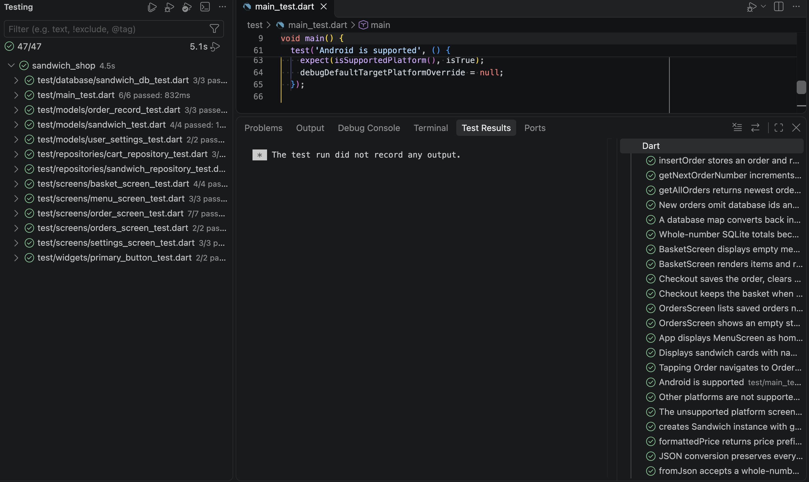

Compare your finished application with branch `7`. Check both the automated tests and the emulator restart behaviour; an in-memory database test cannot prove that a device file survives restarting the app.

## Organising tests

From Demo 4 onwards, your test folders must mirror the folders under `lib/`, as we arranged in [Move the tests into mirrored folders](#move-the-tests-into-mirrored-folders). Keep model, repository, screen, widget and database tests in their matching subfolders under `test/`.

For Sandwich Shop, screen tests belong under `test/screens/` because the application uses `lib/screens/`. The cinema application uses `lib/views/`, so its view tests belong under `test/views/`. Match the actual application structure rather than renaming folders to copy the example.

Tests for the root-level `lib/main.dart` may remain at the root of `test/`; model, repository and screen tests should not remain there.

## Exercises

The exercises below apply these concepts to your Southsea Cinema coursework. Together with the exercises in Worksheet 8, they prepare you for Demo 4. For the full coursework specification and grading criteria, see the [Southsea Cinema coursework brief](https://portdotacdotuk-my.sharepoint.com/:w:/g/personal/mani_ghahremani_port_ac_uk/IQDtIJB3bM7gQ4p03eLUngyyAd7JuhjhHuNA1l0H-qCy3Jw).

Build on the cinema app from Worksheet 6. Keep the JSON film catalogue, saved profile settings, drawer navigation, squared buttons and ticket basket you already built. Past bookings appear on the basket page, so you do not need a separate bookings page.

1. Set up an Android emulator or device by following [Preparing an Android emulator or device](#preparing-an-android-emulator-or-device). If your cinema project has no `android` folder, take a look at [Add Android support to the project](#add-android-support-to-the-project). Then add the [SQLite packages](#adding-the-sqlite-packages) and check that the app runs on the emulator.

2. In [Representing a saved order](#representing-a-saved-order), we created an `OrderRecord` model for the Sandwich Shop. Your task is to create a `Booking` model in `lib/models/booking.dart` with an optional `id`, a `bookingNumber`, a `summary`, a `total` and a `date`. Test it as thoroughly as we tested `OrderRecord`.

3. Create a `CinemaDatabase` in `lib/database/cinema_db.dart`, using our [SQLite database helper](#creating-the-sqlite-database-helper) as a guide.

    It should create a `bookings` table, add a few sample bookings when the database is first created, save a booking, read all bookings with the highest booking number first, return the next booking number using the same scheme as our orders, and close the connection. Following [Test inserting, reading and numbering orders](#test-inserting-reading-and-numbering-orders), test it with an in-memory database.

4. Checkout on your basket page should now save a numbered `Booking` before it clears the basket, and show the booking number in its confirmation. We did the same for sandwich orders in [Saving the basket at checkout](#saving-the-basket-at-checkout). Below the basket, list past bookings with a message when there are none; [Displaying saved orders](#displaying-saved-orders) is a useful reference.

    Write widget tests for both. Finally, fully close and reopen the app and check that your bookings and saved profile are still there, just as we did in [Connect the checkout button and verify a restart](#connect-the-checkout-button-and-verify-a-restart).

5. Make your cinema project's `test/` folder mirror `lib/`, in the same way that we [moved the Sandwich Shop tests into mirrored folders](#move-the-tests-into-mirrored-folders). When you have finished, `dart format lib test`, `dart analyze` and `flutter test` should report no issues and no failing tests.

6. (Advanced) Write a widget test for the basket page that adds three different films, deletes the middle one and checks that only the other two remain. `.first` and `.last` cannot reach the middle delete button. Read the [Flutter finders recipe](https://docs.flutter.dev/cookbook/testing/widget/finders) and find out how a [`Key`](https://api.flutter.dev/flutter/foundation/Key-class.html) lets a test pick out one particular button.
