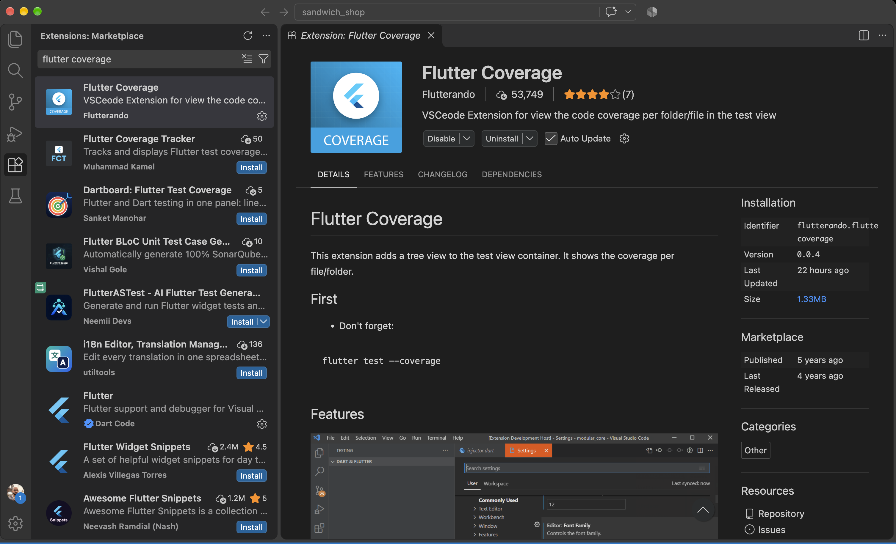

# Worksheet 8 — AI-assisted development with Copilot

## Table of contents

- [Getting help](#getting-help)
- [Getting started](#getting-started)
  - [Continue from Worksheet 7](#continue-from-worksheet-7)
  - [Set up Copilot](#set-up-copilot)
  - [Connect Dart tools](#connect-dart-tools)
- [Working with Copilot](#working-with-copilot)
  - [Write a prompt](#write-a-prompt)
  - [Plan first](#plan-first)
  - [Make a small change](#make-a-small-change)
  - [Review the result](#review-the-result)
  - [Finish the feature](#finish-the-feature)
- [Debugging](#debugging)
  - [Add a bug](#add-a-bug)
  - [Set breakpoints](#set-breakpoints)
  - [Inspect state](#inspect-state)
  - [Diagnose layout](#diagnose-layout)
  - [Debug painting](#debug-painting)
  - [Fix the bug](#fix-the-bug)
- [Updating the README](#updating-the-readme)
  - [Attach context](#attach-context)
  - [Check the draft](#check-the-draft)
- [Order items table](#order-items-table)
  - [The relationship](#the-relationship)
  - [Plan the upgrade](#plan-the-upgrade)
  - [Implement in steps](#implement-in-steps)
  - [Verify the upgrade](#verify-the-upgrade)
- [Test coverage](#test-coverage)
  - [Install the extension](#install-the-extension)
  - [Measure coverage](#measure-coverage)
  - [Plan the tests](#plan-the-tests)
  - [Write unit tests](#write-unit-tests)
  - [Write widget tests](#write-widget-tests)
  - [Check the tests](#check-the-tests)
  - [Close the gaps](#close-the-gaps)
- [Exercises](#exercises)

## Getting help

To get support with this worksheet, follow the [Discord guide](https://portdotacdotuk-my.sharepoint.com/:p:/g/personal/mani_ghahremani_port_ac_uk/IQCMJP6IiR_bQoYUMdXJSRDYAWnajEALZYEXFZyrJkHS1QU) and post your questions there. You can also attend your timetabled practical sessions and ask a member of teaching staff for guidance.

## Getting started

### Continue from Worksheet 7

Continue with your Sandwich Shop app from [Worksheet 7](worksheet-7.md). You should already be able to save an order, see past orders and keep them after closing and reopening the app. Keep running the app on your Android emulator; if you need a reminder of how to pick it as the target, see [Select the device and run the app](worksheet-7.md#select-the-device-and-run-the-app).

If you need the starting code, clone the [Sandwich Shop repository](https://github.com/manighahrmani/sandwich_shop) and switch to branch `7`:

```bash
git clone https://github.com/manighahrmani/sandwich_shop.git
cd sandwich_shop
git switch 7
```

Do not switch branches if you are continuing your own work. Run `flutter test` once before making changes. If it fails, investigate those failures first so that you can distinguish them from problems introduced later.

### Set up Copilot

This worksheet uses GitHub Copilot in VS Code. You do not need a separate Claude or Codex subscription, an API key or a paid upgrade. Follow [GitHub's student setup guide](https://docs.github.com/en/copilot/how-tos/copilot-on-github/set-up-copilot/enable-copilot/set-up-for-students) to activate your free student access. Education verification and Copilot activation are separate steps.

If your account still offers only paid options after verification, do not buy a plan. Follow the troubleshooting advice on that page and ask for help in your practical. Copilot Free is also available, but has a smaller allowance and limited features.

Open your project folder and follow the [VS Code Copilot setup guide](https://code.visualstudio.com/docs/setup/copilot) to sign in. In the Command Palette, run **Chat: Focus on Chat View**. Keep the permissions and model at their default settings.

Send a short greeting such as `Hello` to test that Copilot responds, as shown below:


Your student plan selects models automatically, which VS Code shows as **Auto** or **Copilot Fusion** depending on its version. Use the choices your account provides rather than trying to select a particular paid model. The [Copilot plans page](https://docs.github.com/en/copilot/get-started/plans) lists the current entitlements. The list below shows the models available to me when I wrote this worksheet; yours may differ:


You can also change settings such as the effort level, as shown below, but this affects the quota and usage limits of your Copilot plan.


### Connect Dart tools

Model Context Protocol (MCP) lets Copilot call development tools. The [Dart and Flutter MCP server](https://github.com/dart-lang/ai/tree/main/pkgs/dart_mcp_server) appears in VS Code as **Dart SDK MCP Server**. It can help Copilot look up code and inspect a running Flutter app; it does not replace your own review or tests.

Click **Open Customizations** (the puzzle icon) in the Chat panel, select **MCP Servers** and search for `dart`. Enable **Dart SDK MCP Server** using its toggle, as shown below. If it is already enabled, leave it enabled rather than adding a second copy.


If the server is missing, check that you have Dart 3.9 or later and version 3.114 or later of the Dart extension. The [Dart extension setting](https://dartcode.org/docs/settings/#dartmcpserver) `dart.mcpServer` should be enabled.

Review any trust request before approving it. Use the server's menu to start it or view its output if needed; the [VS Code server controls](https://code.visualstudio.com/docs/agents/run/manage-mcp-servers) explain these actions.

## Working with Copilot

We will use one workflow throughout this worksheet: understand the task, plan, make a small change, test, review and explain.

These are ordinary software engineering habits applied to an AI assistant. For this worksheet, we follow [GitHub's best practices](https://docs.github.com/en/copilot/get-started/best-practices) and the [VS Code workflow guidance](https://code.visualstudio.com/docs/agents/best-practices).

Copilot can read code, suggest changes and run tools, but you always remain responsible for the result. A working app is not enough for your demo: you need to understand the changes and show how you checked them.

### Write a prompt

Run the app and look at the text on its screens. We want users to choose a font size in Settings, keep that choice after reopening the app and still use Android's accessibility text size.

Write a prompt describing that outcome and ask for a plan rather than code, as shown below. Use your own words; deciding what a task means is part of your work. GitHub's [prompt guide](https://docs.github.com/en/copilot/concepts/prompting-and-context/prompt-engineering) gives further advice.

<!-- Capture: enter your font-size request in Plan mode, before sending it. -->


### Plan first

Change the agent mode to **Plan** or use `/plan` followed by your request to start Copilot's planning workflow as shown below:


This mode researches the project and proposes an approach before implementation. Read the affected files yourself and check that the plan uses the patterns you already know. You can also ask Copilot to provide you links to relevant documentation, code references or examples that explain the proposed changes.

Check whether the plan solves your task, includes meaningful tests and preserves existing behaviour. Challenge unnecessary packages, complicated code and changes outside the task. Ask for revisions before you approve it. Follow the [planning guide](https://code.visualstudio.com/docs/agents/run/planning) for the controls in your version.

In the example below, we asked Copilot to propose a plan for letting users with visual impairments change the font size of the app. The agent may first ask for clarification, as Copilot did here:


Once you answer, Copilot reads the relevant files and drafts a plan. You can follow its thinking as it works:


It then presents a plan that you can open with **Open Full Plan** and edit:


To change the plan, type your feedback and select **Submit Feedback** instead of approving it. We asked Copilot to split the first step into the interface change and the saving of the setting, and to give each screen its own step:


### Make a small change

Instead of **Implement with Autopilot**, switch to **Interactive** and ask Copilot to implement only the first agreed step, including its tests, then stop for review. For our revised plan, this first step is adding the size choices to the Settings screen, not completing the whole feature, as shown below.


Copilot may ask you for permission to run commands as shown below. Use the **Explain** button to understand why it needs to run the command before granting permission. Select **Allow Once** to approve the command for that single execution; avoid selecting **Allow all** so that you remain in control of what executes in your environment.


### Review the result

As changes are being made to your code, expand **files changed** in the chat to see which files were edited, as shown below:


You can keep or discard any change after reviewing it carefully. In our case, Copilot created an `enum` called `FontSizeOption` for the size choices. An `enum` is a type whose value must be one of a fixed set of named options, which we had not used before, so we asked Copilot to explain its purpose and usage, as shown below.


Once you are happy with a step, review each changed file in **Source Control**. Read the added and removed lines, including the tests, and ask Copilot to explain anything unfamiliar. If a change is unnecessary or hard to follow, edit it yourself or ask for a specific correction, then review the new diff before continuing. **Keep** does not commit the changes; see the [review guide](https://code.visualstudio.com/docs/agents/run/review-code-edits).


### Finish the feature

Ask Copilot to complete the remaining steps of the agreed plan, one by one, including their tests. Review the changed files as before. If you do not want Copilot to make a particular change, edit it or discard it. In the example shown below, it changed `README.md` and we clicked **Undo** to discard the unwanted changes; we will update `README.md` later in this worksheet.


If any choice does not make sense, question it and seek clarification before proceeding. You can also ask for an alternative solution or approach before accepting the change. In the example below, we questioned why the `rendering.dart` library was imported.


If you are unhappy with an implementation, ask Copilot to undo or modify the changes. In the example below, instead of an `enum` used with a `ChoiceChip`, we asked for a simpler approach: a toggle switch to increase the font size.


Now run `dart analyze` and `flutter test` the way you did back in [Running test suites and static analysis](worksheet-4.md#running-test-suites-and-static-analysis). We also asked whether the setting could live in `constants.dart` instead. Copilot explained that a `const` value is fixed at compile time but shared preferences load while the app runs, so we kept its approach. See the results below.


On the emulator, turn on the **Bigger text** switch, select **Save Settings**, visit each screen and close and reopen the app. Check that the choice is saved, text and controls fit, and your profile and basket still work, as shown below.


Finally, review the complete diff in **Source Control** once more. Every changed file should belong to the font size feature and you should be able to explain each change, as shown below.


## Debugging

As you know already, an application with errors will not run, and warnings appear in the **Problems** panel or when you run `dart analyze`, giving immediate feedback on potential issues in your code.

However, if your app runs but misbehaves, for example with incorrect calculations or layout issues, you need debugging techniques to find the underlying problem.

In this section, we will deliberately introduce a bug into the app and use debugging tools to find and fix it. Running the app under a debugger lets you pause execution, inspect runtime state, step through control flow and explore layout constraints directly.

Flutter's [debugging guide](https://docs.flutter.dev/testing/debugging), [VS Code running and debugging guide](https://docs.flutter.dev/tools/vs-code#running-and-debugging) and [Flutter DevTools documentation](https://docs.flutter.dev/tools/devtools) describe these capabilities in detail. Read them in your own time.

### Add a bug

Suppose we want to show a live subtotal on the order screen before adding an item to the basket. Open `lib/screens/order_screen.dart`, locate the `build` method in `_OrderScreenState`, and add this subtotal row directly above the `SizedBox` that wraps the `PrimaryButton`:

```dart
Row(
  children: [
    Text(
      'Current order subtotal for ${widget.sandwich.name}:',
      style: const TextStyle(fontWeight: FontWeight.bold),
    ),
    const SizedBox(width: 8),
    Text(
      '£$widget.sandwich.price * _quantity',
      style: const TextStyle(fontWeight: FontWeight.bold),
    ),
  ],
),
const SizedBox(height: 12),
```

Save the file and run the app. Tap **Order** on a sandwich. You will notice two problems immediately: the subtotal prints raw text instead of calculating the price, and the row overflows the right edge of the screen with yellow-and-black hazard stripes, as shown below.


This happens because `$` interpolates only the identifier directly after it unless the expression is enclosed in curly braces `${...}`, a rule we met in [Worksheet 2](worksheet-2.md#implement-the-build-method-of-orderitemdisplay). Dart therefore inserted only `widget` (printed as `OrderScreen`) and treated `.sandwich.price * _quantity` as literal text. Because the resulting text is so long and cannot shrink inside the `Row`, it exceeds the screen width. We will now diagnose both issues using the debugger and Flutter DevTools.

### Set breakpoints

Check that your Android emulator is still the selected device (see [Select the device and run the app](worksheet-7.md#select-the-device-and-run-the-app) if it is not).

Start debugging by pressing **F5** or selecting **Run > Start Debugging**. Alternatively, click the **Debug** button above the `main` function in `lib/main.dart`, as shown below:


The status bar turns orange and the debug toolbar appears as shown below:


A breakpoint pauses execution at a specific line so you can inspect variables before that line runs. In `lib/screens/order_screen.dart`, click the gutter margin next to the line number of the subtotal `Row` inside `build()` to set a breakpoint. See below:


In the emulator, tap **Order** on any sandwich. Execution halts at your breakpoint, as shown below.


### Inspect state

The floating debug toolbar lets you control execution:

- **Continue** (the play icon) resumes execution until the next breakpoint.
- **Step Over** (a curved arrow) runs the current line and advances to the next one.
- **Step Into** (an arrow pointing down) enters the method called on the current line.
- **Step Out** (an arrow pointing up) finishes the current method and returns to its caller.
- **Hot Reload** (the lightning bolt) and **Hot Restart** (the circular arrow) update or restart the running app.

In the **Run and Debug** view on the left, open the **VARIABLES** panel and expand `this` to inspect `_quantity`, as shown below. The `widget` entry lets you reach `widget.sandwich.price` in the same way.


In the **WATCH** panel, click **+** and add `widget.toString()` and `widget.sandwich.price * _quantity` to compare the raw widget string with the intended calculation. See below:


You can also evaluate expressions in the `Debug Console` (**Ctrl + Shift + Y** on Windows or **⌘ + Shift + Y** on macOS). Type `widget.sandwich.price * _quantity` at the `>` prompt and press **Enter** to see the result, as shown below.


### Diagnose layout

Press **Continue** to let the screen finish rendering. Notice the hazard stripes and the error in the `Debug Console` reporting that a `RenderFlex` overflowed by 176 pixels.

Open the Widget Inspector in Flutter DevTools, the tool you opened for the first time in [Worksheet 2](worksheet-2.md#open-the-widget-inspector). While debugging, click its icon in the sidebar or the DevTools button in the debug toolbar (the icon with a magnifying glass), as shown below. You can also run **Flutter DevTools: Inspector: Focus on View** from the Command Palette.


Click **Toggle select widget mode** (the crosshair icon) in the inspector, as shown below.


Then tap the overflowing text on the emulator. The inspector selects the `Text` and its parent `Row` in the widget tree, and the **Widget properties** tab shows the size of the selected `Text`, as shown below.


Switch to the **Flex explorer** tab for a detailed view of the `Row` and the constraints applied to each child. It shows that the children need 536.5 pixels of width but only 360.7 are available, which matches the overflow of 176 pixels, as shown below.


This shows why the overflow happens: the children of a `Row` try to take all the width they need. Because the text is not wrapped in a flexible container, it cannot shrink or wrap onto multiple lines. Recall that [Worksheet 3](worksheet-3.md#build-the-menu-interface) solved the same kind of overflow with `Expanded`.

### Debug painting

Flutter also includes visual debugging aids. Run **Flutter: Toggle Debug Painting** from the Command Palette (or click **Show Guidelines** in DevTools) to display render boxes, padding and tap boundaries on the screen, as shown below.


### Fix the bug

Now that we understand both issues, update the subtotal row in `lib/screens/order_screen.dart` to enclose the calculation in curly braces, format it with `toStringAsFixed(2)` and wrap the label in an `Expanded` widget:

```dart
Row(
  children: [
    Expanded(
      child: Text(
        'Current order subtotal for ${widget.sandwich.name}:',
        style: const TextStyle(fontWeight: FontWeight.bold),
      ),
    ),
    Text(
      '£${(widget.sandwich.price * _quantity).toStringAsFixed(2)}',
      style: const TextStyle(fontWeight: FontWeight.bold),
    ),
  ],
),
const SizedBox(height: 12),
```

Save the file and click **Hot Reload** in the debug toolbar, just like the hot reload you learned about in [Worksheet 1](worksheet-1.md#using-hot-reload).

Flutter updates the running app immediately without losing screen state. The hazard stripes disappear, the text wraps neatly within the screen, and the subtotal updates accurately as you tap **Add** and **Remove**, as shown below.


Remove your breakpoint by clicking the red dot in the gutter margin before moving on. Otherwise, execution pauses every time you add or remove an item and you have to click **Continue**.

## Updating the README

It's time to update the project documentation of our sandwich shop. A `README.md` file helps another person understand the app, install dependencies, run it and test it. As an example, GitHub shows the [Flutter README](https://github.com/flutter/flutter/blob/main/README.md) as the home page of the [Flutter repository](https://github.com/flutter/flutter).

Your `README.md` probably still holds the setup notes that came with the starter code, which say little about what the app does. We would like it to document the actual features and usage of the app accurately. Rather than asking Copilot to guess the features and behaviour, we will provide it with the relevant files so it can generate precise and context-aware documentation.

### Attach context

Only share files needed for the README update, and check that they contain no passwords or personal data before attaching them. Listing a file in `.gitignore` does not stop you attaching it to Copilot. (`.gitignore` lists files such as build outputs, temporary cache files and personal configuration files that Git should not upload to GitHub.)

Type `#` or click **Add Context** to attach the files relevant to the completed feature: `README.md`, `pubspec.yaml`, `lib/main.dart` and the folder `lib/screens/`, as shown below. The [context guide](https://code.visualstudio.com/docs/chat/copilot-chat-context) explains the available attachment types.


Write your prompt asking Copilot to inspect the attached files and outline an accurate update for `README.md`. Ask it to focus strictly on the details of the app as implemented in the attached files, without assuming any unimplemented features. You can also ask it to leave spaces for images, as in our prompt below:


### Check the draft

Once you approve the outline, ask Copilot to draft the changes to `README.md`. Read every claim carefully against your project:

- Check supported platforms: does it state the app runs on Android, or does it incorrectly claim browser or desktop support?
- Check setup and run commands: do they match the commands you actually ran?
- Check test instructions: does it distinguish emulator-dependent tasks from unit tests?

Try any instruction you have not already verified. Correct inaccuracies yourself or give Copilot specific feedback. Check the diff in **Source Control**, using the approach from [Review the result](#review-the-result), to confirm that only `README.md` changed.

You can preview the README by clicking the **Open Preview** button in the top right corner of the editor, or by pressing **Ctrl + Shift + V** on Windows or **⌘ + Shift + V** on macOS.


To add images (screenshots) to your README, place them in the `images` folder and reference them using the Markdown syntax ``. Alt text describes the image for accessibility, in case the image cannot be displayed or the reader uses a screen reader. Take a look at ours:


Keep this document updated as you add new features and tests throughout this worksheet and the following worksheets.

## Order items table

### The relationship

Worksheet 7 stores an order's items in one summary string. That is easy to display but awkward to query: counting how many of one sandwich were sold would require interpreting text.

Our next task is to store each purchased item separately while keeping it linked to its order. One order can have several items; this is a one-to-many relationship. Consider an example order before asking Copilot to plan it. The basket below has two lines, three Footlong Subs and two Loaded Nachos, so it would become one row in `orders` and two rows in a new table:


Each line becomes a row in an `order_items` table whose `order_id` refers to the `id` primary key of its row in the `orders` table that [Worksheet 7](worksheet-7.md#create-the-orders-table) created. This reference is a foreign key. It uses the database row id, not the displayed order number.

The new table records a sandwich id, its name and unit price at purchase, and its quantity. These are snapshots: changing the current menu must not change a past purchase. Our app has no bread or size selections, so do not ask Copilot to invent those fields.

Here is the relationship in SQL. You will recognise the column definitions from Worksheet 7; the new parts are explained below the code:

```sql
CREATE TABLE IF NOT EXISTS order_items (
  id INTEGER PRIMARY KEY AUTOINCREMENT,
  order_id INTEGER NOT NULL REFERENCES orders(id),
  sandwich_id TEXT NOT NULL,
  sandwich_name TEXT NOT NULL,
  unit_price REAL NOT NULL CHECK (unit_price >= 0),
  quantity INTEGER NOT NULL CHECK (quantity > 0)
);
```

`REFERENCES` links the row to its parent order. `CHECK` rejects a negative price or a quantity that is not positive. `IF NOT EXISTS` lets us run the same statement safely from more than one place, as we will see. SQLite foreign-key enforcement must also be enabled when opening each connection with `PRAGMA foreign_keys = ON`; follow the [SQLite foreign-key documentation](https://www.sqlite.org/foreignkeys.html).

To read one order's items, use the open connection `db` and store the parent row id in `orderId`. `whereArgs` supplies the value separately rather than joining user input into SQL:

```dart
final List<Map<String, Object?>> rows = await db.query(
  'order_items',
  where: 'order_id = ?',
  whereArgs: <Object?>[orderId],
);
```

With all this in mind, let's ask Copilot to plan the implementation of the `order_items` table and the necessary changes to save and read related rows in transactions.

### Plan the upgrade

A SQLite database file stores a version number. When we opened the database in [Worksheet 7](worksheet-7.md#open-the-database-in-the-app-folder), we gave it `version: 1` and an `onCreate` callback, which runs only when the file is first created. An emulator that already has a version 1 file will never run `onCreate` again, so it would never get the new table. Raising the version to 2 makes `sqflite` call an `onUpgrade` callback for those existing files. It receives the old and new version numbers, so it can create just the missing table and leave the `orders` rows untouched, while `onCreate` creates both tables for brand new installs. `onConfigure` runs before either, which makes it the place to switch on foreign keys.

Switch Copilot to **Plan** mode or type `/plan`, exactly as in [Plan first](#plan-first). We don't recommend **Autopilot** at this stage because it may generate changes that are not fully aligned with the existing project structure and conventions. Since a database migration affects multiple files, attach all the related files so Copilot has the full context, as we did when [attaching context for the README](#attach-context).

Attach `#lib/database/sandwich_db.dart`, `#lib/models/order_record.dart`, `#lib/models/cart_item.dart`, `#lib/screens/basket_screen.dart` and `#lib/screens/orders_screen.dart`. Close unrelated editor tabs so Copilot focuses on the relevant files.

Write a specific prompt that defines the requirements and constraints clearly:

- Upgrade the SQLite database from version 1 to 2 (see the explanation above).
- Create an `order_items` table with foreign key `order_id` referencing `orders(id)`.
- Enable SQLite foreign keys in `onConfigure` with `PRAGMA foreign_keys = ON`.
- Add an `onUpgrade` migration path that preserves all existing version 1 orders without data loss.
- Wrap checkout saves in a database transaction so an order and its items save together, rolling back if an insert fails.

The more details you specify in your prompt, the better Copilot can generate an accurate and reliable migration plan that aligns with your project requirements and preserves existing data. See below our prompt:


Review the plan Copilot proposes. Make sure it preserves existing order records, uses transactions for multi-row writes, and explains how to test the migration. Check it against your schema too: in our case the plan named a column `name`, so we replied asking Copilot to use `sandwich_name` instead, as shown below.


### Implement in steps

Once you are happy with the plan, switch to **Interactive** as before. Rather than asking Copilot to generate all changes at once, guide it through small, verifiable steps. First ask it to add a model class for an individual order item and to link it to the parent order. Review the generated code to ensure field types and nullability match your schema.

In our case, Copilot also updated `README.md` to describe the new database. Documentation should follow the code, but the edit was too detailed, so, as shown below, we asked Copilot to keep the README concise and minimise how it changes.


Then have Copilot implement the database, checkout and order history changes from the approved plan. Check that existing orders and totals are preserved, failed saves leave the basket intact, and new orders display their saved item details. As before, inspect every changed file in **Source Control** before accepting it, as shown below. If Copilot introduces unfamiliar syntax or unnecessary packages, ask it to explain the code or rephrase your prompt to follow existing project conventions.


### Verify the upgrade

AI-generated code requires validation. Ask Copilot to write automated tests that prove the migration and transactions work as intended, and place them in the folders that mirror `lib` (see [Organising tests](worksheet-7.md#organising-tests) for the layout):

1. A migration test that creates a file-backed version 1 database containing sample orders, closes it and reopens it through the application's version 2 migration code. Verify that the existing orders remain intact; a fresh in-memory database cannot prove this.
2. A transaction test verifying that saving an order with multiple items inserts rows into both `orders` and `order_items`.
3. A rollback test proving that if an item insert fails, the parent order is not saved.

Run your test suite in the terminal to verify the implementation:

```bash
flutter test
```

Once tests pass, launch the app on your emulator without clearing app storage. Place a new order with multiple items and open past orders to verify that both your older purchases and the new itemised order are displayed, as shown below. If you want to look at the new table directly, revisit [Inspect the database on the emulator](worksheet-7.md#inspect-the-database-on-the-emulator).


## Test coverage

A passing test suite only proves what the tests actually check. Coverage reports which lines of your app ran while the tests ran, so it shows you what nobody has tested yet. Our aim is a suite that opens every screen, uses every feature and reaches close to 100% of the lines in `lib`.

Copilot can write most of these tests, but you remain responsible for them: you must understand each one, run it and be able to explain what it proves. From Demo 4 onwards you are asked to run the report and show it with the Flutter Coverage extension. We will do that here for Sandwich Shop, and you will repeat it for Southsea Cinema in the exercises.

### Install the extension

Open the Extensions view with **Ctrl + Shift + X** on Windows or **⌘ + Shift + X** on macOS, search for `Flutter Coverage` by Flutterando and click **Install**, as shown below. Branch `8` recommends this extension in `.vscode/extensions.json`, so VS Code may offer it to you automatically.

<!-- Capture: the Extensions view showing Flutter Coverage by Flutterando with the Install button. -->


### Measure coverage

Run the tests with coverage in the terminal:

```bash
flutter test --coverage
```

Flutter writes the report to `coverage/lcov.info`, a plain text file with a count for every executable line. It is generated output, so make sure `coverage/` is listed in your `.gitignore`. Open the **Testing** view from the flask icon, which [Running test suites and static analysis](worksheet-4.md#running-test-suites-and-static-analysis) introduced. The extension adds a tree that shows the coverage of every folder and file, as shown below.

<!-- Capture: the Flutter Coverage tree in the Testing view for your starting point, before adding any tests. -->


Write down your starting percentage and the files with the lowest coverage. The report does not update by itself, so run the command again after changing your tests. If the tree is empty, check that `flutter-coverage.coverageFilePaths` and `flutter-coverage.coverageFileNames` in the extension settings point to `coverage` and `lcov.info`.

The report has two limits. A file that no test imports does not appear in it at all, so compare the tree with the files in `lib` rather than trusting a high total. And a line can run without being checked: a project can have 100% coverage and still have bugs, so coverage is only useful together with good assertions.

### Plan the tests

Do not ask Copilot to "write all the tests". Switch to **Plan** mode and attach `coverage/lcov.info`, the `lib` folder and your existing `test` folder. Ask it to list the screens, widgets, models, repositories, database methods and user actions in the app, which of them already have tests, and what is missing. Check its list against your own knowledge of the app. These gaps are usually the most important:

- every route in `lib/main.dart`, reached by tapping the real buttons and returning with the back button
- every button, switch, text field and form action on each screen
- empty, loading and error states, such as a menu that cannot load or an order that fails to save
- each database method and each model conversion, including values that should be rejected

Keep the tests in folders that mirror `lib`, the layout described in [Organising tests](worksheet-7.md#organising-tests). For example, `lib/screens/orders_screen.dart` is tested by `test/screens/orders_screen_test.dart`. Ask Copilot to follow the style of your existing tests, including explicit types and simple statements, so that the new tests read like the ones you already understand.

### Write unit tests

Unit tests check logic without building any widgets, which is how [Worksheet 4](worksheet-4.md) introduced them. Start with the files that contain logic: the models, the repositories and the database helper. Work on one file at a time. Ask Copilot to write the tests for it, run only that file, then read the result before moving on:

```bash
flutter test test/models/order_item_test.dart
```

For the database, reuse the in-memory setup shown in [Prepare a fresh database for each test](worksheet-7.md#prepare-a-fresh-database-for-each-test). If a test needs a failing database, cause a real failure, such as inserting an invalid row, instead of replacing the code under test.

### Write widget tests

Widget tests build a screen, interact with it and check what appears. Ask Copilot for one test per behaviour, for example opening the order screen from the menu, adding items, checking out, and finding the new order in the history. Use the screens' own keys or finders scoped to one card, because a generic **Order** finder can match several buttons.

Error states need a real failure. In the reference solution on branch `8`, the menu error is triggered by an asset bundle that returns nothing, and the orders error by dropping the database tables before the screen opens. Database calls need `tester.runAsync` so that they complete, as in the existing tests.

Stop after each file and run `dart analyze` and `flutter test`. If a generated test fails, decide whether the test or the app is wrong before changing either. Never delete an assertion or change the app's behaviour just to get a green result.

### Check the tests

Tests can pass without checking the behaviour that matters. A test that finds a settings title does not prove the larger font size setting is saved, and a history test that finds a seeded order does not prove checkout saved a new one. Ask Copilot to explain each new test, then check these things yourself:

- the test has at least one assertion that would fail if the feature broke
- it covers the success path and any empty or error path
- a seeded value cannot satisfy it by accident
- you can explain its setup, action and expected result in your own words

In a disposable change, break one important line and run its test. It should fail for the missing behaviour. Restore the line immediately and confirm that the test passes again.

### Close the gaps

Run `flutter test --coverage` again and compare the tree with your starting point. Open each file that is still below 100% and find the lines that did not run; in `coverage/lcov.info` these are the `DA:` entries that end in `,0`, and Copilot can list them for you. For each gap, decide whether it deserves a test and write it. Do not write trivial tests only to increase the percentage.

In the reference solution, the last gaps were the menu and orders error messages, the missing image message, the default database path and the `main` function. They are typical: the last few percent are usually error paths and start-up code. Finish when your suite passes, analysis is clean and you can explain the remaining uncovered lines, if any.

## Exercises

The exercises below apply this workflow to your Southsea Cinema coursework. Together with Worksheet 7, they prepare you for Demo 4. See the [Southsea Cinema coursework brief](https://portdotacdotuk-my.sharepoint.com/:w:/g/personal/mani_ghahremani_port_ac_uk/IQDtIJB3bM7gQ4p03eLUngyyAd7JuhjhHuNA1l0H-qCy3Jw) for the formal requirements.

Use your own prompts and acceptance criteria. For each change, be ready to explain the plan, a decision you reviewed and the evidence that it works. Use the [review workflow](#review-the-result) for each one.

1. Use test-driven development to add a saved dark mode setting across your cinema app using `ThemeMode` and `SharedPreferencesAsync`. Keep your existing profile settings and squared buttons intact (`shape: const RoundedRectangleBorder(borderRadius: BorderRadius.zero)`), and verify that the theme persists across app restarts.

2. Practise using the debugging tools in your Southsea Cinema project. Set breakpoints to step through a user action, such as booking a ticket or updating settings, and inspect runtime variables. Open the Flutter Widget Inspector to explore the widget tree and examine layout constraints. During your Demo 4 assessment, the marker will ask an understanding question where they introduce an intentional defect or layout error into your app and ask you to inspect, diagnose and resolve it live using the debugger and Flutter Widget Inspector.

3. Update your cinema `README.md` with Copilot, using [Updating the README](#updating-the-readme) as your guide. Attach your cinema project files as context and verify every generated instruction against your actual codebase. Document the supported platform, prerequisites, how to run the app and how to execute the tests. You must showcase all the main features of your app with screenshots captured from your running app, each accompanied by a short explanation and descriptive alt text. Include browsing films, selecting tickets, managing the basket, completing a booking, viewing booking history, and using profile and settings features. Store the screenshots in your repository and embed them in the README using relative paths, then check that they display correctly in the preview. Keep the text and screenshots updated as you complete each exercise.

4. (Advanced) Give bookings related item rows in your SQLite database, modelled on [Order items table](#order-items-table). Create a `booking_items` table linked to `bookings` through a foreign key. Write an `onUpgrade` database migration that preserves all existing bookings, and use transactions to ensure no partial booking is saved if an item insert fails.

5. (Advanced) Measure and raise test coverage in your Southsea Cinema app, working through [Test coverage](#test-coverage). Install the Flutter Coverage extension, run `flutter test --coverage` and record your starting percentage. Use Copilot to plan and write unit and widget tests, organised in folders that mirror `lib`, that open every screen, use every feature and cover the loading, empty and error states. Aim for close to 100% and be ready to explain every test. At Demo 4 you can be asked to run the report, show the Flutter Coverage tree and explain a test of your choice.
