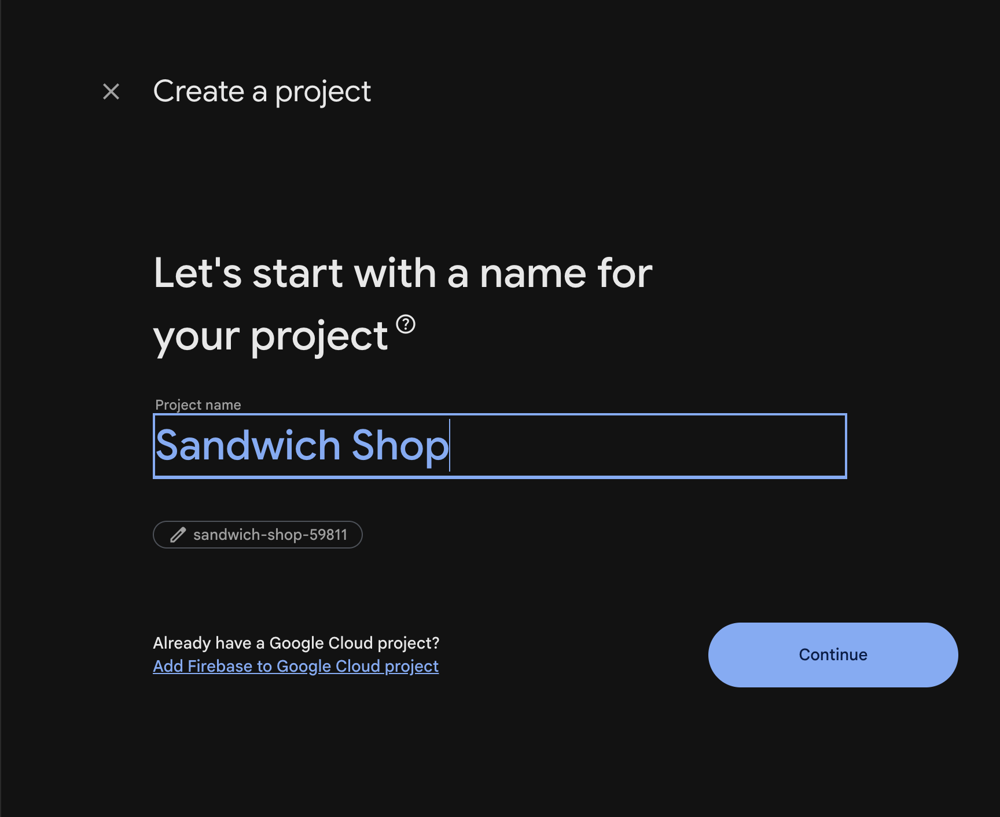

# Worksheet 9 — Cloud services

<!-- DRAFT: setup instructions written for walkthrough and screenshot capture; code implementation, Firestore data flow and testing sections remain outlined as TODO comments pending branch 9 completion. -->

## Table of contents

- [Getting help](#getting-help)
- [Getting started](#getting-started)
  - [Continue from Worksheet 8](#continue-from-worksheet-8)
  - [Enable Android and web support](#enable-android-and-web-support)
- [Why apps use the cloud](#why-apps-use-the-cloud)
- [Choosing cloud services](#choosing-cloud-services)
  - [Billing](#billing)
- [Setting up Firebase](#setting-up-firebase)
  - [Create a Firebase project](#create-a-firebase-project)
  - [Set up user authentication](#set-up-user-authentication)
  - [Create a Cloud Firestore database](#create-a-cloud-firestore-database)
  - [Install the Firebase and FlutterFire tools](#install-the-firebase-and-flutterfire-tools)
  - [Connect the Flutter app](#connect-the-flutter-app)
  - [Support more platforms](#support-more-platforms)
- [Firebase Authentication](#firebase-authentication)
  - [Sign up, sign in and sign out](#sign-up-sign-in-and-sign-out)
- [Cloud Firestore](#cloud-firestore)
  - [Read the menu from Firestore](#read-the-menu-from-firestore)
  - [Save user settings in the cloud](#save-user-settings-in-the-cloud)
  - [Store and read orders](#store-and-read-orders)
  - [Test with multiple users](#test-with-multiple-users)
  - [Protect user data with security rules](#protect-user-data-with-security-rules)
- [Testing cloud code](#testing-cloud-code)
  - [Fake Firebase in unit tests](#fake-firebase-in-unit-tests)
  - [Keep coverage high](#keep-coverage-high)
- [Exercises](#exercises)

## Getting help

To get support with this worksheet, follow the [Discord guide](https://portdotacdotuk-my.sharepoint.com/:p:/g/personal/mani_ghahremani_port_ac_uk/IQCMJP6IiR_bQoYUMdXJSRDYAWnajEALZYEXFZyrJkHS1QU) and post your questions there. You can also attend your timetabled practical sessions and ask a member of teaching staff for guidance.

## Getting started

### Continue from Worksheet 8

Continue with your Sandwich Shop app from [Worksheet 8](worksheet-8.md). Your tests should pass, and your coverage should sit close to 100% after the work in [Test coverage](worksheet-8.md#test-coverage). If you need the starting code, clone the [Sandwich Shop repository](https://github.com/manighahrmani/sandwich_shop) and switch to branch `8`:

```bash
git clone https://github.com/manighahrmani/sandwich_shop.git
cd sandwich_shop
git switch 8
```

Run `flutter pub get` to install the existing dependencies, then run `flutter test` to confirm all tests from Worksheet 8 pass before you start making changes.

Do not switch branches over unfinished work. Branch `9` contains the completed Sandwich Shop application for this worksheet; use it to compare your finished work, not as your starting point.

### Enable Android and web support

Up to [Worksheet 7](worksheet-7.md), the app stored orders in a local SQLite database that could not run in a browser, so we removed the `web` folder and blocked web builds in `lib/main.dart`. Replacing local SQLite with Cloud Firestore means customers will be able to use the shop in Chrome or Edge as well as on Android.

Check that your Flutter installation lists Chrome or Edge alongside your Android emulator by opening the terminal and running:

```bash
flutter devices
```

If your project does not already contain a `web` folder, generate the web runner files in the root of your repository:

```bash
flutter create --platforms=web .
```

The `.` targets the current project folder without touching your `lib`, `assets` or existing test files. If `flutter create` adds a starter `test/widget_test.dart` template, delete that template file and keep your existing mirrored `test/` files.

Even with the `web` folder restored, running the app in Chrome right now still shows the fallback screen from Worksheet 7 because `isSupportedPlatform()` in `lib/main.dart` returns `false` whenever `kIsWeb` is `true`. In this worksheet, we enable both Android and web for Firebase as a minimum, while keeping `isSupportedPlatform()` so accidentally launching a platform you have not configured, such as Windows, macOS or Linux, shows a helpful message rather than crashing. If you also want to add iOS or desktop platforms later, follow the optional [Support more platforms](#support-more-platforms) section.

Open `lib/main.dart` and update `isSupportedPlatform()` so it allows web builds alongside Android. Passing an optional `isWeb` parameter that defaults to `kIsWeb` keeps the real app's behaviour while letting unit tests simulate running on the web without a browser:

```dart
bool isSupportedPlatform({bool isWeb = kIsWeb}) {
  if (isWeb) {
    return true;
  }
  if (defaultTargetPlatform == TargetPlatform.android) {
    return true;
  }
  return false;
}
```

In the same file, update the message inside `UnsupportedPlatformApp` so it describes the supported platforms accurately:

```dart
            child: Text(
              'This app is configured for Android and web only. Stop the app '
              'and run it on Chrome or an Android emulator instead.',
              textAlign: TextAlign.center,
            ),
```

Now open `test/main_test.dart`, add a unit test confirming `isSupportedPlatform(isWeb: true)` returns `true`, and update the fallback screen test so it checks for the updated text:

```dart
  test('Web is supported', () {
    expect(isSupportedPlatform(isWeb: true), isTrue);
  });

  testWidgets('The unsupported platform screen explains what to do', (
    WidgetTester tester,
  ) async {
    await tester.pumpWidget(const UnsupportedPlatformApp());
    expect(find.textContaining('Android and web'), findsOneWidget);
  });
```

Run `flutter test` to confirm all tests still pass. You can also run `flutter run -d chrome` to check that the menu, order and settings screens open in Chrome. Note that tapping **Checkout** on the basket screen or opening the orders screen in Chrome will still fail until we replace `sqflite` with Cloud Firestore later in [Store and read orders](#store-and-read-orders), so keep testing order saving on your Android emulator until then.

## Why apps use the cloud

So far, our app has stored its data locally in JSON or on a SQL database on a single device. If someone switches devices or opens the app in a web browser, that local data is unavailable.

Most real-world apps avoid this by storing data on remote servers over the internet, known as cloud. Keeping the data (as well as other services of the app) on the cloud lets every customer access it from anywhere (and on any device or browser).

## Choosing cloud services

In this worksheet, we will walk you through provisioning cloud services that let your app store data and verify user accounts. In this worksheet we connect the Sandwich Shop app to Firebase for user sign-in (`firebase_auth`) and cloud database storage (`cloud_firestore`).

Firebase is a cloud service provided by Google that provides a variety of services for app development, including user authentication, database storage, and more. We have selected Firebase over the other providers such as Azure or Amazon AWS because it generally has a better integration with Flutter.

### Billing

Firebase offers two billing tiers on its [Firebase pricing](https://firebase.google.com/pricing) page: the no-cost Spark plan and the pay-as-you-go Blaze plan. Firebase Authentication and Cloud Firestore both include generous free daily quotas on the Spark plan without attaching a payment card.

In our case we don't require a cloud storage (e.g., storing user profile pictures or PDF receipts) so we can make do with the Spark plan. Just be aware as the need for your app grows, you may be asked to upgrade to the Blaze plan. Alternatively, you can also explore the [Firebase Local Emulator Suite](https://firebase.google.com/docs/emulator-suite) to simulate Firebase services locally.

## Setting up Firebase

Before writing any Dart code, create a Firebase project in the web dashboard and link it to your Flutter project.

### Create a Firebase project

Before the app can use any cloud features, we need a project on Firebase to hold our authentication settings, database and app configuration in one place.

Open the [Firebase dashboard](https://console.firebase.google.com/) in your browser and confirm that the profile icon in the top-right corner shows the Google account you want to use.

Select **Create a new Firebase project** (or **Create a project**), enter a project name such as `Sandwich Shop`, review the generated project ID underneath, and select **Continue**.



Disable Google Analytics when prompted if you want a simpler setup, otherwise create an account when prompted and set the analytics location to United Kingdom as shown below, then select **Create project**.


Once Firebase finishes provisioning, select **Continue** to open your project overview, as shown below:


Notice **Gemini in Firebase** on the right-hand side of the project overview, which is available at no cost on the Spark plan. You can ask it general questions about Firebase services or Firestore queries, though it cannot edit your Flutter project files, so keep using GitHub Copilot in VS Code if you need an AI agent that can access your codebase.

### Set up user authentication

So far our app does not have any authentication mechanism, meaning customers cannot register or sign in yet. Ideally we would like to let users create accounts, sign in securely, and manage their orders and preferences within the app. We would also like their settings and preferences to be tied to their authenticated identity so they can access them across devices.

In the left navigation menu of the Firebase dashboard under **Product categories**, open **Security** and select **Authentication**, then select **Get started**. Under the **Sign-in method** tab, choose **Email/Password**, toggle both **Enable** and **Email link (passwordless sign-in)** on if you want both password and email-link sign-in, and select **Save**.

To let customers sign in with their Google account too, select **Add new provider**, choose **Google**, toggle **Enable** on, set the public-facing project name and support email, and select **Save**, as shown below:


If you use **Google** sign-in on Android later, open **Settings** then **Project settings** and add your computer's debug SHA-1 certificate fingerprint under your Android app so Android allows the Google sign-in token request.

### Create a Cloud Firestore database

Once user accounts are enabled, the app needs a cloud database where it can store the shared menu alongside each customer's saved settings and order history so data is not trapped on one phone. Cloud Firestore organises this data into collections and documents rather than SQL tables and rows.

In the left navigation menu under **Product categories**, open **Databases and storage** and select **Firestore**, then select **Create database**. Keep **Standard edition** selected and select **Next**, pick a nearby location such as `europe-west2` (London) and select **Next**, choose **Start in test mode** and select **Next**, then leave scheduled backups skipped and select **Create**, as shown below:


Starting in test mode lets your app read and write documents while you test checkout and account creation, though anyone with your project ID could write data while it remains open. We replace those temporary rules with user-scoped security rules later in [Protect user data with security rules](#protect-user-data-with-security-rules).

### Install the Firebase and FlutterFire tools

Before connecting our Flutter code, the project needs platform-specific configuration files that point it to your `Sandwich Shop` project. The Firebase CLI lets you manage your cloud project from the terminal, while the FlutterFire CLI generates those configuration files for Android and web automatically instead of requiring manual edits to Gradle and web files.

Install the Firebase CLI following the [Firebase CLI documentation](https://firebase.google.com/docs/cli), or verify it is already installed by running `firebase --version` in your terminal. Next, sign in with the same Google account you used in the Firebase dashboard:

```bash
firebase login
```

If you are already signed into a different Google account in the CLI and want to switch accounts, run:

```bash
firebase login --reauth
```

Once signed in, activate the FlutterFire CLI globally using Dart Pub and confirm it responds:

```bash
dart pub global activate flutterfire_cli
flutterfire --version
```

If your terminal reports that `flutterfire` cannot be found after activation, add Dart's global `bin` folder (`~/.pub-cache/bin` on macOS or Linux, or `%LOCALAPPDATA%\Pub\Cache\bin` on Windows) to your system `PATH` and open a fresh terminal.

### Connect the Flutter app

Once the tools are ready, our app needs the official Firebase packages installed and initialised before any widgets read authentication state or database records.

Add the three Firebase packages we need across Android and web by running the following command in your project root:

```bash
flutter pub add firebase_core firebase_auth cloud_firestore
```

Now generate the Firebase configuration for both platforms using FlutterFire. Run the configure command in the root of your repository and select your project from the list when prompted:

```bash
flutterfire configure
```

When asked which platforms to support, use the arrow keys and space bar to select at least `android` and `web`, then press **Enter**. FlutterFire updates `android/app/google-services.json` and creates `lib/firebase_options.dart` with your project's public client identifiers (`apiKey`, `appId`, `projectId`), as shown below. Unlike server credentials or service account JSON files, these client options are safe to commit to Git because access control relies on Firebase Authentication and Cloud Firestore Security Rules rather than hiding project IDs.

<!-- Capture: Terminal output of flutterfire configure selecting android and web platforms -->


Open `lib/main.dart` and add two imports at the top of the file so Dart can load the Firebase core package and the generated options:

```dart
import 'package:firebase_core/firebase_core.dart';
import 'package:sandwich_shop/firebase_options.dart';
```

Firebase needs to finish initialising before any widget reads authentication state or Firestore data, so `main` must become an asynchronous function that returns `Future<void>`. Inside the supported-platform branch, call `WidgetsFlutterBinding.ensureInitialized()` so Flutter sets up platform channels before `runApp`, then await `Firebase.initializeApp` with `DefaultFirebaseOptions.currentPlatform` to pick the matching Android or web configuration automatically.

Replace `main()` in `lib/main.dart` with the updated function below. Including an optional `initializeFirebase` parameter defaulting to `true` lets the real app connect to Firebase while allowing widget tests to start `App` offline without calling native plugins:

```dart
Future<void> main({bool initializeFirebase = true}) async {
  if (isSupportedPlatform()) {
    if (initializeFirebase) {
      WidgetsFlutterBinding.ensureInitialized();
      await Firebase.initializeApp(
        options: DefaultFirebaseOptions.currentPlatform,
      );
    }
    runApp(const App());
  } else {
    runApp(const UnsupportedPlatformApp());
  }
}
```

Next, open `test/main_test.dart` and pass `initializeFirebase: false` to both `app.main()` calls inside the startup tests (`await app.main(initializeFirebase: false);`), then run `flutter test` to check that all existing tests still pass.

Finally, run the app on Chrome (`flutter run -d chrome`) and on your Android emulator to verify that both platforms connect to Firebase and open the menu screen cleanly, as shown below:

<!-- Capture: Sandwich Shop app running in Chrome web browser alongside Android emulator or device -->


### Support more platforms

Configuring Android and web gives every student a mobile emulator target and a browser target without extra desktop build tools. If you also want to run the app on iOS, macOS, Windows or Linux, you can enable those optional platforms in your existing Firebase project at any point.

First, generate the native folders for the extra platforms you want with `flutter create --platforms=ios,macos,windows,linux .`, keeping only the platform names you intend to use and deleting any starter `test/widget_test.dart` file if it is created. Check the build tools needed on your operating system (such as Xcode for iOS and macOS, with the **Keychain Sharing** capability enabled for macOS authentication, or the C++ desktop workload for Windows, as covered in [Run on other platforms](worksheet-7.md#run-on-other-platforms)).

Next, re-run `flutterfire configure` and select those additional platforms alongside `android` and `web` so FlutterFire updates `lib/firebase_options.dart` and creates any platform files such as `GoogleService-Info.plist` for Apple devices. Finally, update `isSupportedPlatform()` in `lib/main.dart` and its unit tests in `test/main_test.dart` so each extra `TargetPlatform` returns `true` instead of falling back to `UnsupportedPlatformApp`.

## Firebase Authentication

Before reading or saving any personal data in Cloud Firestore, the app must know which customer is signed in. Every signed-in user receives a unique user ID (`uid`) from Firebase Authentication, which later sections use as the key for storing that customer's own settings and orders.

### Sign up, sign in and sign out

Customers need a simple way to create an account, sign back in on any device, and sign out when someone else shares the browser or phone. Separating authentication logic behind an `AuthRepository` keeps our screens clean and makes testing sign-in flows straightforward.

<!-- TODO: build a dedicated sign-in / registration screen using FirebaseAuth (Email/Password, optional Email link, and Google Sign-In via google_sign_in), wrap auth operations in an AuthRepository, show clear validation/error messages, and react to authStateChanges() across the app. -->

## Cloud Firestore

With authentication in place to identify each customer, we can store both shared shop data and private user data in Cloud Firestore. Rather than SQL tables and joins, Firestore stores data as documents inside collections, which syncs automatically between Android and the web.

### Read the menu from Firestore

Keeping the menu in a bundled JSON file meant changing a sandwich name, description or price required releasing an updated app. Moving sandwich details into a shared Firestore collection lets the shop update the live menu for every customer immediately while keeping the bundled asset images fast to load.

<!-- TODO: seed and read a Cloud Firestore 'sandwiches' collection (including bundled asset image paths) instead of loading menu metadata only from local JSON. -->

### Save user settings in the cloud

In Worksheet 8, settings such as text size were stored locally in `SharedPreferences`, so changing phones or switching to Chrome reset the customer's choices. Saving settings inside a Firestore document under each user's `uid` ties preferences to the account rather than the device.

<!-- TODO: persist user settings (font size, default bread, etc.) per UID under users/<uid> in Cloud Firestore rather than local-only SharedPreferences, syncing settings when the user signs in on Android or web. -->

### Store and read orders

Until now, order history lived in a local SQLite database that could not follow a customer to another device or work in a web browser. Storing each customer's orders inside an `orders` subcollection under their `uid` replaces local SQLite while keeping orders scoped to the person who placed them.

<!-- TODO: replace SQLite DatabaseHelper / SqliteOrderRepository with a Cloud Firestore order flow under users/<uid>/orders so orders work cleanly on both Android and web. -->

### Test with multiple users

To prove that cloud storage and authentication isolate each person's data properly, we need to test the app with more than one account. Signing in as a second customer should show their own saved settings and empty or separate order history without exposing the first customer's records.

<!-- TODO: walk through registering/signing in with two test accounts across Chrome and Android, updating settings and placing orders in each, and inspecting the users/<uid> documents in the Cloud Firestore dashboard to show per-user isolation and cross-device sync. -->

### Protect user data with security rules

We started Cloud Firestore in test mode so any connected app could read and write documents during initial development, which leaves customer records unprotected. Replacing those temporary rules with Firestore Security Rules guarantees that anyone can read the public menu, while each customer's settings and orders can only be read or modified when signed in as that exact `uid`.

<!-- TODO: replace temporary test mode rules with Firestore Security Rules allowing public read on the menu collection and owner-only read/write (request.auth != null && request.auth.uid == userId) on users/<uid> and orders. -->

## Testing cloud code

### Fake Firebase in unit tests

Running unit and widget tests against live Firebase servers is slow, requires an internet connection, and writes test records into your production database. Replacing live Firebase instances with fake in-memory packages lets tests verify sign-in, settings and order logic offline in milliseconds.

<!-- TODO: add firebase_auth_mocks and fake_cloud_firestore as dev dependencies so Auth and Firestore repositories can be tested fast offline without hitting live Firebase servers. -->

### Keep coverage high

Every new repository method, error branch and authentication state introduces paths that could silently break checkout or lock users out if untested. Checking coverage ensures our new cloud code stays just as reliable as the local code from Worksheet 8.

<!-- TODO: run flutter test --coverage and check the new Auth, Firestore repository, and error states with the Flutter Coverage extension, mirroring lib/ inside test/. -->

## Exercises

The exercises below apply these concepts to your Southsea Cinema coursework and prepare you for Demo 5. For the full coursework specification and grading criteria, see the [Southsea Cinema coursework brief](https://portdotacdotuk-my.sharepoint.com/:w:/g/personal/mani_ghahremani_port_ac_uk/IQDtIJB3bM7gQ4p03eLUngyyAd7JuhjhHuNA1l0H-qCy3Jw).

<!-- TODO: write numbered exercises:
1. Create a Firebase project on the free Spark plan, enable Email/Password Authentication and Cloud Firestore, and connect Southsea Cinema for Android and web with flutterfire configure.
2. Store the cinema film catalogue details (title, synopsis, ticket price, rating, screening times, and local poster asset path) in a Cloud Firestore collection while keeping poster image files in assets/images/.
3. Add user registration, sign-in and sign-out so customers view only their own bookings and saved cinema preferences in the cloud.
4. Implement transactional Cloud Firestore booking creation and saved booking history replacing SQLite.
5. Add unit and widget tests using fake_cloud_firestore and firebase_auth_mocks and maintain test coverage matching lib/ inside test/.
-->
