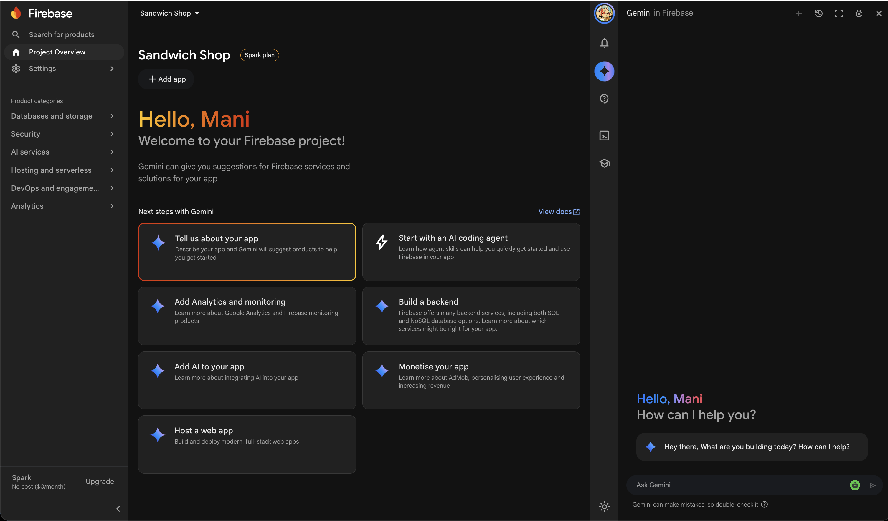
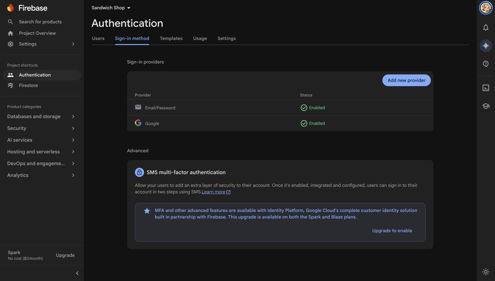
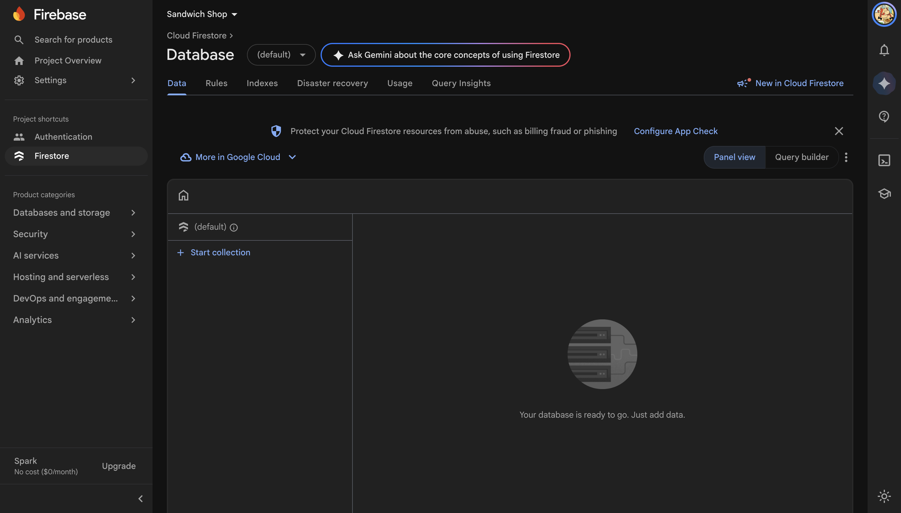

# Worksheet 9 — Cloud services

<!-- DRAFT: setup instructions written for walkthrough and screenshot capture; code implementation, Firestore data flow and testing sections remain outlined as TODO comments pending branch 9 completion. -->

## Table of contents

- [Getting help](#getting-help)
- [Getting started](#getting-started)
  - [Continue from Worksheet 8](#continue-from-worksheet-8)
  - [Enable Android and web support](#enable-android-and-web-support)
- [Choosing cloud services](#choosing-cloud-services)
  - [Why the Spark plan](#why-the-spark-plan)
  - [Where app data lives](#where-app-data-lives)
- [Setting up Firebase](#setting-up-firebase)
  - [Create a Firebase project](#create-a-firebase-project)
  - [Enable Email and Password authentication](#enable-email-and-password-authentication)
  - [Create a Cloud Firestore database](#create-a-cloud-firestore-database)
  - [Install the Firebase and FlutterFire tools](#install-the-firebase-and-flutterfire-tools)
  - [Connect the Flutter app](#connect-the-flutter-app)
- [Firebase Authentication](#firebase-authentication)
  - [Sign up, sign in and sign out](#sign-up-sign-in-and-sign-out)
  - [Save user settings in the cloud](#save-user-settings-in-the-cloud)
- [Cloud Firestore](#cloud-firestore)
  - [Read the menu from Firestore](#read-the-menu-from-firestore)
  - [Store and read orders](#store-and-read-orders)
  - [Protect user data with security rules](#protect-user-data-with-security-rules)
- [Testing cloud code](#testing-cloud-code)
  - [Fake Firebase in unit tests](#fake-firebase-in-unit-tests)
  - [Keep coverage high](#keep-coverage-high)
- [Exercises](#exercises)

## Getting help

To get support with this worksheet, follow the [Discord guide](https://portdotacdotuk-my.sharepoint.com/:p:/g/personal/mani_ghahremani_port_ac_uk/IQCMJP6IiR_bQoYUMdXJSRDYAWnajEALZYEXFZyrJkHS1QU) and post your questions there. You can also attend your timetabled practical sessions and ask a member of teaching staff for guidance.

## Getting started

### Continue from Worksheet 8

Continue with your Sandwich Shop app from [Worksheet 8](worksheet-8.md). Your tests should pass, and your coverage should sit close to 100% after the work in [Test coverage](worksheet-8.md#test-coverage). If you need the starting code, clone the [Sandwich Shop repository](https://github.com/manighahrmani/sandwich_shop) and switch to branch `8`:

```bash
git clone https://github.com/manighahrmani/sandwich_shop.git
cd sandwich_shop
git switch 8
```

### Enable Android and web support

Up to [Worksheet 7](worksheet-7.md), the app stored orders in a local SQLite database that ran on mobile and desktop targets. Replacing local SQLite with Cloud Firestore means your app works on Android and in a web browser as well. Check that your Flutter installation lists Chrome or Edge alongside your Android emulator by opening the terminal and running:

```bash
flutter devices
```

If your project does not already contain a `web` folder, generate the web runner files in the root of your repository:

```bash
flutter create --platforms=web .
```

## Choosing cloud services

A cloud service lets your app store data and verify user accounts on remote servers rather than keeping everything on one phone. In this worksheet we connect the Sandwich Shop app to Firebase for user sign-in (`firebase_auth`) and cloud database storage (`cloud_firestore`).

### Why the Spark plan

Firebase offers two billing tiers on its [Firebase pricing](https://firebase.google.com/pricing) page: the no-cost **Spark plan** and the pay-as-you-go **Blaze plan**. Firebase Authentication and Cloud Firestore both include generous free daily quotas on the **Spark plan** without attaching a payment card.

Enabling Cloud Storage for user-uploaded files requires upgrading a project to the **Blaze plan** and adding a billing card. We keep the entire module strictly on the free **Spark plan** so you never need a payment card, and you can upgrade independently later only if you decide to add cloud file uploads. You can also explore the [Firebase Local Emulator Suite](https://firebase.google.com/docs/emulator-suite) to run offline tests locally without touching live quotas.

### Where app data lives

Moving to Cloud Firestore removes the need to bundle product text or keep local SQLite tables, while avoiding paid Cloud Storage buckets for images. We store two kinds of data in two places:

- Image files remain inside the app bundle under `assets/images/`, just as in earlier worksheets, so they load fast without requiring a storage bucket.
- Product details such as titles, descriptions, prices, categories and the string path to each bundled asset (for example `assets/images/footlong_cheese.png`) live in a Cloud Firestore collection so you can update menu items or cinema listings from the cloud.

<!-- Capture: Firebase Pricing page highlighting Spark (No-cost) tier vs Blaze plan -->


## Setting up Firebase

Before writing any Dart code, create a Firebase project in the web dashboard and link it to your Flutter project.

### Create a Firebase project

Every Firebase project has a globally unique project ID shared across all Firebase users worldwide, similar to a domain name. Common names such as `sandwich-shop` are usually already taken, so Firebase suggests a unique suffix for you (for example `sandwich-shop-12345`) or lets you type your own unique ID such as `sandwich-shop-username`. If you want to keep your coursework separate from a personal Google account, sign into the browser with your preferred Google account first before opening the dashboard.

1. Open the [Firebase dashboard](https://console.firebase.google.com/) in your browser and confirm that the profile icon in the top-right corner shows the Google account you want to use.
2. Select **Create a project** (or **Add project**), enter a project name such as `Sandwich Shop Demo`, and check the generated project ID underneath.
3. Disable Google Analytics when prompted if you want a simpler setup, and select **Create project**.
4. Wait a few seconds until Firebase finishes provisioning, then select **Continue** to open your project overview, as shown below:

<!-- Capture: Firebase dashboard project overview after creating the project on Spark plan -->


### Enable Email and Password authentication

Next, turn on email and password sign-in so customers can register accounts and sign in before checking out or viewing past orders.

1. In the left navigation menu of the Firebase dashboard, open **Build** and select **Authentication**.
2. Select **Get started** to initialise Authentication for your project.
3. Under the **Sign-in method** tab, choose **Email/Password**, toggle **Enable** on for the first switch (leave **Email link (passwordless sign-in)** off), and select **Save**, as shown below:

<!-- Capture: Firebase Authentication Sign-in providers list showing Email/Password enabled -->


### Create a Cloud Firestore database

With authentication active, create the Cloud Firestore database that stores your menu items, customer settings and order records.

1. In the left navigation menu, open **Build** and select **Firestore Database**.
2. Select **Create database**, keep the **Standard edition** default if prompted, choose a nearby location such as `europe-west2` (London), and select **Next**.
3. Choose **Start in test mode** while building and testing the app during this worksheet, then select **Create**, as shown below:

<!-- Capture: Cloud Firestore Database dashboard showing an empty database in test mode -->


Starting in test mode lets your app read and write documents while you test checkout and account creation, though anyone with your project ID could write data while it remains open. We replace those temporary rules with user-scoped security rules later in [Protect user data with security rules](#protect-user-data-with-security-rules).

### Install the Firebase and FlutterFire tools

The Firebase CLI lets you manage your cloud project from the terminal, and the FlutterFire CLI generates the platform configuration files your Flutter app needs for Android and web automatically.

Install the Firebase CLI following the [Firebase CLI documentation](https://firebase.google.com/docs/cli), or verify it is already installed by running `firebase --version` in your terminal. Next, sign in with the same Google account you used in the Firebase dashboard:

```bash
firebase login
```

If you are already signed into a different Google account in the CLI and want to switch accounts, run:

```bash
firebase login --reauth
```

Once signed in, activate the FlutterFire CLI globally using Dart Pub and confirm it responds:

```bash
dart pub global activate flutterfire_cli
flutterfire --version
```

If your terminal reports that `flutterfire` cannot be found after activation, add Dart's global `bin` folder (`~/.pub-cache/bin` on macOS or Linux, or `%LOCALAPPDATA%\Pub\Cache\bin` on Windows) to your system `PATH` and open a fresh terminal.

### Connect the Flutter app

Add the three Firebase packages we need across Android and web by running the following command in your project root:

```bash
flutter pub add firebase_core firebase_auth cloud_firestore
```

Now generate the Firebase configuration for both platforms using FlutterFire. Run the configure command in the root of your repository and select your project from the list when prompted:

```bash
flutterfire configure
```

When asked which platforms to support, use the arrow keys and space bar to select **android** and **web**, then press **Enter**. FlutterFire updates `android/app/google-services.json` and creates `lib/firebase_options.dart` containing public client keys (`apiKey`, `appId`, `projectId`) that tell the app which Firebase project to talk to, as shown below:

<!-- Capture: Terminal output of flutterfire configure selecting android and web platforms -->


Open `lib/main.dart` and import `package:firebase_core/firebase_core.dart` alongside the generated `firebase_options.dart`. Ensure bindings are initialised and await `Firebase.initializeApp` before `runApp`, then run the app on both Chrome (`flutter run -d chrome`) and your Android emulator to confirm it starts cleanly:

```dart
import 'package:firebase_core/firebase_core.dart';
import 'package:flutter/material.dart';
import 'firebase_options.dart';

Future<void> main() async {
  WidgetsFlutterBinding.ensureInitialized();
  await Firebase.initializeApp(
    options: DefaultFirebaseOptions.currentPlatform,
  );
  runApp(const App());
}
```

<!-- Capture: Sandwich Shop app running in Chrome web browser alongside Android emulator or device -->


## Firebase Authentication

### Sign up, sign in and sign out

<!-- TODO: build a dedicated sign-in / registration screen using FirebaseAuth, wrap auth operations in an AuthRepository, show clear validation/error messages, and gate orders/settings behind authenticated users. -->

### Save user settings in the cloud

<!-- TODO: persist user settings (default bread, etc.) per UID under users/<uid> in Cloud Firestore rather than local-only SharedPreferences, keeping settings synced across Android and web. -->

## Cloud Firestore

### Read the menu from Firestore

<!-- TODO: replace local JSON asset loading of Sandwich metadata with a Cloud Firestore 'sandwiches' collection (including asset image paths), keeping assets/images/ bundled locally so no paid Storage bucket is required. -->

### Store and read orders

<!-- TODO: replace SQLite DatabaseHelper / SqliteOrderRepository with a transactional Cloud Firestore order flow under users/<uid>/orders so orders work cleanly on both Android and web. -->

### Protect user data with security rules

<!-- TODO: replace temporary test mode rules with Firestore Security Rules allowing public read on the menu collection and owner-only read/write (request.auth.uid == userId) on users/<uid> and orders. -->

## Testing cloud code

### Fake Firebase in unit tests

<!-- TODO: add firebase_auth_mocks and fake_cloud_firestore as dev dependencies so Auth and Firestore repositories can be tested fast offline without hitting live Firebase servers. -->

### Keep coverage high

<!-- TODO: run flutter test --coverage and check the new Auth, Firestore repository, and error states with the Flutter Coverage extension, mirroring lib/ inside test/. -->

## Exercises

The exercises below apply these concepts to your Southsea Cinema coursework and prepare you for Demo 5. For the full coursework specification and grading criteria, see the [Southsea Cinema coursework brief](https://portdotacdotuk-my.sharepoint.com/:w:/g/personal/mani_ghahremani_port_ac_uk/IQDtIJB3bM7gQ4p03eLUngyyAd7JuhjhHuNA1l0H-qCy3Jw).

<!-- TODO: write numbered exercises:
1. Create a Firebase project on the free Spark plan, enable Email/Password Authentication and Cloud Firestore, and connect Southsea Cinema for Android and web with flutterfire configure.
2. Store the cinema film catalogue details (title, synopsis, ticket price, rating, screening times, and local poster asset path) in a Cloud Firestore collection while keeping poster image files in assets/images/.
3. Add user registration, sign-in and sign-out so customers view only their own bookings and saved cinema preferences in the cloud.
4. Implement transactional Cloud Firestore booking creation and saved booking history replacing SQLite.
5. Add unit and widget tests using fake_cloud_firestore and firebase_auth_mocks and maintain test coverage matching lib/ inside test/.
-->
