# Worksheet 9 — Cloud services

<!-- DRAFT: setup instructions written for walkthrough and screenshot capture; code implementation, Firestore data flow and testing sections remain outlined as TODO comments pending branch 9 completion. -->

## Table of contents

- [Getting help](#getting-help)
- [Getting started](#getting-started)
  - [Continue from Worksheet 8](#continue-from-worksheet-8)
  - [Enable Android and web support](#enable-android-and-web-support)
- [Why apps use the cloud](#why-apps-use-the-cloud)
- [Choosing cloud services](#choosing-cloud-services)
  - [Billing](#billing)
- [Setting up Firebase](#setting-up-firebase)
  - [Create a Firebase project](#create-a-firebase-project)
  - [Set up user authentication](#set-up-user-authentication)
  - [Create a Cloud Firestore database](#create-a-cloud-firestore-database)
  - [Install the Firebase and FlutterFire tools](#install-the-firebase-and-flutterfire-tools)
  - [Connect the Flutter app](#connect-the-flutter-app)
  - [Support more platforms](#support-more-platforms)
- [Firebase Authentication](#firebase-authentication)
  - [Create the authentication repository](#create-the-authentication-repository)
  - [Test the authentication repository](#test-the-authentication-repository)
  - [Build the sign-in screen](#build-the-sign-in-screen)
  - [Test the sign-in screen](#test-the-sign-in-screen)
  - [Add the account button and route](#add-the-account-button-and-route)
  - [Test signing up, signing in and signing out](#test-signing-up-signing-in-and-signing-out)
  - [Sign in with an email link or Google](#sign-in-with-an-email-link-or-google)
  - [Sync settings with the authenticated profile](#sync-settings-with-the-authenticated-profile)
- [Cloud Firestore](#cloud-firestore)
  - [Read the menu from Firestore](#read-the-menu-from-firestore)
  - [Save user settings in the cloud](#save-user-settings-in-the-cloud)
  - [Store and read orders](#store-and-read-orders)
  - [Test with multiple users](#test-with-multiple-users)
  - [Protect user data with security rules](#protect-user-data-with-security-rules)
- [Testing cloud code](#testing-cloud-code)
  - [Fake Firebase in unit tests](#fake-firebase-in-unit-tests)
  - [Keep coverage high](#keep-coverage-high)
- [Exercises](#exercises)

## Getting help

To get support with this worksheet, follow the [Discord guide](https://portdotacdotuk-my.sharepoint.com/:p:/g/personal/mani_ghahremani_port_ac_uk/IQCMJP6IiR_bQoYUMdXJSRDYAWnajEALZYEXFZyrJkHS1QU) and post your questions there. You can also attend your timetabled practical sessions and ask a member of teaching staff for guidance.

## Getting started

### Continue from Worksheet 8

Continue with your Sandwich Shop app from [Worksheet 8](worksheet-8.md). Your tests should pass, and your coverage should sit close to 100% after the work in [Test coverage](worksheet-8.md#test-coverage). If you need the starting code, clone the [Sandwich Shop repository](https://github.com/manighahrmani/sandwich_shop) and switch to branch `8`:

```bash
git clone https://github.com/manighahrmani/sandwich_shop.git
cd sandwich_shop
git switch 8
```

Run `flutter pub get` to install the existing dependencies, then run `flutter test` to confirm all tests from Worksheet 8 pass before you start making changes.

Do not switch branches over unfinished work. Branch `9` contains the completed Sandwich Shop application for this worksheet; use it to compare your finished work, not as your starting point.

### Enable Android and web support

Up to [Worksheet 7](worksheet-7.md), the app stored orders in a local SQLite database that could not run in a browser, so we removed the `web` folder and blocked web builds in `lib/main.dart`. Replacing local SQLite with Cloud Firestore means customers will be able to use the shop in Chrome or Edge as well as on Android.

Check that your Flutter installation lists Chrome or Edge alongside your Android emulator by opening the terminal and running:

```bash
flutter devices
```

If your project does not already contain a `web` folder, generate the web runner files in the root of your repository:

```bash
flutter create --platforms=web .
```

The `.` targets the current project folder without touching your `lib`, `assets` or existing test files. If `flutter create` adds a starter `test/widget_test.dart` template, delete that template file and keep your existing mirrored `test/` files.

Even with the `web` folder restored, running the app in Chrome still shows the fallback screen from [Prevent running on unsupported platforms](worksheet-7.md#prevent-running-on-unsupported-platforms) because `isSupportedPlatform()` returns `false` when `kIsWeb` is `true`. In this worksheet, we enable Android and web as a minimum while keeping that guard for other desktop targets. If you want to add iOS or desktop platforms later, see the optional [Support more platforms](#support-more-platforms) section.

Open `lib/main.dart` and update `isSupportedPlatform()` so it allows web builds alongside Android. Passing an optional `isWeb` parameter that defaults to `kIsWeb` keeps normal app behaviour while letting unit tests simulate running on the web without a browser:

```dart
bool isSupportedPlatform({bool isWeb = kIsWeb}) {
  if (isWeb) {
    return true;
  }
  if (defaultTargetPlatform == TargetPlatform.android) {
    return true;
  }
  return false;
}
```

In the same file, update the message inside `UnsupportedPlatformApp` so it describes the supported platforms accurately:

```dart
            child: Text(
              'This app is configured for Android and web only. Stop the app '
              'and run it on Chrome or an Android emulator instead.',
              textAlign: TextAlign.center,
            ),
```

Now open `test/main_test.dart`, add a unit test confirming `isSupportedPlatform(isWeb: true)` returns `true`, and update the fallback screen test so it checks for the updated text:

```dart
  test('Web is supported', () {
    expect(isSupportedPlatform(isWeb: true), isTrue);
  });

  testWidgets('The unsupported platform screen explains what to do', (
    WidgetTester tester,
  ) async {
    await tester.pumpWidget(const UnsupportedPlatformApp());
    expect(find.textContaining('Android and web'), findsOneWidget);
  });
```

Run `flutter test` to confirm all tests still pass. You can also run `flutter run -d chrome` to check that the menu, order and settings screens open in Chrome. Note that tapping **Checkout** on the basket screen or opening the orders screen in Chrome will still fail until we replace `sqflite` with Cloud Firestore later in [Store and read orders](#store-and-read-orders), so keep testing order saving on your Android emulator until then.

## Why apps use the cloud

So far, our app has stored its data locally in JSON or on a SQL database on a single device. If someone switches devices or opens the app in a web browser, that local data is unavailable.

Most real-world apps avoid this by storing data on remote servers over the internet, known as the cloud. Keeping data and services in the cloud lets customers access them from any device or browser.

## Choosing cloud services

In this worksheet, we connect the Sandwich Shop app to Firebase for user sign-in (`firebase_auth`) and cloud database storage (`cloud_firestore`).

Firebase is a Google platform that provides authentication, cloud databases and hosting, and integrates cleanly with Flutter across Android and web.

### Billing

Firebase offers two billing tiers on its [Firebase pricing](https://firebase.google.com/pricing) page: the no-cost Spark plan and the pay-as-you-go Blaze plan. Firebase Authentication and Cloud Firestore both include generous free daily quotas on the Spark plan without attaching a payment card.

In our case we do not require Cloud Storage for user-uploaded files such as profile pictures or PDF receipts, so the free Spark plan is enough. As an app's usage grows beyond those daily quotas you can upgrade to the Blaze plan, or use the [Firebase Local Emulator Suite](https://firebase.google.com/docs/emulator-suite) to simulate Firebase services locally.

## Setting up Firebase

Before writing any Dart code, create a Firebase project in the web dashboard and link it to your Flutter project.

### Create a Firebase project

Before the app can use any cloud features, we need a project on Firebase to hold our authentication settings, database and app configuration in one place.

Open the [Firebase dashboard](https://console.firebase.google.com/) in your browser and confirm that the profile icon in the top-right corner shows the Google account you want to use.

Select **Create a new Firebase project** (or **Create a project**), enter a project name such as `Sandwich Shop`, review the generated project ID underneath, and select **Continue**.


Disable Google Analytics when prompted if you want a simpler setup, otherwise create an account when prompted and set the analytics location to United Kingdom as shown below, then select **Create project**.


Once Firebase finishes provisioning, select **Continue** to open your project overview, as shown below:


Notice **Gemini in Firebase** on the right-hand side of the project overview, which is available at no cost on the Spark plan. You can ask it general questions about Firebase services or Firestore queries, though it cannot edit your Flutter project files, so keep using GitHub Copilot in VS Code if you need an AI agent that can access your codebase.

### Set up user authentication

So far our app has no user accounts, so customers cannot register, sign in, or carry their saved preferences and order history across devices.

In the left navigation menu of the Firebase dashboard under **Product categories**, open **Security** and select **Authentication**, then select **Get started**. Under the **Sign-in method** tab, choose **Email/Password**, toggle both **Enable** and **Email link (passwordless sign-in)** on if you want both password and email-link sign-in, and select **Save**.

To let customers sign in with their Google account too, select **Add new provider**, choose **Google**, toggle **Enable** on, set the public-facing project name and support email, and select **Save**, as shown below:


### Create a Cloud Firestore database

Once user accounts are enabled, the app also needs a cloud database for the shared menu alongside each customer's saved settings and order history.

For this we use [Cloud Firestore](https://firebase.google.com/docs/firestore), a cloud-hosted NoSQL database built around collections (similar to tables) and documents (similar to rows, stored as key-value fields like JSON) that syncs automatically across devices.

In the left navigation menu under **Product categories**, open **Databases and storage** and select **Firestore**, then select **Create database**. Keep **Standard edition** selected and select **Next**, pick a nearby location such as `europe-west2` (London) and select **Next**, choose **Start in test mode** and select **Next**, then leave scheduled backups skipped and select **Create**, as shown below:


Starting in test mode leaves the database open for 30 days so your app can read and write data freely while you build it. Before finishing, we replace those open rules so each signed-in customer can only access their own orders and settings in [Protect user data with security rules](#protect-user-data-with-security-rules).

### Install the Firebase and FlutterFire tools

Before editing any Dart code, your project needs a few setup files linking it to your `Sandwich Shop` project on Firebase. The Firebase CLI lets you control Firebase from the terminal, and the FlutterFire CLI creates those Android and web setup files automatically so you do not have to configure them by hand.

Install the Firebase CLI following the [Firebase CLI documentation](https://firebase.google.com/docs/cli). Once it is installed, verify that it is correctly installed by running the following command in your terminal:

```bash
firebase --version
```

Next, sign in with the same Google account you used in the Firebase dashboard:

```bash
firebase login
```

If you are already signed into a different Google account in the CLI and want to switch accounts, run:

```bash
firebase login --reauth
```

Once signed in, install the FlutterFire CLI using Dart Pub:

```bash
dart pub global activate flutterfire_cli
```

Look at the end of the terminal output. If Dart shows a warning that `.pub-cache/bin` (or `Pub\Cache\bin`) is not on your `PATH`, add it before running `flutterfire`, as shown in the screenshot below:

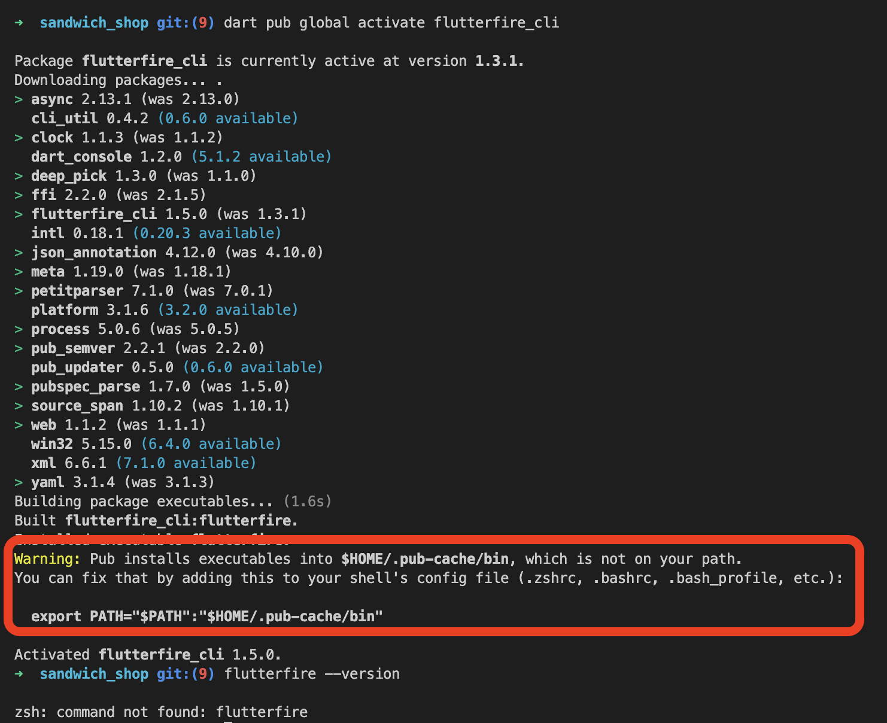

On macOS, run the command below in your terminal, then close and reopen the terminal (use `~/.bashrc` instead on Linux):

```bash
echo 'export PATH="$PATH":"$HOME/.pub-cache/bin"' >> ~/.zshrc
```

On Windows, run these two lines in PowerShell, then close and reopen the terminal (or search the Start menu for **Edit environment variables for your account** and add `%LOCALAPPDATA%\Pub\Cache\bin` to **Path**):

```powershell
$userPath = [Environment]::GetEnvironmentVariable('Path', 'User')
[Environment]::SetEnvironmentVariable('Path', "$userPath;$env:LOCALAPPDATA\Pub\Cache\bin", 'User')
```

Finally, open a new terminal and check that the `flutterfire` command responds:

```bash
flutterfire --version
```

You should get its version as shown below:


### Connect the Flutter app

Once the tools are ready, our app needs the official Firebase packages installed and initialised before any widgets read authentication state or database records.

Add the three Firebase packages we need across Android and web by running the following command in your project root:

```bash
flutter pub add firebase_core firebase_auth cloud_firestore
```

Now generate the Firebase configuration for both platforms using FlutterFire. Run the configure command in the root of your repository and select your project from the list when prompted:

```bash
flutterfire configure
```

When asked which platforms to support, use the arrow keys and space bar to select at least `android` and `web`, then press **Enter**. See below for an example of the selection process:

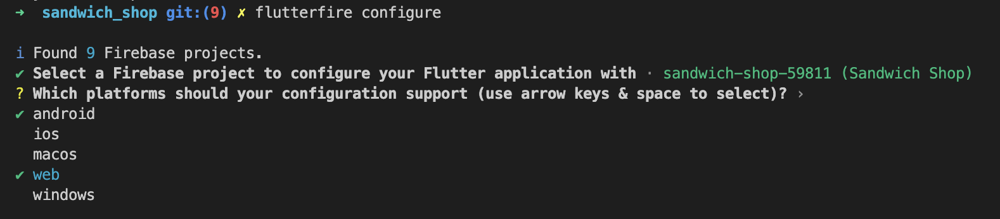

FlutterFire creates `android/app/google-services.json`, `lib/firebase_options.dart` and `firebase.json` (and updates your Android Gradle files) so your app knows which Firebase project to connect to, as shown below. Because these files do not contain private admin credentials (customer data is protected later by sign-in and security rules), they are safe to commit to Git.

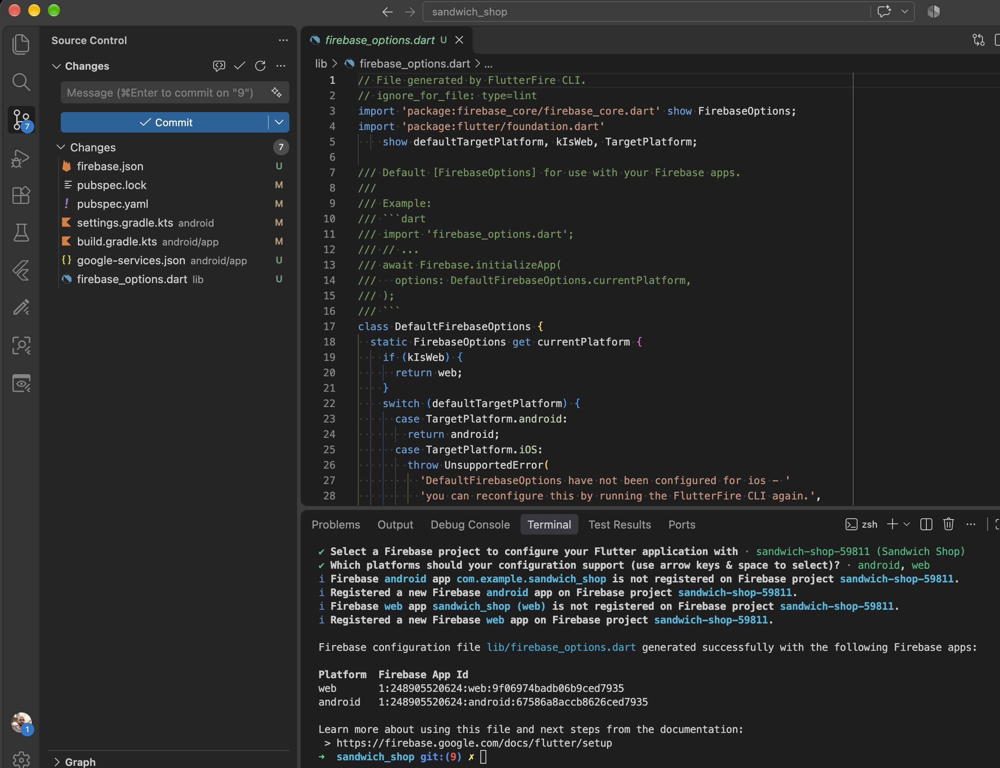

If you push `lib/firebase_options.dart` to a public GitHub repository, GitHub may send you a secret-scanning alert for a Google API key. As explained in [Learn about Firebase API keys](https://firebase.google.com/docs/projects/api-keys), Firebase client API keys only identify which project to reach and do not grant admin access on their own, so you can dismiss that alert once you lock down your database rules in [Protect user data with security rules](#protect-user-data-with-security-rules) (just never attach paid Google APIs such as Gemini or Google Maps to those Firebase client keys, and never commit downloaded admin service-account JSON files).

Open `lib/main.dart` and add two imports at the top of the file so Dart can load the Firebase core package and the generated options:

```dart
import 'package:firebase_core/firebase_core.dart';
import 'package:sandwich_shop/firebase_options.dart';
```

Firebase needs to connect before any screen loads, so we make `main` an `async` function that returns `Future<void>` instead of `void`. Because we run setup code before `runApp`, we first call `WidgetsFlutterBinding.ensureInitialized()` so Flutter sets up the link between Dart and the device or browser.

We then call `await Firebase.initializeApp(...)` and pass `DefaultFirebaseOptions.currentPlatform` from `firebase_options.dart`, which automatically picks the matching Android or web settings generated by FlutterFire.

In `main.dart`, replace your `main()` function with the updated function below:

```dart
Future<void> main() async {
  if (isSupportedPlatform()) {
    WidgetsFlutterBinding.ensureInitialized();
    await Firebase.initializeApp(
      options: DefaultFirebaseOptions.currentPlatform,
    );
    runApp(const App());
  } else {
    runApp(const UnsupportedPlatformApp());
  }
}
```

Next, open `test/main_test.dart` and remove the startup tests that call `app.main()` directly, along with the extra `'package:sandwich_shop/main.dart' as app;` import that is no longer used.

Now that `main()` connects to Firebase, calling it in an offline test would fail, while the remaining tests in `test/main_test.dart` still check `App`, `isSupportedPlatform()` and `UnsupportedPlatformApp` without a network connection. Run `flutter test` to confirm all remaining tests pass. The diff below shows the removed lines in `test/main_test.dart`:

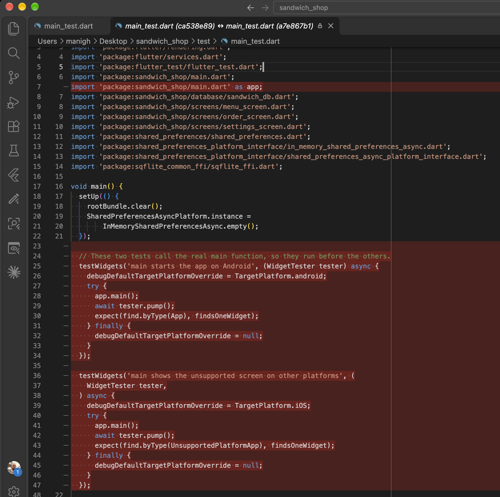

Finally, run the app in Chrome and on your Android emulator to verify that both platforms connect to Firebase and open the menu cleanly. As noted above, checkout in Chrome still fails with an SQLite error until we switch orders to Cloud Firestore:

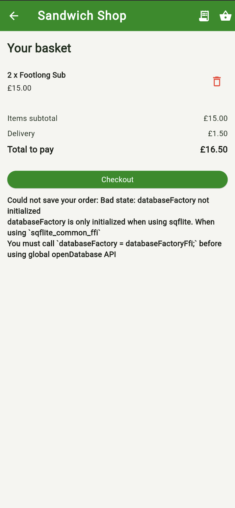

### Support more platforms

This section is optional. Configuring Android and web already gives you a mobile emulator target and a browser target without needing extra build tools. If you also want to run the app on iOS, macOS, Windows or Linux desktop, follow the steps below to add those targets to your Firebase project.

First, make sure you have the required platform tools installed on your computer, such as Xcode for iOS and macOS or the C++ desktop workload for Windows (see [Run on other platforms](worksheet-7.md#run-on-other-platforms)). Only if you build a native macOS desktop app, you will also need to enable the **Keychain Sharing** capability in Xcode (and select a signing team) so Firebase Authentication can save sign-in sessions.

Next, generate the runner folders for the extra platforms you want, keeping only the platform names you need and deleting `test/widget_test.dart` if Flutter creates one:

```bash
flutter create --platforms=ios,macos,windows,linux .
```

Re-run `flutterfire configure` in the root of your project and select those new platforms alongside `android` and `web`. FlutterFire updates `lib/firebase_options.dart` with their settings and generates any platform files such as `GoogleService-Info.plist` for Apple targets.

Finally, open `lib/main.dart` and add an `if` check inside `isSupportedPlatform()` for each platform you added (and update `test/main_test.dart` so those targets expect `isTrue`):

```dart
  if (defaultTargetPlatform == TargetPlatform.iOS) {
    return true;
  }
```

## Firebase Authentication

Before reading or saving personal data in Cloud Firestore, the app must know which customer is signed in. Every signed-in user receives a unique user ID (`uid`) from Firebase Authentication, which later sections use as the key for storing that customer's own settings and orders.

In this section we build a simplified authentication flow for the Sandwich Shop app: registering an account, signing in with email and password, showing friendly error messages, and signing out. For the full reference, see the [Firebase Authentication for Flutter documentation](https://firebase.flutter.dev/docs/auth/overview).

### Create the authentication repository

Putting all `firebase_auth` calls inside a dedicated repository keeps screens clean and lets tests swap out the real Firebase connection later.

Create a new file named `lib/repositories/auth_repository.dart` with the import and an empty class shell:

```dart
import 'package:firebase_auth/firebase_auth.dart';

class AuthRepository {}
```

Inside the braces of `AuthRepository`, add the singleton boilerplate (matching [CartRepository in Worksheet 5](worksheet-5.md#create-the-cart-repository-singleton)) alongside a nullable `_auth` field, a `setAuth` setter, and an `auth` getter (the same test-hook pattern used for `setDatabase` in [Worksheet 7](worksheet-7.md#create-one-shared-database-helper)):

```dart
  AuthRepository._internal();

  static final AuthRepository instance = AuthRepository._internal();

  FirebaseAuth? _auth;

  void setAuth(FirebaseAuth? auth) {
    _auth = auth;
  }

  FirebaseAuth get auth {
    final FirebaseAuth? existingAuth = _auth;
    if (existingAuth != null) {
      return existingAuth;
    }
    return FirebaseAuth.instance;
  }
```

Always read Firebase Authentication through the `auth` getter rather than calling `FirebaseAuth.instance` directly, so tests can supply a fake instance via `setAuth` while the live app falls back to `FirebaseAuth.instance`.

Next, add two read helpers inside `AuthRepository` to check who is signed in right now and to listen whenever sign-in state changes:

```dart
  User? getCurrentUser() {
    final FirebaseAuth authInstance = auth;
    return authInstance.currentUser;
  }

  Stream<User?> watchAuthState() {
    final FirebaseAuth authInstance = auth;
    return authInstance.authStateChanges();
  }
```

Unlike a `Future`, which resolves once, a Dart [Stream](https://dart.dev/libraries/async/using-streams) (`Stream<User?>`) emits a new value every time a user signs in or signs out (`null` when signed out). Listening to `watchAuthState()` lets widgets react immediately rather than polling `getCurrentUser()`.

Now add three methods for creating an account, signing in and signing out:

```dart
  Future<User?> signUpWithEmail(String email, String password) async {
    final FirebaseAuth authInstance = auth;
    final UserCredential credential =
        await authInstance.createUserWithEmailAndPassword(
      email: email,
      password: password,
    );
    return credential.user;
  }

  Future<User?> signInWithEmail(String email, String password) async {
    final FirebaseAuth authInstance = auth;
    final UserCredential credential =
        await authInstance.signInWithEmailAndPassword(
      email: email,
      password: password,
    );
    return credential.user;
  }

  Future<void> signOut() async {
    final FirebaseAuth authInstance = auth;
    await authInstance.signOut();
  }
```

Each email method returns a `UserCredential` wrapping the signed-in `User` (these classes are defined in the `firebase_auth` package). When Firebase rejects an invalid email, short password or wrong password, it throws a `FirebaseAuthException` containing a short machine-readable `code`.

Finish `AuthRepository` by adding `getErrorMessage` inside its braces so screens can display plain messages instead of raw error codes:

```dart
  String getErrorMessage(FirebaseAuthException error) {
    final String code = error.code;
    if (code == 'invalid-email') {
      return 'Please enter a valid email address.';
    }
    if (code == 'user-not-found') {
      return 'No account was found with that email address.';
    }
    if (code == 'wrong-password' || code == 'invalid-credential') {
      return 'Incorrect email or password.';
    }
    if (code == 'email-already-in-use') {
      return 'An account already exists for that email address.';
    }
    if (code == 'weak-password') {
      return 'Password must be at least 6 characters long.';
    }
    return 'Authentication failed. Please try again.';
  }
```

### Test the authentication repository

Before we move on, we need to write unit tests for `AuthRepository` so every sign-in, registration, sign-out and error-mapping path is verified automatically. Automated tests must never connect to live Firebase servers, so install the `firebase_auth_mocks` package as a development dependency first:

```bash
flutter pub add --dev firebase_auth_mocks
```

Open GitHub Copilot in **Interactive** mode and attach `#lib/repositories/auth_repository.dart` and `#test/repositories/sandwich_repository_test.dart` as context. Ask Copilot to create `test/repositories/auth_repository_test.dart` (matching the mirrored `test/repositories/` folder from [Worksheet 7](worksheet-7.md#organising-tests)) using `MockFirebaseAuth` and `MockUser` from `firebase_auth_mocks`.

Make sure your prompt asks Copilot to test every function and branch in `AuthRepository`: `getCurrentUser()` when signed out, `signUpWithEmail()`, `signInWithEmail()`, `signOut()`, `watchAuthState()` emitting sign-in and sign-out updates, `auth` falling back to `FirebaseAuth.instance` when `_auth` is `null`, and every code mapped in `getErrorMessage()` (plus its default fallback message).

Run the tests with coverage enabled in the terminal:

```bash
flutter test --coverage test/repositories/auth_repository_test.dart
```

Open the **Testing** view in VS Code and inspect the **Flutter Coverage** tree (as set up in [Measure coverage](worksheet-8.md#measure-coverage)) to confirm `lib/repositories/auth_repository.dart` reports near-100% coverage. Read through each generated test in `test/repositories/auth_repository_test.dart` manually to verify every method in `AuthRepository` is exercised and checked with specific `expect` assertions (not just smoke calls), then run the full test suite to make sure all existing tests still pass.

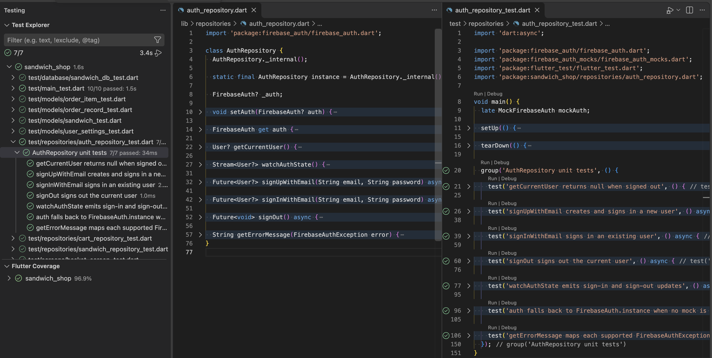

### Build the sign-in screen

Now create a screen where customers can switch between signing in and creating a new account (sign up), then return to the menu once authentication succeeds.

Create a new file named `lib/screens/auth_screen.dart`. Start with the imports and a `StatefulWidget` whose `build` method throws `UnimplementedError` until we complete it:

```dart
import 'package:firebase_auth/firebase_auth.dart';
import 'package:flutter/material.dart';
import 'package:sandwich_shop/constants.dart';
import 'package:sandwich_shop/repositories/auth_repository.dart';
import 'package:sandwich_shop/widgets/primary_button.dart';

class AuthScreen extends StatefulWidget {
  const AuthScreen({super.key});

  @override
  State<AuthScreen> createState() {
    return _AuthScreenState();
  }
}

class _AuthScreenState extends State<AuthScreen> {
  @override
  Widget build(BuildContext context) {
    throw UnimplementedError();
  }
}
```

Inside `_AuthScreenState`, declare the two text controllers and three state variables above `build`. The `_isRegistering` boolean tracks whether the form creates a new account (`true`) or signs in to an existing one (`false`), `_isSubmitting` becomes `true` while waiting for Firebase to reply so we can display a loading indicator, and `_errorMessage` holds any message shown below the fields:

```dart
  late TextEditingController _emailController;
  late TextEditingController _passwordController;
  bool _isRegistering = false;
  bool _isSubmitting = false;
  String _errorMessage = '';
```

Override `initState()` and `dispose()` to create and release the controllers, following the same lifecycle as [Text controllers and form lifecycle](worksheet-5.md#text-controllers-and-form-lifecycle):

```dart
  @override
  void initState() {
    super.initState();
    _emailController = TextEditingController();
    _passwordController = TextEditingController();
  }

  @override
  void dispose() {
    _emailController.dispose();
    _passwordController.dispose();
    super.dispose();
  }
```

Add `_toggleMode` below `dispose()` so the customer can switch the screen between Sign In mode and Create Account mode while clearing any old error message:

```dart
  void _toggleMode() {
    setState(() {
      _isRegistering = !_isRegistering;
      _errorMessage = '';
    });
  }
```

Next, create an empty `Future<void> _submitForm() async {}` method below `_toggleMode`. Inside its braces, read both controllers (trimming spaces from the email as in [Worksheet 5](worksheet-5.md#add-text-fields-and-the-switch-toggle) while leaving the password untouched) and return early with an error message if either field is blank. When both fields are present, set `_isSubmitting` to `true` and clear any previous error before calling Firebase:

```dart
    final String email = _emailController.text.trim();
    final String password = _passwordController.text;

    if (email.isEmpty || password.isEmpty) {
      setState(() {
        _errorMessage = 'Please enter both an email and a password.';
      });
      return;
    }

    setState(() {
      _isSubmitting = true;
      _errorMessage = '';
    });
```

Below that `setState` block (still inside `_submitForm`), add a `try` block that calls `signUpWithEmail` when `_isRegistering` is `true` or `signInWithEmail` otherwise. Because Firebase signs in newly registered users automatically, both branches finish the same way by resetting `_isSubmitting` and calling `Navigator.pop(context)` to close the screen and return to the previous route on the stack from [Worksheet 3](worksheet-3.md#understand-stack-based-navigation) (guarding with `Navigator.canPop(context)` so standalone widget tests do not fail).

Unlike earlier `try`/`catch` blocks, we write `on FirebaseAuthException catch (error)` first so known Firebase errors are converted via `getErrorMessage`, followed by a general `catch (error)` fallback for any unexpected failure. Remember to check `mounted` after each `await`, as introduced in [Worksheet 6](worksheet-6.md#load-the-menu-when-the-screen-opens):

```dart
    try {
      if (_isRegistering) {
        await AuthRepository.instance.signUpWithEmail(email, password);
      } else {
        await AuthRepository.instance.signInWithEmail(email, password);
      }
      if (!mounted) {
        return;
      }
      setState(() {
        _isSubmitting = false;
      });
      if (Navigator.canPop(context)) {
        Navigator.pop(context);
      }
    } on FirebaseAuthException catch (error) {
      if (!mounted) {
        return;
      }
      setState(() {
        _errorMessage = AuthRepository.instance.getErrorMessage(error);
        _isSubmitting = false;
      });
    } catch (error) {
      if (!mounted) {
        return;
      }
      setState(() {
        _errorMessage = 'Could not complete sign-in: $error';
        _isSubmitting = false;
      });
    }
```

Now replace `throw UnimplementedError();` inside `build` so the screen prepares its form labels and widgets directly inside `build`, using `SingleChildScrollView` as in [Worksheet 5](worksheet-5.md#wrap-the-form-in-a-scroll-view). It picks headings and captions from `_isRegistering`, swaps `PrimaryButton` for a `CircularProgressIndicator` while `_isSubmitting` is `true` to prevent double submissions, and uses `SizedBox.shrink()` as a zero-size empty widget for `errorWidget` when `_errorMessage` is empty. Setting `obscureText: true` on the password `TextField` masks typed characters on screen:

```dart
  @override
  Widget build(BuildContext context) {
    String titleText = 'Customer Sign In';
    String buttonLabel = 'Sign In';
    String toggleLabel = 'Need an account? Register';
    if (_isRegistering) {
      titleText = 'Create Account';
      buttonLabel = 'Register';
      toggleLabel = 'Already have an account? Sign In';
    }

    final Widget actionWidget;
    if (_isSubmitting) {
      actionWidget = const CircularProgressIndicator();
    } else {
      actionWidget = PrimaryButton(
        label: buttonLabel,
        onPressed: _submitForm,
      );
    }

    Widget errorWidget = const SizedBox.shrink();
    if (_errorMessage.isNotEmpty) {
      errorWidget = Padding(
        padding: const EdgeInsets.only(bottom: 16),
        child: Text(
          _errorMessage,
          style: const TextStyle(color: Colors.red),
        ),
      );
    }

    return Scaffold(
      appBar: AppBar(
        title: const Text(appTitle, style: shopHeaderStyle),
      ),
      body: SingleChildScrollView(
        padding: const EdgeInsets.all(16.0),
        child: Column(
          crossAxisAlignment: CrossAxisAlignment.start,
          children: [
            Text(titleText, style: shopSectionTitleStyle),
            const SizedBox(height: 16),
            TextField(
              controller: _emailController,
              decoration: const InputDecoration(
                border: OutlineInputBorder(),
                labelText: 'Email',
              ),
            ),
            const SizedBox(height: 16),
            TextField(
              controller: _passwordController,
              obscureText: true,
              decoration: const InputDecoration(
                border: OutlineInputBorder(),
                labelText: 'Password',
              ),
            ),
            const SizedBox(height: 16),
            errorWidget,
            actionWidget,
            const SizedBox(height: 8),
            TextButton(
              onPressed: _toggleMode,
              child: Text(toggleLabel),
            ),
          ],
        ),
      ),
    );
  }
```

### Test the sign-in screen

Because `AuthScreen` is not linked from `MenuScreen` yet, we cannot open it in the running app until the next section. Run `flutter analyze` first to confirm `lib/screens/auth_screen.dart` has no static errors.

Next, use GitHub Copilot in **Interactive** mode with `#lib/screens/auth_screen.dart` and `#test/screens/settings_screen_test.dart` to create widget tests in `test/screens/auth_screen_test.dart`, following the same workflow as [Test the authentication repository](#test-the-authentication-repository). Ask Copilot to use `MockFirebaseAuth` (with a small test subclass overriding `signInWithEmailAndPassword` to throw `FirebaseAuthException` and a general `Exception`) covering empty-field validation, mode toggling, registering and returning, signing in and returning, and error messages. Run your tests, review the generated assertions, and confirm coverage on `lib/screens/auth_screen.dart`:

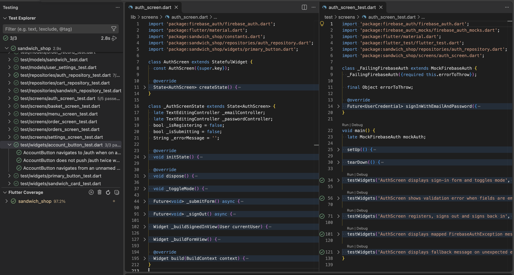

### Add the account button and route

To open `AuthScreen` when signed out and let customers sign out directly from the menu bar once signed in, create an `AccountButton` widget in `lib/widgets/account_button.dart`.

Start with the imports, the `_openAuthScreen` helper (using the same `ModalRoute.of(context)` route guard as [SettingsButton in Worksheet 5](worksheet-5.md#create-the-settings-button-and-register-the-route)), a `_signOut` helper, and a placeholder `build` method:

```dart
import 'package:firebase_auth/firebase_auth.dart';
import 'package:flutter/material.dart';
import 'package:sandwich_shop/constants.dart';
import 'package:sandwich_shop/repositories/auth_repository.dart';

class AccountButton extends StatelessWidget {
  const AccountButton({super.key});

  void _openAuthScreen(BuildContext context) {
    final ModalRoute<dynamic>? modalRoute = ModalRoute.of(context);
    final String currentRoute;
    if (modalRoute != null) {
      final RouteSettings routeSettings = modalRoute.settings;
      final String? name = routeSettings.name;
      if (name != null) {
        currentRoute = name;
      } else {
        currentRoute = '';
      }
    } else {
      currentRoute = '';
    }

    if (currentRoute != '/auth') {
      Navigator.pushNamed(context, '/auth');
    }
  }

  Future<void> _signOut() async {
    await AuthRepository.instance.signOut();
  }

  @override
  Widget build(BuildContext context) {
    throw UnimplementedError();
  }
}
```

Replace `throw UnimplementedError();` inside `build` with a [StreamBuilder](https://api.flutter.dev/flutter/widgets/StreamBuilder-class.html) (`StreamBuilder<User?>`). A `StreamBuilder` subscribes to `watchAuthState()` and runs its `builder` callback whenever the stream emits a new value, passing the latest `User?` inside `snapshot.data` (`AsyncSnapshot<User?>`). When `currentUser` is `null`, the button displays **Log In** and opens `/auth`; when signed in, it displays **Sign Out** and calls `_signOut()`:

```dart
  @override
  Widget build(BuildContext context) {
    return StreamBuilder<User?>(
      stream: AuthRepository.instance.watchAuthState(),
      builder: (BuildContext context, AsyncSnapshot<User?> snapshot) {
        final User? currentUser = snapshot.data;

        String labelText = 'Log In';
        if (currentUser != null) {
          labelText = 'Sign Out';
        }

        return ElevatedButton(
          style: ElevatedButton.styleFrom(
            backgroundColor: shopWhite,
            foregroundColor: shopBrand,
          ),
          onPressed: () {
            if (currentUser != null) {
              _signOut();
            } else {
              _openAuthScreen(context);
            }
          },
          child: Text(labelText),
        );
      },
    );
  }
```

Register the `'/auth'` route in `lib/main.dart` (importing `package:sandwich_shop/screens/auth_screen.dart`) inside the `routes` map of `MaterialApp`, following [Register named routes](worksheet-5.md#register-named-routes):

```dart
        '/auth': (BuildContext context) {
          return const AuthScreen();
        },
```

In `lib/screens/menu_screen.dart`, import `package:sandwich_shop/widgets/account_button.dart` and add `AccountButton()` to the `actions` list in `AppBar` alongside `SettingsButton()` and `BasketButton()`:

```dart
      appBar: AppBar(
        title: const Text(appTitle, style: shopHeaderStyle),
        actions: const [AccountButton(), SettingsButton(), BasketButton()],
      ),
```

Because `MenuScreen` now renders `AccountButton` (`watchAuthState()`), set `AuthRepository.instance.setAuth(MockFirebaseAuth())` in `setUp` (and `null` in `tearDown`) inside both `test/screens/menu_screen_test.dart` and `test/main_test.dart` so widget tests stay offline. Ask Copilot to add `test/widgets/account_button_test.dart` (covering **Log In** navigation, duplicate-route guards, unnamed routes, and tapping **Sign Out** when signed in) and update the menu and main tests for **Log In** and `/auth`, then run your tests and check coverage. Your app bar should now look like this:

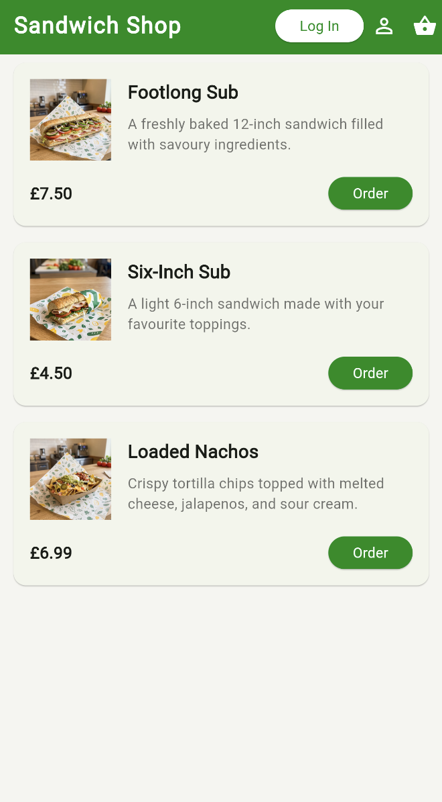

### Test signing up, signing in and signing out

Launch the app in Chrome (`flutter run -d chrome`) or on your Android emulator and select **Log In** in the top-right bar to open `AuthScreen` in sign-in mode:

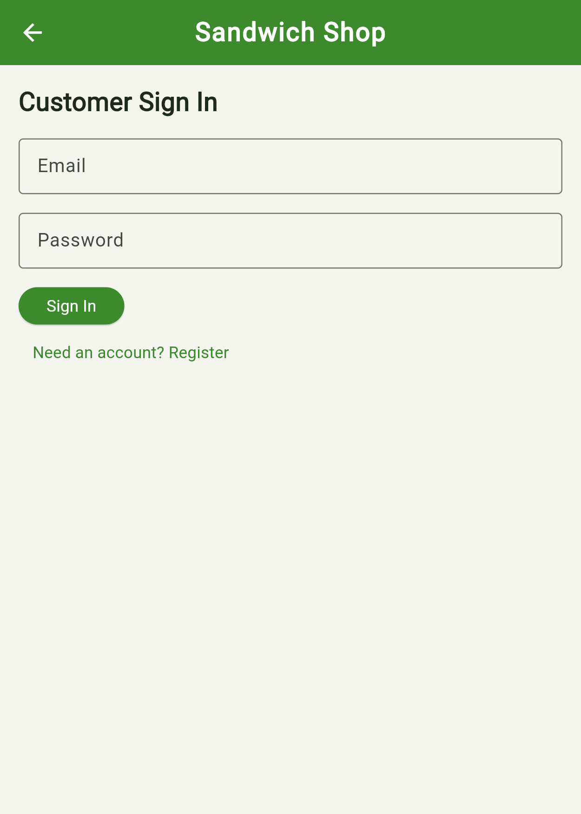

Select **Need an account? Register** so the heading changes to **Create Account** and the button changes to **Register**. Enter an email address and a password of at least six characters, then select **Register** to create the account and return to `MenuScreen`, where the top-right button now shows **Sign Out**:

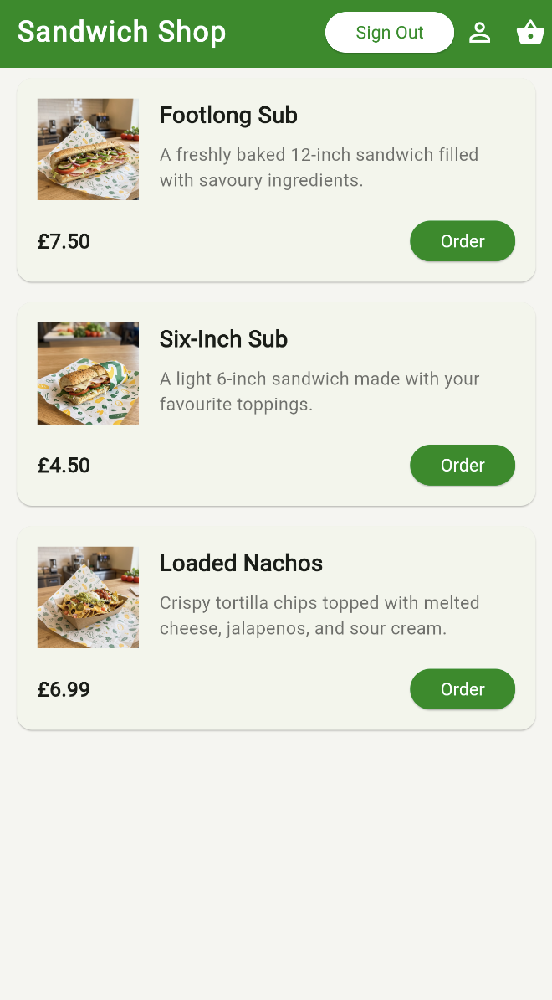

Open your [Firebase dashboard](https://console.firebase.google.com/), go to **Authentication** and select the **Users** tab to confirm your registered email address appears under **Identifier** alongside its **User UID**:

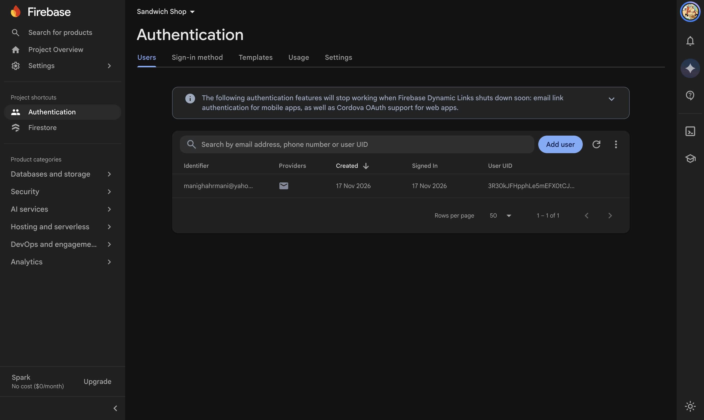

Return to the app and select **Sign Out** in the top bar so the button switches back to **Log In**. Select **Log In** again, test a wrong password to verify the red error message (`Incorrect email or password.`) appears, then sign in with the correct password to return to `MenuScreen`.

### Sign in with an email link or Google

Instead of typing a password every time, customers can also sign in using a one-time link sent to their inbox. Make sure **Email link (passwordless sign-in)** is toggled on under **Authentication > Sign-in method > Email/Password** in your Firebase dashboard, then read the official guide on [authenticating with email links in Flutter](https://firebase.google.com/docs/auth/flutter/email-link-auth) to see how `sendSignInLinkToEmail()`, `isSignInWithEmailLink()`, and `signInWithEmailLink()` work alongside `ActionCodeSettings`. Note that Firebase Dynamic Links is being retired, so mobile deep linking requires a custom domain while web links work straight away on `localhost` and Firebase Hosting.

Because you already enabled the **Google** provider in Firebase, adding Google sign-in only needs a short method in `lib/repositories/auth_repository.dart` (importing `package:flutter/foundation.dart` for `kIsWeb`):

```dart
  Future<User?> signInWithGoogle({bool isWeb = kIsWeb}) async {
    final FirebaseAuth authInstance = auth;
    final GoogleAuthProvider provider = GoogleAuthProvider();
    final UserCredential credential;
    if (isWeb) {
      credential = await authInstance.signInWithPopup(provider);
    } else {
      credential = await authInstance.signInWithProvider(provider);
    }
    return credential.user;
  }
```

In `lib/screens/auth_screen.dart`, add a `_signInWithGoogle` handler that calls `AuthRepository.instance.signInWithGoogle()` and pops back to `MenuScreen`, then add an `OutlinedButton.icon` below the email form:

```dart
            OutlinedButton.icon(
              onPressed: _signInWithGoogle,
              icon: const Icon(Icons.login),
              label: const Text('Sign in with Google'),
            ),
```

Both email-link sign-in (with link completion in `lib/main.dart`) and Google sign-in, along with their tests, are implemented on branch `9` of the Sandwich Shop repository. Check branch `9` to see how both options fit together on `AuthScreen`:

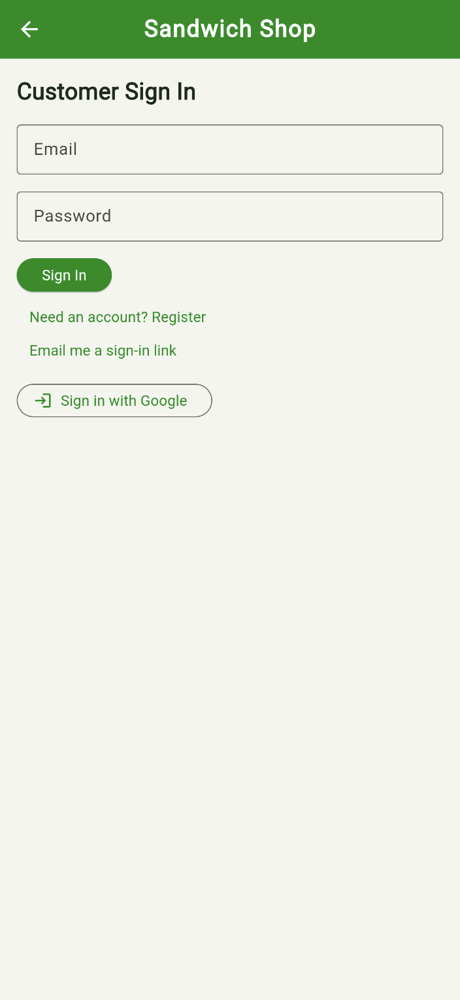

### Sync settings with the authenticated profile

When a customer signs in, `SettingsScreen` can fill **Full name** and **Email address** directly from their Firebase `User` profile (`displayName` and `email`), and save any updated name back to Firebase Authentication. Add an `updateDisplayName` helper to `AuthRepository` in `lib/repositories/auth_repository.dart`:

```dart
  Future<void> updateDisplayName(String displayName) async {
    final User? currentUser = getCurrentUser();
    if (currentUser != null) {
      await currentUser.updateDisplayName(displayName);
    }
  }
```

Next, open `lib/screens/settings_screen.dart`, import `package:firebase_auth/firebase_auth.dart` and `package:sandwich_shop/repositories/auth_repository.dart`, and read `AuthRepository.instance.getCurrentUser()` inside `_loadSettings()` so non-empty `displayName` and `email` values pre-fill the form:

```dart
    final User? currentUser = AuthRepository.instance.getCurrentUser();
    String nameText = savedName ?? '';
    String emailText = savedEmail ?? '';
    if (currentUser != null) {
      final String? authName = currentUser.displayName;
      if (authName != null && authName.isNotEmpty) {
        nameText = authName;
      }
      final String? authEmail = currentUser.email;
      if (authEmail != null && authEmail.isNotEmpty) {
        emailText = authEmail;
      }
    }
```

Assign `_nameController.text = nameText;` and `_emailController.text = emailText;` in `_loadSettings()`, then call `await AuthRepository.instance.updateDisplayName(name);` inside `_saveSettings()` when `name.isNotEmpty`. Update `test/screens/settings_screen_test.dart` to register `MockFirebaseAuth` in `setUp()` (matching `menu_screen_test.dart`).

Add tests for pre-filling and saving a signed-in user's name and email, then verify your tests pass and coverage remains high. An example of the settings screen with the signed-in user's details pre-filled is shown below:

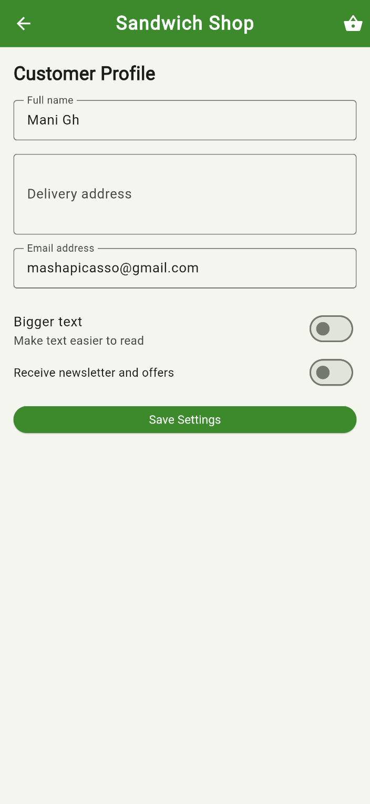

## Cloud Firestore

With your database ready from [Create a Cloud Firestore database](#create-a-cloud-firestore-database), we now store shared menu items in a top-level `sandwiches` collection and move each customer's saved settings and order history under their own `users/<uid>` path instead of local SQLite.

### Read the menu from Firestore

Keeping the menu in a bundled JSON file meant changing a sandwich name, description or price required releasing an updated app. Moving sandwich details into Cloud Firestore lets the shop update the live menu immediately while keeping the local asset images fast to load.

Because `Sandwich` in `lib/models/sandwich.dart` already has `fromJson` and `toJson`, each document in the `sandwiches` collection holds the exact same fields (`id`, `name`, `description`, `price`, and `imagePath`), so the model class needs no edits.

Open `lib/repositories/sandwich_repository.dart`, add the `cloud_firestore` import at the top, and convert `SandwichRepository` into a singleton matching `AuthRepository`:

```dart
import 'package:cloud_firestore/cloud_firestore.dart';
```

Replace the start of `SandwichRepository` (above `getSandwiches`) with the private constructor, shared `instance`, `_firestore` field, `setFirestore`, `clearCache`, and `firestore` getter:

```dart
  SandwichRepository._internal();

  static final SandwichRepository instance = SandwichRepository._internal();

  FirebaseFirestore? _firestore;
  List<Sandwich>? _cachedSandwiches;

  void setFirestore(FirebaseFirestore? firestore) {
    _firestore = firestore;
  }

  void clearCache() {
    _cachedSandwiches = null;
  }

  FirebaseFirestore get firestore {
    final FirebaseFirestore? existingFirestore = _firestore;
    if (existingFirestore != null) {
      return existingFirestore;
    }
    return FirebaseFirestore.instance;
  }
```

Below `loadSandwichesFromAsset()` (still inside `SandwichRepository`), create an empty `Future<List<Sandwich>> loadSandwichesFromFirestore() async {}` method:

```dart
  Future<List<Sandwich>> loadSandwichesFromFirestore() async {}
```

Before writing the body, it helps to know the three Cloud Firestore types we use here. A `CollectionReference<Map<String, dynamic>>` points to a named collection (such as `'sandwiches'`) whose documents each store key-value pairs (`Map<String, dynamic>`). Calling `.get()` fetches a `QuerySnapshot<Map<String, dynamic>>` containing the list of documents in `snapshot.docs`.

Inside the braces of `loadSandwichesFromFirestore`, get a reference to the `sandwiches` collection and fetch its current documents:

```dart
    final CollectionReference<Map<String, dynamic>> sandwichesCollection =
        firestore.collection('sandwiches');
    final QuerySnapshot<Map<String, dynamic>> snapshot =
        await sandwichesCollection.get();
```

Because the Firestore database we created earlier starts completely empty, `snapshot.docs` will have zero items on the very first run. Below the lines above, add an `if` block that loads the existing menu from `assets/data/sandwiches.json` and writes each item into Firestore once (known as seeding). Calling `sandwichesCollection.doc(sandwich.id)` returns a `DocumentReference<Map<String, dynamic>>` pointing to one document with that ID, and `await sandwichDocument.set(sandwichData)` saves the sandwich's fields there:

```dart
    if (snapshot.docs.isEmpty) {
      final List<Sandwich> seededSandwiches = await loadSandwichesFromAsset();
      for (final Sandwich sandwich in seededSandwiches) {
        final DocumentReference<Map<String, dynamic>> sandwichDocument =
            sandwichesCollection.doc(sandwich.id);
        final Map<String, dynamic> sandwichData = sandwich.toJson();
        await sandwichDocument.set(sandwichData);
      }
      return seededSandwiches;
    }
```

On every launch after that, `snapshot.docs` already holds the saved sandwiches. Below the `if` block, loop through each `QueryDocumentSnapshot<Map<String, dynamic>>` in `snapshot.docs`, read its `Map<String, dynamic>` fields with `document.data()`, convert each map into a `Sandwich` using `Sandwich.fromJson`, cache the result, and return it:

```dart
    final List<Sandwich> loadedSandwiches = [];
    for (final QueryDocumentSnapshot<Map<String, dynamic>> document
        in snapshot.docs) {
      final Map<String, dynamic> documentData = document.data();
      final Sandwich sandwich = Sandwich.fromJson(documentData);
      loadedSandwiches.add(sandwich);
    }

    _cachedSandwiches = loadedSandwiches;
    return loadedSandwiches;
```

Next, open `lib/screens/menu_screen.dart` and update `_loadSandwiches()` to read from `SandwichRepository.instance` instead of constructing a new `SandwichRepository()`:

```dart
      final List<Sandwich> sandwiches =
          await SandwichRepository.instance.loadSandwichesFromFirestore();
```

When it comes to testing, using `FakeFirebaseFirestore` allows you to simulate Firestore behaviour without connecting to the real backend. This ensures tests run quickly and consistently, and you can verify that your repository correctly handles seeding, reading, and caching sandwiches.

Install `fake_cloud_firestore` as a development dependency, then update `test/repositories/sandwich_repository_test.dart`, `test/screens/menu_screen_test.dart`, and `test/main_test.dart` to use `SandwichRepository.instance` with `FakeFirebaseFirestore()` and `clearCache()` in `setUp()`. Remember to add unit tests for the `firestore` fallback, seeding an empty collection, and reading existing documents too.

Run the app to seed Firestore automatically on the first load, then open Cloud Firestore in your Firebase dashboard to inspect the new `sandwiches` collection and documents:

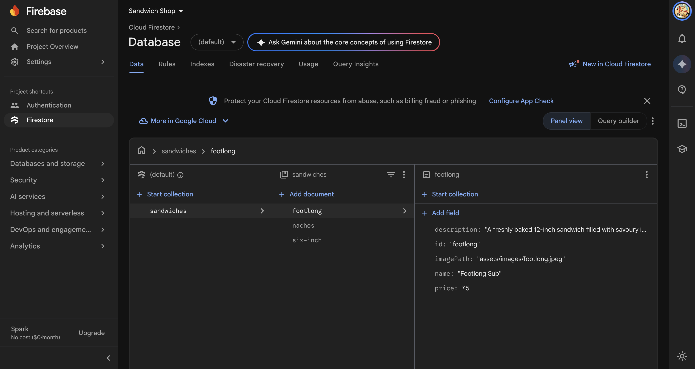

### Save user settings in the cloud

In Worksheet 8, settings such as text size were stored locally in `SharedPreferences`, so changing phones or switching to Chrome reset the customer's choices. Saving settings inside a Firestore document under each user's `uid` ties preferences to the account rather than the device.

<!-- TODO: persist user settings (font size, default bread, etc.) per UID under users/<uid> in Cloud Firestore rather than local-only SharedPreferences, syncing settings when the user signs in on Android or web. -->

### Store and read orders

Until now, order history lived in a local SQLite database that could not follow a customer to another device or work in a web browser. Storing each customer's orders in an `orders` list (a subcollection) under their account replaces local SQLite and keeps orders attached to the person who placed them.

<!-- TODO: replace SQLite DatabaseHelper / SqliteOrderRepository with a Cloud Firestore order flow under users/<uid>/orders so orders work cleanly on both Android and web. -->

### Test with multiple users

To prove that cloud storage and authentication keep each person's data separate, we need to test the app with more than one account. Signing in as a second customer should show their own saved settings and their own order history without exposing the first customer's records.

<!-- TODO: walk through registering/signing in with two test accounts across Chrome and Android, updating settings and placing orders in each, and inspecting the users/<uid> documents in the Cloud Firestore dashboard to show per-user isolation and cross-device sync. -->

### Protect user data with security rules

We started Cloud Firestore in test mode so our app can read and write documents while we build it, which leaves customer records open to anyone. Replacing those temporary rules with Firestore Security Rules lets anyone read the public menu, while each customer can only read or change their own settings and orders once signed in.

<!-- TODO: replace temporary test mode rules with Firestore Security Rules allowing public read on the menu collection and owner-only read/write (request.auth != null && request.auth.uid == userId) on users/<uid> and orders. -->

## Testing cloud code

### Fake Firebase in unit tests

Running automated tests against live Firebase servers is slow, needs an internet connection, and writes test records into your real database. Replacing live Firebase connections with fake in-memory versions lets tests check sign-in, settings and orders offline in milliseconds.

<!-- TODO: add firebase_auth_mocks and fake_cloud_firestore as dev dependencies so Auth and Firestore repositories can be tested fast offline without hitting live Firebase servers. -->

### Keep coverage high

Every new repository method, error branch and authentication state introduces paths that could silently break checkout or lock users out if untested. Checking coverage ensures our new cloud code stays just as reliable as the local code from Worksheet 8.

<!-- TODO: run flutter test --coverage and check the new Auth, Firestore repository, and error states with the Flutter Coverage extension, mirroring lib/ inside test/. -->

## Exercises

The exercises below apply these concepts to your Southsea Cinema coursework and prepare you for Demo 5. For the full coursework specification and grading criteria, see the [Southsea Cinema coursework brief](https://portdotacdotuk-my.sharepoint.com/:w:/g/personal/mani_ghahremani_port_ac_uk/IQDtIJB3bM7gQ4p03eLUngyyAd7JuhjhHuNA1l0H-qCy3Jw).

<!-- TODO: write numbered exercises:
1. Create a Firebase project on the free Spark plan, enable Email/Password Authentication and Cloud Firestore, and connect Southsea Cinema for Android and web with flutterfire configure.
2. Store the cinema film catalogue details (title, synopsis, ticket price, rating, screening times, and local poster asset path) in a Cloud Firestore collection while keeping poster image files in assets/images/.
3. Add user registration, sign-in and sign-out so customers view only their own bookings and saved cinema preferences in the cloud.
4. Implement transactional Cloud Firestore booking creation and saved booking history replacing SQLite.
5. Add unit and widget tests using fake_cloud_firestore and firebase_auth_mocks and maintain test coverage matching lib/ inside test/.
-->
